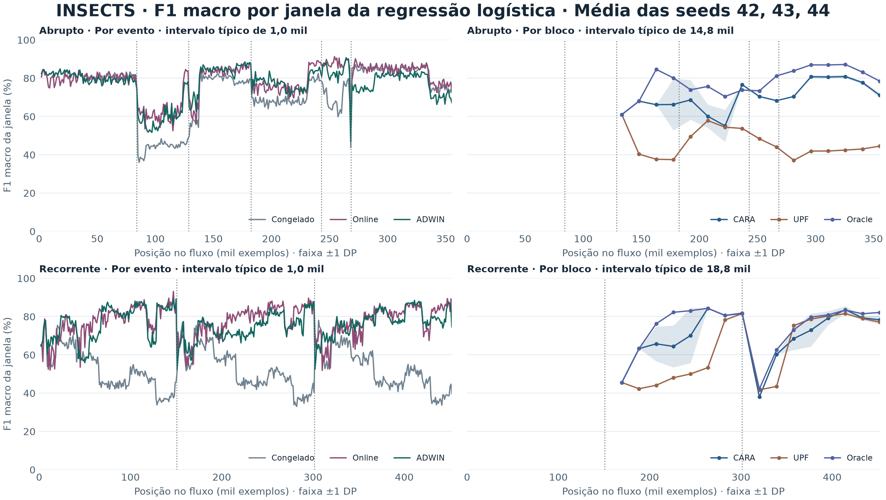
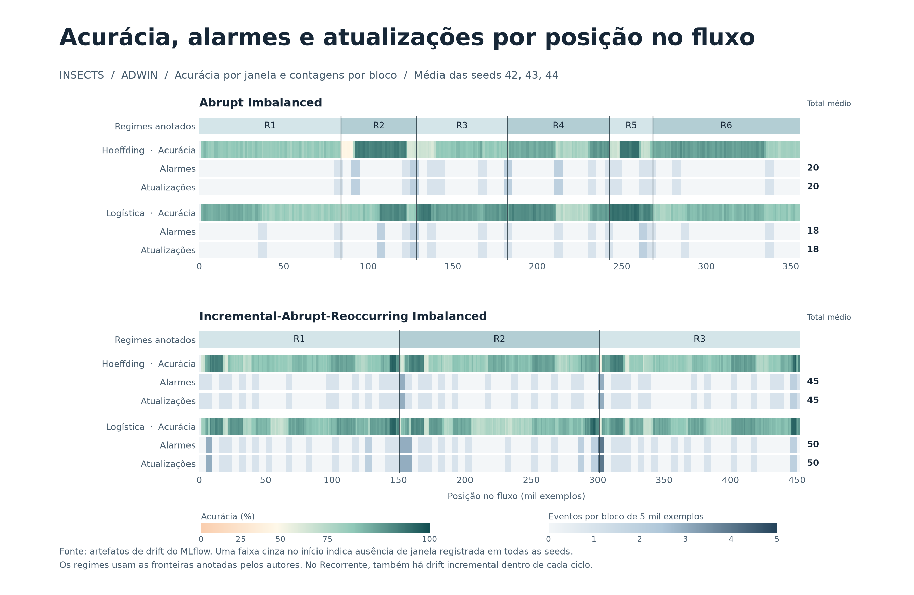
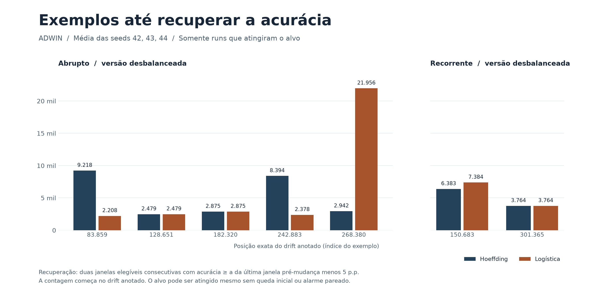
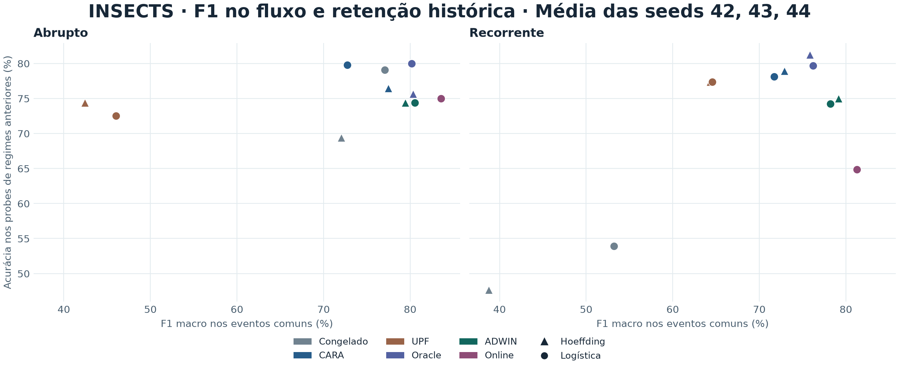

# Análise da adaptação aos drifts em INSECTS

Cruzei os pontos de mudança anotados pelos autores com os alarmes, as atualizações e a recuperação da acurácia nas seeds 42, 43 e 44. No fluxo recorrente, os alarmes pareados surgiram em dezenas de exemplos, e o critério de recuperação foi atingido milhares de exemplos depois.

# Como medi detecção e recuperação

Para cada mudança, procurei o primeiro alarme nos **500 exemplos** seguintes, até a próxima fronteira caso ela viesse antes. Medi o atraso em posições no fluxo. Para considerar que o modelo tinha se recuperado, exigi **duas janelas elegíveis consecutivas** com acurácia igual ou superior ao alvo antes da próxima fronteira. Defini esse alvo como a acurácia da última janela anterior à mudança menos **5 pontos percentuais**. Assim, acompanhei tanto o momento em que o detector reagiu ao erro após receber os rótulos quanto o tempo que o modelo levou para recuperar a acurácia.

| Fluxo | Modelo | Detecções médias / mudanças por seed | Alarmes médios | Alarmes médios fora da janela | Atraso médio (exemplos) |
| --- | --- | --- | --- | --- | --- |
| Recorrente | Hoeffding | 2/2 | 45 | 42 | 48 |
| Recorrente | Logística | 2/2 | 50 | 46 | 32 |
| Abrupto | Hoeffding | 4/5 | 20 | 14 | 83,75 |
| Abrupto | Logística | 4/5 | 18 | 14 | 88,75 |

No abrupto, cada modelo detectou quatro de cinco fronteiras por seed. No recorrente, ambos detectaram as duas fronteiras em todas as seeds. Também contei os alarmes fora das janelas anotadas, que incluem períodos de mudança incremental.

# Fronteiras, atualizações e desempenho

Comparei a última janela de acurácia anterior à fronteira com a primeira que terminou pelo menos 1.000 posições depois. Calculei as médias por fronteira. Para o atraso e a recuperação, usei apenas as seeds em que ocorreu o evento correspondente e indiquei a cobertura de cada valor. Nos 36 alarmes pareados, o marcador de atualização apareceu na mesma posição.

## Fluxo recorrente

| Modelo | Mudança | Seeds com alarme | Atraso médio (exemplos) | Acurácia média antes e depois | Recuperação média (exemplos e seeds) |
| --- | --- | --- | --- | --- | --- |
| Hoeffding | 150.683 | 3/3 | 45 | 89,70% / 73,00% | 6.383 (3/3) |
| Logística | 150.683 | 3/3 | 45 | 91,60% / 63,90% | 7.384 (3/3) |
| Hoeffding | 301.365 | 3/3 | 51 | 84,10% / 56,70% | 3.764 (3/3) |
| Logística | 301.365 | 3/3 | 19 | 90,50% / 69,30% | 3.764 (3/3) |

Na segunda fronteira do recorrente, a logística sinalizou a mudança antes da árvore de Hoeffding. Os dois modelos atingiram o alvo de acurácia após **3.764 exemplos**, em média.

## Fluxo abrupto

| Modelo | Mudança | Seeds com alarme | Atraso médio (exemplos) | Acurácia média antes e depois | Recuperação média (exemplos e seeds) |
| --- | --- | --- | --- | --- | --- |
| Hoeffding | 83.859 | 3/3 | 53 | 80,30% / 46,80% | 9.218 (3/3) |
| Logística | 83.859 | 3/3 | 85 | 78,10% / 78,40% | 2.208 (3/3) |
| Hoeffding | 128.651 | 3/3 | 93 | 69,10% / 66,90% | 2.479 (3/3) |
| Logística | 128.651 | 3/3 | 93 | 80,70% / 90,20% | 2.479 (3/3) |
| Hoeffding | 182.320 | 3/3 | 120 | 81,00% / 86,60% | 2.875 (3/3) |
| Logística | 182.320 | 0/3 | Sem detecção | 88,80% / 90,40% | 2.875 (3/3) |
| Hoeffding | 242.883 | 3/3 | 69 | 89,60% / 72,00% | 8.394 (3/3) |
| Logística | 242.883 | 3/3 | 69 | 87,20% / 93,60% | 2.378 (3/3) |
| Hoeffding | 268.380 | 0/3 | Sem detecção | 82,00% / 85,00% | 2.942 (3/3) |
| Logística | 268.380 | 3/3 | 108 | 88,50% / 76,50% | 21.956 (3/3) |

Na posição **268.380**, a logística sinalizou a mudança após **108 exemplos** e atingiu o alvo em **21.956 exemplos**, em média. A árvore de Hoeffding atingiu o alvo em **2.942 exemplos**, sem alarme pareado nessa fronteira. Para medir a contribuição da atualização, eu precisaria comparar o mesmo modelo com e sem retreinamento na mesma janela.

Acompanhei a média do F1 macro da regressão logística nas janelas com a mesma posição final nas três seeds. As faixas mostram um desvio padrão, e o pontilhado marca as fronteiras anotadas. As avaliações por evento e por bloco têm resoluções diferentes.

## Acurácia, alarmes e recuperação

**Figura 2. Acurácia, alarmes e atualizações ao longo do fluxo.** Calculei a acurácia média nas janelas com a mesma posição final nas três seeds. Para alarmes e atualizações, contei os eventos por seed em blocos de 5.000 exemplos e calculei a média por bloco.

**Figura 3. Média de exemplos até atingir o alvo de acurácia.** Contei a partir da fronteira e fiz a média das seeds que atingiram o alvo. O critério também se aplica quando a acurácia já supera o alvo na primeira janela elegível.

# Retenção e estabilidade

No recorrente com Hoeffding, encontrei **79,14% de F1 macro** com ADWIN nos eventos pareados, frente a **75,82%** com Oracle. Quando olhei os probes históricos, vi a ordem se inverter: Oracle chegou a **81,25% de retenção absoluta** e ADWIN a **75,00%**. Como as métricas usam populações diferentes, acompanhei as duas para entender o desempenho no fluxo e nos regimes anteriores. Usei Oracle como referência retrospectiva.

Cada ponto mostra a média das três seeds para o F1 macro nos eventos pareados e para a retenção nos probes históricos. A cor indica a política e o símbolo indica o modelo.

# Recuperação do Online no fluxo recorrente

Comparei a média de exemplos até atingir o alvo para a logística Online e o ADWIN nas duas fronteiras do recorrente. A tabela mostra também quantas seeds atingiram o alvo. A política Online atualizou o modelo a cada exemplo rotulado.

| Mudança anotada | Online (exemplos e seeds) | ADWIN (exemplos e seeds) |
| --- | --- | --- |
| 150.683 | 3.382 (3/3) | 7.384 (3/3) |
| 301.365 | 5.765 (3/3) | 3.764 (3/3) |

Mantive esta análise de adaptação restrita aos runs com resultados completos. As janelas que validei para o Online com Hoeffding terminavam antes do primeiro drift anotado nos dois fluxos.

Registrei a cobertura por unidade na [Consolidação dos benchmarks INSECTS](consolidacao.md). Reuni as definições e os resultados pareados no [Documento de resultados dos benchmarks INSECTS](resultados.md).
