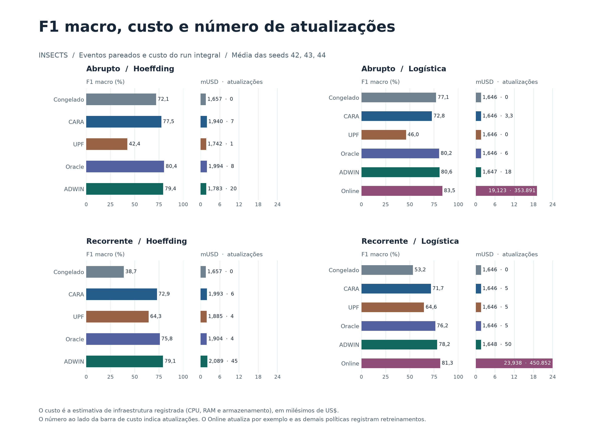

# Consolidação dos benchmarks INSECTS

Reuni os resultados de **66 das 72 unidades** da campanha `insects-72-v1`. Na consulta de **18/11/2026 às 08h50 BRT**, as seis unidades Online de Hoeffding ainda estavam sem resultado final no MLflow. Excluí essas unidades da comparação e aproveitei as janelas iniciais para registrar quanto do fluxo já tinha sido avaliado.

# Cobertura da matriz

| Fluxo | Modelo | Completas | Online fora da comparação |
| --- | --- | --- | --- |
| Abrupto | Logística | 18/18 | 0 |
| Abrupto | Hoeffding | 15/18 | 3 |
| Recorrente | Logística | 18/18 | 0 |
| Recorrente | Hoeffding | 15/18 | 3 |
| **Total** | **Dois modelos** | **66/72** | **6** |

Comparei dois conjuntos de dados, dois modelos e seis políticas com as seeds 42, 43 e 44. Os 63 resultados do primeiro corte vieram da revisão `ffe0b89`, nos experimentos **403 a 408** do MLflow. Incorporei três execuções do experimento **430**, na revisão `31656c4`. Conferi os manifestos e os hashes da fonte antes de verificar as posições, os identificadores e os rótulos dos eventos em comum.

# Resultados no recorte original

Calculei a **média aritmética das três execuções** para cada combinação. Na coluna de tempo, usei a duração registrada pelo benchmark. Na de custo, usei a estimativa de infraestrutura `observations_v1/resources/cost_total`. As rotas por evento e por bloco cobriram trechos diferentes. A comparação direta de qualidade está na tabela de eventos pareados do documento de resultados.

## INSECTS Abrupt Imbalanced

| Modelo | Política | F1 macro médio | AP média | Atualizações médias | Tempo médio (s) | Custo médio estimado |
| --- | --- | --- | --- | --- | --- | --- |
| Hoeffding | ADWIN | 79,42% | 68,81% | 20 | 849,77 | US$ 0,00178 |
| Hoeffding | CARA | 77,50% | 65,33% | 7 | 917,26 | US$ 0,00194 |
| Hoeffding | Congelado | 71,14% | 62,95% | 0 | 849,95 | US$ 0,00166 |
| Hoeffding | Oracle | 80,35% | 68,37% | 8 | 1.265,51 | US$ 0,00199 |
| Hoeffding | UPF | 42,42% | 42,33% | 1 | 956,01 | US$ 0,00174 |
| Logística | ADWIN | 80,42% | 75,48% | 18 | 208,68 | US$ 0,00165 |
| Logística | CARA | 72,75% | 62,70% | 3,33 | 427,84 | US$ 0,00165 |
| Logística | Congelado | 76,44% | 65,14% | 0 | 195,08 | US$ 0,00165 |
| Logística | Online | 82,91% | 80,08% | 353.891 | 489,90 | US$ 0,01912 |
| Logística | Oracle | 80,18% | 74,12% | 6 | 399,42 | US$ 0,00165 |
| Logística | UPF | 46,02% | 25,50% | 0 | 393,17 | US$ 0,00165 |

## INSECTS Incremental Abrupt Reoccurring Imbalanced

| Modelo | Política | F1 macro médio | AP média | Atualizações médias | Tempo médio (s) | Custo médio estimado |
| --- | --- | --- | --- | --- | --- | --- |
| Hoeffding | ADWIN | 79,15% | 66,85% | 45 | 820,25 | US$ 0,00209 |
| Hoeffding | CARA | 72,90% | 51,33% | 6 | 1.077,63 | US$ 0,00199 |
| Hoeffding | Congelado | 38,64% | 18,80% | 0 | 670,25 | US$ 0,00166 |
| Hoeffding | Oracle | 75,82% | 57,28% | 4 | 1.144,37 | US$ 0,00190 |
| Hoeffding | UPF | 64,34% | 45,33% | 4 | 1.237,49 | US$ 0,00188 |
| Logística | ADWIN | 78,82% | 71,73% | 50 | 213,98 | US$ 0,00165 |
| Logística | CARA | 71,70% | 58,95% | 5 | 484,43 | US$ 0,00165 |
| Logística | Congelado | 53,15% | 31,34% | 0 | 195,41 | US$ 0,00165 |
| Logística | Oracle | 76,22% | 66,34% | 5 | 357,65 | US$ 0,00165 |
| Logística | UPF | 64,56% | 45,09% | 5 | 349,06 | US$ 0,00165 |
| Logística | Online | 81,11% | 76,58% | 450.852 | 457,81 | US$ 0,02394 |

# Custos e artefatos

Para precificar a decisão de retreinar em CARA, UPF e Oracle, usei a tarifa On-Demand do Fargate em `us-east-1` para Linux x86, com 2 vCPU, 4 GiB de memória e 50 GiB de armazenamento efêmero. Nos 36 runs, **λ = 10** e **α = 0,01701167** corresponderam a **US$ 0,00170117 por retreinamento**. Esse foi o valor usado para penalizar a decisão. Já na coluna de custo das tabelas, reportei a estimativa de infraestrutura. Nos artefatos que conferi, ela incluiu CPU, memória e armazenamento projetado dos modelos. [Preços do Fargate](https://aws.amazon.com/fargate/pricing/)

**Figura 4. F1 macro, custo estimado e número de atualizações por política.** Mostrei as médias das três seeds. Usei os eventos comuns para calcular F1 e o run integral para registrar custo e atualizações. No recorrente com logística, o Online teve **81,29% de F1 macro** e **US$ 0,02394** de custo estimado, frente a **78,22%** e **US$ 0,00165** com ADWIN.

Usei os índices dos runs para localizar os artefatos no MLflow. Reuni as predições e os históricos das três seeds para calcular médias e comparar políticas nos mesmos eventos. A verificação de todo o catálogo de métricas em cada passo ficou em aberto.

[Inventário dos 66 runs](dados/runs.csv)

[Métricas escalares dos 66 runs](dados/metricas-mlflow.csv)

# Reexecuções Online concluídas

Cada run de logística Online no recorrente consumiu **452.044 exemplos** e pontuou **450.852**. No recorte original, medi em média **81,11% de F1 macro**, **76,58% de AP**, **64,84% de retenção** e **457,81 s** de duração. Os registros individuais estão abaixo para auditoria.

| Fluxo | Modelo | Seed | Run MLflow | Estado no corte | Resultado final |
| --- | --- | --- | --- | --- | --- |
| Recorrente | Logística | 42 | `13fad613d94042c788f1647b9a265424` | FINISHED / SUCCEEDED | F1 81,11%, AP 76,58%, 313,41 s, US$ 0,02394 |
| Recorrente | Logística | 43 | `61859e3cf178426ca8eb694eebfab05b` | FINISHED / SUCCEEDED | F1 81,11%, AP 76,58%, 748,27 s, US$ 0,02394 |
| Recorrente | Logística | 44 | `9f29620b12ee42b3a58a0a0c70d326a7` | FINISHED / SUCCEEDED | F1 81,11%, AP 76,58%, 311,76 s, US$ 0,02394 |

# Progresso do Online com Hoeffding

Somei a duração das tentativas registradas no AWS Batch desde a campanha inicial, incluindo as reexecuções das três seeds. O tempo acumulado passou de **quatro horas em cada configuração**, com cerca de **5h55 no fluxo abrupto** e **7h37 no recorrente**. Essa soma inclui tentativas que rodaram em paralelo.

No MLflow, selecionei as janelas de progresso com a mesma posição final nas três seeds. Somei as contagens da matriz de confusão dentro de cada seed, recalculei o F1 macro e a acurácia e fiz a média das três seeds. Mantive esses dados apenas no diagnóstico parcial.

| Fluxo | Janelas comuns | Última posição da janela | Exemplos por seed | F1 macro médio | Acurácia média |
| --- | --- | --- | --- | --- | --- |
| Abrupto | 16 | 17.012 | 16.000 | 81,96% | 84,63% |
| Recorrente | 15 | 16.006 | 15.000 | 58,83% | 87,82% |

Todas as janelas ficaram antes do primeiro drift anotado. Usei os valores para descrever o trecho inicial, pois os runs ainda não tinham publicado o arquivo de predições nem as métricas finais no MLflow.

[Janelas parciais registradas no MLflow](dados/janelas-parciais-online-hoeffding.csv)

Reuni a comparação nos mesmos eventos e as definições das métricas no [Documento de resultados dos benchmarks INSECTS](resultados.md). Detalhei a sequência de mudanças, alarmes e atualizações na [Análise da adaptação aos drifts em INSECTS](adaptacao-aos-drifts.md).
