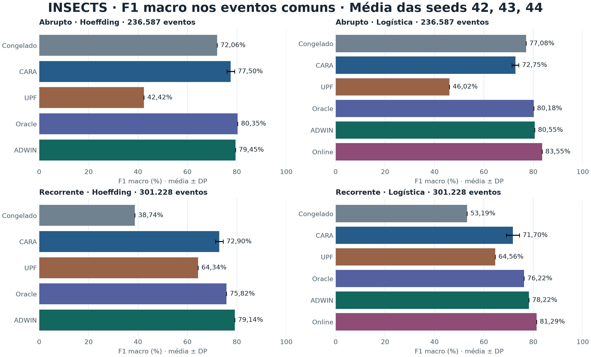
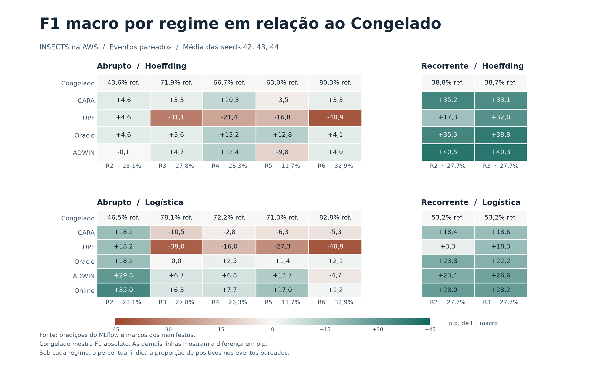

# Documento de resultados dos benchmarks INSECTS

Comparei como diferentes políticas atualizaram o modelo nos dois fluxos INSECTS. Na média das seeds 42, 43 e 44, a logística Online alcançou **83,55% de F1 macro no abrupto** e **81,29% no recorrente**, os maiores valores entre as configurações concluídas em cada fluxo. No recorrente com Hoeffding, medi **38,74%** com o Congelado e **79,14%** com ADWIN. Consolidei **66 de 72 execuções**.

# Metodologia

Usei duas variantes do INSECTS. A **Abrupt Imbalanced** tem **355.275 observações** e cinco mudanças anotadas. A **Incremental Abrupt Reoccurring Imbalanced** tem **452.044 observações** e duas fronteiras publicadas. Os autores coletaram medições ópticas reais e organizaram os registros em sequências com padrões conhecidos de mudança. Para a tarefa binária, usei o rótulo original `2` como classe positiva e reuni os outros cinco na negativa. Usei as anotações para avaliar as mudanças. [Artigo do INSECTS, Tabela 2](https://arxiv.org/pdf/2005.00113#page=37) · [Repositório da USP](https://sites.google.com/view/uspdsrepository)

Comparei regressão logística e árvore de Hoeffding com seis políticas: modelo congelado, Online, Drift com ADWIN, CARA, UPF e Oracle. Rodei a matriz com as seeds 42, 43 e 44. Na avaliação prequential, produzi cada predição antes de usar o rótulo correspondente, com atraso de três posições e limiar de **0,5**. Usei o congelado como referência após o aquecimento. Em Online, o modelo aprendeu a cada atualização incremental. Com ADWIN, retreinei o modelo quando o detector sinalizou uma mudança no padrão de erros. CARA e UPF tomaram decisões por bloco, e Oracle usou o desempenho futuro registrado na matriz para construir a referência retrospectiva.

As rotas pontuaram trechos diferentes. A avaliação por evento cobriu **353.891 exemplos no abrupto** e **450.852 no recorrente**. Por bloco, foram **236.587** e **301.228**. Para comparar as políticas, conferi a posição, o identificador e o rótulo de cada evento e usei a interseção dos 33 runs concluídos em cada fluxo. O trecho começou no passo **118.418** no abrupto e **150.689** no recorrente. Mantive a primeira fronteira do abrupto na análise do detector.

# Métricas monitoradas e interpretação

| Família | Métricas | Como interpretar |
| --- | --- | --- |
| Classificação no limiar | Acurácia, acurácia balanceada, precisão, recall, F1 positivo e F1 macro | Acurácia é a fração de acertos. A balanceada é a média do recall das classes. Precisão positiva mede a fração correta dos positivos preditos e recall positivo mede a fração capturada dos positivos reais. F1 é a média harmônica de precisão e recall. F1 macro dá o mesmo peso ao F1 de cada classe. |
| Ordenação | AP e AUROC | AP resume a curva de precisão e recall e deve ser lida junto à prevalência positiva. AUROC resume a discriminação em diferentes limiares. A ordenação pode ser útil mesmo com recall baixo no limiar de 0,5. |
| Probabilidades | Log loss, Brier e erros de calibração | Log loss penaliza previsões erradas com alta confiança. Brier mede o erro quadrático das probabilidades. ECE e MCE resumem diferenças entre confiança e frequência observada nos grupos de probabilidade. |
| Drift e recuperação | Alarmes, mudanças detectadas, precisão e recall de pareamento, atraso e recuperação | Recall de detecção usa mudanças anotadas elegíveis. Precisão mede a fração de alarmes pareados. Atraso mede posições até o primeiro alarme elegível. Recuperação mede posições até cumprir o alvo de desempenho em duas janelas. |
| Aprendizagem contínua | Retenção absoluta, GEM BWT e post-learning FM | Retenção absoluta é a acurácia média dos regimes anteriores nos probes. BWT mede a diferença entre a acurácia atual e a obtida ao terminar cada regime anterior. FM compara a acurácia atual com o melhor valor anterior a partir do aprendizado daquele regime. FM positivo indica perda. BWT e FM zerados podem coexistir com retenção baixa. |
| Esforço e eficiência | Exemplos avaliados, apresentações ao treino, atualizações, retreinamentos, tempo, throughput, memória e custo | Distinga eventos únicos de apresentações ao treino e atualizações por evento de retreinamentos completos. Compare o tempo do benchmark, a duração do run e os custos no escopo em que foram medidos. α usa uma referência On-Demand e tem a unidade da função objetivo. |

Acompanhei resultados finais, métricas por janela prequential e pontos de verificação da retenção. Para interpretar os valores, considerei quantos exemplos entraram no cálculo e qual política produziu cada resultado. Quando uma métrica ficou indefinida, como o atraso na ausência de detecção, considerei seu valor indisponível. Reservei o zero para resultados medidos. [Contrato de métricas do projeto na revisão da campanha](https://github.com/xxggabriel/residencia-ia/blob/ffe0b89/docs/tracking-metrics.md)

# Resultados pareados das três seeds

Calculei as métricas em cada run no recorte comum e fiz a média aritmética das três seeds para cada combinação. Para o F1 macro, o desvio padrão amostral em pontos percentuais descreve a dispersão observada entre as seeds.

[Métricas pareadas das três seeds](dados/metricas-pareadas-por-seed.csv) · [Médias pareadas e desvios padrão](dados/metricas-pareadas-medias.csv)

## Abrupto · 236.587 eventos comuns

| Modelo | Política | Acurácia média | F1 macro médio ± DP | AP média | Recall positivo médio |
| --- | --- | --- | --- | --- | --- |
| Logística | Online | 86,99% | 83,55% ± 0,00 p.p. | 80,69% | 75,44% |
| Logística | ADWIN | 85,11% | 80,55% ± 0,00 p.p. | 76,63% | 67,12% |
| Logística | Oracle | 84,78% | 80,18% ± 0,00 p.p. | 74,12% | 66,94% |
| Logística | Congelado | 80,65% | 77,08% ± 0,00 p.p. | 64,82% | 75,25% |
| Logística | CARA | 79,03% | 72,75% ± 1,37 p.p. | 62,70% | 56,80% |
| Logística | UPF | 67,11% | 46,02% ± 0,00 p.p. | 25,50% | 8,42% |
| Hoeffding | Oracle | 84,78% | 80,35% ± 0,00 p.p. | 68,37% | 68,20% |
| Hoeffding | ADWIN | 82,52% | 79,45% ± 0,00 p.p. | 67,78% | 80,20% |
| Hoeffding | CARA | 82,08% | 77,50% ± 1,55 p.p. | 65,33% | 67,57% |
| Hoeffding | Congelado | 73,82% | 72,06% ± 0,00 p.p. | 61,94% | 89,09% |
| Hoeffding | UPF | 69,83% | 42,42% ± 0,00 p.p. | 42,33% | 1,53% |

No abrupto com logística, Online superou ADWIN em **2,99 pontos percentuais de F1 macro** e **4,05 pontos de AP**. Nas quatro combinações de fluxo e modelo, a média de F1 macro e AP foi maior com CARA do que com UPF. Em UPF com Hoeffding, medi **42,33% de AP**, frente a **27,35% de prevalência positiva**, e **1,53% de recall positivo** no limiar de 0,5.

## Recorrente · 301.228 eventos comuns

| Modelo | Política | Acurácia média | F1 macro médio ± DP | AP média | Recall positivo médio |
| --- | --- | --- | --- | --- | --- |
| Logística | Online | 85,08% | 81,29% ± 0,00 p.p. | 76,92% | 72,34% |
| Logística | ADWIN | 82,50% | 78,22% ± 0,00 p.p. | 70,91% | 68,88% |
| Logística | Oracle | 80,67% | 76,22% ± 0,00 p.p. | 66,34% | 67,50% |
| Logística | CARA | 76,86% | 71,70% ± 2,64 p.p. | 58,95% | 62,14% |
| Logística | UPF | 72,63% | 64,56% ± 0,00 p.p. | 45,09% | 44,95% |
| Logística | Congelado | 61,42% | 53,19% ± 0,00 p.p. | 31,43% | 35,17% |
| Hoeffding | ADWIN | 82,01% | 79,14% ± 0,00 p.p. | 66,79% | 80,95% |
| Hoeffding | Oracle | 80,12% | 75,82% ± 0,00 p.p. | 57,28% | 68,50% |
| Hoeffding | CARA | 77,19% | 72,90% ± 1,57 p.p. | 51,33% | 67,45% |
| Hoeffding | UPF | 73,69% | 64,34% ± 0,00 p.p. | 45,33% | 40,55% |
| Hoeffding | Congelado | 51,00% | 38,74% ± 0,00 p.p. | 18,84% | 11,30% |

No recorrente com logística, o Online teve **81,29% de F1 macro** e **76,92% de AP** em média. A diferença para ADWIN foi de **3,07** e **6,01 pontos percentuais**, respectivamente. Com Hoeffding, a diferença média de F1 entre ADWIN e Congelado foi de **40,40 pontos**. Usei Oracle como referência retrospectiva nas políticas por bloco.

## Desempenho por regime

**Figura 1. F1 macro médio por regime em relação ao Congelado.** Na primeira linha, mostrei a média do F1 absoluto do Congelado. Nas demais, comparei cada política com o Congelado da mesma seed e fiz a média das diferenças. O percentual sob cada regime indica a prevalência positiva no recorte comum.

# Esforço, custo e limitações

No abrupto com logística, o Online teve em média **353.891 atualizações incrementais**, **489,90 s** e custo estimado de **US$ 0,01912**. Com ADWIN, foram **18 retreinamentos**, **208,68 s** e **US$ 0,00165**. O custo inclui armazenamento projetado dos modelos e é separado do faturamento e da penalidade usada para calcular α.

No recorrente com logística, as três seeds do Online registraram **450.852 atualizações** e **81,11% de F1 macro no recorte original**. A duração média foi de **457,81 s**, com valores entre **311,76 s e 748,27 s**. As reexecuções usaram outra revisão e um perfil de execução diferente, o que limita atribuir diferenças de tempo ou de custo apenas à política.

# Conclusões

O Online com logística apresentou o maior F1 macro nos recortes pareados dos dois fluxos entre as configurações concluídas. No recorrente, observei **64,84% de retenção** com Online e **74,22%** com ADWIN na mesma arquitetura. O ganho na qualidade do fluxo veio acompanhado de menor desempenho nos probes históricos e maior custo estimado de infraestrutura. Nas políticas por bloco, encontrei melhor desempenho de CARA que de UPF e usei Oracle como referência retrospectiva.

Excluí as duas configurações Online com Hoeffding da comparação final depois que cada uma acumulou mais de quatro horas de execução no AWS Batch, somando as tentativas das três seeds. As janelas que consegui validar no MLflow pertenciam ao primeiro regime dos dois fluxos. Usei essas métricas como diagnóstico da fase inicial do benchmark.

Reuni os CSVs e o diagnóstico das execuções incompletas na [Consolidação dos benchmarks INSECTS](consolidacao.md). Detalhei os resultados por fronteira na [Análise da adaptação aos drifts em INSECTS](adaptacao-aos-drifts.md).
