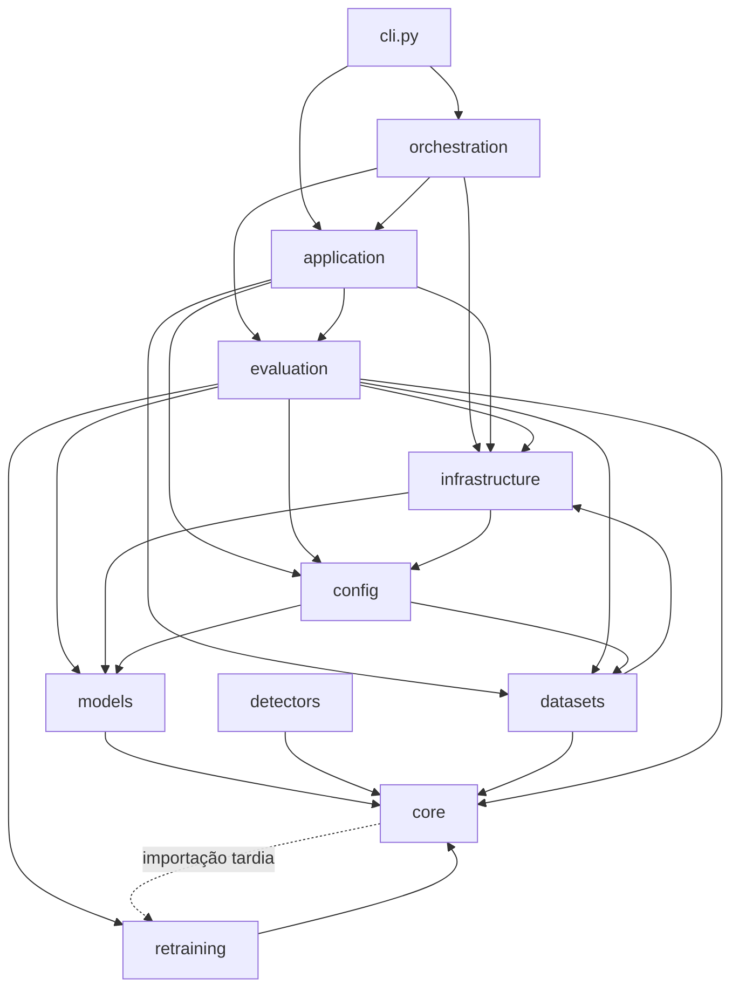
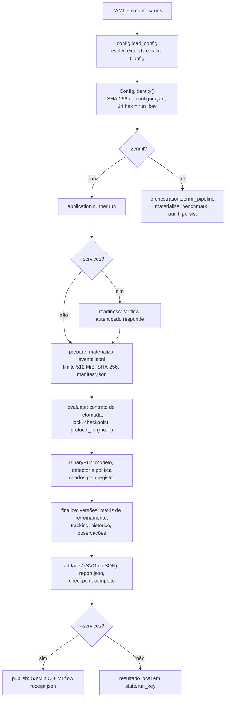
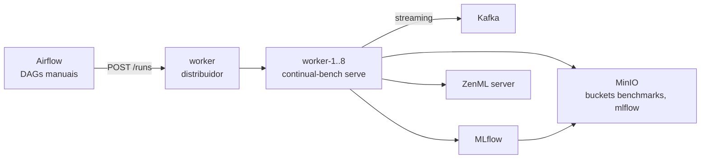

# Arquitetura

Esta página descreve como o pacote `continual_bench` está organizado em camadas, quais componentes participam de uma execução e o caminho completo de uma execução binária, da configuração YAML até o relatório e os artefatos gravados em disco. Os detalhes de cada componente científico (datasets, modelos, políticas, detectores, métricas) ficam nas páginas próprias, linkadas ao longo do texto.

## Visão geral

O `continual-bench` é um pacote Python (`src/continual_bench`) com um ponto de entrada de linha de comando, `continual-bench`, definido em `pyproject.toml` (`[project.scripts]`). Todo o ciclo contínuo (predizer, liberar rótulos, monitorar drift, decidir e executar atualizações) acontece dentro do núcleo Python. Os serviços externos são opcionais e têm papéis delimitados:

| Peça | Papel | Obrigatória para rodar localmente? |
|---|---|---|
| Núcleo Python (River, scikit-learn, Pydantic) | Ciclo por amostra ou por lote, políticas, métricas, artefatos | Sim |
| Kafka | Transporte do fluxo de eventos, apenas no modo `streaming` com `--services` | Não |
| MinIO (API compatível com S3) | Cópia dos relatórios, dados e pontos de recuperação ao final | Não |
| MLflow | Parâmetros, métricas e artefatos por execução | Não |
| ZenML | Encapsula uma execução em quatro etapas com artefatos versionados (`--zenml`) | Não |
| Apache Airflow | Dispara lotes finitos de execuções manualmente (DAGs com `schedule=None`) | Não |
| AWS (Step Functions, Batch, S3, SageMaker) | Perfil gerenciado, descrito em [Execução na AWS](Execucao-na-AWS) | Não |

Airflow e ZenML não controlam o fluxo de dados: eles apenas submetem execuções finitas ao núcleo. Um *drift* (mudança de conceito) é uma alteração na relação entre atributos e rótulo ao longo do tempo; ver [Detectores de Drift](Detectores-de-Drift).

## Camadas e regra de dependência

O código é dividido em subpacotes com uma regra de dependência: cada camada só importa camadas consideradas inferiores. A regra é verificada automaticamente por `tests/test_architecture.py`, que percorre a árvore sintática de cada módulo e falha se encontrar uma importação proibida.

| Pacote | Responsabilidade | Não pode importar (segundo `tests/test_architecture.py`) |
|---|---|---|
| `core` | Contratos (`Event`, `Decision`, protocolos de modelo e detector), tipos de tarefa, registro de componentes, políticas por amostra, motor prequential, métricas | Nenhum outro pacote do projeto exceto `retraining`; nenhuma biblioteca de terceiros da lista do teste (River, Pydantic, PyYAML, ZenML, MLflow, boto3, Kafka, pandas, NumPy, PyArrow, Pillow) |
| `retraining` | Políticas de decisão por lote (CARA, UPF, Oracle), matriz de desempenho, previsão e preços | Tudo exceto `core` |
| `detectors` | Catálogo e adaptadores dos detectores de drift do River | `datasets`, `models`, `evaluation`, `application`, `infrastructure`, `orchestration`, `cli` |
| `models` | Famílias de modelos com um construtor por tipo de tarefa | `datasets`, `evaluation`, `application`, `infrastructure`, `orchestration`, `cli` |
| `config` | Esquemas Pydantic (`Config`, `TypedConfig`, `EpochConfig`, `IterativeConfig`) e carregador com herança `extends` | `evaluation`, `application`, `infrastructure`, `orchestration`, `cli` |
| `datasets` | Catálogo único de fontes e adaptadores (sintéticos, OpenML, ARFF, imagens, Zia) | `evaluation`, `application`, `orchestration`, `cli` |
| `infrastructure` | E/S externa: armazenamento atômico local, versões de modelo, Kafka, S3/MinIO, MLflow, adaptadores AWS | `evaluation`, `application`, `orchestration`, `cli` |
| `evaluation` | Protocolos (prequential, holdout temporal, typed, épocas, iterativo), tracking, custos, artefatos e figuras | `application`, `orchestration`, `cli` |
| `application` | Casos de uso: runner binário, campanha, matriz, fábrica de componentes, prontidão, perfil AWS (`application/cloud`) | `orchestration`, `cli` |
| `orchestration` | Servidores HTTP de jobs, distribuidor de workers, pipeline ZenML, controle AWS e SageMaker | Não verificado pelo teste |
| `cli.py` | Analisador de argumentos e despacho dos subcomandos | Não verificado pelo teste |

O diagrama abaixo resume o fluxo principal de dependências entre pacotes (importações absolutas `continual_bench.<pacote>`). Setas apontam de quem importa para quem é importado. Arestas auxiliares (como `models` -> `config`, `config` -> `core`, `infrastructure` -> `core`/`datasets`, `application` -> `core`/`detectors`/`models`/`retraining` e `orchestration` -> `config`/`core`/`datasets`/`models`) seguem as mesmas regras de fronteira verificadas por `tests/test_architecture.py`.

Observações sobre a regra:

- `config`, `datasets` e `infrastructure` podem importar uns aos outros. Por exemplo, `config/benchmark.py` consulta `datasets.catalog` para validar a família do dataset, e `datasets/images.py` usa `infrastructure.storage.atomic_write`. A camada não é, portanto, uma pilha estrita.
- `core/policies.py` importa `continual_bench.retraining.policies` dentro de uma função, para registrar as políticas por lote sem carregar NumPy no import do núcleo. O núcleo continua sem bibliotecas de terceiros no carregamento do módulo, mas usar as políticas por lote puxa NumPy indiretamente.
- O teste ignora importações relativas (`from ..x import`). Hoje o pacote usa importações absolutas entre camadas, então a verificação cobre o código existente.

Classificação: **Validado** (`tests/test_architecture.py`).

## Componentes registrados

Os componentes são declarados em catálogos (padrão *Registry*) e resolvidos por nome a partir da configuração. As fábricas são cadeias `módulo:atributo` resolvidas sob demanda, de modo que validar uma configuração não importa River nem PyArrow. O comando `continual-bench components` lista o catálogo efetivo:

| Tipo | Nomes registrados | Onde |
|---|---|---|
| Datasets (21 entradas) | `sea`, `agrawal`, `stagger`, `hyperplane`, `rbf_drift`, `friedman_drift`, `electricity`, `airlines`, `insects`, `gas`, `insects_abrupt_imbalanced`, `insects_incremental_abrupt_reoccurring_imbalanced`, `split_mnist`, `permuted_mnist`, `split_cifar10`, `split_cifar100`, `core50`, `clear10`, `clear100`, `split_cifar`, `clear` | `datasets/catalog.py` |
| Modelos | `logistic` (binary, multiclass), `linear_regression` (regression), `hoeffding_tree` e `knn` (binary, multiclass, regression) | `models/__init__.py` |
| Detectores | `none`, `adwin`, `ddm`, `eddm`, `hddm_a`, `hddm_w`, `page_hinkley`, `kswin` | `detectors/__init__.py` |
| Políticas | `none`, `online`, `periodic`, `drift`, `performance`, `cara`, `cara_cumulative`, `cara_periodic`, `upf`, `oracle` | `core/policies.py`, `retraining/policies.py` |

A semântica de cada item está em [Datasets](Datasets), [Modelos e Políticas](Modelos-e-Politicas) e [Detectores de Drift](Detectores-de-Drift). O detector não decide retreinamento sozinho: ele só emite alarmes, e a política aplica guardas como `cooldown`, `min_samples` e `min_window`.

### Extensão por plugins

Um plugin é uma função importável `register(registry)` declarada em `plugins: [modulo:register]` na configuração. `examples/custom_plugin.py` registra a política `every_ten` e o modelo de regressão `running_mean`; `examples/temporal_csv.py` mostra uma fonte CSV temporal com SHA-256 e licença declarados. O módulo precisa estar no caminho de importação do Python: `continual-bench components --plugin examples.custom_plugin:register` só encontra o exemplo quando executado com `PYTHONPATH=.` na raiz do repositório. Os arquivos dos pacotes declarados em `plugin_packages` entram no contrato de retomada. O servidor HTTP de jobs rejeita configurações com `plugins` (`orchestration/server.py`), porque plugins executam código arbitrário e devem ser instalados pelo operador.

Classificação: **Implementado**; o carregamento de plugins é exercitado em `tests/test_components.py`.

### Padrões de projeto usados

| Padrão | Onde | Efeito |
|---|---|---|
| Registry | `core.registry.Registry`, `datasets.catalog.CATALOG`, `models.MODELS`, `detectors.DETECTORS` | Uma declaração por componente, resolvida por nome |
| Abstract Factory | `models.ModelFamily`, `application.components.ComponentRegistry` | Uma família fornece um construtor por tipo de tarefa |
| Strategy | `core.tasks`, `core.policies`, `evaluation.binary.protocol_for` | Regras de alvo, decisão e protocolo trocáveis |
| Template Method | `core.policies.GuardedPolicy.decide`, `core.engine.Engine` | Guardas e ciclo fixos; subclasses definem o gatilho |
| Command | `cli.COMMANDS` | Cada subcomando é um handler registrado pelo decorador `command` |
| Dependency Injection | `run_typed(..., model_factory=...)`, `BinaryRun` | Testes trocam modelo ou fonte sem *monkeypatch* |

## Fluxo de uma execução binária

O caminho mais usado é `continual-bench run <config.yaml>`, que avalia um fluxo binário em um de três protocolos: `streaming` (prequential por evento), `incremental` (prequential por lote) ou `offline` (holdout temporal). *Prequential* significa "testar e depois treinar": cada exemplo é predito antes de o modelo aprender com ele. Os protocolos estão detalhados em [Metodologia Experimental](Metodologia-Experimental).

Passo a passo, com base em `src/continual_bench/cli.py` e `src/continual_bench/application/runner.py`:

1. **Carregar a configuração.** `config.load_config` lê o YAML, resolve as heranças `extends` (ver [Instalação e Configuração](Instalacao-e-Configuracao#configurações)) e valida o resultado no esquema Pydantic `Config`. Combinações inválidas falham aqui, por exemplo política diferente de `none` no modo `offline` ou política por lote fora do modo `incremental`.
2. **Calcular a identidade.** `Config.identity()` serializa a configuração validada em JSON ordenado e usa os 24 primeiros caracteres do SHA-256. Esse valor é o `run_key` e nomeia o diretório `state/<run_key>/`. Mudar qualquer campo, inclusive `name` ou semente, cria outra execução.
3. **Verificar serviços (opcional).** Com `--services`, `application.readiness.ensure_tracking_ready` exige `MLFLOW_TRACKING_URI` HTTP(S), `MLFLOW_TRACKING_USERNAME` e `MLFLOW_TRACKING_PASSWORD` com pelo menos 12 caracteres, e consulta a API do MLflow antes de criar qualquer arquivo.
4. **Materializar a fonte.** `prepare` gera todos os eventos da fonte em `events.jsonl`, recusa materializações acima de 512 MiB (`MATERIALIZATION_BUDGET`), calcula o SHA-256 e grava `manifest.json`. Se o arquivo já existir com outro conteúdo, a execução falha em vez de sobrescrever.
5. **Avaliar com retomada.** `evaluate` monta o contrato de retomada (configuração, SHA-256 da fonte, versão do Python, pacotes, hash do código, `PYTHONHASHSEED`, definições de métricas, identidade dos plugins e transporte), adquire um *lock* exclusivo por `run_key` (`fcntl.flock`) e carrega um ponto de recuperação existente apenas se o contrato for idêntico. Em seguida escolhe o protocolo com `protocol_for(mode)` e cria modelo, detector e política pelo registro.
6. **Executar o protocolo.** `BinaryRun` percorre os eventos, salvando pontos de recuperação periódicos (`checkpoint_every`). Um amostrador mede CPU e memória do processo durante a execução (`evaluation/system_metrics.py`).
7. **Finalizar.** `finalize` anexa versões de modelo e proveniência, calcula a matriz retrospectiva de retreinamento usada por CARA/UPF/Oracle nos modos prequential, grava `metric-definitions.json` e `predictions.jsonl`, monta o histórico de treino e as observações de tracking e, se configurado, a avaliação de futuro próximo.
8. **Gravar artefatos.** Figuras SVG e seus dados JSON vão para `artifacts/plots/` e `artifacts/data/`, com índice em `artifacts/data/index.json`. O relatório `report.json` é gravado antes do ponto de recuperação final, de modo que uma queda entre os dois passos seja segura para recomputar.
9. **Publicar (opcional).** Com `--services`, `infrastructure.services.publish` envia os arquivos ao bucket S3/MinIO (`BENCH_BUCKET`, padrão `benchmarks`) sob a chave `<run_key>/`, registra parâmetros, métricas e artefatos no MLflow localizando o run pela etiqueta `run_key` e grava `receipt.json` só depois de ambos concluírem. No modo `streaming` com `--services`, os eventos passam pelo Kafka (`KafkaTransport`) e o consumidor confere cada mensagem contra o `events.jsonl`.

Todas as gravações usam `infrastructure.storage.atomic_write`: arquivo temporário, `fsync`, substituição atômica e `fsync` do diretório.

### Conteúdo de `state/<run_key>/`

| Arquivo ou pasta | Origem | Observação |
|---|---|---|
| `events.jsonl`, `manifest.json` | `prepare` | Fonte materializada e seu SHA-256 |
| `.lock` | `run_lock` | Impede duas execuções da mesma identidade no mesmo volume |
| `checkpoint.bin` | `LocalCheckpoints` | *Pickle* com cabeçalho e SHA-256; ausente em `artifact_mode: metrics_only` |
| `report.json` | `evaluate` | Relatório completo, com `run_key`, `protocol`, `metrics`, `complete` |
| `predictions.jsonl`, `metric-definitions.json` | `save_tracking_files` | Livro de predições e catálogo de métricas usados no relatório |
| `models.bin`, `model-versions.json`, `model-metadata.json` | `infrastructure/versioning.py` | Versões de modelo, conforme o modo de retenção |
| `artifacts/` | `write_artifacts` | Figuras SVG e dados JSON |
| `receipt.json` | `publish` | Só com `--services` |

O *pickle* do ponto de recuperação é confiável apenas porque é criado pela própria instalação: o SHA-256 detecta corrupção, não substituição maliciosa. Os detalhes de recuperação e artefatos estão em [Reprodutibilidade e Artefatos](Reprodutibilidade-e-Artefatos).

Classificação: **Validado** para o fluxo local (por exemplo `test_checkpoint_resume_matches_uninterrupted_prediction_and_update_history` e `test_checkpoint_corruption_lock_and_resume_manifest_fail_closed` em `tests/test_application.py`, além de `tests/test_config_files.py`); a publicação em serviços reais depende dos testes marcados `services`, que não rodam no CI (ver [Testes e CI/CD](Testes-e-CI-CD)).

## Outros pontos de entrada

| Entrada | Caso de uso | Módulos principais |
|---|---|---|
| `continual-bench smoke` | 21 execuções binárias curtas (SEA, Agrawal, STAGGER) | `cli.py`, `application/runner.py` |
| `continual-bench matrix` | Expande datasets × modelos × estratégias × modos × sementes em casos e executa com diário retomável | `application/matrix.py` |
| `continual-bench campaign` | Campanha declarativa com lista de casos e versão | `application/campaign.py` |
| `continual-bench typed` | Avaliação prequential para multiclasse e regressão | `config/typed.py`, `evaluation/typed.py` |
| `continual-bench datasets`, `epoch-job` | Treino por épocas com holdout | `config/epochs.py`, `evaluation/epochs.py`, `orchestration/epoch_pipeline.py` |
| `continual-bench iterative-worker` | Atualizações sequenciais com até N épocas e *early stopping*; datasets reivindicados por `mkdir` atômico | `evaluation/iterative.py`, `infrastructure/iterative_tracking.py` |
| `continual-bench serve` | Servidor HTTP de jobs na porta 8088 (`/runs`, `/zia-runs`, `/health`, `/ready`) | `orchestration/server.py` |
| `continual-bench serve-datasets` | Servidor HTTP de jobs por épocas (`/epoch-runs`, `/datasets-ready`) | `orchestration/epoch_server.py` |
| `python -m continual_bench.orchestration.worker_pool` | Distribuidor que encaminha jobs a backends livres e responde HTTP 429 quando todos estão ocupados | `orchestration/worker_pool.py` |
| `continual-bench aws ...` | Perfil AWS | `orchestration/aws_cli.py`, `application/cloud/`, `infrastructure/aws/` |

O comando `--zenml` (em `run`, `smoke` e `campaign`) executa a pipeline `finite_benchmark` de `orchestration/zenml_steps.py`, com quatro etapas: `materialize` (chama `prepare`), `benchmark` (chama `evaluate`), `audit_drift_and_retraining` (confere completude, modelo congelado sem atualizações, retreinamento por drift apenas após alarme, `cooldown` e orçamento de treino) e `persist` (publica apenas com `--services`). Com `--services`, o ZenML exige `ZENML_STORE_URL` remoto (HTTP).

O uso de cada comando está em [Execução Local](Execucao-Local). O perfil AWS está em [Execução na AWS](Execucao-na-AWS).

## Perfil Docker Compose

`compose.yaml` monta um laboratório com PostgreSQL (banco do Airflow), MinIO, Kafka em nó único, servidor ZenML, MLflow com autenticação básica, oito containers de execução (`worker-1` a `worker-8`, um job por vez cada), um distribuidor (`worker`) e os serviços do Airflow 3.3.2. As DAGs ficam em `dags/` e enviam configurações validadas ao distribuidor `http://worker:8088`. A descrição operacional está em [Execução Local](Execucao-Local#perfil-docker-compose).

## Estado das capacidades

| Capacidade | Classificação | Evidência |
|---|---|---|
| Regra de camadas | Validado | `tests/test_architecture.py` |
| Herança `extends` e identidade de configurações versionadas | Validado | `tests/test_config_files.py` |
| Execução binária local com retomada | Validado | `tests/test_application.py` (retomada igual à execução ininterrupta; corrupção e lock falham fechado) |
| Pipeline ZenML de quatro etapas | Implementado | `orchestration/zenml_steps.py`; integração com servidor real apenas nos testes `services` |
| Publicação Kafka, MinIO e MLflow | Experimental no CI | `tests/test_services.py` exige serviços reais e fica fora do CI |
| Retomada a partir de checkpoint remoto no perfil local | Pendente | `application/runner.py` só lê checkpoints locais (`LocalCheckpoints`); a cópia enviada ao MinIO por `infrastructure/services.py` não é restaurada automaticamente |
