# 01. Desempenho Preditivo, Calibração Probabilística, Evolução Temporal e Holdout

Este relatório analisa o desempenho preditivo, a calibração probabilística e a dinâmica temporal das 11 políticas avaliadas na campanha na AWS (`xgboost`, protocolo `ordered-stream-batch-prequential-metrics-v2`, seeds `42`, `43` e `44`). Os números provêm exclusivamente dos agregados auditados em [policy-summary.csv](../../evidencias/aws-benchmarks/policy-summary.csv), [quality-summary.csv](../../evidencias/aws-benchmarks/quality-summary.csv), [windows-summary.csv](../../evidencias/aws-benchmarks/windows-summary.csv) e [holdout-summary.csv](../../evidencias/aws-benchmarks/holdout-summary.csv), complementados pelas séries de 28 blocos completos extraídas diretamente dos 132 arquivos `report.json` no Amazon S3.

## 1. Escopos, Denominadores e Repetibilidade

A avaliação de qualidade separa rigorosamente os escopos com denominadores distintos:

| Stream | Fonte integral | Coorte comum (`common_postcalibration`) | Faixa comum (início inclusivo, fim exclusivo) | Holdout (`source_rows - holdout_start`) |
|---|---:|---:|---|---:|
| `electricity` | 45.312 | 27.182 | `13.599` a `40.781` | 4.531 |
| `airlines` | 539.383 | 323.630 | `161.815` a `485.445` | 53.938 |
| `insects_abrupt_imbalanced` | 355.275 | 213.165 | `106.583` a `319.748` | 35.527 |
| `insects_incremental_abrupt_reoccurring_imbalanced` | 452.044 | 271.225 | `135.615` a `406.840` | 45.204 |

Na coorte comum pós-calibração, todas as políticas operam sobre exatamente os mesmos exemplos em cada stream. As séries por janela (`windows-summary.csv`) subdividem essa mesma faixa comum em 16 janelas contíguas e alinhadas, razão pela qual a média aritmética das 16 janelas não substitui a métrica calculada sobre toda a coorte comum. De forma análoga, os 28 blocos completos extraídos dos `report.json` no S3 acompanham a progressão contínua dos dados após o aquecimento ao longo do fluxo, enquanto o `holdout` mede exclusivamente o sufixo final reservado.

Em todas as combinações de stream e política, o desvio-padrão amostral (`sd_ddof = 1`) entre as seeds `42`, `43` e `44` para `macro_f1`, `pr_auc` e `balanced_accuracy` foi igual a `0,0` (com variações da ordem de `1e-16` a `1e-13` em `log_loss` e `brier`). Esse resultado reflete repetibilidade computacional determinística sobre a mesma sequência ordenada de dados, e não constitui intervalo de confiança populacional nem prova de generalização estatística.

## 2. Desempenho Preditivo na Coorte Comum (`common_postcalibration`)

Em todos os streams, `frozen` e `drift` apresentam métricas idênticas entre si, assim como o bloco formado por `cara`, `cara_cumulative`, `cara_periodic` e `oracle`. Nos três primeiros streams (`electricity`, `airlines` e `insects_abrupt_imbalanced`), `upf` também produz os mesmos valores preditivos do grupo `cara`; apenas em `insects_incremental_abrupt_reoccurring_imbalanced` `upf` apresenta leve diferença em relação a `cara` (`macro_f1` de `0,7768` contra `0,7766`).

### 2.1 Electricity (`common_n_per_seed = 27.182`)

| Política | `macro_f1` | `pr_auc` | `balanced_accuracy` | `log_loss` | `brier` |
|---|---:|---:|---:|---:|---:|
| `incremental` | 0,7287 | 0,7401 | 0,7242 | 0,6428 | 0,1893 |
| `drift_adwin` | 0,6989 | 0,7176 | 0,6945 | 0,5649 | 0,1898 |
| `drift_ddm` | 0,6944 | 0,7125 | 0,6903 | 0,5684 | 0,1916 |
| `frozen` / `drift` | 0,6836 | 0,5763 | 0,6800 | 0,6484 | 0,2202 |
| `periodic` | 0,6575 | 0,6662 | 0,6559 | 0,5979 | 0,2046 |
| `cara` / `cara_cumulative` / `cara_periodic` / `upf` / `oracle` | 0,6407 | 0,6595 | 0,6391 | 0,5996 | 0,2058 |

Em `electricity`, `incremental` alcança o maior `macro_f1` (`0,7287`) e o maior `pr_auc` (`0,7401`), além do menor `brier` (`0,1893`), embora registre `log_loss` (`0,6428`) superior ao de `drift_adwin` (`0,5649`) e `drift_ddm` (`0,5684`). O grupo `cara`/`upf`/`oracle` obtém `pr_auc` (`0,6595`) acima de `frozen`/`drift` (`0,5763`), porém com `macro_f1` inferior (`0,6407` contra `0,6836`).

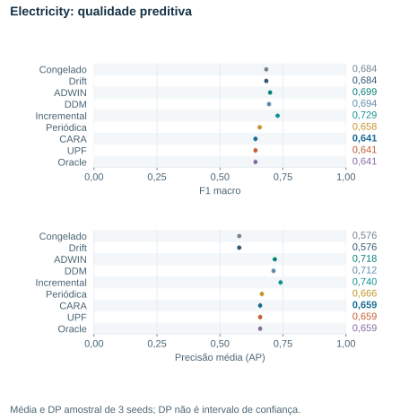

### 2.2 Airlines (`common_n_per_seed = 323.630`)

| Política | `macro_f1` | `pr_auc` | `balanced_accuracy` | `log_loss` | `brier` |
|---|---:|---:|---:|---:|---:|
| `incremental` | 0,6149 | 0,6704 | 0,6201 | 0,6538 | 0,2295 |
| `drift_adwin` | 0,5963 | 0,6645 | 0,6078 | 0,6474 | 0,2281 |
| `frozen` / `drift` | 0,5787 | 0,6531 | 0,6039 | 0,6505 | 0,2295 |
| `periodic` | 0,5728 | 0,6450 | 0,5870 | 0,6576 | 0,2330 |
| `drift_ddm` | 0,5169 | 0,6040 | 0,5638 | 0,6983 | 0,2509 |
| `cara` / `cara_cumulative` / `cara_periodic` / `upf` / `oracle` | 0,4721 | 0,6543 | 0,5560 | 0,6955 | 0,2504 |

Em `airlines`, `incremental` lidera em `macro_f1` (`0,6149`) e `pr_auc` (`0,6704`), seguida por `drift_adwin` (`macro_f1` de `0,5963`, `pr_auc` de `0,6645` e menor erro probabilístico conjunto: `log_loss` de `0,6474` e `brier` de `0,2281`). Apesar de `cara`/`upf`/`oracle` manterem `pr_auc` competitivo (`0,6543`), o `macro_f1` desse grupo cai para `0,4721` devido à baixa revocação da classe positiva (`0,1420`, conforme `quality-summary.csv`).

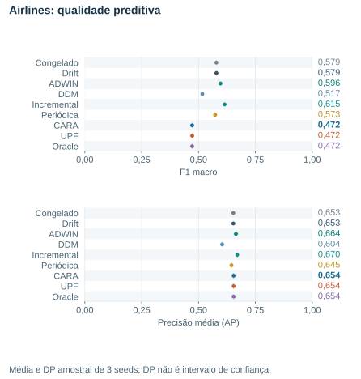

### 2.3 INSECTS Abrupt Imbalanced (`common_n_per_seed = 213.165`)

| Política | `macro_f1` | `pr_auc` | `balanced_accuracy` | `log_loss` | `brier` |
|---|---:|---:|---:|---:|---:|
| `incremental` | 0,8066 | 0,7781 | 0,7947 | 0,3211 | 0,1017 |
| `frozen` / `drift` | 0,7720 | 0,7024 | 0,7603 | 0,4009 | 0,1241 |
| `drift_ddm` | 0,7687 | 0,6900 | 0,7562 | 0,3978 | 0,1238 |
| `cara` / `cara_cumulative` / `cara_periodic` / `upf` / `oracle` | 0,7677 | 0,7284 | 0,7504 | 0,4108 | 0,1261 |
| `periodic` | 0,7169 | 0,6595 | 0,6934 | 0,4144 | 0,1321 |
| `drift_adwin` | 0,6990 | 0,6309 | 0,6766 | 0,4424 | 0,1418 |

Em `insects_abrupt_imbalanced`, `incremental` registra o melhor desempenho conjunto em todas as métricas (`macro_f1` de `0,8066`, `pr_auc` de `0,7781`, `log_loss` de `0,3211` e `brier` de `0,1017`). O grupo `cara`/`upf`/`oracle` mantém `macro_f1` (`0,7677`) próximo ao de `frozen`/`drift` (`0,7720`), com ganho em `pr_auc` (`0,7284` contra `0,7024`), enquanto `drift_adwin` apresenta a maior degradação nesse stream (`macro_f1` de `0,6990`, `pr_auc` de `0,6309`, `log_loss` de `0,4424` e `brier` de `0,1418`).

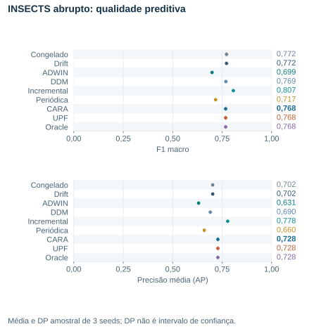

### 2.4 INSECTS Incremental Abrupt Reoccurring Imbalanced (`common_n_per_seed = 271.225`)

| Política | `macro_f1` | `pr_auc` | `balanced_accuracy` | `log_loss` | `brier` |
|---|---:|---:|---:|---:|---:|
| `upf` | 0,7768 | 0,6958 | 0,7845 | 0,4316 | 0,1350 |
| `cara` / `cara_cumulative` / `cara_periodic` / `oracle` | 0,7766 | 0,6952 | 0,7847 | 0,4322 | 0,1352 |
| `incremental` | 0,7700 | 0,7173 | 0,7667 | 0,3830 | 0,1240 |
| `drift_ddm` | 0,6407 | 0,5730 | 0,6276 | 0,4643 | 0,1527 |
| `drift_adwin` | 0,6405 | 0,5941 | 0,6273 | 0,4626 | 0,1515 |
| `periodic` | 0,5960 | 0,4935 | 0,5905 | 0,5006 | 0,1670 |
| `frozen` / `drift` | 0,4250 | 0,2786 | 0,5015 | 0,7270 | 0,2289 |

Neste stream com mudanças incrementais, abruptas e recorrentes, `upf` (`macro_f1` de `0,7768`) e o grupo `cara`/`oracle` (`macro_f1` de `0,7766`) superam `incremental` em `macro_f1` (`0,7700`) e `balanced_accuracy` (`0,7845` a `0,7847` contra `0,7667`), embora `incremental` mantenha melhor `pr_auc` (`0,7173`) e probabilidades mais bem calibradas (`log_loss` de `0,3830` e `brier` de `0,1240`). Sem adaptação efetiva, `frozen`/`drift` colapsa para `macro_f1` de `0,4250`, `balanced_accuracy` de `0,5015`, `log_loss` de `0,7270` e `brier` de `0,2289`.

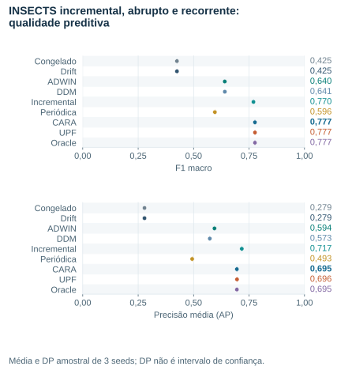

## 3. Calibração Probabilística (`brier` e `log_loss`)

A avaliação conjunta de `brier` (equivalente a `brier_half_sum` no caso binário, `mean((y - p_1)^2)`) e `log_loss` em [quality-summary.csv](../../evidencias/aws-benchmarks/quality-summary.csv) revela que ordenações baseadas apenas em limiares discretos (`macro_f1`) podem ocultar divergências relevantes na qualidade das probabilidades preditas:

- **`electricity`**: `drift_adwin` (`log_loss` `0,5649`, `brier` `0,1898`, `ece` `0,0262`) e `drift_ddm` (`log_loss` `0,5684`, `brier` `0,1916`, `ece` `0,0241`) produzem as probabilidades mais bem calibradas. Embora `incremental` obtenha o menor `brier` (`0,1893`) e o maior `macro_f1` (`0,7287`), seu `log_loss` sobe para `0,6428` (com `ece` de `0,1159`), penalizado por erros confiantes em transições de conceito. `frozen`/`drift` registra o pior `log_loss` (`0,6484`) e o pior `brier` (`0,2202`).
- **`airlines`**: `drift_adwin` alcança simultaneamente o menor `log_loss` (`0,6474`), o menor `brier` (`0,2281`) e o menor `ece` (`0,0249`). `frozen`/`drift` (`log_loss` `0,6505`, `brier` `0,2295`) e `incremental` (`log_loss` `0,6538`, `brier` `0,2295`) mantêm calibração próxima, enquanto `cara`/`upf`/`oracle` (`log_loss` `0,6955`, `brier` `0,2504`, `ece` `0,1412`) e `drift_ddm` (`log_loss` `0,6983`, `brier` `0,2509`) aproximam-se do patamar de incerteza máxima binária (`0,25` em `brier`).
- **`insects_abrupt_imbalanced`**: `incremental` domina a calibração com `log_loss` de `0,3211`, `brier` de `0,1017` e `ece` de `0,0262`, abrindo margem expressiva sobre `drift_ddm` (`0,3978` e `0,1238`) e `frozen`/`drift` (`0,4009` e `0,1241`). `drift_adwin` sofre a maior descalibração (`log_loss` `0,4424`, `brier` `0,1418`).
- **`insects_incremental_abrupt_reoccurring_imbalanced`**: `incremental` também registra os menores erros probabilísticos (`log_loss` `0,3830`, `brier` `0,1240`, `ece` `0,0286`), superando `upf` (`0,4316` e `0,1350`) e `cara`/`oracle` (`0,4322` e `0,1352`), apesar de estes liderarem em `macro_f1`. `frozen`/`drift` degrada para `log_loss` de `0,7270`, `brier` de `0,2289` e `ece` de `0,1495`.

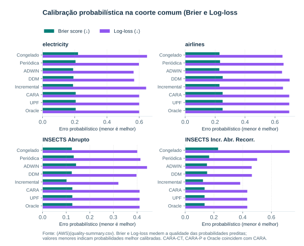

## 4. Dinâmica Temporal nas 16 Janelas Alinhadas

As séries temporais de 16 janelas alinhadas (`windows-summary.csv`) mostram como cada política responde às transições de conceito ao longo da coorte comum:

- **`electricity`**: `incremental` oscila entre o mínimo na janela 6 (`macro_f1` de `0,5876`) e o máximo na janela 3 (`0,8498`), fechando a janela 16 em `0,7774`. `drift_adwin` e `drift_ddm` convergem na janela 16 para `0,8202` (com mínimo de `0,5562` na janela 15), enquanto `periodic` cai para `0,4305` na janela 16. O grupo `cara`/`upf` parte de `0,8022` na janela 1, atinge mínimo de `0,4996` na janela 8 e termina em `0,7964` na janela 16.
- **`airlines`**: todas as políticas apresentam variação acentuada entre janelas. `incremental` varia de `0,5449` (janela 2) a `0,6534` (janela 11), encerrando em `0,5946`. `drift_adwin` cai a `0,4041` na janela 3 e alcança `0,6638` na janela 12. Já `cara`/`upf` apresenta quedas severas em janelas intermediárias e finais, atingindo mínimo de `0,3105` na janela 11 e encerrando em `0,3516` na janela 16.
- **`insects_abrupt_imbalanced`**: as políticas partem de patamares baixos nas janelas iniciais (`0,5465` em `frozen` e `0,5816` em `cara`/`upf`/`drift_adwin` na janela 1) e se recuperam na segunda metade do stream. `incremental` chega a `0,8920` na janela 16 (mínimo de `0,4789` na janela 3), enquanto `drift_adwin` sofre queda acentuada na janela 5 (`0,3997`) antes de recuperar para `0,8323` na janela 16.
- **`insects_incremental_abrupt_reoccurring_imbalanced`**: `frozen` permanece estagnada entre `0,3628` (janela 7) e `0,5000` (janela 2), encerrando em `0,3661`. `periodic` atinge `0,8109` na janela 5, mas degrada para `0,3645` na janela 16. Em contraste, `cara` (`0,8591` na janela 16), `upf` (`0,8566`) e `incremental` (`0,8574`) recuperam desempenho elevado após o vale na janela 2 (`0,4421` a `0,4459`).

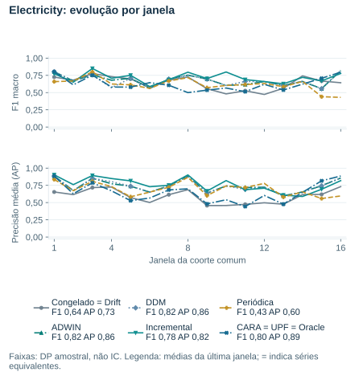

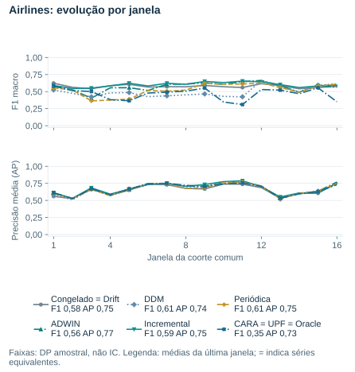

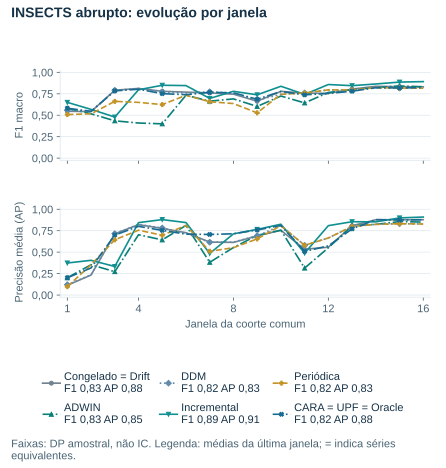

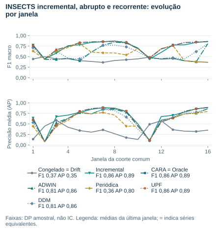

## 5. Evolução nos 28 Blocos Completos vs. Modelo Congelado (`report.json` no S3)

A extração direta dos 28 blocos completos a partir dos arquivos `report.json` armazenados no Amazon S3 (seed `42`, representativa em razão do determinismo dos benchmarks na AWS em qualidade preditiva) permite observar a trajetória de `macro_f1` bloco a bloco após o aquecimento e quantificar o ganho ou a degradação em pontos percentuais (p.p.) frente ao modelo `frozen`:

- **`electricity`**: `frozen` oscila com a sazonalidade do fluxo sem se adaptar às mudanças de regime. `incremental` (23 atualizações) mantém vantagem consistente na maior parte dos blocos, enquanto `drift_adwin` (retreino por alarme) acompanha as recuperações de regime. Em contrapartida, `periodic` (5 retreinos) e `cara` (1 retreino por custo) registram blocos com degradação acentuada frente ao modelo congelado quando os parâmetros retidos ficam defasados.
- **`airlines`**: em um fluxo altamente ruidoso e sem fronteiras abruptas anotadas, `incremental` sustenta ganhos positivos moderados na maior parte dos blocos, ao passo que `cara` sofre queda acentuada na segunda metade do stream, acumulando perda em pontos percentuais em relação a `frozen`.
- **`insects_abrupt_imbalanced`**: as linhas verticais de fronteira real de drift marcam quedas pontuais de desempenho seguidas de recuperação. `incremental` sustenta ganhos positivos após as transições, enquanto `drift_adwin` apresenta vale pronunciado logo após mudança abrupta antes de retomar o patamar de `frozen`.
- **`insects_incremental_abrupt_reoccurring_imbalanced`**: concentra os maiores ganhos positivos sobre `frozen` em toda a campanha. Após a transição inicial, `incremental`, `cara`, `drift_adwin` e `drift_ddm` operam sistematicamente dezenas de pontos percentuais acima do modelo congelado, enquanto `periodic` perde sincronia com os regimes recorrentes nos blocos finais.

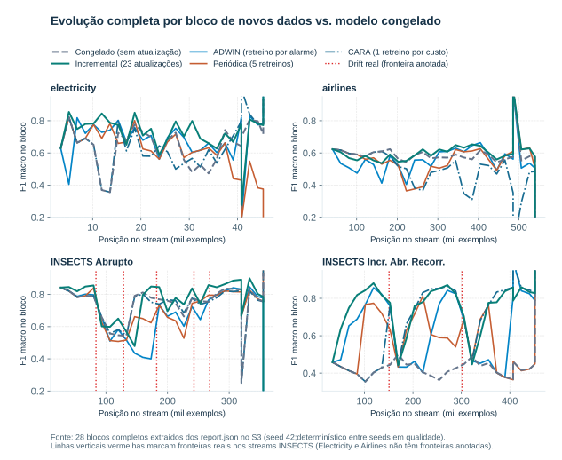

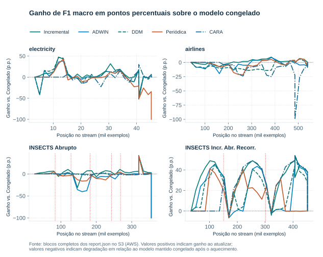

## 6. Contraste entre Coorte Comum e Holdout

O diagnóstico de holdout (`holdout-summary.csv`) avalia exclusivamente o sufixo final de cada stream, mantendo `sample_sd = 0,0` para `macro_f1` e `pr_auc` (com variações de `6,41e-17` em casos pontuais de `pr_auc`) nas 3 seeds. Por terem tamanhos e posições temporais distintos, os valores de holdout não devem ser somados ou comparados diretamente como se pertencessem ao denominador da coorte comum.

| Stream (`holdout_n`) | Política | `macro_f1` (coorte comum) | `macro_f1` (holdout) | `pr_auc` (coorte comum) | `pr_auc` (holdout) |
|---|---|---:|---:|---:|---:|
| `electricity` (4.531) | `cara` / `upf` / `oracle` | 0,6407 | 0,8065 | 0,6595 | 0,8457 |
| `electricity` (4.531) | `drift_adwin` | 0,6989 | 0,7980 | 0,7176 | 0,8609 |
| `electricity` (4.531) | `incremental` | 0,7287 | 0,7900 | 0,7401 | 0,8813 |
| `electricity` (4.531) | `periodic` | 0,6575 | 0,4422 | 0,6662 | 0,6831 |
| `airlines` (53.938) | `incremental` | 0,6149 | 0,6138 | 0,6704 | 0,7347 |
| `airlines` (53.938) | `periodic` | 0,5728 | 0,6126 | 0,6450 | 0,7518 |
| `airlines` (53.938) | `drift_ddm` | 0,5169 | 0,5939 | 0,6040 | 0,7458 |
| `airlines` (53.938) | `cara` / `upf` / `oracle` | 0,4721 | 0,4132 | 0,6543 | 0,7343 |
| `insects_abrupt_imbalanced` (35.527) | `incremental` | 0,8066 | 0,8369 | 0,7781 | 0,8161 |
| `insects_abrupt_imbalanced` (35.527) | `drift_adwin` | 0,6990 | 0,8091 | 0,6309 | 0,7511 |
| `insects_abrupt_imbalanced` (35.527) | `frozen` / `drift` | 0,7720 | 0,7929 | 0,7024 | 0,7432 |
| `insects_abrupt_imbalanced` (35.527) | `cara` / `upf` / `oracle` | 0,7677 | 0,7854 | 0,7284 | 0,7557 |
| `insects_incremental_abrupt_reoccurring_imbalanced` (45.204) | `cara` / `oracle` | 0,7766 | 0,8481 | 0,6952 | 0,8093 |
| `insects_incremental_abrupt_reoccurring_imbalanced` (45.204) | `upf` | 0,7768 | 0,8457 | 0,6958 | 0,8092 |
| `insects_incremental_abrupt_reoccurring_imbalanced` (45.204) | `incremental` | 0,7700 | 0,8446 | 0,7173 | 0,8140 |
| `insects_incremental_abrupt_reoccurring_imbalanced` (45.204) | `frozen` / `drift` | 0,4250 | 0,4268 | 0,2786 | 0,1769 |

O contraste entre coorte comum e holdout evidencia que a ordenação relativa das políticas depende do regime do trecho final: em `electricity`, `cara`/`upf`/`oracle` sobe para `0,8065` de `macro_f1` no holdout enquanto `periodic` cai para `0,4422`; em `airlines`, `cara`/`upf`/`oracle` cai para `0,4132` no holdout enquanto `incremental` e `periodic` permanecem acima de `0,61`; nos dois streams `INSECTS`, as políticas adaptativas mantêm ou ampliam o desempenho no trecho final, com destaque para `cara`/`oracle` (`0,8481`), `upf` (`0,8457`) e `incremental` (`0,8446`) em `insects_incremental_abrupt_reoccurring_imbalanced`.

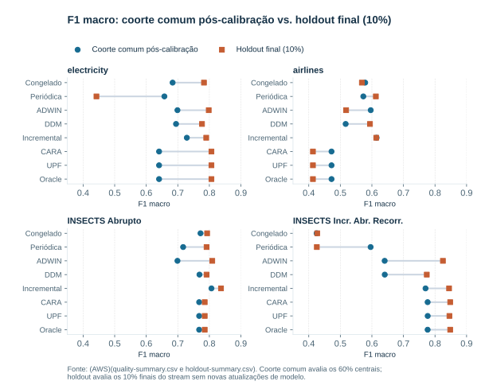
