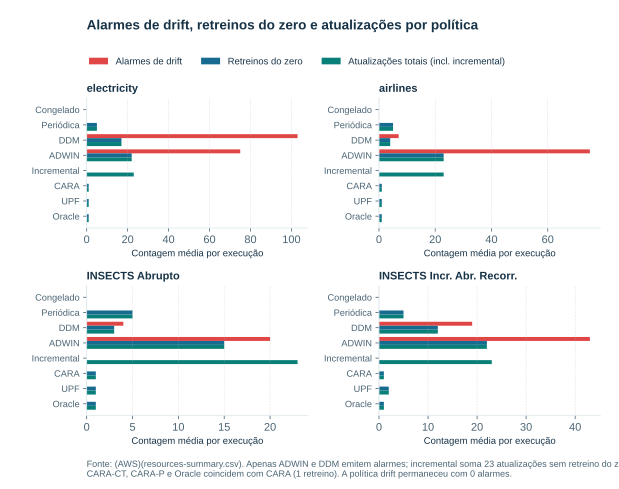
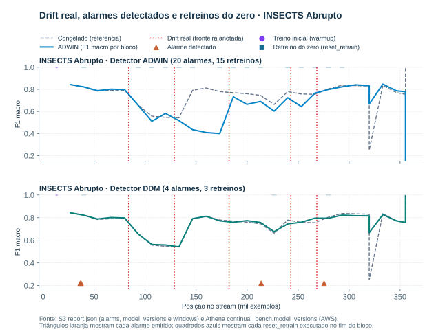
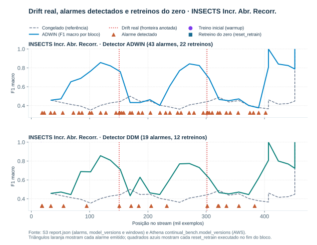
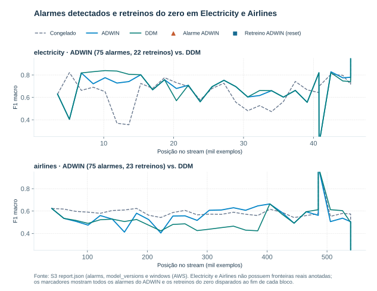
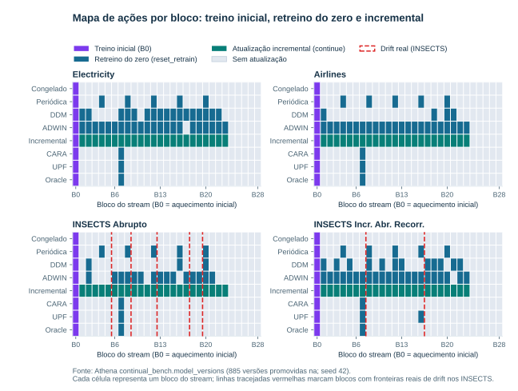

# 02. Detecção de Drift, Alarmes e Retreinamentos

Este relatório analisa o comportamento de detecção de mudança de conceito (*concept drift*), emissão de alarmes, disparo de retreinamentos e evolução das versões de modelo na campanha na AWS (`xgboost`, protocolo `ordered-stream-batch-prequential-metrics-v2`, 4 datasets, 11 políticas e seeds `42`, `43` e `44`, totalizando `132` execuções).

A análise baseia-se exclusivamente nos dados extraídos da tabela `continual_bench.model_versions` no Athena ([tabela model_versions](../../evidencias/aws-benchmarks-v2/athena/f109_model_versions.csv), com `885` registros de versões de modelo), nos alarmes extraídos dos `132` arquivos `report.json` da campanha no S3 ([alarms_by_run.csv](../../evidencias/aws-benchmarks-v2/s3-reports/alarms_by_run.csv)), nos agregados de [resources-summary.csv](../../evidencias/aws-benchmarks/resources-summary.csv), nas especificações de streams de [real_streams.py](../../src/continual_bench/datasets/real_streams.py) e na implementação do protocolo em [stream_benchmark.py](../../src/continual_bench/evaluation/stream_benchmark.py).

## 1. Estrutura dos Streams, Blocos de Avaliação Contínua e Fronteiras Reais de Drift

Em todas as `132` execuções da campanha na AWS, cada stream é particionado em:

1. Um bloco inicial de treino (`initial_train_rows`, índice `0` até `initial_train_rows`).
2. `23` blocos de avaliação contínua (`scope = "prequential"`, índices de bloco `1` a `23`), nos quais cada política prediz antes de observar os rótulos e pode decidir por atualização ou retreinamento ao fim do bloco.
3. Um sufixo de `holdout` (`5` janelas finais com `scope = "holdout"`), usado apenas para avaliação final sem atualização de modelo.

| Stream | Total de linhas | Treino inicial (`initial`) | Fim dos `23` blocos contínuos | Linhas de `holdout` | Fronteiras reais (`changepoints`) |
|---|---:|---:|---:|---:|---|
| `electricity` | 45.312 | 1.699 | 40.781 | 4.531 | Não anotadas |
| `airlines` | 539.383 | 20.226 | 485.445 | 53.938 | Não anotadas |
| `insects_abrupt_imbalanced` | 355.275 | 13.322 | 319.748 | 35.527 | `83.859`, `128.651`, `182.320`, `242.883`, `268.380` |
| `insects_incremental_abrupt_reoccurring_imbalanced` | 452.044 | 16.951 | 406.840 | 45.204 | `150.683`, `301.365` (mais evolução incremental contínua) |

Conforme [real_streams.py](../../src/continual_bench/datasets/real_streams.py), as anotações de drift dos dois streams binários `INSECTS` (classe positiva `"2"` contra as demais, derivadas de Souza et al., 2020) seguem intervalos semiabertos baseados em índice zero (`[start, end)`):

- **`insects_abrupt_imbalanced` (`355.275` linhas, `5` fronteiras abruptas e `6` regimes)**:
  - Regime 1 (`0` a `83.859`): `83.859` linhas (`33.314` positivas, `50.545` negativas).
  - Regime 2 (`83.859` a `128.651`): `44.792` linhas (`5.535` positivas, `39.257` negativas).
  - Regime 3 (`128.651` a `182.320`): `53.669` linhas (`14.904` positivas, `38.765` negativas).
  - Regime 4 (`182.320` a `242.883`): `60.563` linhas (`15.924` positivas, `44.639` negativas).
  - Regime 5 (`242.883` a `268.380`): `25.497` linhas (`2.985` positivas, `22.512` negativas).
  - Regime 6 (`268.380` a `355.275`): `86.895` linhas (`28.594` positivas, `58.301` negativas).
- **`insects_incremental_abrupt_reoccurring_imbalanced` (`452.044` linhas, `2` fronteiras abruptas e `3` regimes)**:
  - Regime 1 (`0` a `150.683`): `150.683` linhas (`41.805` positivas, `108.878` negativas).
  - Regime 2 (`150.683` a `301.365`): `150.682` linhas (`41.758` positivas, `108.924` negativas).
  - Regime 3 (`301.365` a `452.044`): `150.679` linhas (`41.791` positivas, `108.888` negativas).
  - Além das duas transições abruptas em `150.683` e `301.365`, o metadado do stream registra evolução incremental contínua dentro dos regimes.

## 2. Por Que `drift` Emitiu 0 Alarmes Enquanto `drift_adwin` e `drift_ddm` Dispararam Retreinos

A comparação direta entre os arquivos `report.json` e a implementação em [stream_benchmark.py](../../src/continual_bench/evaluation/stream_benchmark.py) explica a inatividade completa da política `drift` (sem sufixo) em contraste com `drift_adwin` e `drift_ddm`:

1. **Sinal de entrada e frequência de atualização**:
   - Na política `drift`, o código instancia `ADWIN(delta=0.002, clock=1)` com o sinal `block_error_rate` (`detector.update(1 - metrics["accuracy"])`). O detector recebe apenas **uma observação escalar por bloco de avaliação contínua** (`23` observações ao longo de toda a execução). Com `delta = 0.002` e somente `23` pontos, o teste estatístico de corte de janela do ADWIN não atinge tamanho amostral suficiente para declarar mudança de média, resultando em `0` alarmes e `0` retreinamentos nos `4` datasets e nas `3` seeds.
   - Na política `drift_adwin`, o código instancia `ADWIN(delta=0.002, clock=32)` com o sinal `binary_error_per_example`. O detector é atualizado a cada exemplo individual (`int(error)` em `decisions != labels`), acumulando dezenas ou centenas de milhares de observações binárias ao longo dos `23` blocos.
   - Na política `drift_ddm`, o código instancia `DDM(warm_start=30, warning_threshold=2.0, drift_threshold=3.0)` também com o sinal `binary_error_per_example`, avaliando o erro binário exemplo a exemplo.
2. **Acoplamento entre alarme no nível de amostra e retreinamento ao fim do bloco**:
   - Em `drift_adwin` e `drift_ddm`, cada alarme é registrado com sua posição exata em amostras (`seq = start + offset + 1`), o índice do bloco (`block_index`) e o fim do bloco (`block_end_seq`).
   - Quando um ou mais alarmes ocorrem dentro de um bloco (`block_alarms > 0`), a política executa exatamente um `reset_retrain` **ao fim daquele bloco** (`block_end_seq`), utilizando uma janela deslizante de replay de até `4` blocos (`REPLAY_BLOCKS = 4`). Por essa razão, múltiplos alarmes no mesmo bloco consolidam-se em apenas um retreinamento, fazendo com que `drift_alarm_count` seja maior ou igual a `retrain_count`.

## 3. Consolidação de Alarmes, Retreinamentos e Versões de Modelo (Benchmarks na AWS)

Nos `132` arquivos `report.json` da campanha na AWS, as posições exatas dos alarmes (`seq`) e os intervalos de todas as versões de modelo (`action`, `start_seq`, `end_seq`) são **100% idênticos entre as seeds `42`, `43` e `44`** (`sample_sd = 0,0` em todas as contagens de [resources-summary.csv](../../evidencias/aws-benchmarks/resources-summary.csv)).

A tabela a seguir consolida os indicadores médios por dataset e política:

| Stream | Política | `drift_alarm_count` | `retrain_count` | `update_count` | `actual_total_fit_count` | `model_versions_count` | `reused_matrix_candidate_fit_count` | `updates_per_1000_evaluated` |
|---|---|---:|---:|---:|---:|---:|---:|---:|
| `electricity` | `frozen` / `drift` | 0 | 0 | 0 | 1 | 1 | 0 | 0,0000 |
| `electricity` | `periodic` | 0 | 5 | 5 | 6 | 6 | 0 | 0,1279 |
| `electricity` | `incremental` | 0 | 0 | 23 | 24 | 24 | 0 | 0,5885 |
| `electricity` | `drift_adwin` | 75 | 22 | 22 | 23 | 23 | 0 | 0,5629 |
| `electricity` | `drift_ddm` | 103 | 17 | 17 | 18 | 18 | 0 | 0,4350 |
| `electricity` | `cara` | 0 | 1 | 1 | 25 | 2 | 0 | 0,0256 |
| `electricity` | `cara_cumulative` / `cara_periodic` / `upf` / `oracle` | 0 | 1 | 1 | 2 | 2 | 23 | 0,0256 |
| `airlines` | `frozen` / `drift` | 0 | 0 | 0 | 1 | 1 | 0 | 0,0000 |
| `airlines` | `periodic` | 0 | 5 | 5 | 6 | 6 | 0 | 0,0107 |
| `airlines` | `incremental` | 0 | 0 | 23 | 24 | 24 | 0 | 0,0494 |
| `airlines` | `drift_adwin` | 75 | 23 | 23 | 24 | 24 | 0 | 0,0494 |
| `airlines` | `drift_ddm` | 7 | 4 | 4 | 5 | 5 | 0 | 0,0086 |
| `airlines` | `cara` | 0 | 1 | 1 | 25 | 2 | 0 | 0,0021 |
| `airlines` | `cara_cumulative` / `cara_periodic` / `upf` / `oracle` | 0 | 1 | 1 | 2 | 2 | 23 | 0,0021 |
| `insects_abrupt_imbalanced` | `frozen` / `drift` | 0 | 0 | 0 | 1 | 1 | 0 | 0,0000 |
| `insects_abrupt_imbalanced` | `periodic` | 0 | 5 | 5 | 6 | 6 | 0 | 0,0163 |
| `insects_abrupt_imbalanced` | `incremental` | 0 | 0 | 23 | 24 | 24 | 0 | 0,0751 |
| `insects_abrupt_imbalanced` | `drift_adwin` | 20 | 15 | 15 | 16 | 16 | 0 | 0,0490 |
| `insects_abrupt_imbalanced` | `drift_ddm` | 4 | 3 | 3 | 4 | 4 | 0 | 0,0098 |
| `insects_abrupt_imbalanced` | `cara` | 0 | 1 | 1 | 25 | 2 | 0 | 0,0033 |
| `insects_abrupt_imbalanced` | `cara_cumulative` / `cara_periodic` / `upf` / `oracle` | 0 | 1 | 1 | 2 | 2 | 23 | 0,0033 |
| `insects_incremental_abrupt_reoccurring_imbalanced` | `frozen` / `drift` | 0 | 0 | 0 | 1 | 1 | 0 | 0,0000 |
| `insects_incremental_abrupt_reoccurring_imbalanced` | `periodic` | 0 | 5 | 5 | 6 | 6 | 0 | 0,0128 |
| `insects_incremental_abrupt_reoccurring_imbalanced` | `incremental` | 0 | 0 | 23 | 24 | 24 | 0 | 0,0590 |
| `insects_incremental_abrupt_reoccurring_imbalanced` | `drift_adwin` | 43 | 22 | 22 | 23 | 23 | 0 | 0,0564 |
| `insects_incremental_abrupt_reoccurring_imbalanced` | `drift_ddm` | 19 | 12 | 12 | 13 | 13 | 0 | 0,0308 |
| `insects_incremental_abrupt_reoccurring_imbalanced` | `cara` | 0 | 1 | 1 | 25 | 2 | 0 | 0,0026 |
| `insects_incremental_abrupt_reoccurring_imbalanced` | `cara_cumulative` / `cara_periodic` / `oracle` | 0 | 1 | 1 | 2 | 2 | 23 | 0,0026 |
| `insects_incremental_abrupt_reoccurring_imbalanced` | `upf` | 0 | 2 | 2 | 3 | 3 | 23 | 0,0051 |

## 4. Posições Exatas de Alarmes (`ADWIN` e `DDM`) Frente às Fronteiras Reais

### 4.1 `insects_abrupt_imbalanced`

O stream possui `5` fronteiras abruptas reais (`83.859`, `128.651`, `182.320`, `242.883`, `268.380`). O comportamento dos dois detectores nos `report.json` é contrastante:

- **`drift_adwin` (`20` alarmes, `15` retreinamentos `reset_retrain`)**:
  - Detecta todas as `5` fronteiras reais dentro do mesmo bloco em que ocorrem:
    - Fronteira `83.859`: primeiro alarme em `seq = 84.042` (atraso de `183` amostras; bloco `6`, retreinamento em `end_seq = 93.260`).
    - Fronteira `128.651`: primeiro alarme em `seq = 128.810` (atraso de `159` amostras; bloco `9`, retreinamento em `end_seq = 133.229`).
    - Fronteira `182.320`: primeiro alarme em `seq = 183.338` (atraso de `1.018` amostras; bloco `13`, retreinamento em `end_seq = 186.521`).
    - Fronteira `242.883`: primeiro alarme em `seq = 243.530` (atraso de `647` amostras; bloco `18`, retreinamento em `end_seq = 253.136`).
    - Fronteira `268.380`: primeiro alarme em `seq = 269.322` (atraso de `942` amostras; bloco `20`, retreinamento em `end_seq = 279.782`).
  - Os `20` alarmes completos ocorrem nos índices `seq`: `36.362` (bloco `2`), `84.042` e `91.050` (bloco `6`), `93.898` (bloco `7`), `106.858` (bloco `8`), `121.770`, `122.986` e `128.810` (bloco `9`), `135.178` e `137.418` (bloco `10`), `168.298` (bloco `12`), `173.546` e `183.338` (bloco `13`), `191.722` (bloco `14`), `211.146` (bloco `15`), `230.922` (bloco `17`), `243.530` (bloco `18`), `253.930` (bloco `19`), `269.322` (bloco `20`) e `280.170` (bloco `21`). Isso evidencia `10` blocos com retreinamentos fora das fronteiras reais.
- **`drift_ddm` (`4` alarmes, `3` retreinamentos `reset_retrain`)**:
  - Os `4` alarmes ocorrem em `seq = 36.421` e `37.247` (bloco `2`, `end_seq = 39.968`), `213.794` (bloco `16`, `end_seq = 226.490`) e `275.496` (bloco `20`, `end_seq = 279.782`).
  - O DDM não dispara alarmes próximos às quatro primeiras fronteiras (`83.859`, `128.651`, `182.320` e `242.883`), reagindo apenas na quinta fronteira (`268.380`, com alarme em `275.496`, atraso de `7.116` amostras).

### 4.2 `insects_incremental_abrupt_reoccurring_imbalanced`

O stream possui `2` fronteiras abruptas reais (`150.683` e `301.365`) combinadas com evolução incremental contínua dentro dos regimes:

- **`drift_adwin` (`43` alarmes, `22` retreinamentos `reset_retrain`)**:
  - Detecta ambas as fronteiras abruptas com atraso reduzido:
    - Fronteira `150.683`: primeiro alarme em `seq = 150.711` (atraso de `28` amostras; bloco `8`, retreinamento em `end_seq = 152.567`).
    - Fronteira `301.365`: primeiro alarme em `seq = 301.399` (atraso de `34` amostras; bloco `17`, retreinamento em `end_seq = 305.135`).
  - Entretanto, a evolução incremental contínua leva o ADWIN a disparar `43` alarmes distribuídos por `22` dos `23` blocos de avaliação contínua (apenas o bloco `21`, entre `355.991` e `372.943`, não registrou alarme), começando já em `seq = 18.519` no bloco `1` e estendendo-se até `seq = 402.007` no bloco `23`.
- **`drift_ddm` (`19` alarmes, `12` retreinamentos `reset_retrain`)**:
  - Também detecta ambas as fronteiras abruptas no mesmo bloco:
    - Fronteira `150.683`: alarme em `seq = 150.902` (atraso de `219` amostras; bloco `8`, `end_seq = 152.567`).
    - Fronteira `301.365`: alarme em `seq = 301.902` (atraso de `537` amostras; bloco `17`, `end_seq = 305.135`).
  - Os `19` alarmes concentram-se em `12` blocos (`block_index` `1`, `3`, `5`, `8`, `10`, `12`, `13`, `17`, `18`, `19`, `21` e `22`), incluindo uma rajada inicial de `6` alarmes no bloco `1` (`18.152`, `18.191`, `18.237`, `18.394`, `18.459`, `33.483`).

### 4.3 `electricity` e `airlines`

Nos dois streams sem fronteiras reais anotadas, a sensibilidade entre ADWIN e DDM inverte-se conforme a dinâmica do erro:

- **`electricity` (`45.312` linhas)**:
  - `drift_adwin` emite `75` alarmes em `22` dos `23` blocos (ausente apenas no bloco `17`, `28.899` a `30.599`), de `seq = 2.179` (bloco `1`) a `seq = 40.739` (bloco `23`), gerando `22` `reset_retrain`.
  - `drift_ddm` emite `103` alarmes (mais do que o próprio ADWIN) distribuídos por `17` blocos (`1`, `2`, `7`, `8`, `9`, `11`, `12`, `13`, `14`, `15`, `16`, `17`, `18`, `19`, `20`, `21`, `22`), de `seq = 1.737` a `seq = 38.716`, gerando `17` `reset_retrain`.
- **`airlines` (`539.383` linhas)**:
  - `drift_adwin` emite `75` alarmes cobrindo **todos os `23` blocos de avaliação contínua** (`block_index` `1` a `23`), de `seq = 35.874` a `seq = 480.994`, gerando `23` `reset_retrain`.
  - `drift_ddm` é altamente conservador, emitindo apenas `7` alarmes em `4` blocos (`seq = 22.362` no bloco `1`; `373.012` e `373.908` no bloco `18`; `410.068` e `410.138` no bloco `20`; `435.771` e `435.928` no bloco `21`), resultando em apenas `4` `reset_retrain`.

## 5. Auditoria de Versões de Modelo em `continual_bench.model_versions` (Athena)

Os dados extraídos de `continual_bench.model_versions` ([tabela model_versions](../../evidencias/aws-benchmarks-v2/athena/f109_model_versions.csv)) totalizam exatamente **`885` versões de modelo** nas `132` execuções (`4` datasets x `11` políticas x `3` seeds), distribuídas em três ações (`action`):

- **`initial` (`132` versões)**: exatamente `1` por execução, sempre com `start_seq = 0` e `end_seq` igual a `initial_train_rows` (`1.699` em `electricity`, `20.226` em `airlines`, `13.322` em `insects_abrupt_imbalanced` e `16.951` em `insects_incremental_abrupt_reoccurring_imbalanced`).
- **`reset_retrain` (`477` versões)**:
  - `drift_adwin`: `246` registros (`(22 + 23 + 15 + 22) * 3`). Treina sobre a janela deslizante de até `4` blocos de replay (`REPLAY_BLOCKS = 4`). Por exemplo, em `insects_abrupt_imbalanced`, o primeiro `reset_retrain` no bloco `2` cobre `[13.322, 39.968)` e o último no bloco `21` cobre `[239.813, 293.105)`.
  - `drift_ddm`: `108` registros (`(17 + 4 + 3 + 12) * 3`).
  - `periodic`: `60` registros (`5` retreinamentos por execução x `4` datasets x `3` seeds), disparados exatamente a cada `4` blocos (`block_index` `4`, `8`, `12`, `16` e `20`), com janelas contíguas de `4` blocos (`13.322..66.614`, `66.614..119.906`, `119.906..173.198`, `173.198..226.490` e `226.490..279.782` em `insects_abrupt_imbalanced`).
  - `cara`, `cara_cumulative`, `cara_periodic` e `oracle`: `48` registros (`1` retreinamento por execução x `4` políticas x `4` datasets x `3` seeds), ocorrendo sempre ao final da fase offline (`block_index = 7`, `8` blocos offline: por exemplo, `[80.907, 161.815)` em `airlines`, `[6.799, 13.599)` em `electricity`, `[53.291, 106.583)` em `insects_abrupt_imbalanced` e `[67.807, 135.615)` em `insects_incremental_abrupt_reoccurring_imbalanced`), com `0` retreinamentos online.
  - `upf`: `15` registros (`(1 + 1 + 1 + 2) * 3`). Repete exatamente o retreinamento offline das demais políticas de matriz nos `4` streams, mas é a única política da família a executar `1` retreinamento online adicional em `insects_incremental_abrupt_reoccurring_imbalanced`, no bloco `16` (`[220.375, 288.183)`).
- **`continue` (`276` versões)**: exclusivamente na política `incremental` (`23` atualizações por execução x `4` datasets x `3` seeds), atualizando o modelo incrementalmente sobre cada bloco individual (`[end_seq_anterior, end_seq_atual)`), de `block_index = 1` até `block_index = 23` (por exemplo, de `[16.951, 33.903)` até `[389.895, 406.840)` no stream recorrente).
- **`frozen` e `drift`**: permanecem com `0` ações de `reset_retrain` e `0` ações de `continue`, mantendo exclusivamente a versão `initial` em todas as `24` execuções combinadas.

A figura a seguir exibe o mapa discreto de ações por bloco (`B0..B27`) para cada stream e política, destacando o bloco inicial (`B0`), os blocos de avaliação contínua (`B1..B23`) com eventuais eventos `reset_retrain` ou `continue`, e os blocos finais de `holdout` (`B24..B27`) sem atualização de modelo.

## 6. Síntese Comparativa

1. **Invariância entre seeds**: na campanha na AWS, todas as posições de alarme (`seq`), ações (`initial`, `reset_retrain`, `continue`) e intervalos de versões (`start_seq`, `end_seq`) são determinísticos e idênticos entre as seeds `42`, `43` e `44`.
2. **Inatividade de `drift` vs. ativação de `drift_adwin` e `drift_ddm`**: a política `drift` monitora apenas `1` taxa de erro por bloco (`23` pontos no total com `ADWIN(delta=0.002, clock=1)`), não atingindo massa estatística para disparar alarmes; `drift_adwin` e `drift_ddm` monitoram o erro binário por exemplo e disparam `reset_retrain` ao fim de cada bloco com alarme.
3. **Compromisso entre sensibilidade e custo de retreinamento**: `drift_adwin` detecta todas as fronteiras abruptas reais nos dois streams `INSECTS` com atraso de `28` a `1.018` amostras, mas dispara retreinamentos em `15` a `23` dos `23` blocos nos `4` datasets (`246` `reset_retrain` no total). `drift_ddm` reduz os retreinamentos para `108` no total, mas perde quatro das cinco fronteiras abruptas em `insects_abrupt_imbalanced`. Políticas baseadas em matriz (`cara`, `upf`, `oracle`) restringem-se a `1` retreinamento offline (e `1` online apenas em `upf` no stream recorrente), mantendo `2` a `3` versões de modelo por execução.
