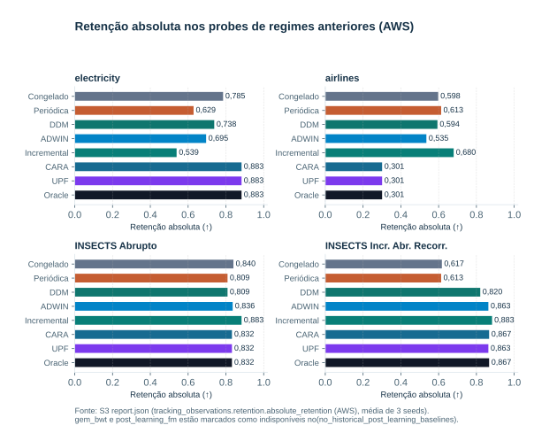
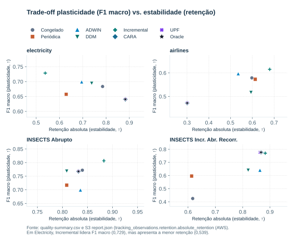

# 03. Esquecimento, Estabilidade e Retenção na Campanha na AWS

Este relatório analisa o compromisso entre plasticidade e estabilidade (*stability-plasticity dilemma*) na campanha na AWS, utilizando exclusivamente os dados extraídos dos 132 arquivos `report.json` da campanha (4 streams, 11 políticas e 3 seeds: `42`, `43` e `44`) e a tabela consolidada de qualidade preditiva na coorte comum em [quality-summary.csv](../../evidencias/aws-benchmarks/quality-summary.csv).

## 1. Cobertura Experimental e Protocolo de Retenção

A matriz experimental da campanha na AWS apresenta cobertura integral de `132/132` execuções (`3/3` seeds completas para todas as 44 combinações de stream e política):

- **Streams avaliados (4):** `airlines`, `electricity`, `insects_abrupt_imbalanced` e `insects_incremental_abrupt_reoccurring_imbalanced`.
- **Políticas avaliadas (11):** `cara`, `cara_cumulative`, `cara_periodic`, `drift`, `drift_adwin`, `drift_ddm`, `frozen`, `incremental`, `oracle`, `periodic` e `upf`.
- **Determinismo entre seeds:** Em todas as 44 combinações de stream e política, as 3 seeds (`42`, `43` e `44`) produziram exatamente os mesmos valores de `absolute_retention` e `macro_f1` na coorte comum (desvio-padrão amostral igual a `0,0000`).

Nos 132 arquivos `report.json`, o bloco `tracking_observations.retention` registra a métrica `absolute_retention` sob as seguintes especificações:

- **`evaluation_method`:** `live_version_on_fixed_read_only_holdout_probes` (avaliação da versão ativa do modelo sobre sondas fixas de holdout somente leitura).
- **`scope`:** `fixed_period_temporal_holdout`.
- **`sampling_method`:** `UTC 30-day periods anchored at Unix epoch; chronological period prefix`.
- **`metric`:** `accuracy` (acurácia preservada nas sondas temporais fixas).

### Disponibilidade de `gem_bwt` e `post_learning_fm`

> [!IMPORTANT]
> Em todos os 132 arquivos `report.json` da campanha na AWS, os campos `tracking_observations.retention.gem_bwt` e `tracking_observations.retention.post_learning_fm` constam com valor `null`, acompanhados em `tracking_observations.retention.availability` pelo registro explícito de `status: "unavailable"` e `reason: "no_historical_post_learning_baselines"`.

Dessa forma, não há medição de transferência retroativa (`gem_bwt`) nem de medida de esquecimento pós-aprendizado (`post_learning_fm`) na campanha na AWS, pois não foram armazenadas linhas de base históricas pós-aprendizado para cada período. Toda a análise quantitativa de estabilidade e retenção dos benchmarks na AWS apoia-se, portanto, em `absolute_retention` em conjunto com `macro_f1` na coorte comum.

## 2. Retenção Absoluta (`absolute_retention`) por Stream e Política

A tabela abaixo consolida os valores médios de `absolute_retention` (extraídos de `tracking_observations.retention.absolute_retention` nos 132 `report.json`) e de `macro_f1` na coorte comum (extraídos de [quality-summary.csv](../../evidencias/aws-benchmarks/quality-summary.csv)) para cada combinação de stream e política.

| Stream | Política | `absolute_retention` | `macro_f1` (coorte comum) |
|---|---|---:|---:|
| `airlines` | `cara` | 0,3008 | 0,4721 |
| `airlines` | `cara_cumulative` | 0,3008 | 0,4721 |
| `airlines` | `cara_periodic` | 0,3008 | 0,4721 |
| `airlines` | `drift` | 0,5977 | 0,5787 |
| `airlines` | `drift_adwin` | 0,5352 | 0,5963 |
| `airlines` | `drift_ddm` | 0,5938 | 0,5169 |
| `airlines` | `frozen` | 0,5977 | 0,5787 |
| `airlines` | `incremental` | **0,6797** | **0,6149** |
| `airlines` | `oracle` | 0,3008 | 0,4721 |
| `airlines` | `periodic` | 0,6133 | 0,5728 |
| `airlines` | `upf` | 0,3008 | 0,4721 |
| `electricity` | `cara` | **0,8828** | 0,6407 |
| `electricity` | `cara_cumulative` | **0,8828** | 0,6407 |
| `electricity` | `cara_periodic` | **0,8828** | 0,6407 |
| `electricity` | `drift` | 0,7852 | 0,6836 |
| `electricity` | `drift_adwin` | 0,6953 | 0,6989 |
| `electricity` | `drift_ddm` | 0,7383 | 0,6944 |
| `electricity` | `frozen` | 0,7852 | 0,6836 |
| `electricity` | `incremental` | 0,5391 | **0,7287** |
| `electricity` | `oracle` | **0,8828** | 0,6407 |
| `electricity` | `periodic` | 0,6289 | 0,6575 |
| `electricity` | `upf` | **0,8828** | 0,6407 |
| `insects_abrupt_imbalanced` | `cara` | 0,8320 | 0,7677 |
| `insects_abrupt_imbalanced` | `cara_cumulative` | 0,8320 | 0,7677 |
| `insects_abrupt_imbalanced` | `cara_periodic` | 0,8320 | 0,7677 |
| `insects_abrupt_imbalanced` | `drift` | 0,8398 | 0,7720 |
| `insects_abrupt_imbalanced` | `drift_adwin` | 0,8359 | 0,6990 |
| `insects_abrupt_imbalanced` | `drift_ddm` | 0,8086 | 0,7687 |
| `insects_abrupt_imbalanced` | `frozen` | 0,8398 | 0,7720 |
| `insects_abrupt_imbalanced` | `incremental` | **0,8828** | **0,8066** |
| `insects_abrupt_imbalanced` | `oracle` | 0,8320 | 0,7677 |
| `insects_abrupt_imbalanced` | `periodic` | 0,8086 | 0,7169 |
| `insects_abrupt_imbalanced` | `upf` | 0,8320 | 0,7677 |
| `insects_incremental_abrupt_reoccurring_imbalanced` | `cara` | 0,8672 | 0,7766 |
| `insects_incremental_abrupt_reoccurring_imbalanced` | `cara_cumulative` | 0,8672 | 0,7766 |
| `insects_incremental_abrupt_reoccurring_imbalanced` | `cara_periodic` | 0,8672 | 0,7766 |
| `insects_incremental_abrupt_reoccurring_imbalanced` | `drift` | 0,6172 | 0,4250 |
| `insects_incremental_abrupt_reoccurring_imbalanced` | `drift_adwin` | 0,8633 | 0,6405 |
| `insects_incremental_abrupt_reoccurring_imbalanced` | `drift_ddm` | 0,8203 | 0,6407 |
| `insects_incremental_abrupt_reoccurring_imbalanced` | `frozen` | 0,6172 | 0,4250 |
| `insects_incremental_abrupt_reoccurring_imbalanced` | `incremental` | **0,8828** | 0,7700 |
| `insects_incremental_abrupt_reoccurring_imbalanced` | `oracle` | 0,8672 | 0,7766 |
| `insects_incremental_abrupt_reoccurring_imbalanced` | `periodic` | 0,6133 | 0,5960 |
| `insects_incremental_abrupt_reoccurring_imbalanced` | `upf` | 0,8633 | **0,7768** |

## 3. Compromisso entre Plasticidade (`macro_f1`) e Estabilidade (`absolute_retention`)

A comparação conjunta entre `macro_f1` na coorte comum (eixo de plasticidade e desempenho preditivo global) e `absolute_retention` (eixo de estabilidade na sonda temporal fixa) revela que o comportamento das políticas varia fortemente conforme a dinâmica de mudança de conceito de cada stream:

1. **`electricity` (troca clássica entre plasticidade e estabilidade):**
   Neste stream, observa-se o conflito direto entre adaptação contínua e preservação do desempenho na sonda inicial. A política `incremental` alcança a maior plasticidade global (`macro_f1 = 0,7287`), superando todas as demais políticas, mas sofre a maior perda de estabilidade, registrando a menor retenção do conjunto (`absolute_retention = 0,5391`). De forma análoga, `periodic` cai para `absolute_retention = 0,6289` (`macro_f1 = 0,6575`) e `drift_adwin` cai para `0,6953` (`macro_f1 = 0,6989`). Em sentido oposto, as políticas baseadas em retenção e controle de atualização (`cara`, `cara_cumulative`, `cara_periodic`, `upf` e `oracle`) atingem a maior retenção absoluta (`0,8828`), porém com `macro_f1 = 0,6407`, abaixo inclusive da linha de base `frozen` (`macro_f1 = 0,6836`, `absolute_retention = 0,7852`).

2. **`airlines` (queda severa nas políticas baseadas em janela/memória vs. ganho em `incremental`):**
   Em `airlines`, não há troca favorável às políticas conservadoras: `cara`, `cara_cumulative`, `cara_periodic`, `upf` e `oracle` registram simultaneamente a menor retenção (`absolute_retention = 0,3008`) e o pior desempenho preditivo (`macro_f1 = 0,4721`). Nos arquivos `report.json` de `cara`, por exemplo, a acurácia na sonda cai de `0,5977` no checkpoint inicial (`v0`) para `0,3008` após a atualização (`v1`). Em contraste, `incremental` atinge tanto a maior retenção (`absolute_retention = 0,6797`) quanto o maior `macro_f1` (`0,6149`), superando `periodic` (`0,6133` e `0,5728`), `frozen`/`drift` (`0,5977` e `0,5787`) e `drift_adwin` (`0,5352` e `0,5963`).

3. **`insects_abrupt_imbalanced` (alta estabilidade geral e liderança de `incremental`):**
   Neste stream de mudanças abruptas desbalanceadas, todas as políticas mantêm `absolute_retention` acima de `0,80`, variando entre `0,8086` (`drift_ddm` e `periodic`) e `0,8828` (`incremental`). A política `incremental` domina nos dois critérios, alcançando `absolute_retention = 0,8828` e `macro_f1 = 0,8066`. As políticas `cara`, `cara_cumulative`, `cara_periodic`, `oracle` e `upf` permanecem empatadas em `absolute_retention = 0,8320` e `macro_f1 = 0,7677`, próximas de `frozen` e `drift` (`0,8398` e `0,7720`).

4. **`insects_incremental_abrupt_reoccurring_imbalanced` (colapso de `frozen`/`drift`/`periodic` e convergência em alto patamar):**
   Com mudanças incrementais, abruptas e recorrentes, as políticas `frozen` e `drift` colapsam em ambos os eixos (`absolute_retention = 0,6172` e `macro_f1 = 0,4250`), e `periodic` mantém retenção baixa (`0,6133`, com `macro_f1 = 0,5960`). Por outro lado, `incremental` atinge a maior retenção (`0,8828`, com `macro_f1 = 0,7700`), seguida de perto por `cara`, `cara_cumulative`, `cara_periodic` e `oracle` (`absolute_retention = 0,8672` e `macro_f1 = 0,7766`) e por `upf` (`absolute_retention = 0,8633` e o maior `macro_f1` do stream, `0,7768`). Já `drift_adwin` e `drift_ddm` preservam boa retenção (`0,8633` e `0,8203`), mas com `macro_f1` intermediário (`0,6405` e `0,6407`).

## 4. Síntese dos Achados

- **Ausência de `gem_bwt` e `post_learning_fm`:** A campanha na AWS documenta explicitamente `status: "unavailable"` (`reason: "no_historical_post_learning_baselines"`) para ambas as métricas nos 132 `report.json`, restringindo a avaliação de retenção à série de `absolute_retention`.
- **Inexistência de política universalmente ótima em estabilidade:** Enquanto `cara`, `cara_cumulative`, `cara_periodic`, `oracle` e `upf` lideram em `absolute_retention` em `electricity` (`0,8828`) e competem no topo em `insects_incremental_abrupt_reoccurring_imbalanced` (`0,8672` e `0,8633`), o grupo apresenta degradação severa em `airlines` (`0,3008`).
- **Comportamento dual de `incremental`:** `incremental` obtém o melhor equilíbrio simultâneo de `absolute_retention` e `macro_f1` em `airlines` (`0,6797` e `0,6149`) e `insects_abrupt_imbalanced` (`0,8828` e `0,8066`), mas exemplifica o custo da alta plasticidade sobre a estabilidade em `electricity`, onde atinge o maior `macro_f1` (`0,7287`) ao preço da menor `absolute_retention` (`0,5391`).
