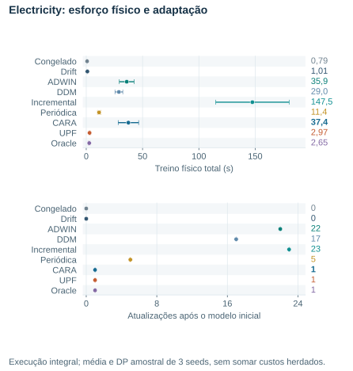
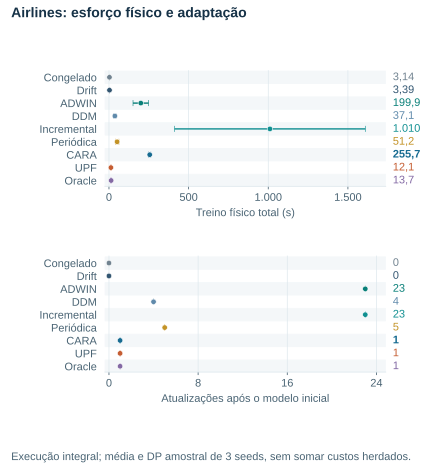
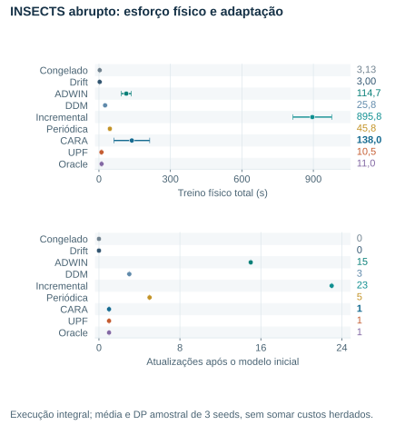
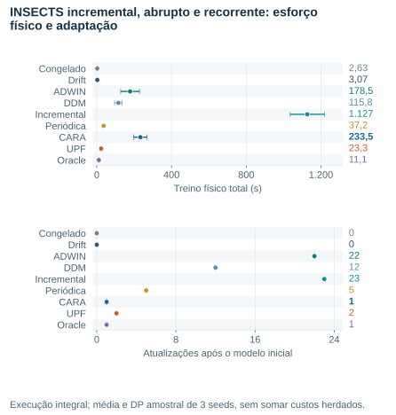
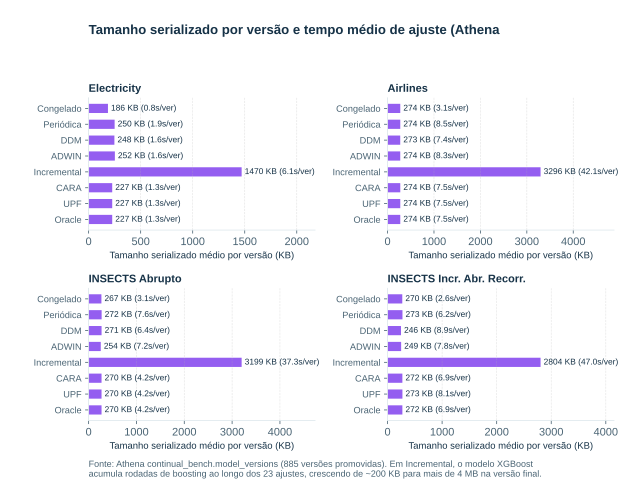
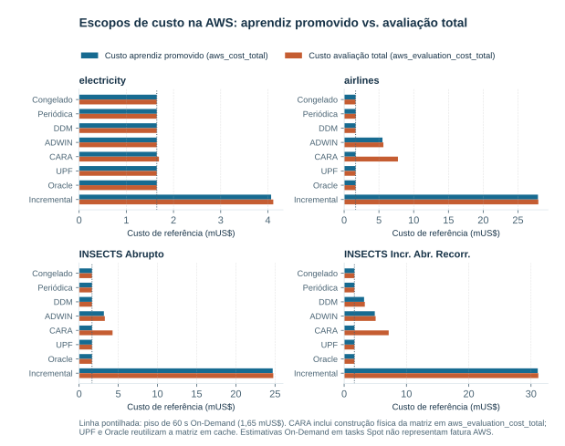
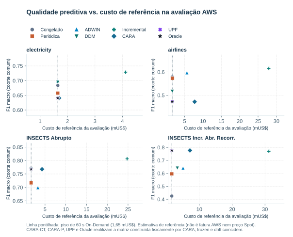
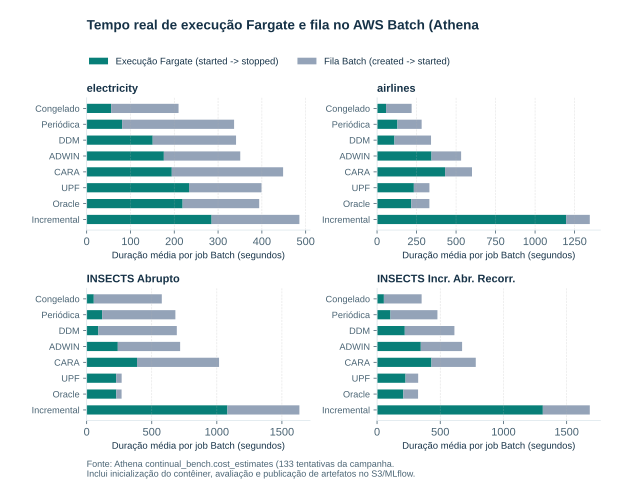

# 04. Recursos, Retreinamentos e Custos Computacionais

Este relatório analisa o esforço computacional, o inventário de ajustes, os tempos de treinamento e avaliação, o uso de memória e a telemetria real de execução no AWS Batch durante a campanha na AWS (`xgboost`, avaliação em fluxo contínuo, seeds `42`, `43` e `44`). Todos os dados quantitativos provêm exclusivamente dos artefatos consolidados da campanha em [resources-summary.csv](../../evidencias/aws-benchmarks/resources-summary.csv), [resources-by-seed.csv](../../evidencias/aws-benchmarks/resources-by-seed.csv), [training-inventory.csv](../../evidencias/aws-benchmarks/training-inventory.csv), [metric-dictionary.csv](../../evidencias/aws-benchmarks/metric-dictionary.csv) e [provenance.json](../../evidencias/aws-benchmarks/provenance.json), complementados pelas extrações diretas do Amazon Athena em `evidencias/aws-benchmarks-v2/athena/`: [f109_cost_estimates.csv](../../evidencias/aws-benchmarks-v2/athena/f109_cost_estimates.csv) (`133` tentativas operacionais) e [f109_model_versions.csv](../../evidencias/aws-benchmarks-v2/athena/f109_model_versions.csv) (`885` versões de modelo).

## 1. Inventário de Ajustes e Reutilização na Matriz CARA

A matriz experimental completa reúne `132` unidades lógicas (4 streams x 11 políticas x 3 seeds), com `133` tentativas operacionais registradas no AWS Batch (`1` retomada de publicação de métricas após falha sem novo treinamento, conforme `historical_failed_publication_attempts_recovered = 1` em [provenance.json](../../evidencias/aws-benchmarks/provenance.json)).

Ao consolidar [training-inventory.csv](../../evidencias/aws-benchmarks/training-inventory.csv), o inventário de treinamentos contabiliza:

| Dimensão do inventário | Quantidade verificada | Observação |
|---|---:|---|
| Registros totais de ajuste (`fits`) | 2.265 | `226.500` pontos de época registrados (100 rodadas configuradas por ajuste) |
| Ajustes físicos executados (`physical_fits`) | 1.161 | `116.100` rodadas físicas de boosting (`14.731,24 s` acumulados) |
| Registros reutilizados de ajuste existente (`reused_metric_fits`) | 1.104 | Evidência de matriz herdada sem reexecução física |
| Ajustes de materialização (`materialization_fits`) | 123 | Subconjunto dos ajustes físicos (`608,82 s` acumulados; nunca somar novamente ao total físico) |
| Ajustes lógicos promovidos (`promoted_logical_fits`) | 885 | Ajustes efetivamente adotados na inferência em fluxo contínuo |

A distribuição dos `1.161` ajustes físicos por política evidencia o contraste entre a execução completa da matriz de retreinamento e a reutilização de evidência:

- `cara`: `300` ajustes físicos (25 por unidade, construindo a matriz completa de candidatos).
- `incremental`: `288` ajustes físicos (24 por unidade: 1 inicial + 23 atualizações incrementais).
- `drift_adwin`: `258` ajustes físicos (varia conforme os alarmes de drift em cada stream).
- `drift_ddm`: `120` ajustes físicos.
- `periodic`: `72` ajustes físicos (6 por unidade: 1 inicial + 5 retreinamentos periódicos).
- `upf`: `27` ajustes físicos (2 por unidade em 3 streams e 3 por unidade em `insects_incremental_abrupt_reoccurring_imbalanced`).
- `cara_cumulative`, `cara_periodic` e `oracle`: `24` ajustes físicos cada (2 por unidade, com reutilização de `23` candidatos da matriz por unidade).
- `frozen` e `drift`: `12` ajustes físicos cada (apenas o ajuste inicial em cada uma das 12 unidades).

## 2. Retreinamentos, Tempos e Uso de Memória por Stream

Conforme definido em [metric-dictionary.csv](../../evidencias/aws-benchmarks/metric-dictionary.csv), é obrigatório distinguir:
- `train_seconds`: duração dos ajustes lógicos promovidos (o ajuste inicial e as atualizações promovidas são subconjuntos).
- `actual_total_fit_seconds`: soma de todos os ajustes físicos executados pela unidade, já incluindo `materialization_train_seconds` (subconjunto que não deve ser somado novamente).
- `retraining_matrix_fit_seconds`: custo de medição da matriz de candidatos na família CARA, que pode ser herdado/reutilizado pelas políticas derivadas (`cara_cumulative`, `cara_periodic`, `oracle` e `upf`).
- `evaluation_compute_seconds`: tempo total de cômputo da avaliação (excluindo provisionamento e publicação).

### 2.1 Electricity

| Política | `retrain_count` | `update_count` | `actual_total_fit_count` | `materialization_fit_count` | `reused_matrix_candidate_fit_count` | `train_seconds` | `actual_total_fit_seconds` | `evaluation_compute_seconds` | Pico RSS (MB) |
|---|---:|---:|---:|---:|---:|---:|---:|---:|---:|
| `frozen` | 0,0 | 0,0 | 1,0 | 0,0 | 0,0 | 0,7883 | 0,7883 | 1,5992 | 312,0 |
| `drift` | 0,0 | 0,0 | 1,0 | 0,0 | 0,0 | 1,0062 | 1,0062 | 2,0042 | 311,7 |
| `periodic` | 5,0 | 5,0 | 6,0 | 0,0 | 0,0 | 11,3907 | 11,3907 | 13,5592 | 320,9 |
| `drift_ddm` | 17,0 | 17,0 | 18,0 | 0,0 | 0,0 | 28,9643 | 28,9643 | 32,3143 | 331,6 |
| `drift_adwin` | 22,0 | 22,0 | 23,0 | 0,0 | 0,0 | 35,9376 | 35,9376 | 40,2784 | 336,4 |
| `incremental` | 0,0 | 23,0 | 24,0 | 0,0 | 0,0 | 147,4822 | 147,4822 | 149,7296 | 387,5 |
| `cara` | 1,0 | 1,0 | 25,0 | 2,0 | 0,0 | 2,5128 | 37,4237 | 51,1884 | 345,6 |
| `cara_cumulative` | 1,0 | 1,0 | 2,0 | 2,0 | 23,0 | 2,5128 | 2,5729 | 14,6181 | 347,5 |
| `cara_periodic` | 1,0 | 1,0 | 2,0 | 2,0 | 23,0 | 2,5128 | 2,8359 | 14,5103 | 347,3 |
| `oracle` | 1,0 | 1,0 | 2,0 | 2,0 | 23,0 | 2,5128 | 2,6466 | 14,0312 | 347,3 |
| `upf` | 1,0 | 1,0 | 2,0 | 2,0 | 23,0 | 2,5128 | 2,9662 | 16,6947 | 347,3 |

Nota: valores de pico RSS em MB convertidos de `process_peak_rss_bytes` dividindo por `1.048.576` (`1024^2`). Em `electricity`, `retraining_matrix_fit_seconds` é `35,2653 s` para as 6 políticas da família matricial.

### 2.2 Airlines

| Política | `retrain_count` | `update_count` | `actual_total_fit_count` | `materialization_fit_count` | `reused_matrix_candidate_fit_count` | `train_seconds` | `actual_total_fit_seconds` | `evaluation_compute_seconds` | Pico RSS (MB) |
|---|---:|---:|---:|---:|---:|---:|---:|---:|---:|
| `frozen` | 0,0 | 0,0 | 1,0 | 0,0 | 0,0 | 3,1375 | 3,1375 | 5,0023 | 330,9 |
| `drift` | 0,0 | 0,0 | 1,0 | 0,0 | 0,0 | 3,3910 | 3,3910 | 5,3983 | 333,4 |
| `periodic` | 5,0 | 5,0 | 6,0 | 0,0 | 0,0 | 51,2212 | 51,2212 | 53,5300 | 343,9 |
| `drift_ddm` | 4,0 | 4,0 | 5,0 | 0,0 | 0,0 | 37,0584 | 37,0584 | 39,8069 | 345,6 |
| `drift_adwin` | 23,0 | 23,0 | 24,0 | 0,0 | 0,0 | 199,9098 | 199,9098 | 205,4500 | 360,5 |
| `incremental` | 0,0 | 23,0 | 24,0 | 0,0 | 0,0 | 1010,4587 | 1010,4587 | 1018,0549 | 462,3 |
| `cara` | 1,0 | 1,0 | 25,0 | 2,0 | 0,0 | 15,0548 | 255,7466 | 281,7267 | 370,6 |
| `cara_cumulative` | 1,0 | 1,0 | 2,0 | 2,0 | 23,0 | 15,0548 | 9,5695 | 18,3906 | 376,8 |
| `cara_periodic` | 1,0 | 1,0 | 2,0 | 2,0 | 23,0 | 15,0548 | 12,9609 | 25,4344 | 377,1 |
| `oracle` | 1,0 | 1,0 | 2,0 | 2,0 | 23,0 | 15,0548 | 13,7305 | 27,0964 | 377,6 |
| `upf` | 1,0 | 1,0 | 2,0 | 2,0 | 23,0 | 15,0548 | 12,0618 | 23,1182 | 377,0 |

Em `airlines`, `retraining_matrix_fit_seconds` é `241,3287 s`. Observa-se que `incremental` atinge `1.010,46 s` de treinamento (`1.018,05 s` de cômputo de avaliação) e `462,3 MB` de pico RSS, superando em mais de quatro vezes o tempo total de cômputo da própria construção completa da matriz `cara` (`281,73 s`).

### 2.3 INSECTS Abrupt Imbalanced

| Política | `retrain_count` | `update_count` | `actual_total_fit_count` | `materialization_fit_count` | `reused_matrix_candidate_fit_count` | `train_seconds` | `actual_total_fit_seconds` | `evaluation_compute_seconds` | Pico RSS (MB) |
|---|---:|---:|---:|---:|---:|---:|---:|---:|---:|
| `frozen` | 0,0 | 0,0 | 1,0 | 0,0 | 0,0 | 3,1341 | 3,1341 | 5,6448 | 359,9 |
| `drift` | 0,0 | 0,0 | 1,0 | 0,0 | 0,0 | 3,0032 | 3,0032 | 5,3951 | 366,9 |
| `periodic` | 5,0 | 5,0 | 6,0 | 0,0 | 0,0 | 45,8333 | 45,8333 | 48,9133 | 385,5 |
| `drift_ddm` | 3,0 | 3,0 | 4,0 | 0,0 | 0,0 | 25,7607 | 25,7607 | 28,9254 | 386,7 |
| `drift_adwin` | 15,0 | 15,0 | 16,0 | 0,0 | 0,0 | 114,7410 | 114,7410 | 119,0835 | 397,3 |
| `incremental` | 0,0 | 23,0 | 24,0 | 0,0 | 0,0 | 895,7769 | 895,7769 | 902,7535 | 476,8 |
| `cara` | 1,0 | 1,0 | 25,0 | 2,0 | 0,0 | 8,3174 | 138,0044 | 155,2116 | 423,8 |
| `cara_cumulative` | 1,0 | 1,0 | 2,0 | 2,0 | 23,0 | 8,3174 | 10,3411 | 22,1443 | 417,6 |
| `cara_periodic` | 1,0 | 1,0 | 2,0 | 2,0 | 23,0 | 8,3174 | 10,8365 | 26,3793 | 420,9 |
| `oracle` | 1,0 | 1,0 | 2,0 | 2,0 | 23,0 | 8,3174 | 10,9698 | 24,6712 | 417,3 |
| `upf` | 1,0 | 1,0 | 2,0 | 2,0 | 23,0 | 8,3174 | 10,5102 | 24,9016 | 417,2 |

Em `insects_abrupt_imbalanced`, `retraining_matrix_fit_seconds` é `130,1180 s`.

### 2.4 INSECTS Incremental Abrupt Reoccurring Imbalanced

| Política | `retrain_count` | `update_count` | `actual_total_fit_count` | `materialization_fit_count` | `reused_matrix_candidate_fit_count` | `train_seconds` | `actual_total_fit_seconds` | `evaluation_compute_seconds` | Pico RSS (MB) |
|---|---:|---:|---:|---:|---:|---:|---:|---:|---:|
| `frozen` | 0,0 | 0,0 | 1,0 | 0,0 | 0,0 | 2,6285 | 2,6285 | 4,6479 | 382,7 |
| `drift` | 0,0 | 0,0 | 1,0 | 0,0 | 0,0 | 3,0706 | 3,0706 | 5,4461 | 391,8 |
| `periodic` | 5,0 | 5,0 | 6,0 | 0,0 | 0,0 | 37,2019 | 37,2019 | 39,4594 | 401,6 |
| `drift_ddm` | 12,0 | 12,0 | 13,0 | 0,0 | 0,0 | 115,7810 | 115,7810 | 120,3953 | 411,4 |
| `drift_adwin` | 22,0 | 22,0 | 23,0 | 0,0 | 0,0 | 178,5425 | 178,5425 | 183,5839 | 426,2 |
| `incremental` | 0,0 | 23,0 | 24,0 | 0,0 | 0,0 | 1126,8127 | 1126,8127 | 1136,2087 | 489,4 |
| `cara` | 1,0 | 1,0 | 25,0 | 2,0 | 0,0 | 13,8415 | 233,4932 | 260,1229 | 445,2 |
| `cara_cumulative` | 1,0 | 1,0 | 2,0 | 2,0 | 23,0 | 13,8415 | 14,8910 | 30,9310 | 446,5 |
| `cara_periodic` | 1,0 | 1,0 | 2,0 | 2,0 | 23,0 | 13,8415 | 11,3385 | 21,3392 | 443,3 |
| `oracle` | 1,0 | 1,0 | 2,0 | 2,0 | 23,0 | 13,8415 | 11,1391 | 22,0285 | 449,8 |
| `upf` | 2,0 | 2,0 | 3,0 | 3,0 | 23,0 | 24,3268 | 23,3432 | 38,1382 | 445,7 |

Em `insects_incremental_abrupt_reoccurring_imbalanced`, `retraining_matrix_fit_seconds` é `220,1048 s`, e `upf` é a única política da família matricial que executa 2 retreinamentos pós-calibração (`3` ajustes físicos totais), elevando seu tempo lógico para `24,3268 s`.

### 2.5 Tamanho Serializado por Versão e Tempo Médio de Ajuste

Os `885` registros de versão de modelo em [f109_model_versions.csv](../../evidencias/aws-benchmarks-v2/athena/f109_model_versions.csv) permitem contrastar o tamanho serializado do modelo (`bytes`) e o tempo médio de ajuste (`train_seconds`) entre as políticas de retreinamento com reinício (`reset_retrain`) e a atualização contínua (`continue` na política `incremental`):

- **Crescimento linear do modelo em `incremental` (`continue`)**: ao acumular `100` novas árvores a cada bloco (`version 0` até `version 23`), o tamanho serializado cresce continuamente em todos os streams:
  - `airlines`: de `280.729` bytes (`274,1 KiB`, média de `2,45 s` na `version 0`) para `6.526.196` bytes (`6,22 MiB`, média de `83,95 s` na `version 23`), um aumento de `23,25x` no tamanho serializado.
  - `electricity`: de `190.221` bytes (`185,8 KiB`, `1,03 s`) para `3.066.788` bytes (`2,92 MiB`, `12,72 s`), um aumento de `16,12x`.
  - `insects_abrupt_imbalanced`: de `273.826` bytes (`267,4 KiB`, `2,50 s`) para `6.206.136` bytes (`5,92 MiB`, `72,44 s`), um aumento de `22,66x`.
  - `insects_incremental_abrupt_reoccurring_imbalanced`: de `276.478` bytes (`270,0 KiB`, `3,37 s`) para `5.610.168` bytes (`5,35 MiB`, `93,35 s`), um aumento de `20,29x`.
- **Estabilidade de tamanho em `reset_retrain` e `initial`**: nas políticas que reconstroem o modelo (`periodic`, `drift_adwin`, `drift_ddm`, `cara`, `cara_cumulative`, `cara_periodic`, `oracle`, `upf`), o tamanho serializado permanece limitado a no máximo `280.830` bytes (média de `266.668` bytes nas `477` versões `reset_retrain` e `255.314` bytes nas `132` versões `initial`), com tempo médio de ajuste de `6,35 s` por `reset_retrain` e `2,51 s` por ajuste `initial`, contra `34,47 s` em média (e até `128,86 s` individuais em `airlines`) nas `276` versões `continue`.

## 3. Ausências Explícitas (`NULL`) na Grade de Recursos

### 3.1 Os 168 `NULL`s Explícitos na Grade de Recursos

Em [resources-by-seed.csv](../../evidencias/aws-benchmarks/resources-by-seed.csv), a grade completa possui `6.336` células (`132` unidades x `48` métricas), das quais `6.168` contêm fatos observados (`source_fact_present = True`) e `168` são ausências estruturais explícitas preservadas como `NULL` (`source_fact_present = False`), nunca imputadas como zero:

- `24` células `NULL` em `postwarmup_train_samples_per_second`: correspondem às políticas `frozen` (12 unidades) e `drift` (12 unidades), que não executam nenhum ajuste após o aquecimento inicial.
- `72` células `NULL` em `retraining_matrix_fit_seconds`: correspondem às `6` políticas que não utilizam matriz de candidatos (`frozen`, `drift`, `drift_adwin`, `drift_ddm`, `incremental` e `periodic`, com 12 unidades cada).
- `72` células `NULL` em `retraining_matrix_training_presentations`: correspondem às mesmas `6` políticas sem matriz de candidatos (12 unidades cada).

## 4. Decomposição de Custos na AWS, Piso de 60 s e On-Demand em Spot

Os custos financeiros reportados em [resources-summary.csv](../../evidencias/aws-benchmarks/resources-summary.csv) possuem unidade `USD_reference` e representam **estimativas parametrizadas de cenário com preços On-Demand aplicados sobre execuções em Fargate Spot**, conforme documentado em [metric-dictionary.csv](../../evidencias/aws-benchmarks/metric-dictionary.csv). Eles **não** equivalem a uma fatura AWS real nem ao preço Spot efetivo, e excluem custos de startup, ociosidade e infraestrutura de publicação.

Dois conceitos de custo são separados explicitamente:
- `aws_cost_total_usd`: custo de referência associado ao trabalho lógico promovido (treino lógico + predição).
- `aws_evaluation_cost_total_usd`: custo de referência associado ao tempo total de cômputo da unidade avaliada (`evaluation_compute_seconds`), refletindo o esforço físico completo quando há construção da matriz sem cache.

Ambas as métricas estão sujeitas a um **piso mínimo de faturamento de 60 segundos**, igual a **`$0,001646`** por execução (composto por `$0,001349` de CPU e `$0,000296` de RAM, com `aws_cost_model_storage_usd = $0,0` em todas as 132 unidades, dado que `persisted_model_storage_bytes = 0`).

| Stream | Política | `aws_cost_total_usd` | `aws_evaluation_cost_total_usd` | Observação de faturamento |
|---|---|---:|---:|---|
| `electricity` | `incremental` | $0,004068 | $0,004114 | Acima do piso de 60 s |
| `electricity` | `cara` | $0,001646 | $0,001691 | Custo lógico no piso; avaliação inclui matriz física (`51,19 s` de cômputo e sobrecarga) |
| `electricity` | Demais 9 políticas | $0,001646 | $0,001646 | Ambas no piso de 60 s |
| `airlines` | `incremental` | $0,027876 | $0,027931 | Maior custo da campanha em `airlines` (`$0,022856` CPU + `$0,005020` RAM lógico) |
| `airlines` | `cara` | $0,001646 | $0,007735 | Custo lógico no piso; avaliação reflete construção da matriz (`$0,0063` CPU + `$0,0014` RAM) |
| `airlines` | `drift_adwin` | $0,005513 | $0,005641 | 23 retreinamentos ultrapassam o piso de 60 s |
| `airlines` | `periodic` | $0,001664 | $0,001682 | Marginalmente acima do piso de 60 s |
| `airlines` | Demais 7 políticas | $0,001646 | $0,001646 | Ambas no piso de 60 s (inclui `cara_cumulative`, `cara_periodic`, `oracle`, `upf`) |
| `insects_abrupt_imbalanced` | `incremental` | $0,024703 | $0,024776 | Maior custo lógico e físico do stream |
| `insects_abrupt_imbalanced` | `cara` | $0,001646 | $0,004270 | Custo lógico no piso; avaliação inclui matriz física |
| `insects_abrupt_imbalanced` | `drift_adwin` | $0,003163 | $0,003282 | 15 retreinamentos acima do piso |
| `insects_abrupt_imbalanced` | Demais 8 políticas | $0,001646 | $0,001646 | Ambas no piso de 60 s |
| `insects_incremental_abrupt_reoccurring_imbalanced` | `incremental` | $0,031085 | $0,031176 | Maior custo absoluto da campanha (`$0,025487` CPU + `$0,005597` RAM lógico) |
| `insects_incremental_abrupt_reoccurring_imbalanced` | `cara` | $0,001646 | $0,007150 | Custo lógico no piso; avaliação inclui matriz física |
| `insects_incremental_abrupt_reoccurring_imbalanced` | `drift_adwin` | $0,004919 | $0,005056 | 22 retreinamentos acima do piso |
| `insects_incremental_abrupt_reoccurring_imbalanced` | `drift_ddm` | $0,003200 | $0,003319 | 12 retreinamentos acima do piso |
| `insects_incremental_abrupt_reoccurring_imbalanced` | Demais 7 políticas | $0,001646 | $0,001646 | Ambas no piso de 60 s |

A relação entre qualidade preditiva e custo operacional na campanha na AWS mostra que `incremental` obtém liderança preditiva em três dos quatro streams, mas ao custo financeiro e computacional mais elevado (até `18,9x` o piso de `$0,001646` em `insects_incremental_abrupt_reoccurring_imbalanced`). Já as políticas com reutilização de evidência (`cara_cumulative`, `cara_periodic`, `oracle` e `upf`) mantêm tanto `aws_cost_total_usd` quanto `aws_evaluation_cost_total_usd` no piso mínimo de `$0,001646` em todos os streams.

## 5. Telemetria Real do AWS Batch via Athena (`continual_bench.cost_estimates`)

Além das estimativas lógicas de avaliação descritas na seção anterior, a consulta direta à tabela `continual_bench.cost_estimates` no Amazon Athena ([f109_cost_estimates.csv](../../evidencias/aws-benchmarks-v2/athena/f109_cost_estimates.csv)) recupera a telemetria operacional completa das `133` tentativas submetidas ao AWS Batch Fargate na campanha na AWS (`132` execuções `SUCCEEDED` e `1` execução `FAILED`, correspondente a `oracle` em `airlines`, seed `42`, com `200,67 s` antes da retomada bem-sucedida de `187,27 s`).

No agregado das `133` tentativas, a campanha consumiu `34.696,98 s` (`9,64 h`) de execução efetiva de container (`seconds`), `34.891 s` faturados (`billed_seconds`, já considerando o piso de `60 s` que incidiu sobre `16` tentativas das políticas `frozen` e `drift`), `31.192,62 s` (`8,66 h`) de espera em fila (`queue_seconds`) e `69.393,96` vCPU-segundos (`19,28` vCPU-h). O custo estimado total dos jobs Batch na tabela `cost_estimates` somou **`$0,9893` USD** (`$0,7847` de vCPU, `$0,1723` de memória e `$0,0323` de armazenamento efêmero).

| Stream | Tentativas | Execução acumulada (`seconds`) | Fila média (`queue_seconds`) | Custo estimado Batch (`total_usd`) |
|---|---:|---:|---:|---:|
| `electricity` | 33 | 5.701,73 s | 186,46 s | $0,1632 |
| `airlines` | 34 | 10.066,94 s | 140,50 s | $0,2863 |
| `insects_abrupt_imbalanced` | 33 | 8.781,63 s | 362,74 s | $0,2503 |
| `insects_incremental_abrupt_reoccurring_imbalanced` | 33 | 10.146,68 s | 251,28 s | $0,2894 |
| **Total da campanha na AWS** | **133** | **34.696,98 s** | **234,53 s** | **$0,9893** |

Os dados por tentativa revelam dois fenômenos operacionais que não aparecem no tempo puramente algorítmico (`evaluation_compute_seconds`):

1. **Overhead de container e I/O**: políticas que permanecem no piso lógico de `60 s` dentro do benchmark (como `cara_cumulative`, `cara_periodic`, `oracle` e `upf`) apresentam duração real de container entre `208 s` e `264 s` em média no AWS Batch devido ao carregamento de dados, inicialização de ambiente e leitura/gravação de artefatos no S3. Ainda assim, permanecem muito abaixo de `incremental`, cujo job atinge média de `1.311,64 s` (`$0,0372` USD/job) em `insects_incremental_abrupt_reoccurring_imbalanced` e pico individual de `1.761,27 s` (`$0,0500` USD) em `airlines` (seed `44`).
2. **Latência de fila (`queue_seconds`)**: a espera média em fila foi de `234,53 s` (mediana de `175,87 s`, variando de `31,49 s` a `821,37 s`), sendo mais acentuada nos dois streams INSECTS (`362,74 s` e `251,28 s` em média) devido à concorrência de submissão na fila Fargate Spot. Como as políticas derivadas da matriz (`cara_cumulative`, `cara_periodic`, `oracle` e `upf`) rodaram na etapa subsequente (`-c-*`), enfrentaram menor contenção de fila (`36,9 s` a `174,8 s` em média) em comparação aos jobs base submetidos em lote simultâneo.

