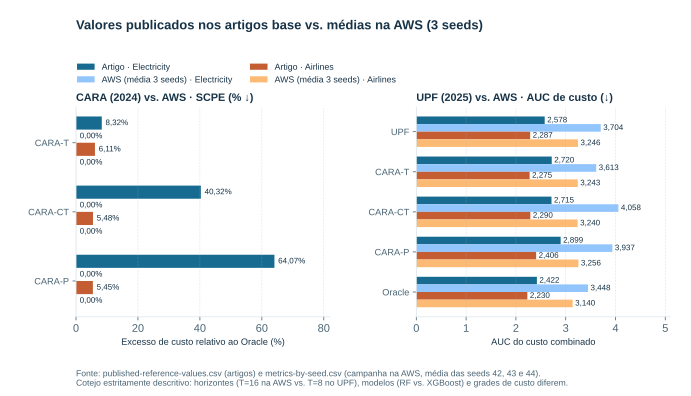
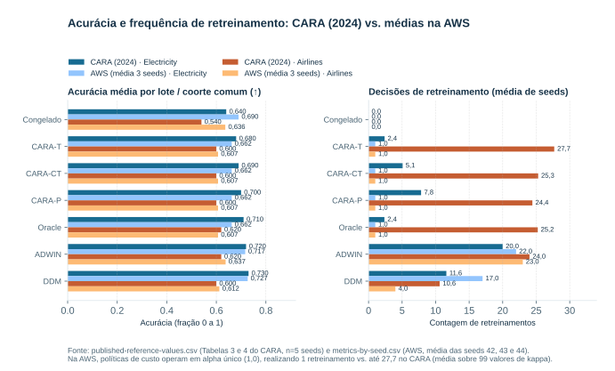

# 05. Comparação Descritiva com os Artigos Base (CARA e UPF)

Este relatório analisa os resultados originais publicados nos dois artigos base da literatura, CARA (2024) e UPF (2025), apresenta o cotejo descritivo usando as **médias das 3 seeds (`42`, `43` e `44`)** obtidas na campanha na AWS para `electricity` e `airlines`, e responde objetivamente **quando e por que os resultados dos artigos podem ou não ser comparados diretamente** com os benchmarks na AWS. Todas as informações provêm exclusivamente dos dois artigos originais (`cost-aware-retraining.pdf` e `regol25a.pdf`), de [protocol-comparability.csv](../../evidencias/aws-benchmarks/papers/protocol-comparability.csv), [published-reference-values.csv](../../evidencias/aws-benchmarks/papers/published-reference-values.csv), [paper-metrics.csv](../../evidencias/aws-benchmarks/papers/paper-metrics.csv), [limitations.json](../../evidencias/aws-benchmarks/papers/limitations.json), [paper-data-provenance.json](../../evidencias/aws-benchmarks/papers/paper-data-provenance.json) e [metrics-by-seed.csv](../../evidencias/aws-benchmarks/metrics-by-seed.csv).

> Para a replicação metodológica fiel de **CARA (2024)** e **UPF (2025)** com `scikit-multiflow==0.5.3` e a extensão completa para as duas variantes do **INSECTS**, consulte [09-Benchmarks-Metodologia-Artigos.md](09-Benchmarks-Metodologia-Artigos.md).

Conforme registrado em [paper-data-provenance.json](../../evidencias/aws-benchmarks/papers/paper-data-provenance.json), a campanha na AWS **não** é comparada numericamente por meio de deltas ou rankings conjuntos com os valores publicados nos artigos. Os `110` valores de referência publicados passaram por auditoria independente (`1.085` verificações em `paper-data-provenance.json`, `all_pass = true`).

## 1. Análise dos Resultados Reais dos Artigos Base

### 1.1 O que o artigo CARA (2024) demonstrou

O artigo *Cost-aware retraining for machine learning* (Mahadevan & Mathioudakis, *Knowledge-Based Systems*, 2024) formula o retreinamento como um problema de equilíbrio entre o **custo de obsolescência** (*staleness cost*, medido por kernel RBF sobre a janela de consultas) e o **custo de retreinamento** parametrizado por `kappa` (`99` valores avaliados, `5` seeds com `Random Forest` de `100` árvores, `100` lotes na Tabela 1 e `25` lotes offline na seção 7.2):

- **Em `Electricity` (`45.312` linhas, `6` atributos)**: os detectores de drift `ADWIN` e `DDM` alcançam a maior acurácia média (`0,72` e `0,73`), mas ao preço de `20,00` e `11,60` retreinamentos, respectivamente, resultando em excesso de custo relativo ao Oracle (`SCPE`) de `285,78%` (`ADWIN`) e `156,55%` (`DDM`). Já o `CARA-T` reduz o número de retreinamentos para `2,39` (próximo aos `2,36` do `Oracle`), mantendo acurácia de `0,68` e atingindo o menor `SCPE` da literatura no cenário (`8,32%`), superando inclusive `Markov` (`11,01%`) e `Congelado` (`17,08%`).
- **Em `Airlines` (`539.383` linhas, `7.198` atributos após one-hot encoding de 5 variáveis nominais + 2 numéricas)**: manter o modelo `Congelado` degrada a acurácia para `0,54` e gera `SCPE` de `141,13%`. As três variantes `CARA-T` (`6,11%`), `CARA-CT` (`5,48%`) e `CARA-P` (`5,45%`) reduzem drasticamente o `SCPE` (superando `ADWIN` com `86,41%` e `DDM` com `99,95%`), executando entre `24,43` e `27,69` retreinamentos (muito próximo aos `25,23` do `Oracle`) e atingindo acurácia média de `0,60`.

### 1.2 O que o artigo UPF (2025) demonstrou

O artigo *When to retrain a machine learning model* (Regol et al., *PMLR* v. 267, 2025) propõe o algoritmo **UPF** (*Uncertainty-aware Performance Forecasting*), que estima a queda de desempenho futura a partir da incerteza do modelo e minimiza o custo combinado $\sum_{t} \text{erro}_t + \alpha \cdot \mathbb{I}(\text{retreino}_t)$ ao longo de um horizonte online de `T = 8` lotes (precedido por `w = 7` lotes offline, `10` repetições com `XGBoost` e `15` lotes de `2.000` linhas em `electricity` e `3.000` linhas em `airplanes`):

- **Em `Electricity` (`alpha` em `[0, 1]`, Tabela 1)**: `UPF` obtém o menor `combined_cost_auc` entre todas as políticas implementáveis (`2,5782`), superando `CARA-CT` (`2,7147`), `CARA-T` (`2,7198`), `CARA-P` (`2,8986`), `ADWIN-5%` (`2,8099`), `FHDDM-5%` (`3,1525`) e `KSWIN-5%` (`3,8979`), ficando a apenas `0,1565` acima do `Oracle de erro` (`2,4217`).
- **Em `Airplanes` (`alpha` em `[0, 0,7]`, Tabela 1)**: `UPF` (`2,2865`) e `CARA-T` (`2,2753`) ficam virtualmente empatados próximos ao `Oracle` (`2,2298`), com ampla vantagem sobre `ADWIN-5%` (`2,6353`), `FHDDM-5%` (`2,6577`) e `KSWIN-5%` (`3,2300`).
- **Sensibilidade ao regime de custo (Tabela 2, `Electricity`)**: quando o retreinamento é barato (`alpha = 0,1`), o `UPF` retreina `2,50 ± 0,67` vezes e atinge acurácia `0,75 ± 0,03` (custo `2,24 ± 0,17`). Quando o retreinamento é caro (`alpha = 0,9`), o `UPF` reduz os retreinamentos para `0,10 ± 0,30` (custo `2,69 ± 0,26`, quase igual ao `Oracle` com `2,68 ± 0,26`), enquanto detectores agnósticos ao custo como `ADWIN-50%` continuam retreinando `1,17 ± 0,38` vezes e acumulam custo `3,32 ± 0,32`.
- **Ressalva de implementação do CARA no artigo UPF (Apêndice A.12, p. 32)**: os autores do UPF aplicaram o algoritmo CARA diretamente sobre o custo absoluto de obsolescência $\Psi(Q_t, D_t, f_{t'})$ em vez da obsolescência relativa $\bar{\Psi}$, o que ajuda a explicar por que `CARA-T` e `CARA-CT` no artigo UPF raramente retreinam mesmo em `alpha = 0,1` (`0,33` retreinamentos).

## 2. Matriz de Comparabilidade entre Protocolos

As dez dimensões de [protocol-comparability.csv](../../evidencias/aws-benchmarks/papers/protocol-comparability.csv) explicam por que os resultados publicados em CARA (2024), em UPF (2025) e nos benchmarks na AWS não são diretamente comensuráveis:

| Dimensão | Artigo CARA (2024) | Artigo UPF (2025) | Campanha na AWS | Implicação na comparabilidade |
|---|---|---|---|---|
| **Origem e população** | Electricity (`45.312`) e Airlines (`539.383` linhas) | Electricity (`2.000`/lote) e `airplanes` (`3.000`/lote) | Quatro streams completos pinados por SHA (`electricity`, `airlines` e duas variantes `INSECTS`) | Streams e recortes de amostragem distintos impedem pareamento direto. |
| **Modelo e configuração** | Random Forest (`100` árvores, `5` seeds) | XGBoost (`eta = 0,3`, `10` repetições, split 80/20 intra-lote) | XGBoost (`100` rodadas, `eta = 0,01`, profundidade `5`, `max_bin = 128`, L2 `0,001`, `3` seeds) | Diferenças de acurácia base refletem também o algoritmo e o ritmo de aprendizado. |
| **Horizonte e partição** | `100` lotes totais (`25` offline na seção 7.2; `100` online na Tabela 1) | `w = 7` lotes offline e `T = 8` lotes online (`15` lotes totais) | `w = 8` blocos de calibração e `T = 16` blocos online (`24` blocos de coorte comum) + holdout final de `10%` | A métrica `upf_paper_auc` soma erros sobre `T` blocos: `T = 16` na AWS dobra a base somada frente a `T = 8` no UPF. |
| **Pré-processamento** | One-hot encoding explícito em Airlines (`7.198` atributos) | Pré-processamento dos autores em `electricity` e `airplanes` | Transformação pinada por stream; `class_weight` / codificação padronizada entre todas as políticas | A dimensionalidade e a codificação das variáveis categóricas alteram a capacidade do modelo. |
| **Objetivo e parâmetro** | `99` preços positivos de `kappa` (kernel RBF + obsolescência relativa) | Grade de `10` valores de `alpha` (`[0, 1]` ou `[0, 0,7]`) | Políticas de custo executadas em regime operacional único (`alpha = 1,0`) | Em `alpha = 1,0`, todas as políticas de custo na AWS convergem para `1` retreinamento (`SCPE = 0,00%`). |
| **Métricas publicadas** | `SCPE`, acurácia média das consultas e decisões de retreinamento | `combined_cost_auc` e Tabela 2 (`retrains`, acurácia e custo) | `accuracy`, `macro_f1`, `pr_auc`, `cost_scpe`, `upf_paper_auc`, calibração e custo operacional | `macro_f1` e `pr_auc` não existem nas tabelas dos artigos; apenas `accuracy`, `retrain_count`, `cost_scpe` e `upf_paper_auc` têm paralelo nominal. |

## 3. Veredito Técnico: Os Resultados Podem Ser Realmente Comparados?

A resposta técnica é **não em valor absoluto**, mas **sim quanto aos padrões qualitativos relativos dentro de cada protocolo**:

1. **Por que `upf_paper_auc` na AWS é sistematicamente maior que no artigo UPF (2025)**: na formulação do UPF, o custo combinado soma a taxa de erro ao longo de todos os `T` blocos online. Enquanto o artigo UPF usa `T = 8` blocos online, a campanha na AWS avalia `T = 16` blocos online após os `8` blocos de calibração. Somar erros em `16` blocos em vez de `8` eleva naturalmente a escala da AUC mesmo para o `Oracle` (`3,4478` em `electricity` e `3,1404` em `airlines` na AWS, contra `2,4217` e `2,2298` no UPF). Além disso, o UPF usa split aleatório 80/20 dentro de lotes de tamanho fixo, enquanto a AWS avalia em ordem temporal estrita sobre o stream completo com `XGBoost` mais regularizado (`eta = 0,01`).
2. **Por que `cost_scpe` na AWS zera (`0,00%`) frente aos `5,45%` a `64,07%` do artigo CARA (2024)**: no artigo CARA, o `SCPE` é a média percentual do excesso de custo sobre uma grade de `99` valores de `kappa` (onde políticas mais agressivas ou conservadoras se distanciam do Oracle conforme o preço muda). Na campanha na AWS, as políticas de custo rodam sob um único `alpha = 1,0`, cenário no qual `cara`, `cara_cumulative`, `cara_periodic`, `upf` e `oracle` executam exatamente `1,00` retreinamento (`sd = 0,0000`) e obtêm o mesmo custo total que o `Oracle`, zerando o `SCPE`.
3. **O que é legitimamente comparável**: o comportamento relativo entre famílias de políticas dentro do mesmo protocolo. Tanto no artigo CARA quanto na campanha na AWS, os detectores estatísticos de drift (`ADWIN` e `DDM`) retreinam em excesso (`20,0` e `11,6` vezes no CARA `Electricity`; `22,0` e `17,0` vezes na AWS `electricity`) e atingem acurácia média elevada (`0,72` a `0,73` no CARA; `0,717` a `0,727` na AWS), mas às custas de um volume muito maior de atualizações. Em `airlines`, a acurácia média na coorte comum da AWS para `cara`/`upf`/`oracle` (`0,6070`) e `ddm` (`0,6121`) situa-se na mesma faixa observada na Tabela 3 do CARA (`0,60` a `0,62`), confirmando consistência de ordem de grandeza do problema, apesar das diferenças de modelo e particionamento.

## 4. Cotejo Descritivo: Artigos Base vs. Médias na AWS (3 Seeds)

As tabelas a seguir comparam os valores publicados nos artigos ([published-reference-values.csv](../../evidencias/aws-benchmarks/papers/published-reference-values.csv)) com as **médias e desvios padrão amostrais das 3 seeds (`42`, `43` e `44`)** da campanha na AWS no escopo de fluxo contínuo (`coorte comum`), calculados a partir de [metrics-by-seed.csv](../../evidencias/aws-benchmarks/metrics-by-seed.csv).

### 4.1 SCPE (`strategy_scpe` vs. `cost_scpe`, %, menor é melhor)

| Dataset | Política (Artigo / AWS) | CARA (2024) Publicado (%) | AWS Média ± DP (`3 seeds`, %) |
|---|---|---:|---:|
| `electricity` | `CARA-T` / `cara` | 8,32 | 0,00 ± 0,00 |
| `electricity` | `CARA-CT` / `cara_cumulative` | 40,32 | 0,00 ± 0,00 |
| `electricity` | `CARA-P` / `cara_periodic` | 64,07 | 0,00 ± 0,00 |
| `airlines` | `CARA-T` / `cara` | 6,11 | 0,00 ± 0,00 |
| `airlines` | `CARA-CT` / `cara_cumulative` | 5,48 | 0,00 ± 0,00 |
| `airlines` | `CARA-P` / `cara_periodic` | 5,45 | 0,00 ± 0,00 |

### 4.2 AUC do Custo Combinado (`combined_cost_auc` vs. `upf_paper_auc`, menor é melhor)

| Dataset | Política (Artigo / AWS) | UPF (2025) Publicado | AWS Média ± DP (`3 seeds`) |
|---|---|---:|---:|
| `electricity` | `UPF` / `upf` | 2,5782 | 3,7038 ± 0,1228 |
| `electricity` | `CARA-T` / `cara` | 2,7198 | 3,6125 ± 0,1057 |
| `electricity` | `CARA-CT` / `cara_cumulative` | 2,7147 | 4,0585 ± 0,1565 |
| `electricity` | `CARA-P` / `cara_periodic` | 2,8986 | 3,9375 ± 0,0933 |
| `electricity` | `Oracle de erro` / `oracle` | 2,4217 | 3,4478 ± 0,0000 |
| `airlines` | `UPF` / `upf` | 2,2865 | 3,2465 ± 0,0132 |
| `airlines` | `CARA-T` / `cara` | 2,2753 | 3,2428 ± 0,0263 |
| `airlines` | `CARA-CT` / `cara_cumulative` | 2,2900 | 3,2397 ± 0,0275 |
| `airlines` | `CARA-P` / `cara_periodic` | 2,4061 | 3,2555 ± 0,0043 |
| `airlines` | `Oracle de erro` / `oracle` | 2,2298 | 3,1404 ± 0,0000 |

**Leitura da figura ([papers-valores-publicados-referencia.svg](figuras/papers/papers-valores-publicados-referencia.svg)):**
- **Painel esquerdo (`CARA (2024) vs. AWS · SCPE %`)**: em `electricity`, o artigo reporta `8,32%` (`CARA-T`), `40,32%` (`CARA-CT`) e `64,07%` (`CARA-P`), enquanto em `airlines` reporta `6,11%`, `5,48%` e `5,45%`. Na AWS (média das 3 seeds), o `cost_scpe` é `0,00%` em todas as variantes porque em `alpha = 1,0` todas convergem para `1,00` retreinamento idêntico ao `Oracle`.
- **Painel direito (`UPF (2025) vs. AWS · AUC de custo`)**: em `electricity`, o artigo UPF marca `2,578` (`UPF`), `2,720` (`CARA-T`), `2,715` (`CARA-CT`), `2,899` (`CARA-P`) e `2,422` (`Oracle`), enquanto as médias de 3 seeds na AWS marcam `3,704`, `3,613`, `4,059`, `3,938` e `3,448`. Em `airlines`, o artigo marca `2,287`, `2,275`, `2,290`, `2,406` e `2,230`, ante `3,247`, `3,243`, `3,240`, `3,256` e `3,140` na AWS. O deslocamento sistemático de `+0,9` a `+1,3` ponto decorre diretamente da soma sobre `T = 16` blocos online na AWS contra `T = 8` no artigo UPF.

### 4.3 Acurácia Média e Decisões de Retreinamento: CARA (2024) vs. Médias na AWS (3 Seeds)

| Dataset | Política (Artigo / AWS) | CARA Acurácia | AWS Acurácia (Média ± DP) | CARA Retreinos | AWS Retreinos (Média ± DP) |
|---|---|---:|---:|---:|---:|
| `electricity` | `Congelado` / `frozen` | 0,64 | 0,6898 ± 0,0000 | 0,00 | 0,00 ± 0,00 |
| `electricity` | `CARA-T` / `cara` | 0,68 | 0,6622 ± 0,0000 | 2,39 | 1,00 ± 0,00 |
| `electricity` | `CARA-CT` / `cara_cumulative` | 0,69 | 0,6622 ± 0,0000 | 5,08 | 1,00 ± 0,00 |
| `electricity` | `CARA-P` / `cara_periodic` | 0,70 | 0,6622 ± 0,0000 | 7,83 | 1,00 ± 0,00 |
| `electricity` | `Oracle` / `oracle` | 0,71 | 0,6622 ± 0,0000 | 2,36 | 1,00 ± 0,00 |
| `electricity` | `ADWIN` / `drift_adwin` | 0,72 | 0,7166 ± 0,0000 | 20,00 | 22,00 ± 0,00 |
| `electricity` | `DDM` / `drift_ddm` | 0,73 | 0,7265 ± 0,0000 | 11,60 | 17,00 ± 0,00 |
| `airlines` | `Congelado` / `frozen` | 0,54 | 0,6362 ± 0,0000 | 0,00 | 0,00 ± 0,00 |
| `airlines` | `CARA-T` / `cara` | 0,60 | 0,6070 ± 0,0000 | 27,69 | 1,00 ± 0,00 |
| `airlines` | `CARA-CT` / `cara_cumulative` | 0,60 | 0,6070 ± 0,0000 | 25,29 | 1,00 ± 0,00 |
| `airlines` | `CARA-P` / `cara_periodic` | 0,60 | 0,6070 ± 0,0000 | 24,43 | 1,00 ± 0,00 |
| `airlines` | `Oracle` / `oracle` | 0,62 | 0,6070 ± 0,0000 | 25,23 | 1,00 ± 0,00 |
| `airlines` | `ADWIN` / `drift_adwin` | 0,62 | 0,6375 ± 0,0000 | 24,00 | 23,00 ± 0,00 |
| `airlines` | `DDM` / `drift_ddm` | 0,60 | 0,6121 ± 0,0000 | 10,60 | 4,00 ± 0,00 |

**Leitura da figura ([papers-acuracia-e-retreinos-referencia.svg](figuras/papers/papers-acuracia-e-retreinos-referencia.svg)):**
- **Painel esquerdo (`Acurácia média`)**: apesar de modelos e partições distintos, `ADWIN` e `DDM` atingem patamares muito próximos entre o artigo CARA (`0,72` e `0,73` em `electricity`; `0,62` e `0,60` em `airlines`) e a média de 3 seeds na AWS (`0,717` e `0,727` em `electricity`; `0,638` e `0,612` em `airlines`). Já `Congelado` na AWS (`0,690` e `0,636`) supera a linha de base congelada do artigo CARA (`0,64` e `0,54`) em razão do modelo `XGBoost` sobre janelas de calibração maiores.
- **Painel direito (`Decisões de retreinamento`)**: evidencia a principal diferença operacional entre os protocolos. Enquanto `ADWIN` retreina em volume semelhante nos dois estudos (`20,0` vs. `22,0` em `electricity`; `24,0` vs. `23,0` em `airlines`), as políticas `CARA` e `Oracle` no artigo CARA retreinam até `27,69` vezes em `airlines` (média sobre `99` preços `kappa` em `100` lotes), ao passo que na AWS (operando em `alpha = 1,0`) todas executam exatamente `1,0` retreinamento.

## 5. Limitações e Ressalvas Metodológicas

De acordo com [limitations.json](../../evidencias/aws-benchmarks/papers/limitations.json) e com a análise dos artigos originais, a interpretação está sujeita às seguintes restrições obrigatórias:

1. **Incompatibilidade de escala numérica direta**: não se devem calcular diferenças nem rankings conjuntos entre os benchmarks na AWS e as tabelas publicadas em CARA (2024) e UPF (2025).
2. **Divergência documental na Tabela 1 do CARA (`cara_table1`)**: a Tabela 1 do artigo CARA informa `100` lotes online, enquanto a seção 7.2 informa `100` lotes totais com `25` offline.
3. **Tipo do `±` na Tabela 2 do UPF (`upf_spread`)**: o texto publicado no PMLR v. 267 não especifica se os desvios da Tabela 2 correspondem a desvio padrão amostral ou erro padrão sobre as `10` repetições.
4. **Cálculo do CARA no artigo UPF (Apêndice A.12)**: o artigo UPF avaliou CARA sobre a obsolescência absoluta $\Psi$ em vez da obsolescência relativa $\bar{\Psi}$, diferindo tanto da formulação original do CARA (2024) quanto da implementação nativa na campanha na AWS.

## 6. Referências Bibliográficas

Conclui-se abaixo o cotejo histórico da campanha AWS F109.

> [!NOTE]
> Para os benchmarks executados **integralmente sob a metodologia fiel dos artigos CARA (2024) e UPF (2025)** (`99` valores de $\kappa$, `T = 8`, `scikit-multiflow 0.5.3`) — incluindo validação em `electricity`/`airlines` e extensão para as duas versões do **INSECTS** — consulte o relatório [09-Benchmarks-Metodologia-Artigos.md](09-Benchmarks-Metodologia-Artigos.md).

1. **Cost-aware retraining for machine learning** (2024). Mahadevan, A.; Mathioudakis, M. *Knowledge-Based Systems*, v. 293, 111610. DOI: [https://doi.org/10.1016/j.knosys.2024.111610](https://doi.org/10.1016/j.knosys.2024.111610). Fonte numérica: Tabelas 1, 2, 3 e 4 (`cost-aware-retraining.pdf`).
2. **When to retrain a machine learning model** (2025). Regol, F.; et al. *Proceedings of Machine Learning Research (PMLR)*, v. 267. URL: [https://proceedings.mlr.press/v267/regol25a.html](https://proceedings.mlr.press/v267/regol25a.html). DOI do preprint: [https://doi.org/10.48550/arXiv.2505.14903](https://doi.org/10.48550/arXiv.2505.14903). Fonte numérica: Tabelas 1, 2 e 4 e Apêndice A.12 (`regol25a.pdf`).

> [!NOTE]
> Para a reprodução experimental direta nos protocolos CARA (2024) e UPF (2025) após o alinhamento completo da arquitetura (`electricity`, `airlines` e as duas versões do `INSECTS`), consulte [09-Benchmarks-Metodologia-Artigos.md](09-Benchmarks-Metodologia-Artigos.md).
