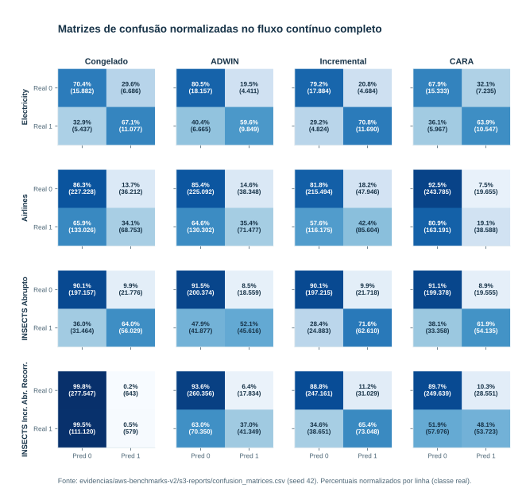
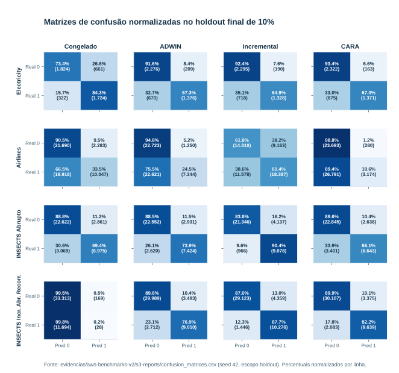
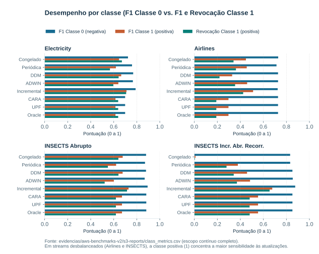
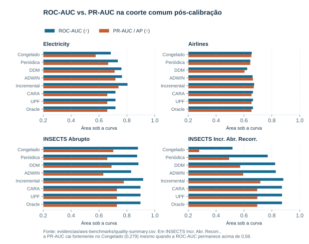

# 06. Matrizes de Confusão, Análise por Classe e Contraste ROC-AUC vs. PR-AUC

Este relatório analisa as matrizes de confusão, as taxas de erro por classe real (`FPR` e `FNR`), o desempenho desagregado entre a classe negativa (`Classe 0`) e a classe positiva (`Classe 1`) e o contraste entre `ROC-AUC` e `PR-AUC` (`Average Precision`) na campanha na AWS (`xgboost`, protocolo `ordered-stream-batch-prequential-metrics-v2`, seeds `42`, `43` e `44`).

Os dados utilizados provêm integralmente dos registros auditados extraídos do Amazon S3 em [confusion_matrices.csv](../../evidencias/aws-benchmarks-v2/s3-reports/confusion_matrices.csv) e [class_metrics.csv](../../evidencias/aws-benchmarks-v2/s3-reports/class_metrics.csv), complementados pelo agregado da coorte comum pós-calibração em [quality-summary.csv](../../evidencias/aws-benchmarks/quality-summary.csv). Em todas as combinações de dataset, política e escopo, os resultados das seeds `42`, `43` e `44` são idênticos em contagens de confusão, taxas de erro e métricas de classificação (desvio-padrão amostral nulo), refletindo repetibilidade determinística sobre a mesma sequência ordenada de dados.

## 1. Escopos de Avaliação e Grupos de Equivalência

A análise distingue três escopos complementares presentes nos artefatos auditados:

| Escopo | Fonte | `electricity` | `airlines` | `insects_abrupt_imbalanced` | `insects_incremental_abrupt_reoccurring_imbalanced` |
|---|---|---:|---:|---:|---:|
| Fluxo contínuo completo (`scope = prequential`) | `confusion_matrices.csv` / `class_metrics.csv` | 39.082 | 465.219 | 306.426 | 389.889 |
| Coorte comum pós-calibração (`common_postcalibration`) | `quality-summary.csv` | 27.182 | 323.630 | 213.165 | 271.225 |
| Holdout final (`scope = holdout`) | `confusion_matrices.csv` / `class_metrics.csv` | 4.531 | 53.938 | 35.527 | 45.204 |

Nos quatro streams, observam-se dois grupos principais de equivalência exata nas matrizes de confusão e métricas por classe:
1. `frozen` e `drift` produzem contagens `TP`, `FP`, `TN`, `FN` e métricas por classe idênticas em ambos os escopos (`prequential` e `holdout`), indicando que o detector padrão `drift` não disparou adaptações efetivas distintas do modelo congelado.
2. `cara`, `cara_cumulative`, `cara_periodic` e `oracle` produzem contagens e métricas idênticas em todos os streams. Nos três primeiros streams (`electricity`, `airlines` e `insects_abrupt_imbalanced`), `upf` também coincide exatamente com esse grupo; em `insects_incremental_abrupt_reoccurring_imbalanced`, `upf` apresenta leve variação em relação a `cara` (`TP = 53.618` contra `53.723` no fluxo contínuo; `TP = 9.517` contra `9.639` no holdout).

## 2. Matrizes de Confusão: Fluxo Contínuo vs. Holdout Final

As taxas de erro por classe real são definidas como:

$$\mathrm{FPR} = \frac{\mathrm{FP}}{\mathrm{TN} + \mathrm{FP}}, \qquad \mathrm{FNR} = \frac{\mathrm{FN}}{\mathrm{TP} + \mathrm{FN}}$$

onde $\mathrm{FPR}$ mede a fração de instâncias reais da `Classe 0` classificadas erroneamente como positivas, e $\mathrm{FNR} = 1 - \mathrm{Recall}_{\text{Classe 1}}$ mede a fração de instâncias reais da `Classe 1` perdidas pelo classificador.

### 2.1 Electricity (`total prequential = 39.082`; `total holdout = 4.531`)

No fluxo contínuo completo de `electricity` (22.568 instâncias reais da Classe 0 e 16.514 da Classe 1; prevalência positiva de 42,25%), e no holdout final (2.485 da Classe 0 e 2.046 da Classe 1; prevalência positiva de 45,16%), as políticas principais apresentam os seguintes resultados:

| Política | Escopo | `TP` | `FP` | `TN` | `FN` | Acurácia | `FPR` | `FNR` |
|---|---|---:|---:|---:|---:|---:|---:|---:|
| `frozen` / `drift` | `prequential` | 11.077 | 6.686 | 15.882 | 5.437 | 0,6898 | 0,2963 | 0,3292 |
| `drift_adwin` | `prequential` | 9.849 | 4.411 | 18.157 | 6.665 | 0,7166 | 0,1955 | 0,4036 |
| `drift_ddm` | `prequential` | 10.610 | 4.784 | 17.784 | 5.904 | 0,7265 | 0,2120 | 0,3575 |
| `incremental` | `prequential` | 11.690 | 4.684 | 17.884 | 4.824 | 0,7567 | 0,2076 | 0,2921 |
| `cara` / `oracle` / `upf` | `prequential` | 10.547 | 7.235 | 15.333 | 5.967 | 0,6622 | 0,3206 | 0,3613 |
| `periodic` | `prequential` | 9.367 | 4.397 | 18.171 | 7.147 | 0,7046 | 0,1948 | 0,4328 |
| `frozen` / `drift` | `holdout` | 1.724 | 661 | 1.824 | 322 | 0,7831 | 0,2660 | 0,1574 |
| `drift_adwin` | `holdout` | 1.376 | 209 | 2.276 | 670 | 0,8060 | 0,0841 | 0,3275 |
| `drift_ddm` | `holdout` | 1.230 | 134 | 2.351 | 816 | 0,7903 | 0,0539 | 0,3988 |
| `incremental` | `holdout` | 1.328 | 190 | 2.295 | 718 | 0,7996 | 0,0765 | 0,3509 |
| `cara` / `oracle` / `upf` | `holdout` | 1.371 | 163 | 2.322 | 675 | 0,8151 | 0,0656 | 0,3299 |
| `periodic` | `holdout` | 2.046 | 2.162 | 323 | 0 | 0,5228 | 0,8700 | 0,0000 |

Em `electricity`, `incremental` obtém o melhor equilíbrio no fluxo contínuo (`FPR = 0,2076`, `FNR = 0,2921`, acurácia `0,7567`). Na transição para o holdout, as políticas adaptativas (`cara`, `drift_adwin`, `incremental`, `drift_ddm`) reduzem drasticamente os falsos positivos (`FPR` entre `0,0539` e `0,0841`), embora elevem a `FNR` para `0,3275` a `0,3988`. Em contraste extremo, `periodic` no holdout classifica quase todas as instâncias como positivas (`TP = 2.046`, `FP = 2.162`), zerando os falsos negativos (`FNR = 0,0000`) ao custo de `FPR = 0,8700` e acurácia de `0,5228`.

### 2.2 Airlines (`total prequential = 465.219`; `total holdout = 53.938`)

Em `airlines`, o fluxo contínuo soma 263.440 instâncias da Classe 0 e 201.779 da Classe 1 (prevalência positiva de 43,37%). No holdout final, a distribuição se inverte para 23.973 da Classe 0 e 29.965 da Classe 1 (prevalência positiva de 55,55%):

| Política | Escopo | `TP` | `FP` | `TN` | `FN` | Acurácia | `FPR` | `FNR` |
|---|---|---:|---:|---:|---:|---:|---:|---:|
| `frozen` / `drift` | `prequential` | 68.753 | 36.212 | 227.228 | 133.026 | 0,6362 | 0,1375 | 0,6593 |
| `drift_adwin` | `prequential` | 71.477 | 38.348 | 225.092 | 130.302 | 0,6375 | 0,1456 | 0,6458 |
| `drift_ddm` | `prequential` | 44.151 | 22.810 | 240.630 | 157.628 | 0,6121 | 0,0866 | 0,7812 |
| `incremental` | `prequential` | 85.604 | 47.946 | 215.494 | 116.175 | 0,6472 | 0,1820 | 0,5758 |
| `cara` / `oracle` / `upf` | `prequential` | 38.588 | 19.655 | 243.785 | 163.191 | 0,6070 | 0,0746 | 0,8088 |
| `periodic` | `prequential` | 72.960 | 45.663 | 217.777 | 128.819 | 0,6249 | 0,1733 | 0,6384 |
| `frozen` / `drift` | `holdout` | 10.047 | 2.283 | 21.690 | 19.918 | 0,5884 | 0,0952 | 0,6647 |
| `drift_adwin` | `holdout` | 7.344 | 1.250 | 22.723 | 22.621 | 0,5574 | 0,0521 | 0,7549 |
| `drift_ddm` | `holdout` | 12.271 | 3.731 | 20.242 | 17.694 | 0,6028 | 0,1556 | 0,5905 |
| `incremental` | `holdout` | 18.387 | 9.163 | 14.810 | 11.578 | 0,6155 | 0,3822 | 0,3864 |
| `cara` / `oracle` / `upf` | `holdout` | 3.174 | 280 | 23.693 | 26.791 | 0,4981 | 0,0117 | 0,8941 |
| `periodic` | `holdout` | 14.291 | 5.070 | 18.903 | 15.674 | 0,6154 | 0,2115 | 0,5231 |

Todas as políticas exibem viés conservador em `airlines`, concentrando predições na Classe 0 e produzindo `FNR` elevada. Esse comportamento é particularmente severo em `cara`: no fluxo contínuo, `cara` mantém `FPR = 0,0746`, mas deixa escapar 163.191 positivos (`FNR = 0,8088`); no holdout, onde a Classe 1 se torna majoritária (55,55%), `cara` reduz `FPR` para `0,0117` (apenas 280 falsos positivos), mas perde 26.791 de 29.965 atrasos (`FNR = 0,8941`), levando a acurácia a `0,4981`. Por outro lado, `incremental` é a única política a reduzir `FNR` abaixo de 0,40 no holdout (`0,3864`), ainda que com aumento de `FPR` para `0,3822`. Na coorte comum (`quality-summary.csv`, `n = 323.630`, prevalência positiva de `0,4800`), o padrão se repete: `cara` registra taxa de positivos preditos de apenas `0,0837` (`FPR = 0,0299`, `FNR = 0,8580`), contra `0,3509` em `incremental` (`FPR = 0,2356`, `FNR = 0,5242`) e `0,3017` em `drift_adwin` (`FPR = 0,1982`, `FNR = 0,5862`).

### 2.3 INSECTS Abrupt Imbalanced (`total prequential = 306.426`; `total holdout = 35.527`)

Em `insects_abrupt_imbalanced`, a classe positiva representa 28,55% do fluxo contínuo (87.493 positivos contra 218.933 negativos) e 28,27% do holdout (10.044 positivos contra 25.483 negativos):

| Política | Escopo | `TP` | `FP` | `TN` | `FN` | Acurácia | `FPR` | `FNR` |
|---|---|---:|---:|---:|---:|---:|---:|---:|
| `frozen` / `drift` | `prequential` | 56.029 | 21.776 | 197.157 | 31.464 | 0,8263 | 0,0995 | 0,3596 |
| `drift_adwin` | `prequential` | 45.616 | 18.559 | 200.374 | 41.877 | 0,8028 | 0,0848 | 0,4786 |
| `drift_ddm` | `prequential` | 56.107 | 22.087 | 196.846 | 31.386 | 0,8255 | 0,1009 | 0,3587 |
| `incremental` | `prequential` | 62.610 | 21.718 | 197.215 | 24.883 | 0,8479 | 0,0992 | 0,2844 |
| `cara` / `oracle` / `upf` | `prequential` | 54.135 | 19.555 | 199.378 | 33.358 | 0,8273 | 0,0893 | 0,3813 |
| `periodic` | `prequential` | 48.042 | 19.294 | 199.639 | 39.451 | 0,8083 | 0,0881 | 0,4509 |
| `frozen` / `drift` | `holdout` | 6.975 | 2.861 | 22.622 | 3.069 | 0,8331 | 0,1123 | 0,3056 |
| `drift_adwin` | `holdout` | 7.424 | 2.931 | 22.552 | 2.620 | 0,8438 | 0,1150 | 0,2609 |
| `drift_ddm` | `holdout` | 6.819 | 2.694 | 22.789 | 3.225 | 0,8334 | 0,1057 | 0,3211 |
| `incremental` | `holdout` | 9.078 | 4.137 | 21.346 | 966 | 0,8564 | 0,1623 | 0,0962 |
| `cara` / `oracle` / `upf` | `holdout` | 6.643 | 2.638 | 22.845 | 3.401 | 0,8300 | 0,1035 | 0,3386 |
| `periodic` | `holdout` | 6.819 | 2.694 | 22.789 | 3.225 | 0,8334 | 0,1057 | 0,3211 |

Neste stream, `incremental` registra a menor taxa de falsos negativos tanto no fluxo contínuo (`FNR = 0,2844` com `FPR = 0,0992`) quanto no holdout final (`FNR = 0,0962`, perdendo apenas 966 de 10.044 positivos, com `FPR = 0,1623`). Já `drift_adwin` sofre degradação durante o fluxo contínuo (`FNR = 0,4786`), mas recupera no holdout (`FNR = 0,2609`), superando `frozen` (`0,3056`) e `cara` (`0,3386`) no bloco final.

### 2.4 INSECTS Incremental Abrupt Reoccurring Imbalanced (`total prequential = 389.889`; `total holdout = 45.204`)

Neste stream, a classe positiva responde por 28,65% no fluxo contínuo (111.699 positivos e 278.190 negativos) e 25,93% no holdout (11.722 positivos e 33.482 negativos):

| Política | Escopo | `TP` | `FP` | `TN` | `FN` | Acurácia | `FPR` | `FNR` |
|---|---|---:|---:|---:|---:|---:|---:|---:|
| `frozen` / `drift` | `prequential` | 579 | 643 | 277.547 | 111.120 | 0,7133 | 0,0023 | 0,9948 |
| `drift_adwin` | `prequential` | 41.349 | 17.834 | 260.356 | 70.350 | 0,7738 | 0,0641 | 0,6298 |
| `drift_ddm` | `prequential` | 38.244 | 17.038 | 261.152 | 73.455 | 0,7679 | 0,0612 | 0,6576 |
| `incremental` | `prequential` | 73.048 | 31.029 | 247.161 | 38.651 | 0,8213 | 0,1115 | 0,3460 |
| `cara` / `oracle` | `prequential` | 53.723 | 28.551 | 249.639 | 57.976 | 0,7781 | 0,1026 | 0,5190 |
| `upf` | `prequential` | 53.618 | 28.341 | 249.849 | 58.081 | 0,7783 | 0,1019 | 0,5200 |
| `periodic` | `prequential` | 31.265 | 22.393 | 255.797 | 80.434 | 0,7363 | 0,0805 | 0,7201 |
| `frozen` / `drift` | `holdout` | 28 | 169 | 33.313 | 11.694 | 0,7376 | 0,0050 | 0,9976 |
| `drift_adwin` | `holdout` | 9.010 | 3.493 | 29.989 | 2.712 | 0,8627 | 0,1043 | 0,2314 |
| `drift_ddm` | `holdout` | 7.226 | 3.025 | 30.457 | 4.496 | 0,8336 | 0,0903 | 0,3836 |
| `incremental` | `holdout` | 10.276 | 4.359 | 29.123 | 1.446 | 0,8716 | 0,1302 | 0,1234 |
| `cara` / `oracle` | `holdout` | 9.639 | 3.375 | 30.107 | 2.083 | 0,8793 | 0,1008 | 0,1777 |
| `upf` | `holdout` | 9.517 | 3.314 | 30.168 | 2.205 | 0,8779 | 0,0990 | 0,1881 |
| `periodic` | `holdout` | 0 | 0 | 33.482 | 11.722 | 0,7407 | 0,0000 | 1,0000 |

Este cenário evidencia de forma nítida o colapso de políticas sem adaptação efetiva sob drift combinado e desbalanceamento:
- **`frozen` / `drift`**: prevê a classe majoritária em praticamente todo o fluxo (`FPR = 0,0023` no fluxo contínuo e `0,0050` no holdout), mas falha em 99,48% dos positivos no fluxo contínuo (`FN = 111.120`, `TP = 579`) e em 99,76% no holdout (`FN = 11.694`, `TP = 28`). Mesmo assim, a acurácia global permanece acima de 71% (`0,7133` e `0,7376`), mascarando o colapso completo na classe minoritária.
- **`periodic` no holdout**: perde sincronia com os regimes recorrentes e passa a prever exclusivamente a Classe 0 (`TP = 0`, `FP = 0`), atingindo `FPR = 0,0000` e `FNR = 1,0000` com acurácia aparente de `0,7407`.
- **`incremental` e `cara`**: `incremental` sustenta a menor `FNR` ao longo do fluxo (`0,3460`) e no holdout (`0,1234`). `cara` apresenta `FNR = 0,5190` no fluxo contínuo completo, mas no holdout final atinge a maior acurácia (`0,8793`) com `FNR = 0,1777` e `FPR = 0,1008`.

## 3. Desempenho Desagregado por Classe (`Classe 0` vs. `Classe 1`)

O desbalanceamento de classes e as mudanças de conceito afetam de forma assimétrica a `Classe 0` e a `Classe 1` (positiva). Em [class_metrics.csv](../../evidencias/aws-benchmarks-v2/s3-reports/class_metrics.csv), o `ece` é reportado como métrica global de calibração (idêntica nas duas linhas de cada par `(dataset, policy, seed, scope)`), e a `roc_auc` é simétrica entre as duas classes (até precisão numérica de `1e-7`). Já precisão, revocação, F1 e `pr_auc` separam claramente o comportamento em cada classe.

### 3.1 Impacto do Desbalanceamento e da Mudança de Priors em `Airlines`

Embora `airlines` seja próximo do equilíbrio no agregado contínuo (56,63% Classe 0 vs. 43,37% Classe 1) e inverta o balanço no holdout (44,45% Classe 0 vs. 55,55% Classe 1), a assimetria de desempenho entre as classes é expressiva:

| Política | Escopo | Classe | Precisão | Revocação | F1 | `pr_auc` | `roc_auc` | `ece` |
|---|---|---:|---:|---:|---:|---:|---:|---:|
| `frozen` | `prequential` | 0 | 0,6307 | 0,8625 | 0,7287 | 0,6898 | 0,6524 | 0,0364 |
| `frozen` | `prequential` | 1 | 0,6550 | 0,3407 | 0,4483 | 0,6022 | 0,6524 | 0,0364 |
| `drift_adwin` | `prequential` | 0 | 0,6334 | 0,8544 | 0,7275 | 0,7043 | 0,6714 | 0,0149 |
| `drift_adwin` | `prequential` | 1 | 0,6508 | 0,3542 | 0,4588 | 0,6289 | 0,6714 | 0,0149 |
| `incremental` | `prequential` | 0 | 0,6497 | 0,8180 | 0,7242 | 0,7045 | 0,6772 | 0,0384 |
| `incremental` | `prequential` | 1 | 0,6410 | 0,4242 | 0,5106 | 0,6343 | 0,6772 | 0,0384 |
| `cara` | `prequential` | 0 | 0,5990 | 0,9254 | 0,7273 | 0,6545 | 0,6003 | 0,0701 |
| `cara` | `prequential` | 1 | 0,6625 | 0,1912 | 0,2968 | 0,5359 | 0,6003 | 0,0701 |
| `frozen` | `holdout` | 0 | 0,5213 | 0,9048 | 0,6615 | 0,5936 | 0,6697 | 0,1039 |
| `frozen` | `holdout` | 1 | 0,8148 | 0,3353 | 0,4751 | 0,7325 | 0,6697 | 0,1039 |
| `drift_adwin` | `holdout` | 0 | 0,5011 | 0,9479 | 0,6556 | 0,5979 | 0,6737 | 0,0935 |
| `drift_adwin` | `holdout` | 1 | 0,8545 | 0,2451 | 0,3809 | 0,7339 | 0,6737 | 0,0935 |
| `incremental` | `holdout` | 0 | 0,5612 | 0,6178 | 0,5882 | 0,5931 | 0,6735 | 0,0560 |
| `incremental` | `holdout` | 1 | 0,6674 | 0,6136 | 0,6394 | 0,7347 | 0,6735 | 0,0560 |
| `cara` | `holdout` | 0 | 0,4693 | 0,9883 | 0,6364 | 0,5953 | 0,6718 | 0,2244 |
| `cara` | `holdout` | 1 | 0,9189 | 0,1059 | 0,1900 | 0,7343 | 0,6718 | 0,2244 |

Em `airlines`, `cara` exemplifica o efeito de um modelo pouco atualizado frente à mudança de prevalência: no holdout, atinge precisão de `0,9189` na Classe 1, mas com revocação de apenas `0,1059` (`F1 = 0,1900`), enquanto na Classe 0 exibe revocação de `0,9883` com precisão abaixo do acaso (`0,4693`) e erro de calibração elevado (`ece = 0,2244`). Já `incremental` é a política com menor desbalanceamento entre classes no holdout (`F1` de `0,5882` na Classe 0 e `0,6394` na Classe 1) e menor `ece` no holdout (`0,0560`). No fluxo contínuo, `drift_adwin` apresenta a melhor calibração (`ece = 0,0149`), superando `incremental` (`0,0384`) e `frozen` (`0,0364`).

### 3.2 Impacto do Desbalanceamento em `INSECTS`

Nos dois streams `INSECTS`, a razão de classes próxima de 2,5:1 a 2,85:1 a favor da Classe 0 amplifica a distância entre as métricas das duas classes sempre que há drift sem adaptação adequada:

#### `insects_abrupt_imbalanced`

| Política | Escopo | Classe | Precisão | Revocação | F1 | `pr_auc` | `roc_auc` | `ece` |
|---|---|---:|---:|---:|---:|---:|---:|---:|
| `frozen` | `prequential` | 0 | 0,8624 | 0,9005 | 0,8810 | 0,9438 | 0,8806 | 0,0761 |
| `frozen` | `prequential` | 1 | 0,7201 | 0,6404 | 0,6779 | 0,7273 | 0,8806 | 0,0761 |
| `drift_adwin` | `prequential` | 0 | 0,8271 | 0,9152 | 0,8690 | 0,9159 | 0,8406 | 0,0509 |
| `drift_adwin` | `prequential` | 1 | 0,7108 | 0,5214 | 0,6015 | 0,6654 | 0,8406 | 0,0509 |
| `incremental` | `prequential` | 0 | 0,8880 | 0,9008 | 0,8943 | 0,9605 | 0,9058 | 0,0152 |
| `incremental` | `prequential` | 1 | 0,7425 | 0,7156 | 0,7288 | 0,7731 | 0,9058 | 0,0152 |
| `cara` | `prequential` | 0 | 0,8567 | 0,9107 | 0,8829 | 0,9442 | 0,8864 | 0,0963 |
| `cara` | `prequential` | 1 | 0,7346 | 0,6187 | 0,6717 | 0,7419 | 0,8864 | 0,0963 |
| `incremental` | `holdout` | 0 | 0,9567 | 0,8377 | 0,8932 | 0,9763 | 0,9351 | 0,0656 |
| `incremental` | `holdout` | 1 | 0,6869 | 0,9038 | 0,7806 | 0,8161 | 0,9351 | 0,0656 |
| `drift_adwin` | `holdout` | 0 | 0,8959 | 0,8850 | 0,8904 | 0,9704 | 0,9185 | 0,0904 |
| `drift_adwin` | `holdout` | 1 | 0,7169 | 0,7391 | 0,7279 | 0,7511 | 0,9185 | 0,0904 |
| `cara` | `holdout` | 0 | 0,8704 | 0,8965 | 0,8833 | 0,9655 | 0,9076 | 0,1041 |
| `cara` | `holdout` | 1 | 0,7158 | 0,6614 | 0,6875 | 0,7557 | 0,9076 | 0,1041 |

Em `insects_abrupt_imbalanced`, `incremental` lidera a Classe 1 em ambos os escopos (`F1 = 0,7288` e `pr_auc = 0,7731` no fluxo contínuo; `F1 = 0,7806` e `pr_auc = 0,8161` no holdout) e apresenta o menor erro de calibração (`ece = 0,0152` no fluxo contínuo e `0,0656` no holdout). Enquanto a Classe 0 mantém `F1` acima de `0,86` em todas as políticas, a Classe 1 oscila de `0,6015` (`drift_adwin` no fluxo contínuo) a `0,7806` (`incremental` holdout).

#### `insects_incremental_abrupt_reoccurring_imbalanced`

| Política | Escopo | Classe | Precisão | Revocação | F1 | `pr_auc` | `roc_auc` | `ece` |
|---|---|---:|---:|---:|---:|---:|---:|---:|
| `frozen` | `prequential` | 0 | 0,7141 | 0,9977 | 0,8324 | 0,7345 | 0,5133 | 0,1575 |
| `frozen` | `prequential` | 1 | 0,4738 | 0,0052 | 0,0103 | 0,2870 | 0,5133 | 0,1575 |
| `drift_adwin` | `prequential` | 0 | 0,7873 | 0,9359 | 0,8552 | 0,9309 | 0,8478 | 0,0777 |
| `drift_adwin` | `prequential` | 1 | 0,6987 | 0,3702 | 0,4839 | 0,6424 | 0,8478 | 0,0777 |
| `incremental` | `prequential` | 0 | 0,8648 | 0,8885 | 0,8765 | 0,9534 | 0,8887 | 0,0220 |
| `incremental` | `prequential` | 1 | 0,7019 | 0,6540 | 0,6771 | 0,7359 | 0,8887 | 0,0220 |
| `cara` | `prequential` | 0 | 0,8115 | 0,8974 | 0,8523 | 0,7987 | 0,7119 | 0,0866 |
| `cara` | `prequential` | 1 | 0,6530 | 0,4810 | 0,5539 | 0,5826 | 0,7119 | 0,0866 |
| `frozen` | `holdout` | 0 | 0,7402 | 0,9950 | 0,8489 | 0,6383 | 0,2799 | 0,2596 |
| `frozen` | `holdout` | 1 | 0,1421 | 0,0024 | 0,0047 | 0,1769 | 0,2799 | 0,2596 |
| `drift_adwin` | `holdout` | 0 | 0,9171 | 0,8957 | 0,9062 | 0,9723 | 0,9218 | 0,1236 |
| `drift_adwin` | `holdout` | 1 | 0,7206 | 0,7686 | 0,7439 | 0,7674 | 0,9218 | 0,1236 |
| `incremental` | `holdout` | 0 | 0,9527 | 0,8698 | 0,9094 | 0,9799 | 0,9403 | 0,0541 |
| `incremental` | `holdout` | 1 | 0,7022 | 0,8766 | 0,7798 | 0,8140 | 0,9403 | 0,0541 |
| `cara` | `holdout` | 0 | 0,9353 | 0,8992 | 0,9169 | 0,9792 | 0,9390 | 0,1324 |
| `cara` | `holdout` | 1 | 0,7407 | 0,8223 | 0,7793 | 0,8093 | 0,9390 | 0,1324 |

Em `insects_incremental_abrupt_reoccurring_imbalanced`, a discrepância entre classes atinge seu máximo em `frozen`: a Classe 0 exibe `F1 = 0,8324` no fluxo contínuo e `0,8489` no holdout, enquanto a Classe 1 cai para `F1 = 0,0103` no fluxo contínuo e `0,0047` no holdout, acompanhada de forte descalibração (`ece = 0,1575` e `0,2596`). Entre as políticas adaptativas, `incremental` preserva a melhor calibração em ambos os escopos (`ece = 0,0220` no fluxo contínuo e `0,0541` no holdout), enquanto `cara` iguala praticamente o `F1` da Classe 1 de `incremental` no holdout (`0,7793` contra `0,7798`), porém com `ece` mais que duas vezes maior (`0,1324`).

### 3.3 Referência em `Electricity`

Em `electricity`, por ter menor desbalanceamento relativo (57,75% Classe 0 vs. 42,25% Classe 1 no fluxo contínuo), a distância entre classes é mais contida no fluxo completo: `incremental` alcança `F1` de `0,7900` na Classe 0 e `0,7109` na Classe 1 (`pr_auc` de `0,8347` e `0,7547`), enquanto `drift_ddm` (`ece = 0,0271`) e `drift_adwin` (`ece = 0,0338`) obtêm as menores distorções de calibração no fluxo contínuo. No holdout, `periodic` ilustra o colapso inverso ao de `INSECTS`: prevê excessivamente a Classe 1 (`recall = 1,0000`, `precision = 0,4862`, `F1 = 0,6543`) e derruba a Classe 0 (`recall = 0,1300`, `F1 = 0,2301`, `ece = 0,2341`).

## 4. Contraste entre `ROC-AUC` e `PR-AUC` (`Average Precision`)

A curva ROC relaciona a taxa de verdadeiros positivos ($\mathrm{TPR} = \mathrm{TP} / (\mathrm{TP} + \mathrm{FN})$) contra a taxa de falsos positivos ($\mathrm{FPR} = \mathrm{FP} / (\mathrm{TN} + \mathrm{FP})$). Como $\mathrm{FPR}$ tem no denominador todos os negativos reais ($\mathrm{TN} + \mathrm{FP}$), em datasets desbalanceados um aumento substancial de falsos positivos produz deslocamento pequeno no eixo horizontal da ROC, tornando a `ROC-AUC` pouco sensível à perda de pureza nas predições positivas e idêntica para as duas classes.

Em contraste, a curva Precisão-Revocação (`PR-AUC` ou `AP`) relaciona $\mathrm{Precisão} = \mathrm{TP} / (\mathrm{TP} + \mathrm{FP})$ com $\mathrm{TPR}$, ambos dependentes diretos da classe alvo e ancorados pela prevalência positiva $\pi = P / (P + N)$ como linha de base aleatória:

1. **Detecção imediata de degradação na classe minoritária sob drift (`insects_incremental_abrupt_reoccurring_imbalanced` com `frozen`)**:
   - No fluxo contínuo (`class_metrics.csv`), `frozen` registra `roc_auc = 0,5133` (aparentemente apenas marginalmente acima de 0,50, o que não distingue entre um modelo aleatório equilibrado e um modelo colapsado na classe minoritária). Já a `pr_auc` separa os dois regimes: `0,7345` para a Classe 0 (próximo da prevalência da Classe 0, de `0,7135`) contra `0,2870` para a Classe 1 (praticamente colado à prevalência da Classe 1, de `0,2865`).
   - Na coorte comum (`quality-summary.csv`, `positive_rate = 0,2765`), o mesmo padrão ocorre: `roc_auc = 0,5176` contra `pr_auc = 0,2786` na classe positiva, confirmando ausência de poder discriminativo útil sobre o baseline aleatório.
   - No holdout (`positive_rate = 0,2593`), ocorre inversão de ranqueamento (`roc_auc = 0,2799`), e a `pr_auc` da Classe 1 despenca para `0,1769`, abaixo da própria prevalência positiva.
2. **Separação de políticas sob desbalanceamento moderado (`insects_abrupt_imbalanced`)**:
   - No fluxo contínuo, `drift_adwin` exibe `roc_auc = 0,8406` (aparentemente alto em escala absoluta), mas sua `pr_auc` na Classe 1 cai para `0,6654`, bem abaixo de `incremental` (`roc_auc = 0,9058`, `pr_auc = 0,7731`). A diferença de `6,52` pontos percentuais em `ROC-AUC` corresponde a `10,77` pontos percentuais em `PR-AUC` da Classe 1 (e `14,72` pontos percentuais na coorte comum: `0,6309` contra `0,7781`), refletindo mais fielmente a queda de `recall` de `0,7156` para `0,5214`.
3. **Caso limite de limiar e ordenação (`periodic` no holdout de `insects_incremental_abrupt_reoccurring_imbalanced`)**:
   - No holdout, `periodic` obtém `roc_auc = 0,8541`, sugerindo que o ranqueamento relativo dos scores probabilísticos ainda preserva separação entre classes, mas a `pr_auc` da Classe 1 cai para `0,6166` (contra `0,8140` em `incremental` e `0,8093` em `cara`), enquanto no ponto de operação `0,5` o modelo colapsa (`TP = 0`, `FP = 0`, `recall = 0,0000` e precisão indefinida por ausência de predições positivas).
4. **Sinalização de mudança de prevalência em `Airlines`**:
   - No fluxo contínuo de `airlines` (`cara`), `roc_auc = 0,6003` parece moderadamente acima de 0,50, enquanto `pr_auc` da Classe 1 é `0,5359` (apenas 10,22 pontos percentuais acima da prevalência do fluxo contínuo de `0,4337`). No holdout, como a prevalência positiva sobe para `0,5555`, a `pr_auc` da Classe 1 de `cara` sobe numericamente para `0,7343` (acima de `roc_auc = 0,6718`) apenas porque o baseline aleatório da curva PR subiu com $\pi$, enquanto a `pr_auc` da Classe 0 cai de `0,6545` para `0,5953`. Isso reforça que `PR-AUC` deve sempre ser interpretada em conjunto com a prevalência $\pi$ do escopo avaliado e com métricas de limiar (`F1`, `FPR`, `FNR`) e calibração (`ece`).

## 5. Síntese dos Achados

1. **`incremental` oferece a melhor combinação entre controle de `FNR`, equilíbrio entre classes e calibração (`ece`)**: nos dois cenários `INSECTS`, reduz `FNR` no holdout para `0,0962` (`insects_abrupt_imbalanced`) e `0,1234` (`insects_incremental_abrupt_reoccurring_imbalanced`), mantendo os menores valores de `ece` no fluxo contínuo (`0,0152` e `0,0220`).
2. **Políticas estáticas ou pouco adaptativas falham na classe minoritária sob drift**: `frozen` e `drift` atingem `FNR > 0,994` em `insects_incremental_abrupt_reoccurring_imbalanced`, enquanto `cara` apresenta `FNR` de `0,8088` (fluxo contínuo) e `0,8941` (holdout) em `airlines`, apesar de manter `FPR` muito baixa.
3. **`PR-AUC` é indispensável em fluxos desbalanceados**: a `ROC-AUC` suaviza a penalidade por falsos positivos quando a Classe 0 domina, ao passo que a `PR-AUC` da Classe 1 expõe diretamente a perda de precisão e revocação na classe minoritária quando confrontada com a prevalência positiva $\pi$ do escopo.
