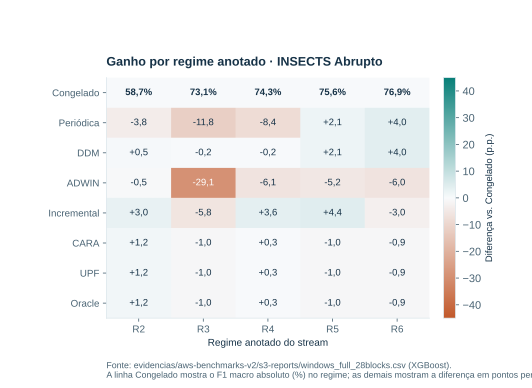
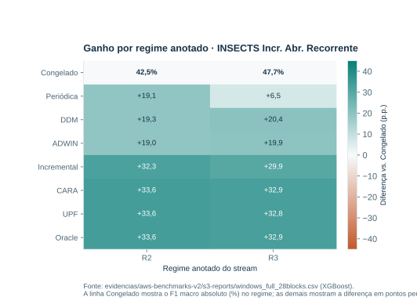
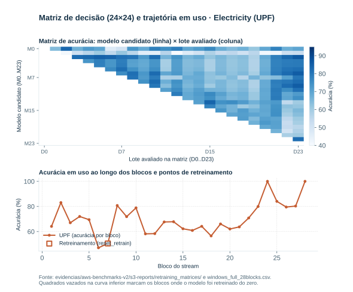
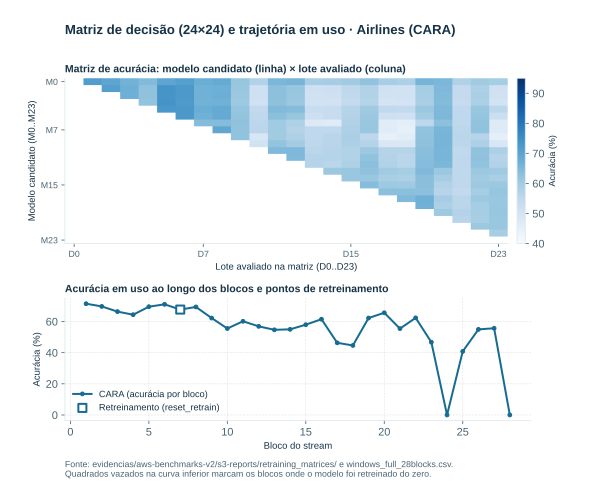

# 07. Análise por Regimes e Matrizes de Decisão

Este relatório apresenta a análise diagnóstica por regimes estacionários nos fluxos `INSECTS` (`Abrupto` e `Incremental-Abrupto-Recorrente`) e o exame das matrizes de decisão (`24 × 24`) acopladas às trajetórias de acurácia em uso nos fluxos `Electricity` e `Airlines`. Todos os resultados provêm exclusivamente da campanha AWS com `XGBoost` em fluxo contínuo de 28 blocos, consolidada em [`windows_full_28blocks.csv`](../../evidencias/aws-benchmarks-v2/s3-reports/windows_full_28blocks.csv), nas matrizes de acurácia em [`retraining_matrices/`](../../evidencias/aws-benchmarks-v2/s3-reports/retraining_matrices/), nos registros de versionamento de modelos em `evidencias/aws-benchmarks-v2/athena/` e nas definições de fronteiras de conceito de [`real_streams.py`](../../src/continual_bench/datasets/real_streams.py).

As quatro figuras incorporadas neste documento são:

- [`figuras/regimes-e-matrizes/aws-regimes-insects-abrupto.svg`](figuras/regimes-e-matrizes/aws-regimes-insects-abrupto.svg)
- [`figuras/regimes-e-matrizes/aws-regimes-insects-recorrente.svg`](figuras/regimes-e-matrizes/aws-regimes-insects-recorrente.svg)
- [`figuras/regimes-e-matrizes/aws-matriz-trajetoria-electricity.svg`](figuras/regimes-e-matrizes/aws-matriz-trajetoria-electricity.svg)
- [`figuras/regimes-e-matrizes/aws-matriz-trajetoria-airlines.svg`](figuras/regimes-e-matrizes/aws-matriz-trajetoria-airlines.svg)

---

## 1. Mapas de Calor por Regime nos Fluxos `INSECTS`

### 1.1 Protocolo de Segmentação e Leitura

De acordo com [`real_streams.py`](../../src/continual_bench/datasets/real_streams.py), ambos os fluxos `INSECTS` possuem 33 atributos numéricos e foram convertidos para classificação binária do tipo um-contra-todos, adotando a classe original `2` como positiva (`1`) e agrupando as demais cinco classes (`3`, `4`, `5`, `11` e `12`) na classe negativa (`0`).

As fronteiras de mudança de conceito anotadas na literatura de origem definem intervalos semiabertos `[início, fim)` em índice base 0:

- **`insects_abrupt_imbalanced` (`355.275` registros):** cinco pontos de mudança abrupta em `(83.859, 128.651, 182.320, 242.883, 268.380)`, delimitando seis regimes (`R1` a `R6`).
- **`insects_incremental_abrupt_reoccurring_imbalanced` (`452.044` registros):** dois pontos de mudança abrupta em `(150.683, 301.365)`, delimitando três regimes (`R1` a `R3`), além de evolução incremental contínua dentro de cada regime.

Na avaliação contínua em [`windows_full_28blocks.csv`](../../evidencias/aws-benchmarks-v2/s3-reports/windows_full_28blocks.csv) (seed `42`, após a janela inicial de aquecimento), cada bloco é atribuído ao regime vigente no seu índice de encerramento (`end_seq`), e o F1 macro do regime corresponde à média aritmética simples dos valores de `macro_f1` dos blocos pertencentes àquele regime.

**Convenção de leitura dos mapas de calor:**

1. **Linha `Congelado`:** exibe o **F1 macro absoluto médio (em `%`)** obtido pelo modelo estático (`frozen`) após o treinamento inicial em cada regime pós-aquecimento (`R2..R6` no `Abrupto`; `R2..R3` no `Recorrente`).
2. **Demais linhas (`Periódica`, `DDM`, `ADWIN`, `Incremental`, `CARA`, `UPF` e `Oracle`):** exibem a **diferença média em pontos percentuais (`p.p.`)** em relação ao `Congelado` no mesmo regime. Valores positivos (`+`) indicam ganho líquido sobre manter o modelo estático; valores negativos (`-`) indicam degradação.

---

### 1.2 Fluxo `INSECTS Abrupto` (`R2` a `R6`)

Após o regime inicial `R1` (blocos `1..5`, `[0, 83.859)`, `66.615` instâncias avaliadas, `41,60%` positivas, onde `Congelado` atinge `80,60%` de F1 macro), o fluxo atravessa cinco regimes subsequentes:

- `R2` (`[83.859, 128.651)`): blocos `6..8` (`39.969` instâncias; `12,98%` positivas).
- `R3` (`[128.651, 182.320)`): blocos `9..12` (`53.292` instâncias; `26,44%` positivas).
- `R4` (`[182.320, 242.883)`): blocos `13..17` (`66.615` instâncias; `27,21%` positivas).
- `R5` (`[242.883, 268.380)`): blocos `18..19` (`26.646` instâncias; `13,97%` positivas).
- `R6` (`[268.380, 355.275)`): blocos `20..28` (`88.816` instâncias; `32,31%` positivas). Observa-se que `R6` inclui dois blocos residuais de fronteira (`24` com `n = 3` e `28` com `n = 1`), o que explica a diferença entre a média simples por bloco de `Congelado` (`76,9%`) e a média ponderada por volume (`81,2%`).

A tabela abaixo consolida o F1 macro absoluto do `Congelado` e os deltas (`p.p.`, seguidos do valor absoluto entre parênteses) para as políticas exibidas no mapa de calor:

| Política | Atualizações pós-inicial | `R2` (`39.969` ev.; `12,98%`) | `R3` (`53.292` ev.; `26,44%`) | `R4` (`66.615` ev.; `27,21%`) | `R5` (`26.646` ev.; `13,97%`) | `R6` (`88.816` ev.; `32,31%`) |
|---|---:|---:|---:|---:|---:|---:|
| **`Congelado` (F1 abs.)** | **0** | **`58,7%`** | **`73,1%`** | **`74,3%`** | **`75,6%`** | **`76,9%`** |
| `Periódica` (delta) | 5 | `-3,8 p.p.` (`54,9%`) | `-11,8 p.p.` (`61,3%`) | `-8,4 p.p.` (`66,0%`) | `+2,1 p.p.` (`77,7%`) | `+4,0 p.p.` (`80,8%`) |
| `DDM` (delta) | 3 | `+0,5 p.p.` (`59,2%`) | `-0,2 p.p.` (`72,9%`) | `-0,2 p.p.` (`74,2%`) | `+2,1 p.p.` (`77,7%`) | `+4,0 p.p.` (`80,8%`) |
| `ADWIN` (delta) | 15 | `-0,5 p.p.` (`58,2%`) | `-29,1 p.p.` (`44,0%`) | `-6,1 p.p.` (`68,3%`) | `-5,2 p.p.` (`70,5%`) | `-6,0 p.p.` (`70,8%`) |
| `Incremental` (delta) | 23 | `+3,0 p.p.` (`61,7%`) | `-5,8 p.p.` (`67,3%`) | `+3,6 p.p.` (`77,9%`) | `+4,4 p.p.` (`80,0%`) | `-3,0 p.p.` (`73,8%`) |
| `CARA` (delta) | 1 | `+1,2 p.p.` (`59,9%`) | `-1,0 p.p.` (`72,1%`) | `+0,3 p.p.` (`74,6%`) | `-1,0 p.p.` (`74,6%`) | `-0,9 p.p.` (`75,9%`) |
| `UPF` (delta) | 1 | `+1,2 p.p.` (`59,9%`) | `-1,0 p.p.` (`72,1%`) | `+0,3 p.p.` (`74,6%`) | `-1,0 p.p.` (`74,6%`) | `-0,9 p.p.` (`75,9%`) |
| `Oracle` (delta) | 1 | `+1,2 p.p.` (`59,9%`) | `-1,0 p.p.` (`72,1%`) | `+0,3 p.p.` (`74,6%`) | `-1,0 p.p.` (`74,6%`) | `-0,9 p.p.` (`75,9%`) |

**Leitura diagnóstica do `INSECTS Abrupto`:**

1. **Conservadorismo idêntico de `CARA`, `UPF` e `Oracle`:** todas executaram exatamente **1 retreinamento** (`reset_retrain` no intervalo `[53.291, 106.583]`, ao final do bloco 7), permanecendo com o mesmo modelo até o fim do fluxo. Isso produziu leve ganho em `R2` (`+1,2 p.p.`) e variação próxima da neutralidade entre `-1,0 p.p.` e `+0,3 p.p.` nos regimes seguintes.
2. **Degradação por excesso de retreinamentos em `ADWIN` e `Periódica`:** `ADWIN` disparou 15 retreinamentos do zero e sofreu queda acentuada em `R3` (`-29,1 p.p.`, para `44,0%`), mantendo saldo negativo em `R4..R6` (`-6,1`, `-5,2` e `-6,0 p.p.`). A política `Periódica` (5 retreinamentos) também perdeu desempenho em `R2..R4` (`-3,8`, `-11,8` e `-8,4 p.p.`), recuperando apenas em `R5` (`+2,1 p.p.`) e `R6` (`+4,0 p.p.`).
3. **Equilíbrio entre `DDM` e `Incremental`:** `DDM` (3 retreinamentos) evitou perdas em `R2..R4` e igualou os ganhos finais em `R5` (`+2,1 p.p.`) e `R6` (`+4,0 p.p.`). Já `Incremental` (23 atualizações contínuas `continue`) obteve os maiores ganhos individuais em `R2` (`+3,0 p.p.`), `R4` (`+3,6 p.p.`) e `R5` (`+4,4 p.p.`), com oscilações negativas nas transições de `R3` (`-5,8 p.p.`) e `R6` (`-3,0 p.p.`).

---

### 1.3 Fluxo `INSECTS Incremental-Abrupto-Recorrente` (`R2` e `R3`)

Diferentemente do fluxo `Abrupto`, no `Recorrente` o modelo `Congelado` degrada severamente já em `R1` (blocos `1..7`, `[0, 150.683)`, `118.664` instâncias, `30,93%` positivas, F1 macro de `41,23%`) e permanece em patamar baixo nos regimes seguintes:

- `R2` (`[150.683, 301.365)`): blocos `8..16` (`152.568` instâncias; `27,72%` positivas).
- `R3` (`[301.365, 452.044)`): blocos `17..28` (`163.861` instâncias; `27,11%` positivas; inclui os blocos residuais `24` com `n = 7` e `28` com `n = 1`).

| Política | Atualizações pós-inicial | `R2` (`152.568` ev.; `27,72%`) | `R3` (`163.861` ev.; `27,11%`) |
|---|---:|---:|---:|
| **`Congelado` (F1 abs.)** | **0** | **`42,5%`** | **`47,7%`** |
| `Periódica` (delta) | 5 | `+19,1 p.p.` (`61,6%`) | `+6,5 p.p.` (`54,2%`) |
| `DDM` (delta) | 12 | `+19,3 p.p.` (`61,8%`) | `+20,4 p.p.` (`68,1%`) |
| `ADWIN` (delta) | 22 | `+19,0 p.p.` (`61,5%`) | `+19,9 p.p.` (`67,6%`) |
| `Incremental` (delta) | 23 | `+32,3 p.p.` (`74,8%`) | `+29,9 p.p.` (`77,6%`) |
| `CARA` (delta) | 1 | `+33,6 p.p.` (`76,1%`) | `+32,9 p.p.` (`80,6%`) |
| `UPF` (delta) | 2 | `+33,6 p.p.` (`76,1%`) | `+32,8 p.p.` (`80,5%`) |
| `Oracle` (delta) | 1 | `+33,6 p.p.` (`76,1%`) | `+32,9 p.p.` (`80,6%`) |

**Leitura diagnóstica do `INSECTS Recorrente`:**

1. **Liderança de `CARA`, `UPF` e `Oracle`:** com apenas **1 retreinamento** (`v1` em `[67.807, 135.615]`) para `CARA` e `Oracle`, e **2 retreinamentos** (`v1` e `v2` em `[220.375, 288.183]`) para `UPF`, essas políticas alcançaram **`+33,6 p.p.` em `R2`** (`76,1%`) e **`+32,8` a `+32,9 p.p.` em `R3`** (`80,5%` a `80,6%`), superando todas as políticas reativas baseadas em janela ou periodicidade.
2. **Desempenho consistente de `Incremental` e patamar intermediário dos detectores:** `Incremental` (23 atualizações contínuas) acompanhou de perto o grupo líder (`+32,3 p.p.` em `R2` e `+29,9 p.p.` em `R3`), enquanto `DDM` (`12` retreinamentos) e `ADWIN` (`22` retreinamentos) ficaram cerca de 12 a 14 pontos percentuais abaixo (`+19,0` a `+20,4 p.p.`), e `Periódica` caiu para `+6,5 p.p.` em `R3`.

---

## 2. Matrizes de Decisão (`24 × 24`) e Trajetórias em Uso (`Electricity` e `Airlines`)

### 2.1 Estrutura das Matrizes e Relação com os 28 Blocos

Os arquivos em [`retraining_matrices/`](../../evidencias/aws-benchmarks-v2/s3-reports/retraining_matrices/) contêm matrizes triangulares superiores `24 × 24` (`M0..M23` nas linhas × `D0..D23` nas colunas), em que cada célula `(M_i, D_j)` registra a acurácia do modelo candidato treinado até a janela `i` quando avaliado no lote futuro `j` (`j >= i + 1`).

- O deslocamento ao longo da **diagonal (`M_i, D_{i+1}`)** mede o desempenho imediato de um modelo recém-treinado no bloco seguinte.
- O deslocamento **horizontal para a direita** na linha `M_i` revela a estabilidade ou degradação temporal daquele candidato à medida que o fluxo avança sem retreinamento.
- O painel inferior de cada figura acopla essa matriz à **trajetória efetiva em uso** ao longo dos 28 blocos de [`windows_full_28blocks.csv`](../../evidencias/aws-benchmarks-v2/s3-reports/windows_full_28blocks.csv), marcando com **quadrados vazados** os pontos exatos em que ocorreu `reset_retrain` segundo os registros de versionamento em `evidencias/aws-benchmarks-v2/athena/`.

---

### 2.2 `Electricity` com `UPF`

Em `Electricity` (`43.613` instâncias avaliadas em 28 blocos), a política `UPF` executou **apenas 1 retreinamento** ao longo de todo o fluxo:

- **Modelo inicial (`v0` / `M0`):** treinado em `[0, 1.699]` (`1.530` amostras; tempo médio de treino `0,962 s` em 3 execuções). Aplicado aos blocos `1..7`, oscilou entre `83,06%` (bloco 2) e queda acentuada para `47,06%` (bloco 6) e `50,53%` (bloco 7).
- **Retreinamento (`v1` / `M7`):** disparado em `[6.799, 13.599]` ao final do bloco 7 (`6.120` amostras; `1,551 s` em média). O novo modelo entrou em operação no bloco 8, elevando a acurácia imediatamente para **`80,76%`** (contra `71,88%` no bloco 9 e `78,88%` no bloco 10).
- **Estagnação e custo de oportunidade:** sem novos retreinamentos entre os blocos 8 e 28, `M7` degradou na segunda metade da janela, atingindo **`58,18%`** no bloco 11, **`58,35%`** no bloco 12 e **`56,53%`** no bloco 18 (média de `66,87%` em `D8..D23`). Na matriz `24 × 24`, candidatos posteriores superariam `M7` com folga, com destaque para `M13` em `D15` (`83,65%` contra `62,24%` de `M7`, diferença de **`+21,41 p.p.`**) e `M11` em `D12` (`78,82%` contra `58,35%`, **`+20,47 p.p.`**). Nos blocos finais (`25..27`), `M7` recuperou o patamar de `79,53%` a `84,06%` (além de `100,00%` nos blocos residuais `24` com `n = 18` e `28` com `n = 1`), fechando os 28 blocos com **`70,25%`** de média simples por bloco e **`67,81%`** de acurácia ponderada pelo volume.

---

### 2.3 `Airlines` com `CARA`

Em `Airlines` (`519.157` instâncias avaliadas em 28 blocos), a política `CARA` também realizou **apenas 1 retreinamento** em todo o fluxo:

- **Modelo inicial (`v0` / `M0`):** treinado em `[0, 20.226]` (`18.204` amostras; tempo médio de treino `3,689 s` em 3 execuções). Nos blocos `1..7`, manteve acurácia entre `64,34%` (bloco 4) e `71,40%` (bloco 1).
- **Retreinamento (`v1` / `M7`):** disparado em `[80.907, 161.815]` ao final do bloco 7 (`72.818` amostras; `11,366 s` em média), implantando `M7` do bloco 8 até o bloco 28.
- **Degradação progressiva na matriz:** `M7` iniciou em `69,32%` no bloco 8, mas declinou progressivamente ao longo do fluxo, caindo para `55,49%` (bloco 10), `54,65%` (bloco 13), **`46,30%`** (bloco 17), **`44,62%`** (bloco 18), `46,72%` (bloco 23) e **`40,82%`** (bloco 25), com média de `57,26%` na janela `D8..D23` da matriz `24 × 24`. A matriz evidencia que a diagonal de candidatos (`M0..M22` em `D1..D23`, média de `63,75%`) permaneceu sistematicamente acima de `M7` na segunda metade do fluxo: candidatos como `M17` atingiriam `64,61%` em `D18` (**`+19,99 p.p.`** sobre `M7`) e `67,04%` em `D19`, enquanto `M16` alcançaria `63,09%` em `D17` (**`+16,79 p.p.`**) e `61,82%` em `D23` (**`+15,11 p.p.`**). Até mesmo o modelo inicial `M0` (média de `63,62%` em `D1..D23`) superaria `M7` em blocos como `D11` (`65,21%` contra `60,12%`) e `D12` (`65,82%` contra `56,86%`).
- **Síntese nos 28 blocos:** nos blocos residuais `24` (`n = 2`) e `28` (`n = 1`), a acurácia foi `0,00%`, levando a média simples por bloco para `55,26%` e a **acurácia ponderada pelo volume para `59,57%`**.

---

## 3. Síntese Comparativa

1. **Regimes estacionários nos fluxos `INSECTS`:** a eficácia das políticas adaptativas depende diretamente da severidade da degradação do modelo `Congelado`. No `INSECTS Abrupto`, onde `Congelado` ainda sustenta `73,1%` a `76,9%` entre `R3` e `R6`, retreinamentos frequentes (`ADWIN` e `Periódica`) introduzem instabilidade severa (`-29,1 p.p.` e `-11,8 p.p.` em `R3`), enquanto atualizações conservadoras (`DDM`) ou contínuas (`Incremental`) preservam melhor o equilíbrio. No `INSECTS Recorrente`, onde `Congelado` colapsa (`42,5%` em `R2` e `47,7%` em `R3`), um único retreinamento bem posicionado (`CARA` e `Oracle`, `+33,6 p.p.` e `+32,9 p.p.`) ou dois retreinamentos (`UPF`) capturam praticamente todo o ganho possível.
2. **Matrizes de decisão em `Electricity` e `Airlines`:** tanto `UPF` em `Electricity` quanto `CARA` em `Airlines` interromperam os retreinamentos após `v1` (bloco 7). Embora esse único retreinamento tenha corrigido quedas pontuais em `Electricity` (salto de `50,53%` no bloco 7 para `80,76%` no bloco 8), a leitura horizontal das matrizes `24 × 24` demonstra que a ausência de novas atualizações na segunda metade do fluxo deixou de capturar ganhos de até **`+21,41 p.p.`** em `Electricity` (`D15`) e **`+19,99 p.p.`** em `Airlines` (`D18`).
