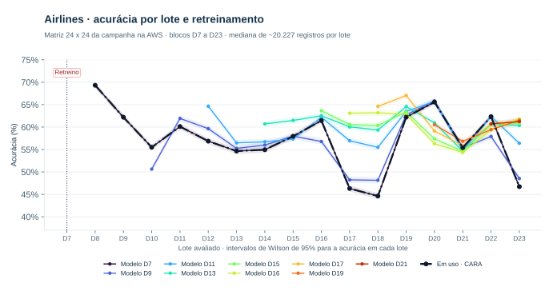
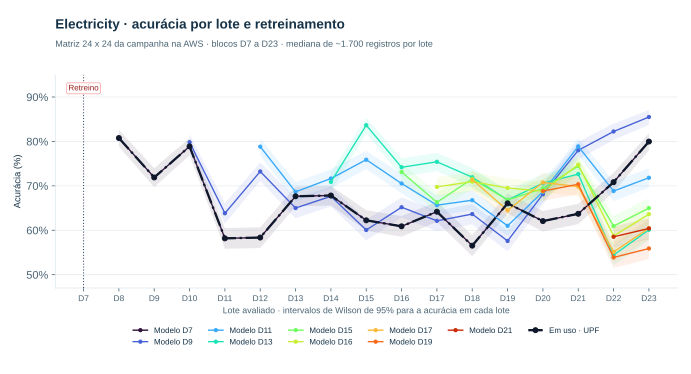
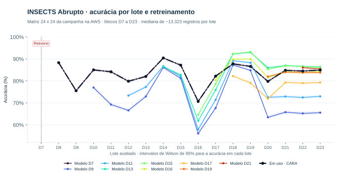
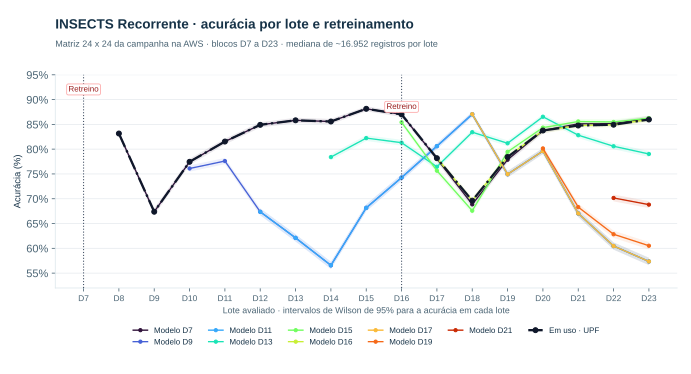
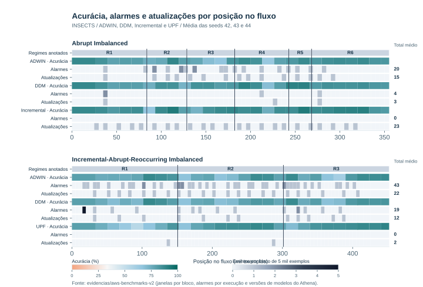

# 08. Evolução por Lote, Modelos Candidatos e Posição no Fluxo

Este relatório analisa a dinâmica detalhada de **acurácia por lote com intervalos de confiança de Wilson de 95%** para os modelos candidatos (`M7` a `M23`) frente à trajetória do modelo efetivamente implantado (**Em uso**) nos quatro fluxos da campanha na AWS, bem como a **distribuição espacial de acurácia, alarmes de drift e atualizações ao longo da posição no fluxo** nos dois benchmarks `INSECTS` (`Abrupt Imbalanced` e `Incremental-Abrupt-Reoccurring Imbalanced`). Todas as figuras e métricas deste documento utilizam exclusivamente as evidências de [evidencias/aws-benchmarks-v2/](../../evidencias/aws-benchmarks-v2/README.md), combinando as matrizes `24 × 24` de [s3-reports/retraining_matrices/](../../evidencias/aws-benchmarks-v2/s3-reports/retraining_matrices/), as decisões de implantação em [retraining_decisions.json](../../evidencias/aws-benchmarks-v2/s3-reports/retraining_decisions.json), as séries de 28 blocos em [windows_full_28blocks.csv](../../evidencias/aws-benchmarks-v2/s3-reports/windows_full_28blocks.csv), os alarmes por execução em [alarms_by_run.csv](../../evidencias/aws-benchmarks-v2/s3-reports/alarms_by_run.csv) e o histórico de versões de modelo extraído do Athena.

## 1. Acurácia por Lote, Intervalos de Wilson e Trajetória do Modelo em Uso (`D7` a `D23`)

Nas figuras desta seção, cada curva colorida representa um **modelo candidato** (`Modelo D7`, `Modelo D9`, ..., `Modelo D23`) avaliado nos lotes subsequentes com **intervalo de confiança de Wilson de 95%** (calculado a partir do tamanho `n` real de cada lote em [windows_full_28blocks.csv](../../evidencias/aws-benchmarks-v2/s3-reports/windows_full_28blocks.csv)). A linha preta espessa em traço-ponto (**Em uso**) rastreia a acurácia do modelo selecionado pela política ao longo dos 16 lotes online (`D8` a `D23`), enquanto as linhas verticais pontilhadas (**Retreino**) assinalam os lotes em que houve retreinamento efetivo segundo [retraining_decisions.json](../../evidencias/aws-benchmarks-v2/s3-reports/retraining_decisions.json).

| Fluxo | Política avaliada | Média em uso (`D8..D23`) | Mínimo / Máximo em uso | Média do Oracle passo a passo | Maior ganho perdido (modelo candidato vs. em uso) |
|---|---|---:|---:|---:|---|
| `airlines` | `CARA` (`M7` em `D8..D23`) | 57,26% | 44,62% / 69,32% | 62,94% | `+19,99 p.p.` (`M17` em `D18`) |
| `electricity` | `UPF` (`M7` em `D8..D23`) | 66,87% | 56,53% / 80,76% | 76,82% | `+21,41 p.p.` (`M13` em `D15`) |
| `insects_abrupt_imbalanced` | `CARA` (`M7` em `D8..D23`) | 83,37% | 70,67% / 90,44% | 86,58% | `+6,61 p.p.` (`M15` em `D19`) |
| `insects_incremental_abrupt_reoccurring_imbalanced` | `UPF` (`M7` até `D16`, depois `M16`) | 81,67% | 67,38% / 88,14% | 85,40% | `+22,45 p.p.` (`M0` em `D9`) |

### 1.1 `Airlines` (`CARA` / `UPF`)

**Leitura da figura ([aws-acuracia-por-lote-modelos-airlines.svg](figuras/regimes-e-matrizes/aws-acuracia-por-lote-modelos-airlines.svg)):**
- Após o retreinamento ao final da calibração (`D7`), o modelo `M7` permanece **em uso** por toda a janela `D8..D23`, registrando média de **`57,26%`** (oscilando de `44,62%` a `69,32%`), cerca de `5,68 p.p.` abaixo da média teórica de um Oracle passo a passo (`62,94%`).
- Na segunda metade da janela online (`D15..D21`), candidatos mais recentes (`M15`, `M17`, `M19`) superam `M7` com bandas de Wilson de 95% claramente separadas, alcançando diferença máxima de **`+19,99 p.p.`** para `M17` sobre `M7` no lote `D18`.

### 1.2 `Electricity` (`UPF` / `CARA`)

**Leitura da figura ([aws-acuracia-por-lote-modelos-electricity.svg](figuras/regimes-e-matrizes/aws-acuracia-por-lote-modelos-electricity.svg)):**
- Em `electricity`, o modelo `M7` permanece **em uso** de `D8` a `D23` sob `alpha = 1,0`, com acurácia média de **`66,87%`** (mínimo de `56,53%` e máximo de `80,76%`), ante **`76,82%`** do Oracle passo a passo (lacuna média de `9,95 p.p.`).
- A partir de `D11..D12`, os modelos recém-treinados (`M11`, `M13`, `M15`) abrem vantagem consistente acima da banda de Wilson de `M7`, com pico de **`+21,41 p.p.`** no lote `D15` (`M13` atingindo `83,65%` contra `62,24%` de `M7`).

### 1.3 `INSECTS Abrupto` (`CARA` / `UPF`)

**Leitura da figura ([aws-acuracia-por-lote-modelos-insects-abrupto.svg](figuras/regimes-e-matrizes/aws-acuracia-por-lote-modelos-insects-abrupto.svg)):**
- Apesar das transições abruptas do fluxo, `M7` mantém média elevada de **`83,37%`** ao longo de `D8..D23` (faixa de `70,67%` a `90,44%`), ficando a apenas `3,21 p.p.` do Oracle passo a passo (`86,58%`) e com diferença máxima pontual de **`+6,61 p.p.`** (`M15` em `D19`).
- A sobreposição frequente entre as bandas de Wilson de `M7` e dos candidatos posteriores explica por que a política de custo (`alpha = 1,0`) não dispara um segundo retreinamento neste fluxo.

### 1.4 `INSECTS Recorrente` (`UPF`)

**Leitura da figura ([aws-acuracia-por-lote-modelos-insects-recorrente.svg](figuras/regimes-e-matrizes/aws-acuracia-por-lote-modelos-insects-recorrente.svg)):**
- Este é o único fluxo em que `UPF` executa um **segundo retreinamento online (`D16`)** além do retreinamento inicial em `D7`, promovendo `M16` para atender `D17..D23` (conforme `served_by = [7, ..., 7, 16, ..., 16]` em [retraining_decisions.json](../../evidencias/aws-benchmarks-v2/s3-reports/retraining_decisions.json)).
- A linha **Em uso · UPF** acompanha `M7` até `D16`, realiza o salto para `M16` e sustenta média global de **`81,67%`** em `D8..D23` (contra `85,40%` do Oracle passo a passo). No trecho inicial da janela online (`D9`), o modelo inicial `M0` chega a ficar `+22,45 p.p.` acima de `M7` antes da convergência dos regimes seguintes.

## 2. Acurácia, Alarmes e Atualizações por Posição no Fluxo (`INSECTS`)

Para inspecionar como os detectores de drift (`ADWIN` e `DDM`) e as políticas adaptativas (`Incremental` e `UPF`) reagem às fronteiras reais de mudança de conceito, a figura abaixo alinha a **posição exata no fluxo (em mil exemplos)** com os regimes anotados (`R1` a `R6` no `Abrupt Imbalanced`; `R1` a `R3` no `Incremental-Abrupt-Reoccurring Imbalanced`), exibindo faixas paralelas de acurácia por bloco, densidade de alarmes e densidade de atualizações em blocos de `5 mil exemplos` (média das seeds `42`, `43` e `44`).

| Stream | Política | Alarmes (média 3 seeds) | Atualizações pós-inicial (média 3 seeds) | Acurácia média nos blocos válidos (mín. / máx.) |
|---|---|---:|---:|---:|
| `Abrupt Imbalanced` | `ADWIN` | 20,0 | 15,0 | 80,73% (`64,66%` / `88,31%`) |
| `Abrupt Imbalanced` | `DDM` | 4,0 | 3,0 | 82,62% (`68,95%` / `89,98%`) |
| `Abrupt Imbalanced` | `Incremental` | 0,0 | 23,0 | 84,84% (`65,63%` / `92,49%`) |
| `Incremental-Abrupt-Reoccurring` | `ADWIN` | 43,0 | 22,0 | 78,41% (`60,46%` / `87,62%`) |
| `Incremental-Abrupt-Reoccurring` | `DDM` | 19,0 | 12,0 | 77,55% (`67,23%` / `87,62%`) |
| `Incremental-Abrupt-Reoccurring` | `UPF` | 0,0 | 2,0 | 79,00% (`54,28%` / `89,24%`) |

**Leitura da figura ([aws-acuracia-alarmes-atualizacoes-insects.svg](figuras/drift-e-retreinos/aws-acuracia-alarmes-atualizacoes-insects.svg)):**
- **No `Abrupt Imbalanced` (`0` a `355` mil exemplos, 6 regimes `R1..R6`)**:
  - `ADWIN` dispara `20` alarmes médios e executa `15` atualizações, concentrando disparos próximos às fronteiras de transição (`~84 mil`, `~129 mil`, `~182 mil`, `~243 mil` e `~268 mil`), mas sofre quedas locais de acurácia logo após resets sucessivos (`80,73%` de média por bloco).
  - `DDM` reduz os alarmes para `4` e as atualizações para `3`, preservando acurácia média superior (`82,62%`), enquanto `Incremental` (`23` atualizações contínuas sem alarmes) atinge a maior média por bloco (**`84,84%`**, pico de `92,49%`).
- **No `Incremental-Abrupt-Reoccurring Imbalanced` (`0` a `452` mil exemplos, 3 regimes `R1..R3`)**:
  - `ADWIN` dispara `43` alarmes médios (`22` atualizações) e `DDM` dispara `19` alarmes (`12` atualizações), com concentrações visíveis em torno das transições `150,7 mil` (`R1 -> R2`) e `301,4 mil` (`R2 -> R3`) e disparos recorrentes dentro de cada ciclo devido ao drift incremental contínuo.
  - Mesmo com apenas **`2` atualizações** (e `0` alarmes de drift), `UPF` obtém acurácia média por bloco (`79,00%`) ligeiramente superior à de `ADWIN` (`78,41%`) e `DDM` (`77,55%`), evitando a instabilidade causada por reinicializações repetidas durante o drift gradual.
