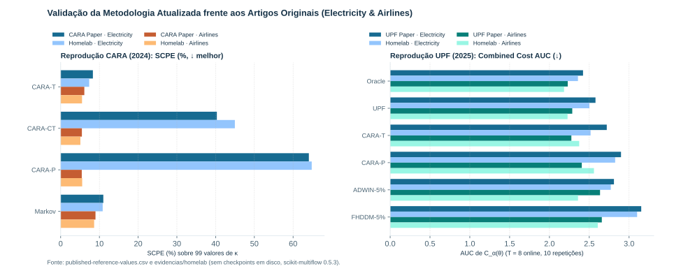
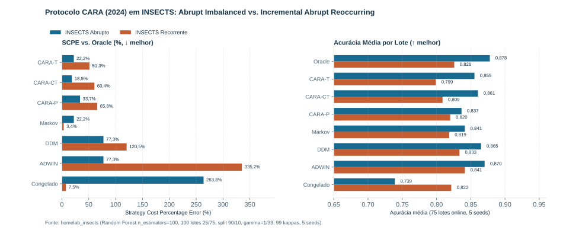
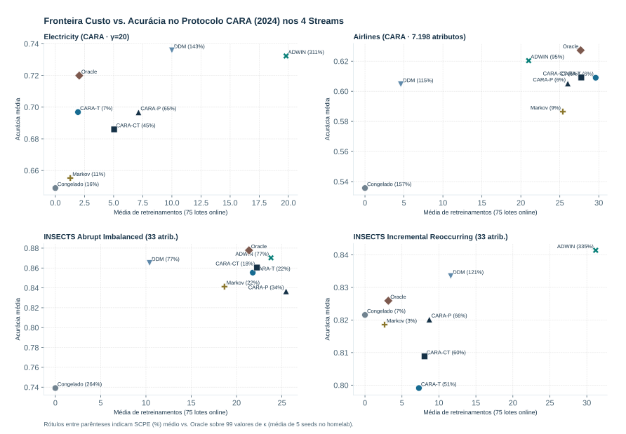
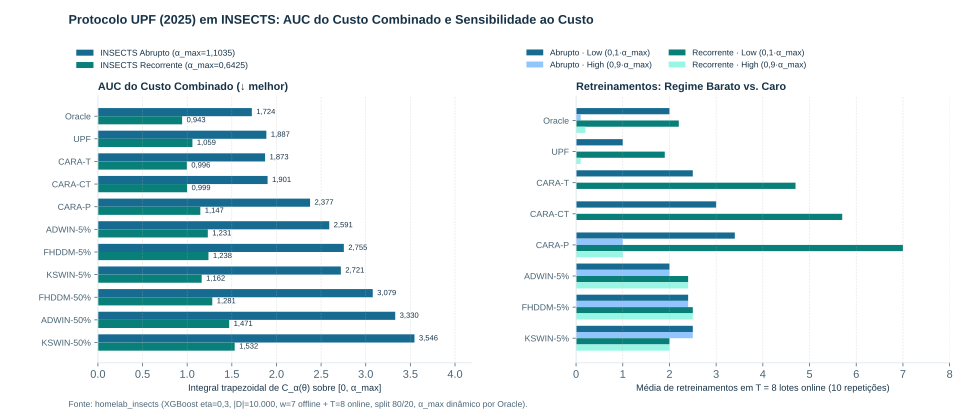

# 09. Benchmarks com a Metodologia Atualizada dos Artigos (CARA 2024 e UPF 2025) — Electricity, Airlines e INSECTS

Este relatório consolida os resultados experimentais obtidos com a arquitetura desacoplada de `continual_bench` seguindo **estritamente a metodologia, os hiperparâmetros, o pré-processamento e os detectores (`scikit-multiflow==0.5.3` e `FHDDM`) dos artigos CARA (2024) e UPF (2025)** em quatro *streams* de dados:

1. **`electricity`** (`45.312` registros, `6` atributos numéricos) — dataset de referência dos dois artigos.
2. **`airlines` (`airplanes`)** (`539.383` registros; `7.198` dimensões com *one-hot encoding* no CARA e `7` atributos no UPF) — dataset de referência dos dois artigos.
3. **`insects_abrupt_imbalanced`** (`355.275` registros, `33` atributos numéricos, projeção binária classe `'2' -> 1`, `5` mudanças abruptas em `[83.859, 128.651, 182.320, 242.883, 268.380]`).
4. **`insects_incremental_abrupt_reoccurring_imbalanced`** (`452.044` registros, `33` atributos numéricos, projeção binária classe `'2' -> 1`, transições incrementais/abruptas/recorrentes em `[150.683, 301.365]`).

Todas as `8` campanhas (`4` streams $\times$ `2` protocolos) foram executadas no servidor **homelab (`platform=homelab`)** com `BENCH_SAVE_MODEL_CHECKPOINTS=false` (zero binários/checkpoints gravados em disco) e gerador visual em [generate_paper_methodology_reports.py](../../scripts/generate_paper_methodology_reports.py).

> Os relatórios históricos [01](01-Desempenho-Preditivo-e-Holdout.md) a [08](08-Evolucao-por-Lote-e-Posicao-no-Fluxo.md) permanecem exclusivamente vinculados à campanha na AWS (`T = 16`, `alpha = 1,0` único). Este relatório apresenta a suíte com a **metodologia fiel dos artigos** aplicada tanto aos datasets originais quanto às duas variantes do **INSECTS**.

---

## 1. Generalização Metodológica para Qualquer Dataset

Para estender os protocolos **CARA (2024)** e **UPF (2025)** além de `electricity` e `airlines` para qualquer dataset arbitrário (incluindo as duas versões do INSECTS em Parquet `zia-temporal-v1`), foram consolidadas as seguintes garantias no pipeline:

| Camada | Melhoria implementada para generalização multi-dataset | Referência no código |
|---|---|---|
| **Leitura e Pré-processamento** | Descoberta automática de arquivos `full.parquet`/`data.parquet`/`csv`/`arff`/`npz`; remoção automática de colunas de vazamento temporal (`event_time`, `timestamp`, `seq`, `available_at`, `concept`); codificação *one-hot* esparsa + `MaxAbsScaler` para atributos mistos ou `MinMaxScaler` para contínuos no CARA; suporte nativo a rótulos binários e multiclasse. | [streams_unified.py](../../src/continual_bench/datasets/streams_unified.py) |
| **Adaptadores de Modelos** | Interface uniforme para `RandomForestAdapter`, `XGBoostAdapter` (com comutação automática entre `binary:logistic` e `multi:softprob`, inclusive em lotes sem todas as classes) e `SklearnAdapter`. | [adapters.py](../../src/continual_bench/models/adapters.py) |
| **Detectores `scikit-multiflow`** | Implementação 1:1 em Python puro dos detectores `ADWIN`, `DDM` e `KSWIN` do `scikit-multiflow==0.5.3` + `FHDDM` com suporte unificado a `reset`/`warm_start`, selecionável via `backend="skmultiflow"`. | [skmultiflow.py](../../src/continual_bench/detectors/skmultiflow.py) |
| **Grade Dinâmica de Custos** | No **CARA**: $\kappa_{\max}$ inferido automaticamente a partir da matriz de obsolescência offline (`99` valores positivos em `(0, kappa_max]`). No **UPF (Seção 5, p. 6)**: quando $\alpha_{\max}$ não é pré-definido pelo artigo (`electricity=1,0`, `airlines=0,7`), determina-se dinamicamente o menor $\alpha_{\max}$ para o qual o `Oracle` atinge `0` retreinamentos nas repetições, avaliando `10` pontos em `[0, alpha_max]` e regimes proporcionais `low = 0,1·alpha_max` e `high = 0,9·alpha_max`. | [cara.py](../../src/continual_bench/protocols/cara.py), [upf.py](../../src/continual_bench/protocols/upf.py) |
| **Relatórios e Gráficos Agnósticos** | Geração automática de `benchmark_summary.{csv,json,md}`, gráficos `benchmark_*.svg` e fronteira `benchmark_tradeoff.svg` mesmo quando o dataset não consta em `published-reference-values.csv`. | [report.py](../../src/continual_bench/protocols/report.py) |

---

## 2. Validação nos Datasets Base dos Artigos (`Electricity` e `Airlines`)

Antes de executar os benchmarks do INSECTS, a aderência do motor experimental foi validada diretamente contra os valores publicados em [published-reference-values.csv](../../evidencias/aws-benchmarks/papers/published-reference-values.csv).

### 2.1 Trilha CARA (2024): `100` lotes (`25` offline / `75` online), `RandomForest(100)`, `5` seeds, `99` valores de $\kappa$

| Dataset | Política | SCPE (%) Obs. ± DP | SCPE (%) Paper | Acurácia Obs. ± DP | Acurácia Paper | Retreinos Obs. ± DP | Retreinos Paper |
|---|---|---:|---:|---:|---:|---:|---:|
| `electricity` | `CARA-T` | 7,37 ± 1,63 | **8,32** | 0,697 ± 0,006 | **0,68** | 1,94 ± 0,25 | **2,39** |
| `electricity` | `CARA-CT` | 44,97 ± 8,12 | **40,32** | 0,686 ± 0,018 | **0,69** | 5,04 ± 0,43 | **5,08** |
| `electricity` | `CARA-P` | 64,81 ± 2,47 | **64,07** | 0,697 ± 0,004 | **0,70** | 7,14 ± 0,05 | **7,83** |
| `electricity` | `Oracle` | — | — | 0,720 ± 0,007 | **0,71** | 2,05 ± 0,16 | **2,36** |
| `electricity` | `Congelado` | 16,32 ± 4,95 | **17,08** | 0,649 ± 0,024 | **0,64** | 0,00 ± 0,00 | **0,00** |
| `electricity` | `Markov` | 10,85 ± 4,03 | **11,01** | 0,655 ± 0,022 | **0,64** | 1,29 ± 0,04 | **1,53** |
| `electricity` | `ADWIN` | 311,47 ± 27,06 | **285,78** | 0,732 ± 0,007 | **0,72** | 19,80 ± 1,64 | **20,00** |
| `electricity` | `DDM` | 142,83 ± 4,82 | **156,55** | 0,736 ± 0,006 | **0,73** | 10,00 ± 0,00 | **11,60** |
| `airlines` | `CARA-T` | 5,52 ± 1,52 | **6,11** | 0,609 ± 0,009 | **0,60** | 29,60 ± 0,84 | **27,69** |
| `airlines` | `CARA-CT` | 5,09 ± 0,41 | **5,48** | 0,609 ± 0,002 | **0,60** | 27,76 ± 0,13 | **25,29** |
| `airlines` | `CARA-P` | 5,56 ± 0,15 | **5,45** | 0,605 ± 0,001 | **0,60** | 26,03 ± 0,22 | **24,43** |
| `airlines` | `Oracle` | — | — | 0,627 ± 0,000 | **0,62** | 27,67 ± 0,08 | **25,23** |
| `airlines` | `Congelado` | 157,20 ± 1,50 | **141,13** | 0,536 ± 0,003 | **0,54** | 0,00 ± 0,00 | **0,00** |
| `airlines` | `Markov` | 8,64 ± 0,28 | **8,99** | 0,586 ± 0,001 | **0,58** | 25,39 ± 0,06 | **23,12** |
| `airlines` | `ADWIN` | 95,47 ± 2,54 | **86,41** | 0,620 ± 0,002 | **0,62** | 21,00 ± 3,67 | **24,00** |
| `airlines` | `DDM` | 115,40 ± 5,83 | **99,95** | 0,605 ± 0,009 | **0,60** | 4,60 ± 1,82 | **10,60** |

### 2.2 Trilha UPF (2025): `w = 7` offline + `T = 8` online (`XGBoost eta=0,3`, `10` repetições)

| Política | `electricity` AUC Obs. ± DP | `electricity` AUC Paper | `airlines` AUC Obs. ± DP | `airlines` AUC Paper |
|---|---:|---:|---:|---:|
| `Oracle` | 2,3581 ± 0,1700 | **2,4217** | 2,1834 ± 0,1171 | **2,2298** |
| `UPF` | 2,5015 ± 0,2054 | **2,5782** | 2,2274 ± 0,1448 | **2,2865** |
| `CARA-T` | 2,5166 ± 0,2354 | **2,7198** | 2,3736 ± 0,1437 | **2,2753** |
| `CARA-CT` | 2,5033 ± 0,2392 | **2,7147** | 2,3786 ± 0,1371 | **2,2900** |
| `CARA-P` | 2,8253 ± 0,2007 | **2,8986** | 2,5589 ± 0,1404 | **2,4061** |
| `ADWIN-5%` | 2,7705 ± 0,2758 | **2,8099** | 2,3588 ± 0,1392 | **2,6353** |
| `ADWIN-50%` | 3,3730 ± 0,2567 | **2,8131** | 2,7109 ± 0,2888 | **2,7147** |
| `FHDDM-5%` | 3,1010 ± 0,3212 | **3,1525** | 2,6067 ± 0,1982 | **2,6577** |
| `FHDDM-50%` | 3,4688 ± 0,2891 | **3,4037** | 2,8116 ± 0,1452 | **2,7077** |
| `KSWIN-5%` | 3,5240 ± 0,2318 | **3,8979** | 2,9692 ± 0,1660 | **3,2300** |
| `KSWIN-50%` | 3,7218 ± 0,1083 | **4,0521** | 3,0158 ± 0,1255 | **3,2042** |



---

## 3. Benchmarks no INSECTS (Ambas as Variantes) sob a Metodologia CARA (2024)

As duas variantes foram configuradas em [cara-insects-abrupt.yaml](../../configs/campaigns/cara-insects-abrupt.yaml) e [cara-insects-reoccurring.yaml](../../configs/campaigns/cara-insects-reoccurring.yaml) com o mesmo protocolo do artigo CARA: `100` lotes cronológicos (`25` offline + `75` online), `MinMaxScaler`, split `90/10` com `X_query = X_test`, `RandomForest(100)`, `gamma = 1/33 = 0,030303`, `5` seeds e grade automática de `99` valores positivos de $\kappa$.

- **`insects_abrupt_imbalanced`**: grade automática $\kappa \in [1,73,\; 171,00]$ (`3.553` registros/lote).
- **`insects_incremental_abrupt_reoccurring_imbalanced`**: grade automática $\kappa \in [17,04,\; 1687,00]$ (`4.520` registros/lote).

| Variante INSECTS | Política | SCPE (%) Médio ± DP | Acurácia Média ± DP | Retreinos Médios ± DP | Custo Estratégico Médio ± DP |
|---|---|---:|---:|---:|---:|
| `insects_abrupt_imbalanced` | `Oracle` | 0,00 ± 0,00 | 0,8778 ± 0,0002 | 21,37 ± 0,10 | 2.978,10 ± 4,94 |
| `insects_abrupt_imbalanced` | `CARA-CT` | **18,48 ± 6,04** | 0,8605 ± 0,0024 | 22,26 ± 1,58 | 3.519,07 ± 91,04 |
| `insects_abrupt_imbalanced` | `CARA-T` | **22,16 ± 3,13** | 0,8554 ± 0,0078 | 21,79 ± 2,37 | 3.606,09 ± 186,19 |
| `insects_abrupt_imbalanced` | `Markov` | **22,21 ± 0,41** | 0,8413 ± 0,0006 | 18,66 ± 0,06 | 3.780,57 ± 16,61 |
| `insects_abrupt_imbalanced` | `CARA-P` | 33,68 ± 0,50 | 0,8365 ± 0,0005 | 25,47 ± 0,07 | 4.120,20 ± 13,45 |
| `insects_abrupt_imbalanced` | `ADWIN` | 77,31 ± 1,43 | **0,8702 ± 0,0006** | 23,80 ± 1,30 | 4.289,80 ± 71,84 |
| `insects_abrupt_imbalanced` | `DDM` | 77,32 ± 10,09 | 0,8650 ± 0,0086 | 10,40 ± 0,89 | 3.809,49 ± 171,59 |
| `insects_abrupt_imbalanced` | `Congelado` | 263,83 ± 4,06 | 0,7391 ± 0,0032 | 0,00 ± 0,00 | 7.013,58 ± 75,78 |
| `insects_reoccurring` | `Oracle` | 0,00 ± 0,00 | 0,8259 ± 0,0008 | 3,15 ± 0,01 | 6.670,33 ± 18,42 |
| `insects_reoccurring` | `Markov` | **3,37 ± 0,16** | 0,8186 ± 0,0010 | 2,65 ± 0,02 | 6.866,50 ± 21,63 |
| `insects_reoccurring` | `Congelado` | 7,46 ± 0,09 | 0,8216 ± 0,0009 | 0,00 ± 0,00 | 6.859,19 ± 22,03 |
| `insects_reoccurring` | `CARA-T` | 51,27 ± 3,73 | 0,7991 ± 0,0005 | 7,29 ± 0,22 | 10.282,11 ± 258,75 |
| `insects_reoccurring` | `CARA-CT` | 60,44 ± 2,06 | 0,8088 ± 0,0009 | 8,05 ± 0,12 | 10.953,54 ± 131,13 |
| `insects_reoccurring` | `CARA-P` | 65,80 ± 1,74 | 0,8201 ± 0,0003 | 8,70 ± 0,07 | 11.323,36 ± 98,84 |
| `insects_reoccurring` | `DDM` | 120,52 ± 49,49 | 0,8335 ± 0,0228 | 11,60 ± 5,94 | 15.072,05 ± 3.670,46 |
| `insects_reoccurring` | `ADWIN` | 335,22 ± 12,55 | **0,8414 ± 0,0016** | 31,20 ± 1,10 | 30.445,48 ± 874,17 |



### Principais achados no CARA (INSECTS)

1. **`insects_abrupt_imbalanced` (mudanças abruptas severas)**: manter o modelo `Congelado` colapsa a acurácia média de `0,878` (`Oracle`) para `0,739`, gerando `SCPE` de **`263,83%`**. As variantes `CARA-CT` (`18,48%`), `CARA-T` (`22,16%`) e `Markov` (`22,21%`) atingem o menor excesso de custo frente ao `Oracle`, executando ~`18,7–22,3` retreinamentos contra `77,3%` de SCPE em `ADWIN`/`DDM`.
2. **`insects_incremental_abrupt_reoccurring_imbalanced` (alta recorrencia)**: como os conceitos antigos retornam ao longo da faixa online e a escala de $\kappa$ sobe até `1.687`, o `Oracle` faz em média apenas `3,15` retreinamentos (`Markov`: `2,65`, `SCPE = 3,37%`). Nessa condição, `ADWIN` (`31,20` retreinamentos, `SCPE = 335,22%`) e `DDM` (`11,60`, `SCPE = 120,52%`) gastam em excesso para um ganho modesto de acurácia (`0,841` vs `0,826` do `Oracle`), enquanto `CARA-T`/`CT` ficam prejudicados pelo limite de `tau` calibrado nos `25` primeiros lotes offline antes da primeira transição abrupta (`150.683`).



---

## 4. Benchmarks no INSECTS (Ambas as Variantes) sob a Metodologia UPF (2025)

As campanhas [upf-insects-abrupt.yaml](../../configs/campaigns/upf-insects-abrupt.yaml) e [upf-insects-reoccurring.yaml](../../configs/campaigns/upf-insects-reoccurring.yaml) utilizam `XGBoost(eta=0,3, num_boost_round=100)`, `|D| = 10.000` registros por lote (`w = 7` offline + `T = 8` online = `150.000` registros por repetição), split aleatório `80/20`, `10` repetições e **determinação automática de $\alpha_{\max}$ pela Seção 5 do UPF**:

- **`insects_abrupt_imbalanced`**: $\alpha_{\max} = 1,1035$, com regimes `low = 0,11035` e `high = 0,99315`.
- **`insects_incremental_abrupt_reoccurring_imbalanced`**: $\alpha_{\max} = 0,6425$, com regimes `low = 0,06425` e `high = 0,57825`.

### 4.1 AUC do Custo Combinado (`combined_cost_auc`, menor é melhor) e Regimes `low` / `high`

| Política | Abrupt AUC (`price_grid`) | Abrupt `low` (`α=0,11`) Ret / Acc / Cost | Abrupt `high` (`α=0,99`) Ret / Acc / Cost | Reocc. AUC (`price_grid`) | Reocc. `low` (`α=0,064`) Ret / Acc / Cost | Reocc. `high` (`α=0,578`) Ret / Acc / Cost |
|---|---:|---:|---:|---:|---:|---:|
| `Oracle` | **1,7243 ± 0,2027** | 2,00 / 0,879 / 1,185 | 0,10 / 0,791 / 1,772 | **0,9434 ± 0,1057** | 2,20 / 0,862 / 1,243 | 0,20 / 0,811 / 1,626 |
| `CARA-T` | **1,8727 ± 0,2421** | 2,50 / 0,868 / 1,336 | 0,00 / 0,777 / 1,783 | **0,9964 ± 0,1427** | 4,70 / 0,870 / 1,344 | 0,00 / 0,796 / 1,634 |
| `UPF` | **1,8870 ± 0,2625** | 1,00 / 0,823 / 1,525 | 0,00 / 0,777 / 1,783 | **1,0587 ± 0,1131** | 1,90 / 0,824 / 1,529 | 0,10 / 0,796 / 1,686 |
| `CARA-CT` | 1,9008 ± 0,2278 | 3,00 / 0,872 / 1,354 | 0,00 / 0,777 / 1,783 | 0,9990 ± 0,1155 | 5,70 / 0,874 / 1,377 | 0,00 / 0,796 / 1,634 |
| `CARA-P` | 2,3766 ± 0,2612 | 3,40 / 0,844 / 1,623 | 1,00 / 0,791 / 2,662 | 1,1472 ± 0,1156 | 7,00 / 0,875 / 1,452 | 1,00 / 0,811 / 2,092 |
| `ADWIN-5%` | 2,5914 ± 0,4511 | 2,00 / 0,844 / 1,466 | 2,00 / 0,844 / 3,231 | 1,2312 ± 0,1348 | 2,40 / 0,857 / 1,300 | 2,40 / 0,857 / 2,533 |
| `KSWIN-5%` | 2,7214 ± 0,4856 | 2,50 / 0,864 / 1,363 | 2,50 / 0,864 / 3,570 | 1,1624 ± 0,2267 | 2,00 / 0,854 / 1,295 | 2,00 / 0,854 / 2,323 |
| `FHDDM-5%` | 2,7550 ± 0,3749 | 2,40 / 0,853 / 1,437 | 2,40 / 0,853 / 3,556 | 1,2385 ± 0,1469 | 2,50 / 0,859 / 1,285 | 2,50 / 0,859 / 2,570 |
| `FHDDM-50%` | 3,0786 ± 0,2451 | 3,20 / 0,872 / 1,377 | 3,20 / 0,872 / 4,202 | 1,2811 ± 0,0989 | 2,70 / 0,859 / 1,300 | 2,70 / 0,859 / 2,688 |
| `ADWIN-50%` | 3,3304 ± 0,4970 | 3,40 / 0,857 / 1,517 | 3,40 / 0,857 / 4,519 | 1,4707 ± 0,1267 | 3,60 / 0,858 / 1,364 | 3,60 / 0,858 / 3,214 |
| `KSWIN-50%` | 3,5461 ± 0,1410 | 4,00 / 0,874 / 1,448 | 4,00 / 0,874 / 4,979 | 1,5323 ± 0,0765 | 4,00 / 0,863 / 1,357 | 4,00 / 0,863 / 3,413 |



### Principais achados no UPF (INSECTS)

1. **Superioridade consistente das políticas cientes de custo**: tanto em `insects_abrupt_imbalanced` quanto em `insects_incremental_abrupt_reoccurring_imbalanced`, **`UPF`, `CARA-T` e `CARA-CT` superam todos os `6` detectores estatísticos de drift** (`ADWIN-5%/50%`, `FHDDM-5%/50%`, `KSWIN-5%/50%`) na métrica principal (`combined_cost_auc`). Em `abrupt`, `UPF` (`1,8870`) e `CARA-T` (`1,8727`) ficam até **`27%–47%`** abaixo da AUC dos detectores (`2,5914–3,5461`).
2. **Elasticidade ao custo de retreinamento**: no regime `high`, os detectores continuam disparando de `2,00` a `4,00` retreinamentos desnecessários (elevando o custo para `2,32–4,98`), enquanto `UPF` e `CARA-T`/`CT` reduzem para `0,00–0,10` retreinamentos (`cost = 1,63–1,78`), praticamente idêntico ao `Oracle` (`1,63–1,77`).
3. **Comparação com a campanha histórica na AWS**: na campanha anterior da AWS (`T = 16`, `alpha = 1,0` único), todas as políticas cientes de custo colapsavam para exatamente `1,00` retreinamento (`SCPE = 0,00%`). Sob a metodologia completa dos artigos, a varredura sobre `[0, alpha_max]` e `99` preços `kappa` revela claramente a sensibilidade real de cada política às transições abruptas e recorrentes do INSECTS.

---

## 5. Reprodutibilidade

Todas as campanhas descritas podem ser reproduzidas em ambiente `local`, `homelab` ou `aws` via CLI sem persistir checkpoints de modelo em disco (`BENCH_SAVE_MODEL_CHECKPOINTS=false`):

```bash
BENCH_SAVE_MODEL_CHECKPOINTS=false BENCH_PLATFORM=homelab \
  uv run continual-bench benchmark --config configs/campaigns/upf-insects-abrupt.yaml
```
