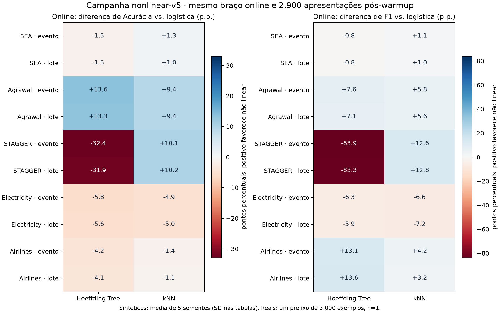

# Campanha nonlinear-v5 — comparação de modelos e políticas

A campanha contém 867 runs verificadas: 289 casos pareados para cada modelo. Os dados, sementes, protocolos e tetos de treino foram preservados em relação à v4. A tabela principal mantém a política online comum; escolher a melhor política depois de ver os resultados é uma análise descritiva, não validação independente.

**Agrawal, online por evento:** Logística: acurácia 58.04%, F1 66.52%; Hoeffding Tree: acurácia 71.60%, F1 74.14%; kNN: acurácia 67.40%, F1 72.27%.

**Airlines, online por evento:** Logística: acurácia 72.93%, F1 14.21%; Hoeffding Tree: acurácia 68.76%, F1 27.29%; kNN: acurácia 71.55%, F1 18.40%.

Em Agrawal, acurácia e F1 melhoram com ambos os modelos não lineares. Em Airlines, o F1 sobe, mas a acurácia e o log loss pioram: não houve melhora geral. A árvore também piora o log loss em Agrawal; o kNN melhora essa métrica nesse dataset. As tabelas abaixo separam protocolos e dispersão.

A auditoria verificou 17 versões de conteúdo dos datasets, 867 versões finais no Registry, 165 famílias e 300052 referências a estados treinados.

Estado Airflow registrado: `success`; tarefas por estado: `{"success": 870}`; tentativas adicionais registradas: 4, incluindo as duas recuperações manuais.

A execução confirmou pico de 8 tarefas `evaluate_and_publish` e 8 processos ativos; 90.28 minutos entre o início original e a consolidação final, incluindo a recuperação. [Registro operacional](nonlinear-v5-execution.json), [primeira tentativa](nonlinear-v5-first-attempt-airflow.json), [estado final Airflow](nonlinear-v5-airflow.json). O Airflow redefine a data de início ao limpar tarefas; a duração usa a data preservada.

## Revisões autorizadas e recuperação

Fonte principal do manifesto: `159e32431ef622c64b2020ab8d9ec73947eaff2f944a58f318910a246756b69c`. Cada run deve corresponder ao SHA padrão ou a um override explícito na sua própria linha do manifesto. Uma lista global de revisões não autoriza fontes adicionais.

| Revisão SHA-256 | Runs autorizadas e verificadas |
|---|---:|
| `159e32431ef622c64b2020ab8d9ec73947eaff2f944a58f318910a246756b69c` | 865 |
| `8dca88bc3e65013ce8595e96988b84c9c52bd46b39789ecab902f327d8d25283` | 2 |

A recuperação trata um cache de inferência da árvore: o splitter nominal criava dicionários vazios para classes não observadas durante predict. A correção remove apenas esses caches novos/vazios. As configurações, dados, parâmetros dos modelos, protocolos e tetos continuam iguais aos casos do manifesto. Isso não substitui a conferência de replay/paridade dos casos reexecutados, nem cria réplicas independentes.

As duas execuções recuperadas reproduziram exatamente métricas, digest de predições, alarmes, atualizações sem os tempos, ledger de treino, dados e configuração. As tentativas anteriores foram preservadas. [Evidência completa de recuperação e replay](nonlinear-v5-recovery.json).

## Comparação online, sem selecionar política pelo resultado

Acurácia, F1, precisão e revocação em %. Sintéticos: média ± desvio-padrão amostral de cinco sementes; reais: um valor, sem estimativa de variância. Brier e log loss: menor é melhor. Não são intervalos de confiança nem testes de significância.

| Dataset | Protocolo | Modelo | Acurácia | F1 | Brier | Log loss | Precisão | Revocação |
|---|---|---|---:|---:|---:|---:|---:|---:|
| Sea | streaming | Logística | 94.21 ± 0.17 | 95.52 ± 0.16 | 0.0529 ± 0.0007 | 0.1902 ± 0.0019 | 99.39 ± 0.14 | 91.93 ± 0.36 |
| Sea | streaming | Hoeffding Tree | 92.66 ± 0.80 | 94.69 ± 0.60 | 0.0567 ± 0.0027 | 0.1989 ± 0.0059 | 92.03 ± 0.88 | 97.51 ± 0.59 |
| Sea | streaming | kNN | 95.46 ± 0.19 | 96.64 ± 0.16 | 0.0378 ± 0.0011 | 0.1309 ± 0.0068 | 95.95 ± 0.36 | 97.35 ± 0.38 |
| Sea | incremental | Logística | 94.21 ± 0.20 | 95.52 ± 0.19 | 0.0538 ± 0.0007 | 0.1925 ± 0.0019 | 99.39 ± 0.20 | 91.94 ± 0.43 |
| Sea | incremental | Hoeffding Tree | 92.68 ± 0.84 | 94.70 ± 0.62 | 0.0569 ± 0.0027 | 0.1995 ± 0.0060 | 92.08 ± 0.87 | 97.48 ± 0.61 |
| Sea | incremental | kNN | 95.26 ± 0.12 | 96.50 ± 0.10 | 0.0383 ± 0.0014 | 0.1322 ± 0.0065 | 95.79 ± 0.40 | 97.21 ± 0.36 |
| Agrawal | streaming | Logística | 58.04 ± 0.83 | 66.52 ± 1.72 | 0.2471 ± 0.0024 | 0.6902 ± 0.0052 | 61.61 ± 0.98 | 72.30 ± 2.78 |
| Agrawal | streaming | Hoeffding Tree | 71.60 ± 3.77 | 74.14 ± 3.38 | 0.2003 ± 0.0262 | 1.2575 ± 0.7510 | 78.29 ± 4.41 | 70.58 ± 4.72 |
| Agrawal | streaming | kNN | 67.40 ± 0.80 | 72.27 ± 1.46 | 0.2069 ± 0.0020 | 0.6154 ± 0.0136 | 70.94 ± 0.67 | 73.69 ± 2.68 |
| Agrawal | incremental | Logística | 57.67 ± 1.14 | 66.43 ± 1.78 | 0.2483 ± 0.0025 | 0.6929 ± 0.0047 | 61.21 ± 1.18 | 72.63 ± 2.82 |
| Agrawal | incremental | Hoeffding Tree | 70.98 ± 3.66 | 73.57 ± 3.41 | 0.2050 ± 0.0267 | 1.3335 ± 0.7162 | 77.65 ± 3.98 | 70.06 ± 4.99 |
| Agrawal | incremental | kNN | 67.08 ± 0.47 | 72.07 ± 1.05 | 0.2085 ± 0.0016 | 0.6303 ± 0.0217 | 70.60 ± 0.62 | 73.62 ± 2.08 |
| Stagger | streaming | Logística | 86.85 ± 0.37 | 83.92 ± 0.51 | 0.1059 ± 0.0010 | 0.3471 ± 0.0039 | 94.64 ± 0.59 | 75.39 ± 0.80 |
| Stagger | streaming | Hoeffding Tree | 54.46 ± 0.50 | 0.00 ± 0.00 | 0.2522 ± 0.0009 | 0.6995 ± 0.0025 | 0.00 ± 0.00 | 0.00 ± 0.00 |
| Stagger | streaming | kNN | 96.92 ± 0.45 | 96.56 ± 0.55 | 0.0243 ± 0.0032 | 0.3642 ± 0.0167 | 98.18 ± 0.17 | 94.99 ± 0.92 |
| Stagger | incremental | Logística | 86.39 ± 0.43 | 83.31 ± 0.62 | 0.1105 ± 0.0011 | 0.3631 ± 0.0045 | 94.34 ± 0.86 | 74.60 ± 0.76 |
| Stagger | incremental | Hoeffding Tree | 54.46 ± 0.50 | 0.00 ± 0.00 | 0.2533 ± 0.0009 | 0.7026 ± 0.0024 | 0.00 ± 0.00 | 0.00 ± 0.00 |
| Stagger | incremental | kNN | 96.54 ± 0.55 | 96.13 ± 0.66 | 0.0294 ± 0.0035 | 0.5208 ± 0.0366 | 98.03 ± 0.35 | 94.30 ± 1.16 |
| Electricity | streaming | Logística | 86.52 | 82.96 | 0.0987 | 0.3189 | 84.55 | 81.44 |
| Electricity | streaming | Hoeffding Tree | 80.72 | 76.70 | 0.1591 | 1.5804 | 74.80 | 78.70 |
| Electricity | streaming | kNN | 81.59 | 76.39 | 0.1316 | 1.1875 | 79.05 | 73.91 |
| Electricity | incremental | Logística | 82.41 | 77.98 | 0.1256 | 0.4001 | 78.73 | 77.25 |
| Electricity | incremental | Hoeffding Tree | 76.83 | 72.07 | 0.1966 | 2.3632 | 70.09 | 74.17 |
| Electricity | incremental | kNN | 77.38 | 70.77 | 0.1591 | 1.7897 | 73.86 | 67.92 |
| Airlines | streaming | Logística | 72.93 | 14.21 | 0.1892 | 0.5634 | 48.51 | 8.32 |
| Airlines | streaming | Hoeffding Tree | 68.76 | 27.29 | 0.2482 | 3.1660 | 36.56 | 21.77 |
| Airlines | streaming | kNN | 71.55 | 18.40 | 0.2005 | 1.0412 | 40.43 | 11.91 |
| Airlines | incremental | Logística | 73.00 | 14.43 | 0.1908 | 0.5681 | 49.25 | 8.45 |
| Airlines | incremental | Hoeffding Tree | 68.93 | 27.98 | 0.2500 | 3.3162 | 37.23 | 22.41 |
| Airlines | incremental | kNN | 71.90 | 17.59 | 0.2003 | 1.0299 | 41.83 | 11.14 |

## Resultados observados, com foco em Agrawal e Airlines

**Hoeffding Tree:** teve média melhor que a logística em 2/10 cenários online de acurácia, 4/10 de F1, 2/10 de Brier e 0/10 de log loss. Cada cenário é dataset/protocolo, com dados compartilhados; essas contagens não são réplicas independentes.

**kNN:** teve média melhor que a logística em 6/10 cenários online de acurácia, 8/10 de F1, 6/10 de Brier e 4/10 de log loss. Cada cenário é dataset/protocolo, com dados compartilhados; essas contagens não são réplicas independentes.

**Agrawal — streaming:** logística online tem acurácia 58.04%, F1 66.52% e revocação 72.30%.
Hoeffding Tree: acurácia 71.60% (+13.56 p.p.; melhora), F1 74.14% (+7.62 p.p.; melhora), revocação 70.58%.
kNN: acurácia 67.40% (+9.36 p.p.; melhora), F1 72.27% (+5.75 p.p.; melhora), revocação 73.69%.

**Agrawal — incremental:** logística online tem acurácia 57.67%, F1 66.43% e revocação 72.63%.
Hoeffding Tree: acurácia 70.98% (+13.31 p.p.; melhora), F1 73.57% (+7.14 p.p.; melhora), revocação 70.06%.
kNN: acurácia 67.08% (+9.41 p.p.; melhora), F1 72.07% (+5.64 p.p.; melhora), revocação 73.62%.

Referências constantes calculadas a posteriori para Agrawal: sempre positivo tem acurácia 57.73% e F1 73.20%; sempre negativo tem acurácia 42.27% e F1 zero. São controles de interpretação, não novos braços treinados ou seleção independente.

**Airlines — streaming:** logística online tem acurácia 72.93%, F1 14.21% e revocação 8.32%.
Hoeffding Tree: acurácia 68.76% (-4.17 p.p.; piora), F1 27.29% (+13.08 p.p.; melhora), revocação 21.77%.
kNN: acurácia 71.55% (-1.38 p.p.; piora), F1 18.40% (+4.19 p.p.; melhora), revocação 11.91%.

**Airlines — incremental:** logística online tem acurácia 73.00%, F1 14.43% e revocação 8.45%.
Hoeffding Tree: acurácia 68.93% (-4.07 p.p.; piora), F1 27.98% (+13.55 p.p.; melhora), revocação 22.41%.
kNN: acurácia 71.90% (-1.10 p.p.; piora), F1 17.59% (+3.17 p.p.; melhora), revocação 11.14%.

Referências constantes calculadas a posteriori para Airlines: sempre positivo tem acurácia 26.93% e F1 42.43%; sempre negativo tem acurácia 73.07% e F1 zero. São controles de interpretação, não novos braços treinados ou seleção independente.

**Diagnóstico da árvore no STAGGER:** os dez casos online terminaram com uma única folha e nenhuma divisão. Receberam as 3000 amostras, incluindo 2900 atualizações após o aquecimento; a folha NBA escolheu a maioria e previu negativo nos 27 padrões possíveis. As condições de split desse perfil permaneceram conservadoras dentro do horizonte, sem bloqueio de crescimento por memória. Isso explica o F1 zero observado nesse braço; não demonstra que outra configuração teria bom resultado. [Diagnóstico medido e limites da inferência](nonlinear-v5-stagger-tree-diagnostic.json).

## Políticas: melhor acurácia observada por teto

Seleção **a posteriori** pela acurácia média no próprio benchmark. Empates de média são preservados. Esses vencedores não foram selecionados em validação independente. Online usa 2900 apresentações nos dois tetos; congelado usa zero após o warmup.

| Dataset | Protocolo | Modelo | Teto | Política(s) com maior média | Acurácia (%) |
|---|---|---|---:|---|---:|
| Sea | streaming | Logística | 2900 | online | 94.21 |
| Sea | streaming | Logística | 5800 | online | 94.21 |
| Sea | streaming | Hoeffding Tree | 2900 | periodic@2900 | 93.61 |
| Sea | streaming | Hoeffding Tree | 5800 | periodic@5800 | 93.52 |
| Sea | streaming | kNN | 2900 | online | 95.46 |
| Sea | streaming | kNN | 5800 | online | 95.46 |
| Sea | incremental | Logística | 2900 | online | 94.21 |
| Sea | incremental | Logística | 5800 | online | 94.21 |
| Sea | incremental | Hoeffding Tree | 2900 | periodic@2900 | 93.66 |
| Sea | incremental | Hoeffding Tree | 5800 | periodic@5800 | 93.55 |
| Sea | incremental | kNN | 2900 | online | 95.26 |
| Sea | incremental | kNN | 5800 | online | 95.26 |
| Agrawal | streaming | Logística | 2900 | online | 58.04 |
| Agrawal | streaming | Logística | 5800 | online | 58.04 |
| Agrawal | streaming | Hoeffding Tree | 2900 | online | 71.60 |
| Agrawal | streaming | Hoeffding Tree | 5800 | online | 71.60 |
| Agrawal | streaming | kNN | 2900 | online | 67.40 |
| Agrawal | streaming | kNN | 5800 | online | 67.40 |
| Agrawal | incremental | Logística | 2900 | online | 57.67 |
| Agrawal | incremental | Logística | 5800 | online | 57.67 |
| Agrawal | incremental | Hoeffding Tree | 2900 | online | 70.98 |
| Agrawal | incremental | Hoeffding Tree | 5800 | online | 70.98 |
| Agrawal | incremental | kNN | 2900 | online | 67.08 |
| Agrawal | incremental | kNN | 5800 | online | 67.08 |
| Stagger | streaming | Logística | 2900 | online | 86.85 |
| Stagger | streaming | Logística | 5800 | online | 86.85 |
| Stagger | streaming | Hoeffding Tree | 2900 | periodic@2900 | 76.82 |
| Stagger | streaming | Hoeffding Tree | 5800 | periodic@5800 | 76.82 |
| Stagger | streaming | kNN | 2900 | online | 96.92 |
| Stagger | streaming | kNN | 5800 | online | 96.92 |
| Stagger | incremental | Logística | 2900 | online | 86.39 |
| Stagger | incremental | Logística | 5800 | online | 86.39 |
| Stagger | incremental | Hoeffding Tree | 2900 | periodic@2900 | 76.68 |
| Stagger | incremental | Hoeffding Tree | 5800 | periodic@5800 | 76.68 |
| Stagger | incremental | kNN | 2900 | online | 96.54 |
| Stagger | incremental | kNN | 5800 | online | 96.54 |
| Electricity | streaming | Logística | 2900 | online | 86.52 |
| Electricity | streaming | Logística | 5800 | online | 86.52 |
| Electricity | streaming | Hoeffding Tree | 2900 | online | 80.72 |
| Electricity | streaming | Hoeffding Tree | 5800 | online | 80.72 |
| Electricity | streaming | kNN | 2900 | online | 81.59 |
| Electricity | streaming | kNN | 5800 | online | 81.59 |
| Electricity | incremental | Logística | 2900 | online | 82.41 |
| Electricity | incremental | Logística | 5800 | online | 82.41 |
| Electricity | incremental | Hoeffding Tree | 2900 | online | 76.83 |
| Electricity | incremental | Hoeffding Tree | 5800 | online | 76.83 |
| Electricity | incremental | kNN | 2900 | ddm@2900 | 78.38 |
| Electricity | incremental | kNN | 5800 | ddm@5800 | 78.38 |
| Airlines | streaming | Logística | 2900 | online | 72.93 |
| Airlines | streaming | Logística | 5800 | online | 72.93 |
| Airlines | streaming | Hoeffding Tree | 2900 | online | 68.76 |
| Airlines | streaming | Hoeffding Tree | 5800 | online | 68.76 |
| Airlines | streaming | kNN | 2900 | ddm@2900 | 72.59 |
| Airlines | streaming | kNN | 5800 | ddm@5800 | 72.59 |
| Airlines | incremental | Logística | 2900 | online | 73.00 |
| Airlines | incremental | Logística | 5800 | online | 73.00 |
| Airlines | incremental | Hoeffding Tree | 2900 | online | 68.93 |
| Airlines | incremental | Hoeffding Tree | 5800 | online | 68.93 |
| Airlines | incremental | kNN | 2900 | ddm@2900 | 72.55 |
| Airlines | incremental | kNN | 5800 | ddm@5800 | 72.55 |

## Detectores e interpretação das políticas

Os detectores recebem o erro do modelo: mudar o estimador altera também a sequência de alarmes. Os resultados avaliam a combinação modelo/detector/política; não isolam a qualidade intrínseca do detector. Não há vencedor único em todas as métricas.

Em Agrawal/streaming, árvore+ADWIN tem acurácia média 67.63% e árvore+DDM 65.23% no teto2900, abaixo da árvore online (71.60%). Isso não implica ordenação igual por F1, probabilidades ou consumo.

Em Airlines/streaming, kNN+DDM alcança acurácia 72.59%, mas F1 7.23%, contra 71.55% e 18.40% do kNN online. Escolher apenas pela acurácia esconderia a pior detecção da classe positiva.

**ADWIN:** 102/102 pares modelo/dataset/semente/protocolo mantiveram o digest de predições ao elevar o teto de2900 para5800. O teto maior só pode ajudar quando muda as atualizações efetivamente executadas; não se deve inferir consumo idêntico entre políticas.

**DDM:** 100/102 pares modelo/dataset/semente/protocolo mantiveram o digest de predições ao elevar o teto de2900 para5800. O teto maior só pode ajudar quando muda as atualizações efetivamente executadas; não se deve inferir consumo idêntico entre políticas.

## Consumo efetivo e mudança de orçamento

Treino é contagem de apresentações após o aquecimento, incluindo replays. Não equivale a segundos de CPU, tempo total, memória ou custo de aquisição de rótulos. A tabela do apêndice mostra o consumo por braço; os pares abaixo preservam dataset, protocolo, modelo e semente, alterando apenas o teto.

**Logística:** 67/102 pares com digest disponível mantiveram predições idênticas ao elevar o teto de 2900 para 5800; 0 pares sem comparação de digest, de 102 pares totais.

**Hoeffding Tree:** 78/102 pares com digest disponível mantiveram predições idênticas ao elevar o teto de 2900 para 5800; 0 pares sem comparação de digest, de 102 pares totais.

**kNN:** 67/102 pares com digest disponível mantiveram predições idênticas ao elevar o teto de 2900 para 5800; 0 pares sem comparação de digest, de 102 pares totais.

| Modelo | Dataset | Protocolo | Braço | Pares | Treino teto 2900 | Treino teto 5800 | Δ acurácia (p.p.) | Predições idênticas |
|---|---|---|---|---:|---:|---:|---:|---:|
| Logística | sea | streaming | periodic | 5 | 2900.0000 ± 0.0000 | 3584.0000 ± 0.0000 | 0.79 ± 0.69 | 0/5 |
| Logística | sea | streaming | adwin | 5 | 307.2000 ± 114.4867 | 307.2000 ± 114.4867 | 0.00 ± 0.00 | 5/5 |
| Logística | sea | streaming | ddm | 5 | 358.4000 ± 291.8849 | 358.4000 ± 291.8849 | 0.00 ± 0.00 | 5/5 |
| Hoeffding Tree | sea | streaming | periodic | 5 | 2900.0000 ± 0.0000 | 3584.0000 ± 0.0000 | -0.09 ± 0.11 | 0/5 |
| Hoeffding Tree | sea | streaming | adwin | 5 | 153.6000 ± 140.2170 | 153.6000 ± 140.2170 | 0.00 ± 0.00 | 5/5 |
| Hoeffding Tree | sea | streaming | ddm | 5 | 409.6000 ± 228.9734 | 409.6000 ± 228.9734 | 0.00 ± 0.00 | 5/5 |
| kNN | sea | streaming | periodic | 5 | 2900.0000 ± 0.0000 | 3584.0000 ± 0.0000 | 0.29 ± 0.15 | 0/5 |
| kNN | sea | streaming | adwin | 5 | 51.2000 ± 114.4867 | 51.2000 ± 114.4867 | 0.00 ± 0.00 | 5/5 |
| kNN | sea | streaming | ddm | 5 | 460.8000 ± 214.1850 | 460.8000 ± 214.1850 | 0.00 ± 0.00 | 5/5 |
| Logística | sea | incremental | periodic | 5 | 2900.0000 ± 0.0000 | 3584.0000 ± 0.0000 | 0.74 ± 0.71 | 0/5 |
| Logística | sea | incremental | adwin | 5 | 307.2000 ± 114.4867 | 307.2000 ± 114.4867 | 0.00 ± 0.00 | 5/5 |
| Logística | sea | incremental | ddm | 5 | 256.0000 ± 181.0193 | 256.0000 ± 181.0193 | 0.00 ± 0.00 | 5/5 |
| Hoeffding Tree | sea | incremental | periodic | 5 | 2900.0000 ± 0.0000 | 3584.0000 ± 0.0000 | -0.10 ± 0.11 | 0/5 |
| Hoeffding Tree | sea | incremental | adwin | 5 | 153.6000 ± 140.2170 | 153.6000 ± 140.2170 | 0.00 ± 0.00 | 5/5 |
| Hoeffding Tree | sea | incremental | ddm | 5 | 460.8000 ± 214.1850 | 460.8000 ± 214.1850 | 0.00 ± 0.00 | 5/5 |
| kNN | sea | incremental | periodic | 5 | 2900.0000 ± 0.0000 | 3584.0000 ± 0.0000 | 0.26 ± 0.20 | 0/5 |
| kNN | sea | incremental | adwin | 5 | 51.2000 ± 114.4867 | 51.2000 ± 114.4867 | 0.00 ± 0.00 | 5/5 |
| kNN | sea | incremental | ddm | 5 | 563.2000 ± 280.4339 | 563.2000 ± 280.4339 | 0.00 ± 0.00 | 5/5 |
| Logística | agrawal | streaming | periodic | 5 | 2900.0000 ± 0.0000 | 3584.0000 ± 0.0000 | 1.19 ± 0.25 | 0/5 |
| Logística | agrawal | streaming | adwin | 5 | 102.4000 ± 140.2170 | 102.4000 ± 140.2170 | 0.00 ± 0.00 | 5/5 |
| Logística | agrawal | streaming | ddm | 5 | 102.4000 ± 228.9734 | 102.4000 ± 228.9734 | 0.00 ± 0.00 | 5/5 |
| Hoeffding Tree | agrawal | streaming | periodic | 5 | 2900.0000 ± 0.0000 | 3584.0000 ± 0.0000 | 0.23 ± 0.53 | 0/5 |
| Hoeffding Tree | agrawal | streaming | adwin | 5 | 512.0000 ± 0.0000 | 512.0000 ± 0.0000 | 0.00 ± 0.00 | 5/5 |
| Hoeffding Tree | agrawal | streaming | ddm | 5 | 409.6000 ± 228.9734 | 409.6000 ± 228.9734 | 0.00 ± 0.00 | 5/5 |
| kNN | agrawal | streaming | periodic | 5 | 2900.0000 ± 0.0000 | 3584.0000 ± 0.0000 | 0.92 ± 0.48 | 0/5 |
| kNN | agrawal | streaming | adwin | 5 | 409.6000 ± 140.2170 | 409.6000 ± 140.2170 | 0.00 ± 0.00 | 5/5 |
| kNN | agrawal | streaming | ddm | 5 | 409.6000 ± 140.2170 | 409.6000 ± 140.2170 | 0.00 ± 0.00 | 5/5 |
| Logística | agrawal | incremental | periodic | 5 | 2900.0000 ± 0.0000 | 3584.0000 ± 0.0000 | 1.14 ± 0.23 | 0/5 |
| Logística | agrawal | incremental | adwin | 5 | 102.4000 ± 140.2170 | 102.4000 ± 140.2170 | 0.00 ± 0.00 | 5/5 |
| Logística | agrawal | incremental | ddm | 5 | 0.0000 ± 0.0000 | 0.0000 ± 0.0000 | 0.00 ± 0.00 | 5/5 |
| Hoeffding Tree | agrawal | incremental | periodic | 5 | 2900.0000 ± 0.0000 | 3584.0000 ± 0.0000 | 0.26 ± 0.57 | 0/5 |
| Hoeffding Tree | agrawal | incremental | adwin | 5 | 512.0000 ± 0.0000 | 512.0000 ± 0.0000 | 0.00 ± 0.00 | 5/5 |
| Hoeffding Tree | agrawal | incremental | ddm | 5 | 307.2000 ± 114.4867 | 307.2000 ± 114.4867 | 0.00 ± 0.00 | 5/5 |
| kNN | agrawal | incremental | periodic | 5 | 2900.0000 ± 0.0000 | 3584.0000 ± 0.0000 | 0.95 ± 0.42 | 0/5 |
| kNN | agrawal | incremental | adwin | 5 | 409.6000 ± 140.2170 | 409.6000 ± 140.2170 | 0.00 ± 0.00 | 5/5 |
| kNN | agrawal | incremental | ddm | 5 | 409.6000 ± 140.2170 | 409.6000 ± 140.2170 | 0.00 ± 0.00 | 5/5 |
| Logística | stagger | streaming | periodic | 5 | 2900.0000 ± 0.0000 | 3584.0000 ± 0.0000 | 0.90 ± 0.68 | 0/5 |
| Logística | stagger | streaming | adwin | 5 | 512.0000 ± 0.0000 | 512.0000 ± 0.0000 | 0.00 ± 0.00 | 5/5 |
| Logística | stagger | streaming | ddm | 5 | 512.0000 ± 0.0000 | 512.0000 ± 0.0000 | 0.00 ± 0.00 | 5/5 |
| Hoeffding Tree | stagger | streaming | periodic | 5 | 2900.0000 ± 0.0000 | 3584.0000 ± 0.0000 | 0.00 ± 0.00 | 5/5 |
| Hoeffding Tree | stagger | streaming | adwin | 5 | 409.6000 ± 140.2170 | 409.6000 ± 140.2170 | 0.00 ± 0.00 | 5/5 |
| Hoeffding Tree | stagger | streaming | ddm | 5 | 460.8000 ± 214.1850 | 460.8000 ± 214.1850 | 0.00 ± 0.00 | 5/5 |
| kNN | stagger | streaming | periodic | 5 | 2900.0000 ± 0.0000 | 3584.0000 ± 0.0000 | 0.00 ± 0.00 | 0/5 |
| kNN | stagger | streaming | adwin | 5 | 512.0000 ± 0.0000 | 512.0000 ± 0.0000 | 0.00 ± 0.00 | 5/5 |
| kNN | stagger | streaming | ddm | 5 | 409.6000 ± 140.2170 | 409.6000 ± 140.2170 | 0.00 ± 0.00 | 5/5 |
| Logística | stagger | incremental | periodic | 5 | 2900.0000 ± 0.0000 | 3584.0000 ± 0.0000 | 0.86 ± 0.66 | 0/5 |
| Logística | stagger | incremental | adwin | 5 | 563.2000 ± 114.4867 | 563.2000 ± 114.4867 | 0.00 ± 0.00 | 5/5 |
| Logística | stagger | incremental | ddm | 5 | 512.0000 ± 0.0000 | 512.0000 ± 0.0000 | 0.00 ± 0.00 | 5/5 |
| Hoeffding Tree | stagger | incremental | periodic | 5 | 2900.0000 ± 0.0000 | 3584.0000 ± 0.0000 | 0.00 ± 0.00 | 5/5 |
| Hoeffding Tree | stagger | incremental | adwin | 5 | 409.6000 ± 140.2170 | 409.6000 ± 140.2170 | 0.00 ± 0.00 | 5/5 |
| Hoeffding Tree | stagger | incremental | ddm | 5 | 460.8000 ± 214.1850 | 460.8000 ± 214.1850 | 0.00 ± 0.00 | 5/5 |
| kNN | stagger | incremental | periodic | 5 | 2900.0000 ± 0.0000 | 3584.0000 ± 0.0000 | 0.00 ± 0.00 | 0/5 |
| kNN | stagger | incremental | adwin | 5 | 614.4000 ± 140.2170 | 614.4000 ± 140.2170 | 0.00 ± 0.00 | 5/5 |
| kNN | stagger | incremental | ddm | 5 | 512.0000 ± 0.0000 | 512.0000 ± 0.0000 | 0.00 ± 0.00 | 5/5 |
| Logística | electricity | streaming | periodic | 1 | 2900.0000 | 3584.0000 | 5.10 | 0/1 |
| Logística | electricity | streaming | adwin | 1 | 1792.0000 | 1792.0000 | 0.00 | 1/1 |
| Logística | electricity | streaming | ddm | 1 | 2900.0000 | 3328.0000 | 0.17 | 0/1 |
| Hoeffding Tree | electricity | streaming | periodic | 1 | 2900.0000 | 3584.0000 | -0.72 | 0/1 |
| Hoeffding Tree | electricity | streaming | adwin | 1 | 1280.0000 | 1280.0000 | 0.00 | 1/1 |
| Hoeffding Tree | electricity | streaming | ddm | 1 | 2048.0000 | 2048.0000 | 0.00 | 1/1 |
| kNN | electricity | streaming | periodic | 1 | 2900.0000 | 3584.0000 | 4.52 | 0/1 |
| kNN | electricity | streaming | adwin | 1 | 1280.0000 | 1280.0000 | 0.00 | 1/1 |
| kNN | electricity | streaming | ddm | 1 | 2900.0000 | 3542.0000 | 4.14 | 0/1 |
| Logística | electricity | incremental | periodic | 1 | 2900.0000 | 3584.0000 | 5.34 | 0/1 |
| Logística | electricity | incremental | adwin | 1 | 1792.0000 | 1792.0000 | 0.00 | 1/1 |
| Logística | electricity | incremental | ddm | 1 | 2560.0000 | 2560.0000 | 0.00 | 1/1 |
| Hoeffding Tree | electricity | incremental | periodic | 1 | 2900.0000 | 3584.0000 | -0.55 | 0/1 |
| Hoeffding Tree | electricity | incremental | adwin | 1 | 1536.0000 | 1536.0000 | 0.00 | 1/1 |
| Hoeffding Tree | electricity | incremental | ddm | 1 | 2304.0000 | 2304.0000 | 0.00 | 1/1 |
| kNN | electricity | incremental | periodic | 1 | 2900.0000 | 3584.0000 | 5.00 | 0/1 |
| kNN | electricity | incremental | adwin | 1 | 1536.0000 | 1536.0000 | 0.00 | 1/1 |
| kNN | electricity | incremental | ddm | 1 | 2777.0000 | 2777.0000 | 0.00 | 1/1 |
| Logística | airlines | streaming | periodic | 1 | 2900.0000 | 3584.0000 | -0.28 | 0/1 |
| Logística | airlines | streaming | adwin | 1 | 0.0000 | 0.0000 | 0.00 | 1/1 |
| Logística | airlines | streaming | ddm | 1 | 256.0000 | 256.0000 | 0.00 | 1/1 |
| Hoeffding Tree | airlines | streaming | periodic | 1 | 2900.0000 | 3584.0000 | 0.00 | 0/1 |
| Hoeffding Tree | airlines | streaming | adwin | 1 | 0.0000 | 0.0000 | 0.00 | 1/1 |
| Hoeffding Tree | airlines | streaming | ddm | 1 | 256.0000 | 256.0000 | 0.00 | 1/1 |
| kNN | airlines | streaming | periodic | 1 | 2900.0000 | 3584.0000 | 1.31 | 0/1 |
| kNN | airlines | streaming | adwin | 1 | 256.0000 | 256.0000 | 0.00 | 1/1 |
| kNN | airlines | streaming | ddm | 1 | 512.0000 | 512.0000 | 0.00 | 1/1 |
| Logística | airlines | incremental | periodic | 1 | 2900.0000 | 3584.0000 | -0.28 | 0/1 |
| Logística | airlines | incremental | adwin | 1 | 0.0000 | 0.0000 | 0.00 | 1/1 |
| Logística | airlines | incremental | ddm | 1 | 256.0000 | 256.0000 | 0.00 | 1/1 |
| Hoeffding Tree | airlines | incremental | periodic | 1 | 2900.0000 | 3584.0000 | 0.00 | 0/1 |
| Hoeffding Tree | airlines | incremental | adwin | 1 | 0.0000 | 0.0000 | 0.00 | 1/1 |
| Hoeffding Tree | airlines | incremental | ddm | 1 | 512.0000 | 512.0000 | 0.00 | 1/1 |
| kNN | airlines | incremental | periodic | 1 | 2900.0000 | 3584.0000 | 1.17 | 0/1 |
| kNN | airlines | incremental | adwin | 1 | 256.0000 | 256.0000 | 0.00 | 1/1 |
| kNN | airlines | incremental | ddm | 1 | 512.0000 | 512.0000 | 0.00 | 1/1 |

## Comparação da logística com a campanha v4

Resultados de reprodução são observados, não assumidos. Mudanças de hashes de código e parâmetros explícitos do modelo não substituem a conferência de métricas e predições.

| Escopo | Casos | Métricas idênticas | Digests prequential idênticos | Cortes/janelas offline idênticos |
|---|---:|---:|---:|---:|
| all | 289 | 289 | 272/272 | 17/17 |
| synthetic | 255 | 255 | 240/240 | 15/15 |
| real | 34 | 34 | 32/32 | 2/2 |

Não foram registradas diferenças nos campos conferidos da logística v5 contra v4.

## Estados, arquivos e custo de persistência

Os tamanhos abaixo são payloads medidos pelo auditor, quando presentes; não incluem todos os checkpoints, metadados, logs, cópias locais, réplicas ou overhead do sistema de arquivos. Diários por referência e objetos S3 únicos são contagens diferentes.

| Escopo | Runs | Diários com medida | GiB de diários por referência | Objetos únicos por URI | GiB únicos de diários |
|---|---:|---:|---:|---:|---:|
| Todos | 867 | 867 | 34.866 | 489 | 33.579 |
| Logística | 289 | 289 | 0.150 | 124 | 0.075 |
| Hoeffding Tree | 289 | 289 | 32.341 | 235 | 32.316 |
| kNN | 289 | 289 | 2.376 | 130 | 1.188 |

## Limitações e interpretação

- Cinco sementes sintéticas; um único prefixo real. As 867 configurações compartilham dados e não são 867 réplicas independentes. SD é descritivo; não há alegação de significância ou intervalos de confiança. Reexecutar sementes anteriores não cria amostras independentes.

- Online é o braço comum principal. O ranking de políticas é selecionado depois dos resultados e não representa validação independente ou promessa de melhora em Agrawal/Airlines.

- kNN retém no máximo 256 vizinhos, inclusive no offline. Seu scaler evolui e os vizinhos preservam a codificação de admissão, podendo misturar sistemas de coordenadas.

- A árvore usa atributos originais e categorias nativas; elevel/car/zipcode do Agrawal e size/color/shape do STAGGER são nominais explícitos. Logística/kNN têm outro tratamento de features. Uma melhoria não isola somente capacidade não linear.

- Um perfil de hiperparâmetros por família, sem busca ou validação independente de parâmetros ou limiar 0.5. Capacidade, memória, representação e retenção de histórico diferem.

- O relógio e atraso de rótulo são simulados; os dados reais são prefixos de 3000 exemplos na ordem publicada. Não há pontos reais de drift anotados; Electricity já vem pré-processado com escopo de ajuste desconhecido.

- Periódico/drift reiniciam modelo/preprocessador numa janela de até 256 rótulos; online continua aprendendo. Alarmes refletem o erro do modelo e não medem qualquer drift. Ausência de alarme não prova estabilidade.

- Offline treina 1797 exemplos disponíveis e avalia 1200 finais; prequential avalia 2900 após warmup de 100. Os protocolos não são agregados num ranking único.

- Precisão/revocação foram reconstruídas das métricas exatas e contagens dos rótulos para os 867 casos, conferindo contagens inteiras, acurácia e F1. Não são novas runs MLflow.

- Compute/wall/RSS incluem efeitos do processo e de persistência/versionamento. Timers de avaliação não são CPU pura, nem duração completa da orquestração/publicação.

## Proveniência e reprodução

SHA principal do manifesto congelado: `159e32431ef622c64b2020ab8d9ec73947eaff2f944a58f318910a246756b69c`; as revisões autorizadas por run estão detalhadas acima. Configurações: [manifesto](../configs/campaign-nonlinear-v5.json). [Ambiente e imagens](nonlinear-v5-environment.json).

Imagens registradas: `/continual-bench-worker-1` → `sha256:36b2481bc82b2de0c114c06e3430204c136b8327e948a498e58011df3a436a46`; `/continual-bench-airflow-scheduler-1` → `sha256:f2de552c9d7685166120a7ae27d01bca8079c410f4110651ab8596ab856f4b90`; `/continual-bench-mlflow-1` → `sha256:fdea23b9c66500b5d0434a4c325e2329e277ba8b3e68caa5b1f7a2762d35017e`; `/continual-bench-zenml-1` → `sha256:6a03880ace49597e5eb4a427facfd43871fe7518c5123f122a61e746aa9aec84`; `/continual-bench-kafka-1` → `sha256:77e3df9054047a88b520d0cc46e16696d3b22022e1d580aeccd2632df6532837`.

[Comparação completa](nonlinear-v5-comparison.json) · [Resumo e matrizes reconstruídas](nonlinear-v5-summary.json) · [Referências constantes](versioned-v4-reference-baselines.json) · [Figura PNG](nonlinear-v5-online-comparison.png) / [PDF](nonlinear-v5-online-comparison.pdf).

Validação: [144 testes anteriores à campanha](nonlinear-v5-unit-tests.txt), [12 testes com serviços reais](nonlinear-v5-service-tests.txt), [156 testes da correção](nonlinear-v5-recovery-unit-tests.txt), [auditoria de publicação](nonlinear-v5-verification.log) e [saúde final autenticada](nonlinear-v5-final-health.json).

`python scripts/compare_nonlinear_campaign.py` calcula os pares; `python scripts/render_nonlinear_campaign.py` gera este relatório somente com 867 runs completas e o código/configurações iguais ao manifesto congelado. Nenhum modelo foi treinado, ajustado ou selecionado em validação independente pelo renderer.

## Apêndice — todos os 255 grupos

Sintéticos: média ± SD; reais: n=1. Treino é pós-warmup; zero no offline não significa ausência do ajuste inicial. Tempos em segundos, RSS em bytes.

| Modelo | Dataset | Protocolo | Braço | n | Acurácia (%) | F1 (%) | Brier | Log loss | Treino | Alarmes | Atualizações | Compute s | Wall s | Pico RSS |
|---|---|---|---|---:|---:|---:|---:|---:|---:|---:|---:|---:|---:|---:|
| Hoeffding Tree | agrawal | incremental | adwin@2900 | 5 | 66.63 ± 1.57 | 74.08 ± 0.70 | 0.2164 ± 0.0087 | 0.6722 ± 0.0166 | 512.0000 ± 0.0000 | 2.0000 ± 0.0000 | 2.0000 ± 0.0000 | 0.2762 ± 0.0196 | 0.7193 ± 0.0409 | 266887168.0000 ± 514688.1114 |
| Hoeffding Tree | agrawal | incremental | adwin@5800 | 5 | 66.63 ± 1.57 | 74.08 ± 0.70 | 0.2164 ± 0.0087 | 0.6722 ± 0.0166 | 512.0000 ± 0.0000 | 2.0000 ± 0.0000 | 2.0000 ± 0.0000 | 0.2839 ± 0.0334 | 0.7476 ± 0.0999 | 266925670.4000 ± 639773.6969 |
| Hoeffding Tree | agrawal | incremental | ddm@2900 | 5 | 65.34 ± 1.30 | 71.40 ± 2.70 | 0.2269 ± 0.0072 | 0.7120 ± 0.0236 | 307.2000 ± 114.4867 | 1.2000 ± 0.4472 | 1.2000 ± 0.4472 | 0.2526 ± 0.0229 | 0.6723 ± 0.0560 | 266918297.6000 ± 457622.3807 |
| Hoeffding Tree | agrawal | incremental | ddm@5800 | 5 | 65.34 ± 1.30 | 71.40 ± 2.70 | 0.2269 ± 0.0072 | 0.7120 ± 0.0236 | 307.2000 ± 114.4867 | 1.2000 ± 0.4472 | 1.2000 ± 0.4472 | 0.2541 ± 0.0196 | 0.6816 ± 0.0456 | 267091148.8000 ± 322134.1901 |
| Hoeffding Tree | agrawal | incremental | none | 5 | 67.93 ± 0.82 | 75.51 ± 1.05 | 0.2469 ± 0.0055 | 1.1012 ± 0.1039 | 0.0000 ± 0.0000 | 0.0000 ± 0.0000 | 0.0000 ± 0.0000 | 0.2146 ± 0.0155 | 0.6487 ± 0.0383 | 266708582.4000 ± 405510.2060 |
| Hoeffding Tree | agrawal | incremental | online | 5 | 70.98 ± 3.66 | 73.57 ± 3.41 | 0.2050 ± 0.0267 | 1.3335 ± 0.7162 | 2900.0000 ± 0.0000 | 0.0000 ± 0.0000 | 2900.0000 ± 0.0000 | 21.1591 ± 18.1755 | 27.6113 ± 24.1015 | 284411494.4000 ± 3464635.6847 |
| Hoeffding Tree | agrawal | incremental | periodic@2900 | 5 | 70.59 ± 0.89 | 74.90 ± 1.36 | 0.1899 ± 0.0030 | 0.6107 ± 0.0261 | 2900.0000 ± 0.0000 | 0.0000 ± 0.0000 | 12.0000 ± 0.0000 | 0.6024 ± 0.1388 | 2.9088 ± 4.2539 | 266755276.8000 ± 374536.5916 |
| Hoeffding Tree | agrawal | incremental | periodic@5800 | 5 | 70.84 ± 0.82 | 75.57 ± 1.36 | 0.1864 ± 0.0016 | 0.5976 ± 0.0211 | 3584.0000 ± 0.0000 | 0.0000 ± 0.0000 | 14.0000 ± 0.0000 | 0.5929 ± 0.0585 | 1.0546 ± 0.1077 | 266601267.2000 ± 469366.5718 |
| Hoeffding Tree | agrawal | offline | none | 5 | 54.53 ± 3.89 | 51.13 ± 5.31 | 0.3227 ± 0.0510 | 1.2816 ± 0.7423 | 0.0000 ± 0.0000 | 0.0000 ± 0.0000 | 0.0000 ± 0.0000 | 0.3775 ± 0.0582 | 0.4284 ± 0.0939 | 270546534.4000 ± 4222332.9466 |
| Hoeffding Tree | agrawal | streaming | adwin@2900 | 5 | 67.63 ± 1.19 | 74.69 ± 1.27 | 0.2090 ± 0.0096 | 0.6438 ± 0.0312 | 512.0000 ± 0.0000 | 2.0000 ± 0.0000 | 2.0000 ± 0.0000 | 0.3769 ± 0.0424 | 3.1231 ± 1.9985 | 277852160.0000 ± 620155.2314 |
| Hoeffding Tree | agrawal | streaming | adwin@5800 | 5 | 67.63 ± 1.19 | 74.69 ± 1.27 | 0.2090 ± 0.0096 | 0.6438 ± 0.0312 | 512.0000 ± 0.0000 | 2.0000 ± 0.0000 | 2.0000 ± 0.0000 | 0.3849 ± 0.0176 | 2.2846 ± 0.0412 | 277482700.8000 ± 522785.0458 |
| Hoeffding Tree | agrawal | streaming | ddm@2900 | 5 | 65.23 ± 3.55 | 72.30 ± 6.04 | 0.2341 ± 0.0206 | 0.7592 ± 0.1134 | 409.6000 ± 228.9734 | 1.6000 ± 0.8944 | 1.6000 ± 0.8944 | 0.3724 ± 0.0259 | 2.2573 ± 0.0883 | 277710438.4000 ± 470189.7579 |
| Hoeffding Tree | agrawal | streaming | ddm@5800 | 5 | 65.23 ± 3.55 | 72.30 ± 6.04 | 0.2341 ± 0.0206 | 0.7592 ± 0.1134 | 409.6000 ± 228.9734 | 1.6000 ± 0.8944 | 1.6000 ± 0.8944 | 0.3760 ± 0.0376 | 2.2402 ± 0.0657 | 277783347.2000 ± 520541.8162 |
| Hoeffding Tree | agrawal | streaming | none | 5 | 67.92 ± 0.82 | 75.50 ± 1.04 | 0.2468 ± 0.0054 | 1.1009 ± 0.1035 | 0.0000 ± 0.0000 | 0.0000 ± 0.0000 | 0.0000 ± 0.0000 | 0.3148 ± 0.0193 | 2.2252 ± 0.0884 | 277770240.0000 ± 371100.7647 |
| Hoeffding Tree | agrawal | streaming | online | 5 | 71.60 ± 3.77 | 74.14 ± 3.38 | 0.2003 ± 0.0262 | 1.2575 ± 0.7510 | 2900.0000 ± 0.0000 | 0.0000 ± 0.0000 | 2900.0000 ± 0.0000 | 22.0351 ± 18.9460 | 31.9168 ± 28.2044 | 296517632.0000 ± 3093861.7522 |
| Hoeffding Tree | agrawal | streaming | periodic@2900 | 5 | 70.53 ± 0.84 | 74.80 ± 1.34 | 0.1887 ± 0.0032 | 0.5986 ± 0.0215 | 2900.0000 ± 0.0000 | 0.0000 ± 0.0000 | 12.0000 ± 0.0000 | 0.5852 ± 0.0241 | 2.4396 ± 0.0538 | 277381939.2000 ± 292876.8892 |
| Hoeffding Tree | agrawal | streaming | periodic@5800 | 5 | 70.76 ± 0.86 | 75.47 ± 1.43 | 0.1852 ± 0.0023 | 0.5850 ± 0.0152 | 3584.0000 ± 0.0000 | 0.0000 ± 0.0000 | 14.0000 ± 0.0000 | 0.6832 ± 0.0497 | 2.5444 ± 0.1096 | 277340979.2000 ± 932455.9968 |
| Hoeffding Tree | airlines | incremental | adwin@2900 | 1 | 66.55 | 24.22 | 0.2592 | 4.9135 | 0.0000 | 0.0000 | 0.0000 | 0.2387 | 0.4909 | 267223040.0000 |
| Hoeffding Tree | airlines | incremental | adwin@5800 | 1 | 66.55 | 24.22 | 0.2592 | 4.9135 | 0.0000 | 0.0000 | 0.0000 | 0.1879 | 0.3788 | 266883072.0000 |
| Hoeffding Tree | airlines | incremental | ddm@2900 | 1 | 64.38 | 23.76 | 0.2891 | 6.5696 | 512.0000 | 2.0000 | 2.0000 | 0.3106 | 3.9804 | 278216704.0000 |
| Hoeffding Tree | airlines | incremental | ddm@5800 | 1 | 64.38 | 23.76 | 0.2891 | 6.5696 | 512.0000 | 2.0000 | 2.0000 | 0.3950 | 12.3294 | 277897216.0000 |
| Hoeffding Tree | airlines | incremental | none | 1 | 66.55 | 24.22 | 0.2592 | 4.9135 | 0.0000 | 0.0000 | 0.0000 | 0.2001 | 0.4072 | 266461184.0000 |
| Hoeffding Tree | airlines | incremental | online | 1 | 68.93 | 27.98 | 0.2500 | 3.3162 | 2900.0000 | 0.0000 | 2900.0000 | 271.1371 | 431.4981 | 337383424.0000 |
| Hoeffding Tree | airlines | incremental | periodic@2900 | 1 | 67.45 | 23.38 | 0.2443 | 3.4492 | 2900.0000 | 0.0000 | 12.0000 | 1.2076 | 4.0662 | 280027136.0000 |
| Hoeffding Tree | airlines | incremental | periodic@5800 | 1 | 67.45 | 23.38 | 0.2443 | 3.4493 | 3584.0000 | 0.0000 | 14.0000 | 1.1972 | 4.3406 | 280276992.0000 |
| Hoeffding Tree | airlines | offline | none | 1 | 66.25 | 26.76 | 0.2672 | 2.8194 | 0.0000 | 0.0000 | 0.0000 | 1.3673 | 1.8624 | 319852544.0000 |
| Hoeffding Tree | airlines | streaming | adwin@2900 | 1 | 66.48 | 24.18 | 0.2596 | 4.9365 | 0.0000 | 0.0000 | 0.0000 | 0.3246 | 2.0313 | 277307392.0000 |
| Hoeffding Tree | airlines | streaming | adwin@5800 | 1 | 66.48 | 24.18 | 0.2596 | 4.9365 | 0.0000 | 0.0000 | 0.0000 | 0.3550 | 2.0464 | 276860928.0000 |
| Hoeffding Tree | airlines | streaming | ddm@2900 | 1 | 66.76 | 28.38 | 0.2621 | 4.9303 | 256.0000 | 1.0000 | 1.0000 | 0.4702 | 3.2574 | 286670848.0000 |
| Hoeffding Tree | airlines | streaming | ddm@5800 | 1 | 66.76 | 28.38 | 0.2621 | 4.9303 | 256.0000 | 1.0000 | 1.0000 | 0.4556 | 3.1169 | 286752768.0000 |
| Hoeffding Tree | airlines | streaming | none | 1 | 66.48 | 24.18 | 0.2596 | 4.9365 | 0.0000 | 0.0000 | 0.0000 | 0.3217 | 2.0108 | 277377024.0000 |
| Hoeffding Tree | airlines | streaming | online | 1 | 68.76 | 27.29 | 0.2482 | 3.1660 | 2900.0000 | 0.0000 | 2900.0000 | 273.7566 | 360.0361 | 349122560.0000 |
| Hoeffding Tree | airlines | streaming | periodic@2900 | 1 | 67.76 | 22.79 | 0.2432 | 3.4149 | 2900.0000 | 0.0000 | 12.0000 | 1.2441 | 5.5798 | 290189312.0000 |
| Hoeffding Tree | airlines | streaming | periodic@5800 | 1 | 67.76 | 22.79 | 0.2431 | 3.4146 | 3584.0000 | 0.0000 | 14.0000 | 1.1907 | 5.5870 | 291926016.0000 |
| Hoeffding Tree | electricity | incremental | adwin@2900 | 1 | 65.62 | 42.93 | 0.3302 | 8.2681 | 1536.0000 | 7.0000 | 6.0000 | 0.3234 | 0.7787 | 267153408.0000 |
| Hoeffding Tree | electricity | incremental | adwin@5800 | 1 | 65.62 | 42.93 | 0.3302 | 8.2681 | 1536.0000 | 7.0000 | 6.0000 | 0.3093 | 0.7371 | 267292672.0000 |
| Hoeffding Tree | electricity | incremental | ddm@2900 | 1 | 71.14 | 62.55 | 0.2672 | 4.6703 | 2304.0000 | 13.0000 | 9.0000 | 0.3867 | 0.8991 | 266850304.0000 |
| Hoeffding Tree | electricity | incremental | ddm@5800 | 1 | 71.14 | 62.55 | 0.2672 | 4.6703 | 2304.0000 | 13.0000 | 9.0000 | 0.4143 | 0.9558 | 268001280.0000 |
| Hoeffding Tree | electricity | incremental | none | 1 | 60.48 | 4.66 | 0.3954 | 13.4945 | 0.0000 | 0.0000 | 0.0000 | 0.1796 | 0.5580 | 266436608.0000 |
| Hoeffding Tree | electricity | incremental | online | 1 | 76.83 | 72.07 | 0.1966 | 2.3632 | 2900.0000 | 0.0000 | 2900.0000 | 21.1382 | 39.3550 | 284344320.0000 |
| Hoeffding Tree | electricity | incremental | periodic@2900 | 1 | 69.45 | 63.30 | 0.2734 | 5.4811 | 2900.0000 | 0.0000 | 12.0000 | 0.4894 | 1.0190 | 268214272.0000 |
| Hoeffding Tree | electricity | incremental | periodic@5800 | 1 | 68.90 | 64.93 | 0.2756 | 5.1631 | 3584.0000 | 0.0000 | 14.0000 | 0.4654 | 0.9374 | 267374592.0000 |
| Hoeffding Tree | electricity | offline | none | 1 | 68.83 | 59.78 | 0.2912 | 4.9540 | 0.0000 | 0.0000 | 0.0000 | 0.3183 | 0.3597 | 269021184.0000 |
| Hoeffding Tree | electricity | streaming | adwin@2900 | 1 | 63.83 | 46.40 | 0.3514 | 9.7153 | 1280.0000 | 6.0000 | 5.0000 | 0.4177 | 2.3019 | 277417984.0000 |
| Hoeffding Tree | electricity | streaming | adwin@5800 | 1 | 63.83 | 46.40 | 0.3514 | 9.7153 | 1280.0000 | 6.0000 | 5.0000 | 0.3748 | 2.1597 | 278007808.0000 |
| Hoeffding Tree | electricity | streaming | ddm@2900 | 1 | 67.52 | 59.95 | 0.2960 | 4.4251 | 2048.0000 | 13.0000 | 8.0000 | 0.4770 | 2.4410 | 277479424.0000 |
| Hoeffding Tree | electricity | streaming | ddm@5800 | 1 | 67.52 | 59.95 | 0.2960 | 4.4251 | 2048.0000 | 13.0000 | 8.0000 | 0.4166 | 2.2705 | 278691840.0000 |
| Hoeffding Tree | electricity | streaming | none | 1 | 60.48 | 4.66 | 0.3953 | 13.4941 | 0.0000 | 0.0000 | 0.0000 | 0.2372 | 1.9829 | 277528576.0000 |
| Hoeffding Tree | electricity | streaming | online | 1 | 80.72 | 76.70 | 0.1591 | 1.5804 | 2900.0000 | 0.0000 | 2900.0000 | 22.7952 | 37.6179 | 297582592.0000 |
| Hoeffding Tree | electricity | streaming | periodic@2900 | 1 | 70.97 | 65.60 | 0.2587 | 4.9802 | 2900.0000 | 0.0000 | 12.0000 | 0.9130 | 15.3238 | 278503424.0000 |
| Hoeffding Tree | electricity | streaming | periodic@5800 | 1 | 70.24 | 66.92 | 0.2616 | 4.5537 | 3584.0000 | 0.0000 | 14.0000 | 0.5819 | 2.4884 | 278183936.0000 |
| Hoeffding Tree | sea | incremental | adwin@2900 | 5 | 90.83 ± 2.66 | 93.25 ± 1.96 | 0.0694 ± 0.0118 | 0.2361 ± 0.0286 | 153.6000 ± 140.2170 | 0.6000 ± 0.5477 | 0.6000 ± 0.5477 | 0.1730 ± 0.0205 | 0.4635 ± 0.0509 | 265992601.6000 ± 626926.2188 |
| Hoeffding Tree | sea | incremental | adwin@5800 | 5 | 90.83 ± 2.66 | 93.25 ± 1.96 | 0.0694 ± 0.0118 | 0.2361 ± 0.0286 | 153.6000 ± 140.2170 | 0.6000 ± 0.5477 | 0.6000 ± 0.5477 | 0.1652 ± 0.0083 | 0.4427 ± 0.0134 | 266276864.0000 ± 357280.6291 |
| Hoeffding Tree | sea | incremental | ddm@2900 | 5 | 92.66 ± 1.32 | 94.64 ± 0.93 | 0.0602 ± 0.0047 | 0.2105 ± 0.0101 | 460.8000 ± 214.1850 | 2.6000 ± 1.5166 | 1.8000 ± 0.8367 | 0.1977 ± 0.0155 | 0.4943 ± 0.0238 | 266333388.8000 ± 333797.6137 |
| Hoeffding Tree | sea | incremental | ddm@5800 | 5 | 92.66 ± 1.32 | 94.64 ± 0.93 | 0.0602 ± 0.0047 | 0.2105 ± 0.0101 | 460.8000 ± 214.1850 | 2.6000 ± 1.5166 | 1.8000 ± 0.8367 | 0.1884 ± 0.0118 | 0.4682 ± 0.0232 | 266217881.6000 ± 384430.9305 |
| Hoeffding Tree | sea | incremental | none | 5 | 92.11 ± 1.46 | 94.34 ± 0.94 | 0.0636 ± 0.0071 | 0.2194 ± 0.0188 | 0.0000 ± 0.0000 | 0.0000 ± 0.0000 | 0.0000 ± 0.0000 | 0.1506 ± 0.0143 | 0.4271 ± 0.0331 | 265940992.0000 ± 279400.0466 |
| Hoeffding Tree | sea | incremental | online | 5 | 92.68 ± 0.84 | 94.70 ± 0.62 | 0.0569 ± 0.0027 | 0.1995 ± 0.0060 | 2900.0000 ± 0.0000 | 0.0000 ± 0.0000 | 2900.0000 ± 0.0000 | 2.5369 ± 0.0435 | 3.2914 ± 0.0379 | 280068096.0000 ± 381478.1404 |
| Hoeffding Tree | sea | incremental | periodic@2900 | 5 | 93.66 ± 0.13 | 95.41 ± 0.11 | 0.0546 ± 0.0025 | 0.1926 ± 0.0076 | 2900.0000 ± 0.0000 | 0.0000 ± 0.0000 | 12.0000 ± 0.0000 | 0.3171 ± 0.0379 | 0.6247 ± 0.0752 | 265952460.8000 ± 237610.3686 |
| Hoeffding Tree | sea | incremental | periodic@5800 | 5 | 93.55 ± 0.23 | 95.34 ± 0.17 | 0.0551 ± 0.0020 | 0.1938 ± 0.0052 | 3584.0000 ± 0.0000 | 0.0000 ± 0.0000 | 14.0000 ± 0.0000 | 0.3411 ± 0.0230 | 0.6428 ± 0.0378 | 265867264.0000 ± 142037.3269 |
| Hoeffding Tree | sea | offline | none | 5 | 93.47 ± 1.02 | 95.37 ± 0.79 | 0.0535 ± 0.0037 | 0.1948 ± 0.0087 | 0.0000 ± 0.0000 | 0.0000 ± 0.0000 | 0.0000 ± 0.0000 | 0.2002 ± 0.0228 | 0.2125 ± 0.0235 | 265986867.2000 ± 582002.5411 |
| Hoeffding Tree | sea | streaming | adwin@2900 | 5 | 90.73 ± 2.80 | 93.17 ± 2.07 | 0.0700 ± 0.0127 | 0.2379 ± 0.0313 | 153.6000 ± 140.2170 | 0.6000 ± 0.5477 | 0.6000 ± 0.5477 | 0.2637 ± 0.0088 | 1.9908 ± 0.0492 | 276355481.6000 ± 564182.9270 |
| Hoeffding Tree | sea | streaming | adwin@5800 | 5 | 90.73 ± 2.80 | 93.17 ± 2.07 | 0.0700 ± 0.0127 | 0.2379 ± 0.0313 | 153.6000 ± 140.2170 | 0.6000 ± 0.5477 | 0.6000 ± 0.5477 | 0.2504 ± 0.0169 | 1.9170 ± 0.0927 | 276591411.2000 ± 583442.0961 |
| Hoeffding Tree | sea | streaming | ddm@2900 | 5 | 92.63 ± 1.37 | 94.62 ± 0.96 | 0.0603 ± 0.0049 | 0.2109 ± 0.0116 | 409.6000 ± 228.9734 | 2.6000 ± 1.5166 | 1.6000 ± 0.8944 | 0.2643 ± 0.0181 | 1.9264 ± 0.0495 | 276491468.8000 ± 762072.8810 |
| Hoeffding Tree | sea | streaming | ddm@5800 | 5 | 92.63 ± 1.37 | 94.62 ± 0.96 | 0.0603 ± 0.0049 | 0.2109 ± 0.0116 | 409.6000 ± 228.9734 | 2.6000 ± 1.5166 | 1.6000 ± 0.8944 | 0.2554 ± 0.0299 | 1.8795 ± 0.0808 | 276878950.4000 ± 826152.1324 |
| Hoeffding Tree | sea | streaming | none | 5 | 92.10 ± 1.46 | 94.34 ± 0.94 | 0.0636 ± 0.0072 | 0.2195 ± 0.0189 | 0.0000 ± 0.0000 | 0.0000 ± 0.0000 | 0.0000 ± 0.0000 | 0.2215 ± 0.0131 | 1.8880 ± 0.0517 | 276747878.4000 ± 445726.8630 |
| Hoeffding Tree | sea | streaming | online | 5 | 92.66 ± 0.80 | 94.69 ± 0.60 | 0.0567 ± 0.0027 | 0.1989 ± 0.0059 | 2900.0000 ± 0.0000 | 0.0000 ± 0.0000 | 2900.0000 ± 0.0000 | 2.6711 ± 0.0162 | 4.9015 ± 0.0502 | 290422784.0000 ± 420703.2686 |
| Hoeffding Tree | sea | streaming | periodic@2900 | 5 | 93.61 ± 0.20 | 95.38 ± 0.15 | 0.0544 ± 0.0026 | 0.1920 ± 0.0079 | 2900.0000 ± 0.0000 | 0.0000 ± 0.0000 | 12.0000 ± 0.0000 | 0.3648 ± 0.0318 | 2.0128 ± 0.0828 | 276369408.0000 ± 230816.0510 |
| Hoeffding Tree | sea | streaming | periodic@5800 | 5 | 93.52 ± 0.31 | 95.33 ± 0.23 | 0.0549 ± 0.0022 | 0.1932 ± 0.0054 | 3584.0000 ± 0.0000 | 0.0000 ± 0.0000 | 14.0000 ± 0.0000 | 0.3954 ± 0.0396 | 2.0287 ± 0.0695 | 276552908.8000 ± 543144.1181 |
| Hoeffding Tree | stagger | incremental | adwin@2900 | 5 | 55.38 ± 0.57 | 3.86 ± 3.79 | 0.3202 ± 0.0143 | 0.8839 ± 0.0473 | 409.6000 ± 140.2170 | 1.6000 ± 0.5477 | 1.6000 ± 0.5477 | 0.1423 ± 0.0152 | 0.3209 ± 0.0239 | 265958195.2000 ± 666814.4588 |
| Hoeffding Tree | stagger | incremental | adwin@5800 | 5 | 55.38 ± 0.57 | 3.86 ± 3.79 | 0.3202 ± 0.0143 | 0.8839 ± 0.0473 | 409.6000 ± 140.2170 | 1.6000 ± 0.5477 | 1.6000 ± 0.5477 | 0.1336 ± 0.0123 | 0.3115 ± 0.0256 | 265996697.6000 ± 651589.7952 |
| Hoeffding Tree | stagger | incremental | ddm@2900 | 5 | 61.14 ± 5.86 | 26.96 ± 25.16 | 0.2575 ± 0.0382 | 0.7180 ± 0.1008 | 460.8000 ± 214.1850 | 1.8000 ± 0.8367 | 1.8000 ± 0.8367 | 0.1578 ± 0.0093 | 0.3467 ± 0.0192 | 266136780.8000 ± 412308.7394 |
| Hoeffding Tree | stagger | incremental | ddm@5800 | 5 | 61.14 ± 5.86 | 26.96 ± 25.16 | 0.2575 ± 0.0382 | 0.7180 ± 0.1008 | 460.8000 ± 214.1850 | 1.8000 ± 0.8367 | 1.8000 ± 0.8367 | 0.1708 ± 0.0442 | 0.3794 ± 0.1146 | 265882009.6000 ± 669370.8715 |
| Hoeffding Tree | stagger | incremental | none | 5 | 54.46 ± 0.50 | 0.00 ± 0.00 | 0.3614 ± 0.0235 | 1.0528 ± 0.1259 | 0.0000 ± 0.0000 | 0.0000 ± 0.0000 | 0.0000 ± 0.0000 | 0.1251 ± 0.0128 | 0.3235 ± 0.0617 | 265707520.0000 ± 474217.0424 |
| Hoeffding Tree | stagger | incremental | online | 5 | 54.46 ± 0.50 | 0.00 ± 0.00 | 0.2533 ± 0.0009 | 0.7026 ± 0.0024 | 2900.0000 ± 0.0000 | 0.0000 ± 0.0000 | 2900.0000 ± 0.0000 | 1.0325 ± 0.0913 | 1.4427 ± 0.1147 | 279487283.2000 ± 342382.4815 |
| Hoeffding Tree | stagger | incremental | periodic@2900 | 5 | 76.68 ± 0.23 | 75.22 ± 0.89 | 0.1547 ± 0.0030 | 0.4537 ± 0.0068 | 2900.0000 ± 0.0000 | 0.0000 ± 0.0000 | 12.0000 ± 0.0000 | 0.2541 ± 0.0301 | 0.4547 ± 0.0494 | 265718169.6000 ± 625358.7367 |
| Hoeffding Tree | stagger | incremental | periodic@5800 | 5 | 76.68 ± 0.23 | 75.22 ± 0.89 | 0.1547 ± 0.0030 | 0.4537 ± 0.0068 | 3584.0000 ± 0.0000 | 0.0000 ± 0.0000 | 14.0000 ± 0.0000 | 0.2627 ± 0.0151 | 0.4612 ± 0.0251 | 265837772.8000 ± 374693.3399 |
| Hoeffding Tree | stagger | offline | none | 5 | 35.58 ± 1.13 | 0.00 ± 0.00 | 0.3405 ± 0.0084 | 0.8857 ± 0.0188 | 0.0000 ± 0.0000 | 0.0000 ± 0.0000 | 0.0000 ± 0.0000 | 0.1370 ± 0.0136 | 0.1478 ± 0.0134 | 265971302.4000 ± 465329.7571 |
| Hoeffding Tree | stagger | streaming | adwin@2900 | 5 | 55.75 ± 0.90 | 5.37 ± 5.04 | 0.3173 ± 0.0165 | 0.8756 ± 0.0531 | 409.6000 ± 140.2170 | 1.6000 ± 0.5477 | 1.6000 ± 0.5477 | 0.2201 ± 0.0044 | 1.7595 ± 0.0302 | 276298956.8000 ± 584009.7426 |
| Hoeffding Tree | stagger | streaming | adwin@5800 | 5 | 55.75 ± 0.90 | 5.37 ± 5.04 | 0.3173 ± 0.0165 | 0.8756 ± 0.0531 | 409.6000 ± 140.2170 | 1.6000 ± 0.5477 | 1.6000 ± 0.5477 | 0.2197 ± 0.0109 | 1.7937 ± 0.0723 | 276461158.4000 ± 127391.5266 |
| Hoeffding Tree | stagger | streaming | ddm@2900 | 5 | 61.27 ± 5.98 | 27.29 ± 25.40 | 0.2562 ± 0.0387 | 0.7141 ± 0.1023 | 460.8000 ± 214.1850 | 1.8000 ± 0.8367 | 1.8000 ± 0.8367 | 0.2168 ± 0.0114 | 1.7400 ± 0.0662 | 275928678.4000 ± 370779.6395 |
| Hoeffding Tree | stagger | streaming | ddm@5800 | 5 | 61.27 ± 5.98 | 27.29 ± 25.40 | 0.2562 ± 0.0387 | 0.7141 ± 0.1023 | 460.8000 ± 214.1850 | 1.8000 ± 0.8367 | 1.8000 ± 0.8367 | 0.2180 ± 0.0230 | 1.7261 ± 0.0494 | 276381696.0000 ± 287231.5437 |
| Hoeffding Tree | stagger | streaming | none | 5 | 54.46 ± 0.50 | 0.00 ± 0.00 | 0.3614 ± 0.0236 | 1.0527 ± 0.1260 | 0.0000 ± 0.0000 | 0.0000 ± 0.0000 | 0.0000 ± 0.0000 | 0.1870 ± 0.0212 | 1.7238 ± 0.0765 | 276295680.0000 ± 365474.7668 |
| Hoeffding Tree | stagger | streaming | online | 5 | 54.46 ± 0.50 | 0.00 ± 0.00 | 0.2522 ± 0.0009 | 0.6995 ± 0.0025 | 2900.0000 ± 0.0000 | 0.0000 ± 0.0000 | 2900.0000 ± 0.0000 | 1.1998 ± 0.0667 | 3.0620 ± 0.0739 | 290702131.2000 ± 562878.9310 |
| Hoeffding Tree | stagger | streaming | periodic@2900 | 5 | 76.82 ± 0.36 | 75.43 ± 0.99 | 0.1532 ± 0.0033 | 0.4493 ± 0.0075 | 2900.0000 ± 0.0000 | 0.0000 ± 0.0000 | 12.0000 ± 0.0000 | 0.3311 ± 0.1055 | 3.1339 ± 2.9772 | 275901644.8000 ± 674444.6784 |
| Hoeffding Tree | stagger | streaming | periodic@5800 | 5 | 76.82 ± 0.36 | 75.43 ± 0.99 | 0.1532 ± 0.0033 | 0.4493 ± 0.0075 | 3584.0000 ± 0.0000 | 0.0000 ± 0.0000 | 14.0000 ± 0.0000 | 0.3102 ± 0.0101 | 1.8258 ± 0.0196 | 275964723.2000 ± 296562.8461 |
| kNN | agrawal | incremental | adwin@2900 | 5 | 58.83 ± 1.84 | 65.32 ± 3.85 | 0.2438 ± 0.0079 | 0.7180 ± 0.0316 | 409.6000 ± 140.2170 | 1.6000 ± 0.5477 | 1.6000 ± 0.5477 | 0.4657 ± 0.0291 | 1.1545 ± 0.0817 | 266961715.2000 ± 454576.6561 |
| kNN | agrawal | incremental | adwin@5800 | 5 | 58.83 ± 1.84 | 65.32 ± 3.85 | 0.2438 ± 0.0079 | 0.7180 ± 0.0316 | 409.6000 ± 140.2170 | 1.6000 ± 0.5477 | 1.6000 ± 0.5477 | 0.4797 ± 0.0237 | 1.1464 ± 0.0561 | 267184537.6000 ± 352405.9960 |
| kNN | agrawal | incremental | ddm@2900 | 5 | 58.14 ± 2.98 | 63.78 ± 5.35 | 0.2479 ± 0.0154 | 0.7496 ± 0.0634 | 409.6000 ± 140.2170 | 1.8000 ± 0.8367 | 1.6000 ± 0.5477 | 0.5155 ± 0.0337 | 1.2317 ± 0.0742 | 266555392.0000 ± 315578.1269 |
| kNN | agrawal | incremental | ddm@5800 | 5 | 58.14 ± 2.98 | 63.78 ± 5.35 | 0.2479 ± 0.0154 | 0.7496 ± 0.0634 | 409.6000 ± 140.2170 | 1.8000 ± 0.8367 | 1.6000 ± 0.5477 | 0.4912 ± 0.0451 | 1.1829 ± 0.1186 | 266424320.0000 ± 892575.6369 |
| kNN | agrawal | incremental | none | 5 | 55.83 ± 2.43 | 65.55 ± 4.82 | 0.2574 ± 0.0056 | 0.7651 ± 0.0397 | 0.0000 ± 0.0000 | 0.0000 ± 0.0000 | 0.0000 ± 0.0000 | 0.3292 ± 0.0284 | 0.8157 ± 0.0740 | 266937958.4000 ± 570099.3436 |
| kNN | agrawal | incremental | online | 5 | 67.08 ± 0.47 | 72.07 ± 1.05 | 0.2085 ± 0.0016 | 0.6303 ± 0.0217 | 2900.0000 ± 0.0000 | 0.0000 ± 0.0000 | 2900.0000 ± 0.0000 | 3.1706 ± 0.0670 | 4.6369 ± 0.1133 | 280148377.6000 ± 148888.3323 |
| kNN | agrawal | incremental | periodic@2900 | 5 | 64.65 ± 1.01 | 70.31 ± 1.76 | 0.2208 ± 0.0013 | 0.6718 ± 0.0232 | 2900.0000 ± 0.0000 | 0.0000 ± 0.0000 | 12.0000 ± 0.0000 | 0.6179 ± 0.0716 | 1.3881 ± 0.1322 | 266493132.8000 ± 340970.7813 |
| kNN | agrawal | incremental | periodic@5800 | 5 | 65.60 ± 0.72 | 70.99 ± 1.73 | 0.2164 ± 0.0005 | 0.6569 ± 0.0157 | 3584.0000 ± 0.0000 | 0.0000 ± 0.0000 | 14.0000 ± 0.0000 | 0.7126 ± 0.0672 | 1.6032 ± 0.1554 | 267204198.4000 ± 452692.3216 |
| kNN | agrawal | offline | none | 5 | 49.13 ± 2.73 | 46.50 ± 5.71 | 0.3054 ± 0.0133 | 1.1530 ± 0.1962 | 0.0000 ± 0.0000 | 0.0000 ± 0.0000 | 0.0000 ± 0.0000 | 0.3221 ± 0.0377 | 0.3352 ± 0.0395 | 267042816.0000 ± 623998.4115 |
| kNN | agrawal | streaming | adwin@2900 | 5 | 58.48 ± 2.66 | 64.60 ± 4.91 | 0.2449 ± 0.0113 | 0.7158 ± 0.0361 | 409.6000 ± 140.2170 | 1.6000 ± 0.5477 | 1.6000 ± 0.5477 | 0.5648 ± 0.0929 | 3.7906 ± 2.7303 | 277793177.6000 ± 159391.7758 |
| kNN | agrawal | streaming | adwin@5800 | 5 | 58.48 ± 2.66 | 64.60 ± 4.91 | 0.2449 ± 0.0113 | 0.7158 ± 0.0361 | 409.6000 ± 140.2170 | 1.6000 ± 0.5477 | 1.6000 ± 0.5477 | 0.5517 ± 0.0450 | 2.6697 ± 0.1317 | 277981593.6000 ± 582335.3944 |
| kNN | agrawal | streaming | ddm@2900 | 5 | 57.86 ± 3.91 | 63.51 ± 5.92 | 0.2481 ± 0.0174 | 0.7497 ± 0.0558 | 409.6000 ± 140.2170 | 2.0000 ± 1.0000 | 1.6000 ± 0.5477 | 0.5683 ± 0.0376 | 2.6876 ± 0.1300 | 277574451.2000 ± 721764.7129 |
| kNN | agrawal | streaming | ddm@5800 | 5 | 57.86 ± 3.91 | 63.51 ± 5.92 | 0.2481 ± 0.0174 | 0.7497 ± 0.0558 | 409.6000 ± 140.2170 | 2.0000 ± 1.0000 | 1.6000 ± 0.5477 | 0.6048 ± 0.0293 | 2.7921 ± 0.1009 | 278373171.2000 ± 396756.3290 |
| kNN | agrawal | streaming | none | 5 | 55.84 ± 2.43 | 65.54 ± 4.82 | 0.2574 ± 0.0056 | 0.7651 ± 0.0397 | 0.0000 ± 0.0000 | 0.0000 ± 0.0000 | 0.0000 ± 0.0000 | 0.4122 ± 0.0211 | 2.3198 ± 0.0751 | 277259059.2000 ± 702111.0344 |
| kNN | agrawal | streaming | online | 5 | 67.40 ± 0.80 | 72.27 ± 1.46 | 0.2069 ± 0.0020 | 0.6154 ± 0.0136 | 2900.0000 ± 0.0000 | 0.0000 ± 0.0000 | 2900.0000 ± 0.0000 | 3.4235 ± 0.2141 | 8.0132 ± 3.7767 | 292175872.0000 ± 676330.1011 |
| kNN | agrawal | streaming | periodic@2900 | 5 | 64.60 ± 0.97 | 70.23 ± 1.77 | 0.2205 ± 0.0016 | 0.6707 ± 0.0298 | 2900.0000 ± 0.0000 | 0.0000 ± 0.0000 | 12.0000 ± 0.0000 | 0.7192 ± 0.0252 | 2.8930 ± 0.0976 | 277803008.0000 ± 607314.0181 |
| kNN | agrawal | streaming | periodic@5800 | 5 | 65.52 ± 0.68 | 70.85 ± 1.78 | 0.2159 ± 0.0009 | 0.6533 ± 0.0167 | 3584.0000 ± 0.0000 | 0.0000 ± 0.0000 | 14.0000 ± 0.0000 | 0.7464 ± 0.0516 | 2.9773 ± 0.1139 | 277744025.6000 ± 742159.7095 |
| kNN | airlines | incremental | adwin@2900 | 1 | 71.86 | 6.42 | 0.2053 | 0.9243 | 256.0000 | 1.0000 | 1.0000 | 0.4084 | 0.6135 | 267620352.0000 |
| kNN | airlines | incremental | adwin@5800 | 1 | 71.86 | 6.42 | 0.2053 | 0.9243 | 256.0000 | 1.0000 | 1.0000 | 0.4108 | 0.6144 | 266465280.0000 |
| kNN | airlines | incremental | ddm@2900 | 1 | 72.55 | 7.01 | 0.2041 | 0.8226 | 512.0000 | 3.0000 | 2.0000 | 0.5063 | 0.7202 | 267255808.0000 |
| kNN | airlines | incremental | ddm@5800 | 1 | 72.55 | 7.01 | 0.2041 | 0.8226 | 512.0000 | 3.0000 | 2.0000 | 0.9437 | 10.6027 | 266903552.0000 |
| kNN | airlines | incremental | none | 1 | 71.59 | 6.79 | 0.2048 | 0.8894 | 0.0000 | 0.0000 | 0.0000 | 0.3514 | 0.5444 | 267583488.0000 |
| kNN | airlines | incremental | online | 1 | 71.90 | 17.59 | 0.2003 | 1.0299 | 2900.0000 | 0.0000 | 2900.0000 | 3.1420 | 4.1533 | 281165824.0000 |
| kNN | airlines | incremental | periodic@2900 | 1 | 71.14 | 18.18 | 0.2036 | 1.2240 | 2900.0000 | 0.0000 | 12.0000 | 0.6452 | 0.8974 | 267481088.0000 |
| kNN | airlines | incremental | periodic@5800 | 1 | 72.31 | 8.85 | 0.2038 | 1.2601 | 3584.0000 | 0.0000 | 14.0000 | 0.7246 | 0.9920 | 266858496.0000 |
| kNN | airlines | offline | none | 1 | 68.42 | 24.95 | 0.2129 | 0.7245 | 0.0000 | 0.0000 | 0.0000 | 0.2781 | 0.3033 | 267517952.0000 |
| kNN | airlines | streaming | adwin@2900 | 1 | 71.86 | 6.42 | 0.2056 | 0.9249 | 256.0000 | 1.0000 | 1.0000 | 0.5034 | 2.1302 | 278740992.0000 |
| kNN | airlines | streaming | adwin@5800 | 1 | 71.86 | 6.42 | 0.2056 | 0.9249 | 256.0000 | 1.0000 | 1.0000 | 0.5281 | 2.1597 | 277995520.0000 |
| kNN | airlines | streaming | ddm@2900 | 1 | 72.59 | 7.23 | 0.2042 | 0.8228 | 512.0000 | 3.0000 | 2.0000 | 0.6458 | 2.3151 | 277766144.0000 |
| kNN | airlines | streaming | ddm@5800 | 1 | 72.59 | 7.23 | 0.2042 | 0.8228 | 512.0000 | 3.0000 | 2.0000 | 0.6002 | 2.1681 | 278130688.0000 |
| kNN | airlines | streaming | none | 1 | 71.59 | 6.79 | 0.2050 | 0.8897 | 0.0000 | 0.0000 | 0.0000 | 0.4812 | 2.1157 | 277782528.0000 |
| kNN | airlines | streaming | online | 1 | 71.55 | 18.40 | 0.2005 | 1.0412 | 2900.0000 | 0.0000 | 2900.0000 | 3.1870 | 5.6509 | 290906112.0000 |
| kNN | airlines | streaming | periodic@2900 | 1 | 71.14 | 18.82 | 0.2035 | 1.1800 | 2900.0000 | 0.0000 | 12.0000 | 0.8727 | 2.6849 | 277454848.0000 |
| kNN | airlines | streaming | periodic@5800 | 1 | 72.45 | 10.53 | 0.2034 | 1.2152 | 3584.0000 | 0.0000 | 14.0000 | 0.7678 | 2.4431 | 278519808.0000 |
| kNN | electricity | incremental | adwin@2900 | 1 | 63.59 | 58.19 | 0.2449 | 3.3122 | 1536.0000 | 6.0000 | 6.0000 | 0.6974 | 1.0137 | 267165696.0000 |
| kNN | electricity | incremental | adwin@5800 | 1 | 63.59 | 58.19 | 0.2449 | 3.3122 | 1536.0000 | 6.0000 | 6.0000 | 0.6545 | 0.9024 | 266317824.0000 |
| kNN | electricity | incremental | ddm@2900 | 1 | 78.38 | 73.58 | 0.1604 | 2.2476 | 2777.0000 | 15.0000 | 11.0000 | 0.7162 | 0.9729 | 267632640.0000 |
| kNN | electricity | incremental | ddm@5800 | 1 | 78.38 | 73.58 | 0.1604 | 2.2476 | 2777.0000 | 15.0000 | 11.0000 | 0.8166 | 1.1010 | 266510336.0000 |
| kNN | electricity | incremental | none | 1 | 41.66 | 57.47 | 0.2612 | 1.1102 | 0.0000 | 0.0000 | 0.0000 | 0.4080 | 0.6825 | 266170368.0000 |
| kNN | electricity | incremental | online | 1 | 77.38 | 70.77 | 0.1591 | 1.7897 | 2900.0000 | 0.0000 | 2900.0000 | 3.3801 | 4.2951 | 279560192.0000 |
| kNN | electricity | incremental | periodic@2900 | 1 | 71.52 | 67.33 | 0.1964 | 3.1158 | 2900.0000 | 0.0000 | 12.0000 | 0.6929 | 0.9557 | 267771904.0000 |
| kNN | electricity | incremental | periodic@5800 | 1 | 76.52 | 69.96 | 0.1827 | 3.2318 | 3584.0000 | 0.0000 | 14.0000 | 0.7769 | 1.0589 | 267284480.0000 |
| kNN | electricity | offline | none | 1 | 74.83 | 69.18 | 0.1832 | 2.0955 | 0.0000 | 0.0000 | 0.0000 | 0.3669 | 0.3791 | 267546624.0000 |
| kNN | electricity | streaming | adwin@2900 | 1 | 68.69 | 65.94 | 0.2030 | 2.2369 | 1280.0000 | 5.0000 | 5.0000 | 0.7080 | 2.4069 | 277590016.0000 |
| kNN | electricity | streaming | adwin@5800 | 1 | 68.69 | 65.94 | 0.2030 | 2.2369 | 1280.0000 | 5.0000 | 5.0000 | 0.7745 | 2.5192 | 277434368.0000 |
| kNN | electricity | streaming | ddm@2900 | 1 | 74.76 | 67.58 | 0.1768 | 1.7311 | 2900.0000 | 22.0000 | 12.0000 | 0.8313 | 2.4832 | 277471232.0000 |
| kNN | electricity | streaming | ddm@5800 | 1 | 78.90 | 74.18 | 0.1551 | 1.8914 | 3542.0000 | 21.0000 | 14.0000 | 0.9338 | 2.6931 | 278872064.0000 |
| kNN | electricity | streaming | none | 1 | 41.76 | 57.57 | 0.2611 | 1.1102 | 0.0000 | 0.0000 | 0.0000 | 0.4565 | 2.0293 | 278130688.0000 |
| kNN | electricity | streaming | online | 1 | 81.59 | 76.39 | 0.1316 | 1.1875 | 2900.0000 | 0.0000 | 2900.0000 | 4.3156 | 17.9095 | 292212736.0000 |
| kNN | electricity | streaming | periodic@2900 | 1 | 71.69 | 67.43 | 0.1949 | 3.0693 | 2900.0000 | 0.0000 | 12.0000 | 0.7705 | 2.4350 | 277159936.0000 |
| kNN | electricity | streaming | periodic@5800 | 1 | 76.21 | 69.58 | 0.1845 | 3.2699 | 3584.0000 | 0.0000 | 14.0000 | 0.8437 | 2.5019 | 276893696.0000 |
| kNN | sea | incremental | adwin@2900 | 5 | 91.06 ± 2.43 | 93.27 ± 1.93 | 0.0687 ± 0.0128 | 0.2489 ± 0.0717 | 51.2000 ± 114.4867 | 0.2000 ± 0.4472 | 0.2000 ± 0.4472 | 0.2442 ± 0.0208 | 0.5951 ± 0.0588 | 266093363.2000 ± 589293.2723 |
| kNN | sea | incremental | adwin@5800 | 5 | 91.06 ± 2.43 | 93.27 ± 1.93 | 0.0687 ± 0.0128 | 0.2489 ± 0.0717 | 51.2000 ± 114.4867 | 0.2000 ± 0.4472 | 0.2000 ± 0.4472 | 0.2285 ± 0.0345 | 0.5730 ± 0.0968 | 266251468.8000 ± 409470.9557 |
| kNN | sea | incremental | ddm@2900 | 5 | 92.44 ± 0.71 | 94.33 ± 0.53 | 0.0582 ± 0.0032 | 0.2069 ± 0.0087 | 563.2000 ± 280.4339 | 2.8000 ± 1.3038 | 2.2000 ± 1.0954 | 0.3096 ± 0.0564 | 1.2683 ± 1.1681 | 266318643.2000 ± 421165.6107 |
| kNN | sea | incremental | ddm@5800 | 5 | 92.44 ± 0.71 | 94.33 ± 0.53 | 0.0582 ± 0.0032 | 0.2069 ± 0.0087 | 563.2000 ± 280.4339 | 2.8000 ± 1.3038 | 2.2000 ± 1.0954 | 0.2641 ± 0.0398 | 0.7003 ± 0.1047 | 266614374.4000 ± 438124.5958 |
| kNN | sea | incremental | none | 5 | 91.82 ± 1.00 | 93.91 ± 0.76 | 0.0643 ± 0.0062 | 0.2190 ± 0.0175 | 0.0000 ± 0.0000 | 0.0000 ± 0.0000 | 0.0000 ± 0.0000 | 0.2098 ± 0.0207 | 0.5417 ± 0.0451 | 266294886.4000 ± 507421.4998 |
| kNN | sea | incremental | online | 5 | 95.26 ± 0.12 | 96.50 ± 0.10 | 0.0383 ± 0.0014 | 0.1322 ± 0.0065 | 2900.0000 ± 0.0000 | 0.0000 ± 0.0000 | 2900.0000 ± 0.0000 | 1.7716 ± 0.1237 | 2.6321 ± 0.1647 | 280144281.6000 ± 1145337.8432 |
| kNN | sea | incremental | periodic@2900 | 5 | 94.64 ± 0.36 | 96.04 ± 0.27 | 0.0456 ± 0.0010 | 0.1641 ± 0.0031 | 2900.0000 ± 0.0000 | 0.0000 ± 0.0000 | 12.0000 ± 0.0000 | 0.3279 ± 0.0247 | 0.7892 ± 0.0510 | 265660825.6000 ± 462300.3344 |
| kNN | sea | incremental | periodic@5800 | 5 | 94.90 ± 0.44 | 96.23 ± 0.35 | 0.0430 ± 0.0013 | 0.1542 ± 0.0047 | 3584.0000 ± 0.0000 | 0.0000 ± 0.0000 | 14.0000 ± 0.0000 | 0.3199 ± 0.0191 | 0.8015 ± 0.0433 | 266358784.0000 ± 213680.1192 |
| kNN | sea | offline | none | 5 | 86.67 ± 2.31 | 89.85 ± 2.02 | 0.0921 ± 0.0172 | 0.4244 ± 0.1732 | 0.0000 ± 0.0000 | 0.0000 ± 0.0000 | 0.0000 ± 0.0000 | 0.1828 ± 0.0095 | 0.1940 ± 0.0089 | 266235084.8000 ± 571038.8127 |
| kNN | sea | streaming | adwin@2900 | 5 | 91.10 ± 2.36 | 93.29 ± 1.88 | 0.0686 ± 0.0125 | 0.2486 ± 0.0710 | 51.2000 ± 114.4867 | 0.2000 ± 0.4472 | 0.2000 ± 0.4472 | 0.3017 ± 0.0215 | 2.0220 ± 0.0911 | 276819968.0000 ± 575251.0829 |
| kNN | sea | streaming | adwin@5800 | 5 | 91.10 ± 2.36 | 93.29 ± 1.88 | 0.0686 ± 0.0125 | 0.2486 ± 0.0710 | 51.2000 ± 114.4867 | 0.2000 ± 0.4472 | 0.2000 ± 0.4472 | 0.2984 ± 0.0121 | 2.0137 ± 0.0604 | 276624998.4000 ± 372630.2092 |
| kNN | sea | streaming | ddm@2900 | 5 | 92.40 ± 0.81 | 94.31 ± 0.59 | 0.0586 ± 0.0037 | 0.2229 ± 0.0349 | 460.8000 ± 214.1850 | 2.6000 ± 1.1402 | 1.8000 ± 0.8367 | 0.3528 ± 0.0471 | 2.1763 ± 0.1431 | 276864204.8000 ± 506112.1424 |
| kNN | sea | streaming | ddm@5800 | 5 | 92.40 ± 0.81 | 94.31 ± 0.59 | 0.0586 ± 0.0037 | 0.2229 ± 0.0349 | 460.8000 ± 214.1850 | 2.6000 ± 1.1402 | 1.8000 ± 0.8367 | 0.3315 ± 0.0338 | 2.1121 ± 0.1280 | 277272166.4000 ± 483558.7788 |
| kNN | sea | streaming | none | 5 | 91.82 ± 1.00 | 93.91 ± 0.76 | 0.0643 ± 0.0063 | 0.2190 ± 0.0176 | 0.0000 ± 0.0000 | 0.0000 ± 0.0000 | 0.0000 ± 0.0000 | 0.2693 ± 0.0241 | 1.9539 ± 0.0581 | 276679884.8000 ± 630347.6517 |
| kNN | sea | streaming | online | 5 | 95.46 ± 0.19 | 96.64 ± 0.16 | 0.0378 ± 0.0011 | 0.1309 ± 0.0068 | 2900.0000 ± 0.0000 | 0.0000 ± 0.0000 | 2900.0000 ± 0.0000 | 1.9076 ± 0.0439 | 4.1978 ± 0.0757 | 292007116.8000 ± 407046.3758 |
| kNN | sea | streaming | periodic@2900 | 5 | 94.59 ± 0.28 | 96.00 ± 0.22 | 0.0454 ± 0.0011 | 0.1637 ± 0.0024 | 2900.0000 ± 0.0000 | 0.0000 ± 0.0000 | 12.0000 ± 0.0000 | 0.3849 ± 0.0215 | 2.1973 ± 0.0631 | 276743782.4000 ± 656993.8035 |
| kNN | sea | streaming | periodic@5800 | 5 | 94.88 ± 0.38 | 96.22 ± 0.31 | 0.0426 ± 0.0012 | 0.1532 ± 0.0041 | 3584.0000 ± 0.0000 | 0.0000 ± 0.0000 | 14.0000 ± 0.0000 | 0.4177 ± 0.0352 | 2.3056 ± 0.1264 | 277095219.2000 ± 366899.6430 |
| kNN | stagger | incremental | adwin@2900 | 5 | 76.38 ± 2.32 | 69.89 ± 4.96 | 0.1836 ± 0.0233 | 3.0800 ± 1.0328 | 614.4000 ± 140.2170 | 2.4000 ± 0.5477 | 2.4000 ± 0.5477 | 0.3081 ± 0.0230 | 0.7838 ± 0.0501 | 266221158.4000 ± 708753.5943 |
| kNN | stagger | incremental | adwin@5800 | 5 | 76.38 ± 2.32 | 69.89 ± 4.96 | 0.1836 ± 0.0233 | 3.0800 ± 1.0328 | 614.4000 ± 140.2170 | 2.4000 ± 0.5477 | 2.4000 ± 0.5477 | 0.3071 ± 0.0239 | 0.7930 ± 0.0501 | 265420800.0000 ± 904854.5161 |
| kNN | stagger | incremental | ddm@2900 | 5 | 68.54 ± 7.17 | 53.97 ± 14.74 | 0.3062 ± 0.0606 | 8.6211 ± 1.7182 | 512.0000 ± 0.0000 | 2.0000 ± 0.0000 | 2.0000 ± 0.0000 | 0.3206 ± 0.0082 | 0.8106 ± 0.0235 | 265819750.4000 ± 218869.7897 |
| kNN | stagger | incremental | ddm@5800 | 5 | 68.54 ± 7.17 | 53.97 ± 14.74 | 0.3062 ± 0.0606 | 8.6211 ± 1.7182 | 512.0000 ± 0.0000 | 2.0000 ± 0.0000 | 2.0000 ± 0.0000 | 0.3208 ± 0.0059 | 0.8175 ± 0.0169 | 265827942.4000 ± 414654.0036 |
| kNN | stagger | incremental | none | 5 | 52.79 ± 1.06 | 17.71 ± 1.28 | 0.4545 ± 0.0082 | 12.9317 ± 0.4875 | 0.0000 ± 0.0000 | 0.0000 ± 0.0000 | 0.0000 ± 0.0000 | 0.2145 ± 0.0149 | 0.5283 ± 0.0360 | 265909862.4000 ± 271568.1979 |
| kNN | stagger | incremental | online | 5 | 96.54 ± 0.55 | 96.13 ± 0.66 | 0.0294 ± 0.0035 | 0.5208 ± 0.0366 | 2900.0000 ± 0.0000 | 0.0000 ± 0.0000 | 2900.0000 ± 0.0000 | 2.0368 ± 0.0756 | 2.9355 ± 0.0846 | 279906713.6000 ± 372021.8918 |
| kNN | stagger | incremental | periodic@2900 | 5 | 93.52 ± 1.30 | 92.66 ± 1.57 | 0.0571 ± 0.0049 | 1.2495 ± 0.1459 | 2900.0000 ± 0.0000 | 0.0000 ± 0.0000 | 12.0000 ± 0.0000 | 0.3420 ± 0.0126 | 0.8130 ± 0.0388 | 265970483.2000 ± 913556.7664 |
| kNN | stagger | incremental | periodic@5800 | 5 | 93.52 ± 1.30 | 92.66 ± 1.57 | 0.0560 ± 0.0052 | 1.2420 ± 0.1458 | 3584.0000 ± 0.0000 | 0.0000 ± 0.0000 | 14.0000 ± 0.0000 | 0.3912 ± 0.0268 | 0.9421 ± 0.0811 | 265860710.4000 ± 554403.8513 |
| kNN | stagger | offline | none | 5 | 60.30 ± 0.45 | 67.12 ± 0.41 | 0.3963 ± 0.0047 | 10.8870 ± 1.1420 | 0.0000 ± 0.0000 | 0.0000 ± 0.0000 | 0.0000 ± 0.0000 | 0.1850 ± 0.0142 | 0.1973 ± 0.0137 | 265687040.0000 ± 433789.4128 |
| kNN | stagger | streaming | adwin@2900 | 5 | 77.10 ± 2.35 | 70.93 ± 5.06 | 0.1765 ± 0.0235 | 2.8530 ± 1.0503 | 512.0000 ± 0.0000 | 2.0000 ± 0.0000 | 2.0000 ± 0.0000 | 0.3847 ± 0.0087 | 2.2365 ± 0.0491 | 276452966.4000 ± 298046.9817 |
| kNN | stagger | streaming | adwin@5800 | 5 | 77.10 ± 2.35 | 70.93 ± 5.06 | 0.1765 ± 0.0235 | 2.8530 ± 1.0503 | 512.0000 ± 0.0000 | 2.0000 ± 0.0000 | 2.0000 ± 0.0000 | 0.3821 ± 0.0249 | 2.2695 ± 0.0667 | 276722483.2000 ± 216631.5503 |
| kNN | stagger | streaming | ddm@2900 | 5 | 66.03 ± 9.23 | 48.41 ± 19.11 | 0.3298 ± 0.0798 | 9.2785 ± 1.9239 | 409.6000 ± 140.2170 | 1.6000 ± 0.5477 | 1.6000 ± 0.5477 | 0.3840 ± 0.0172 | 2.2135 ± 0.0629 | 276387430.4000 ± 441662.0144 |
| kNN | stagger | streaming | ddm@5800 | 5 | 66.03 ± 9.23 | 48.41 ± 19.11 | 0.3298 ± 0.0798 | 9.2785 ± 1.9239 | 409.6000 ± 140.2170 | 1.6000 ± 0.5477 | 1.6000 ± 0.5477 | 0.3824 ± 0.0241 | 2.1774 ± 0.0589 | 276455424.0000 ± 121368.8413 |
| kNN | stagger | streaming | none | 5 | 52.79 ± 1.06 | 17.71 ± 1.28 | 0.4545 ± 0.0082 | 12.9317 ± 0.4874 | 0.0000 ± 0.0000 | 0.0000 ± 0.0000 | 0.0000 ± 0.0000 | 0.2701 ± 0.0315 | 1.9413 ± 0.1140 | 276100710.4000 ± 335041.7837 |
| kNN | stagger | streaming | online | 5 | 96.92 ± 0.45 | 96.56 ± 0.55 | 0.0243 ± 0.0032 | 0.3642 ± 0.0167 | 2900.0000 ± 0.0000 | 0.0000 ± 0.0000 | 2900.0000 ± 0.0000 | 2.2879 ± 0.0573 | 4.6767 ± 0.0554 | 290933964.8000 ± 619413.5287 |
| kNN | stagger | streaming | periodic@2900 | 5 | 93.92 ± 1.36 | 93.12 ± 1.63 | 0.0528 ± 0.0052 | 1.1076 ± 0.1488 | 2900.0000 ± 0.0000 | 0.0000 ± 0.0000 | 12.0000 ± 0.0000 | 0.4553 ± 0.1222 | 3.6681 ± 3.2452 | 276325990.4000 ± 309764.3160 |
| kNN | stagger | streaming | periodic@5800 | 5 | 93.92 ± 1.36 | 93.12 ± 1.63 | 0.0516 ± 0.0055 | 1.0997 ± 0.1487 | 3584.0000 ± 0.0000 | 0.0000 ± 0.0000 | 14.0000 ± 0.0000 | 0.4380 ± 0.0240 | 2.3005 ± 0.0743 | 276534067.2000 ± 573654.9997 |
| Logística | agrawal | incremental | adwin@2900 | 5 | 49.80 ± 1.62 | 56.36 ± 2.24 | 0.2684 ± 0.0079 | 0.7336 ± 0.0173 | 102.4000 ± 140.2170 | 0.4000 ± 0.5477 | 0.4000 ± 0.5477 | 0.1488 ± 0.0078 | 0.3908 ± 0.0150 | 267355750.4000 ± 567865.7529 |
| Logística | agrawal | incremental | adwin@5800 | 5 | 49.80 ± 1.62 | 56.36 ± 2.24 | 0.2684 ± 0.0079 | 0.7336 ± 0.0173 | 102.4000 ± 140.2170 | 0.4000 ± 0.5477 | 0.4000 ± 0.5477 | 0.1497 ± 0.0111 | 0.3946 ± 0.0248 | 267012505.6000 ± 213161.2866 |
| Logística | agrawal | incremental | ddm@2900 | 5 | 50.11 ± 2.14 | 57.45 ± 3.07 | 0.2670 ± 0.0090 | 0.7305 ± 0.0197 | 0.0000 ± 0.0000 | 0.0000 ± 0.0000 | 0.0000 ± 0.0000 | 0.1530 ± 0.0438 | 0.4130 ± 0.1417 | 267427840.0000 ± 536435.2793 |
| Logística | agrawal | incremental | ddm@5800 | 5 | 50.11 ± 2.14 | 57.45 ± 3.07 | 0.2670 ± 0.0090 | 0.7305 ± 0.0197 | 0.0000 ± 0.0000 | 0.0000 ± 0.0000 | 0.0000 ± 0.0000 | 0.1591 ± 0.0168 | 0.3984 ± 0.0306 | 267078041.6000 ± 426865.3037 |
| Logística | agrawal | incremental | none | 5 | 50.11 ± 2.14 | 57.45 ± 3.07 | 0.2670 ± 0.0090 | 0.7305 ± 0.0197 | 0.0000 ± 0.0000 | 0.0000 ± 0.0000 | 0.0000 ± 0.0000 | 0.1473 ± 0.0093 | 0.3906 ± 0.0197 | 266449715.2000 ± 313061.4360 |
| Logística | agrawal | incremental | online | 5 | 57.67 ± 1.14 | 66.43 ± 1.78 | 0.2483 ± 0.0025 | 0.6929 ± 0.0047 | 2900.0000 ± 0.0000 | 0.0000 ± 0.0000 | 2900.0000 ± 0.0000 | 1.1416 ± 0.1326 | 1.6202 ± 0.1587 | 280456396.8000 ± 947032.9349 |
| Logística | agrawal | incremental | periodic@2900 | 5 | 55.15 ± 0.47 | 61.71 ± 1.05 | 0.2499 ± 0.0020 | 0.6939 ± 0.0047 | 2900.0000 ± 0.0000 | 0.0000 ± 0.0000 | 12.0000 ± 0.0000 | 0.2392 ± 0.0239 | 0.4895 ± 0.0343 | 266968268.8000 ± 578445.9895 |
| Logística | agrawal | incremental | periodic@5800 | 5 | 56.30 ± 0.34 | 63.43 ± 1.04 | 0.2476 ± 0.0018 | 0.6893 ± 0.0043 | 3584.0000 ± 0.0000 | 0.0000 ± 0.0000 | 14.0000 ± 0.0000 | 0.2681 ± 0.0267 | 0.5220 ± 0.0629 | 267086233.6000 ± 668053.7074 |
| Logística | agrawal | offline | none | 5 | 47.97 ± 2.30 | 47.79 ± 3.82 | 0.2903 ± 0.0112 | 0.7878 ± 0.0275 | 0.0000 ± 0.0000 | 0.0000 ± 0.0000 | 0.0000 ± 0.0000 | 0.1685 ± 0.0178 | 0.1792 ± 0.0185 | 267186176.0000 ± 474597.2118 |
| Logística | agrawal | streaming | adwin@2900 | 5 | 49.86 ± 1.56 | 56.42 ± 2.11 | 0.2687 ± 0.0079 | 0.7344 ± 0.0173 | 102.4000 ± 140.2170 | 0.4000 ± 0.5477 | 0.4000 ± 0.5477 | 0.2285 ± 0.0139 | 1.9039 ± 0.0603 | 276816691.2000 ± 438610.6505 |
| Logística | agrawal | streaming | adwin@5800 | 5 | 49.86 ± 1.56 | 56.42 ± 2.11 | 0.2687 ± 0.0079 | 0.7344 ± 0.0173 | 102.4000 ± 140.2170 | 0.4000 ± 0.5477 | 0.4000 ± 0.5477 | 0.2373 ± 0.0143 | 1.9370 ± 0.0578 | 277064089.6000 ± 946586.3976 |
| Logística | agrawal | streaming | ddm@2900 | 5 | 50.18 ± 1.95 | 57.16 ± 3.41 | 0.2666 ± 0.0085 | 0.7297 ± 0.0187 | 102.4000 ± 228.9734 | 0.4000 ± 0.8944 | 0.4000 ± 0.8944 | 0.2277 ± 0.0135 | 1.8388 ± 0.0431 | 277564620.8000 ± 585795.3080 |
| Logística | agrawal | streaming | ddm@5800 | 5 | 50.18 ± 1.95 | 57.16 ± 3.41 | 0.2666 ± 0.0085 | 0.7297 ± 0.0187 | 102.4000 ± 228.9734 | 0.4000 ± 0.8944 | 0.4000 ± 0.8944 | 0.2278 ± 0.0132 | 1.8351 ± 0.0185 | 277225472.0000 ± 511360.6248 |
| Logística | agrawal | streaming | none | 5 | 50.09 ± 2.10 | 57.42 ± 3.06 | 0.2670 ± 0.0089 | 0.7305 ± 0.0196 | 0.0000 ± 0.0000 | 0.0000 ± 0.0000 | 0.0000 ± 0.0000 | 0.2217 ± 0.0095 | 1.8913 ± 0.0554 | 277369651.2000 ± 369383.3572 |
| Logística | agrawal | streaming | online | 5 | 58.04 ± 0.83 | 66.52 ± 1.72 | 0.2471 ± 0.0024 | 0.6902 ± 0.0052 | 2900.0000 ± 0.0000 | 0.0000 ± 0.0000 | 2900.0000 ± 0.0000 | 1.3017 ± 0.0442 | 3.2711 ± 0.0658 | 291418112.0000 ± 488189.2480 |
| Logística | agrawal | streaming | periodic@2900 | 5 | 55.26 ± 0.29 | 61.75 ± 1.01 | 0.2496 ± 0.0014 | 0.6934 ± 0.0033 | 2900.0000 ± 0.0000 | 0.0000 ± 0.0000 | 12.0000 ± 0.0000 | 0.3090 ± 0.0192 | 1.9539 ± 0.0463 | 277123891.2000 ± 571457.3267 |
| Logística | agrawal | streaming | periodic@5800 | 5 | 56.46 ± 0.13 | 63.56 ± 1.06 | 0.2473 ± 0.0012 | 0.6888 ± 0.0029 | 3584.0000 ± 0.0000 | 0.0000 ± 0.0000 | 14.0000 ± 0.0000 | 0.4011 ± 0.1168 | 5.1169 ± 6.9876 | 277301657.6000 ± 254060.9831 |
| Logística | airlines | incremental | adwin@2900 | 1 | 72.86 | 3.44 | 0.2027 | 0.6047 | 0.0000 | 0.0000 | 0.0000 | 0.1097 | 0.2489 | 267317248.0000 |
| Logística | airlines | incremental | adwin@5800 | 1 | 72.86 | 3.44 | 0.2027 | 0.6047 | 0.0000 | 0.0000 | 0.0000 | 0.1310 | 0.2781 | 267411456.0000 |
| Logística | airlines | incremental | ddm@2900 | 1 | 72.38 | 14.88 | 0.1990 | 0.5891 | 256.0000 | 1.0000 | 1.0000 | 0.1479 | 0.3011 | 266772480.0000 |
| Logística | airlines | incremental | ddm@5800 | 1 | 72.38 | 14.88 | 0.1990 | 0.5891 | 256.0000 | 1.0000 | 1.0000 | 0.1425 | 0.2939 | 267546624.0000 |
| Logística | airlines | incremental | none | 1 | 72.86 | 3.44 | 0.2027 | 0.6047 | 0.0000 | 0.0000 | 0.0000 | 0.1214 | 0.2687 | 267665408.0000 |
| Logística | airlines | incremental | online | 1 | 73.00 | 14.43 | 0.1908 | 0.5681 | 2900.0000 | 0.0000 | 2900.0000 | 1.4495 | 1.9526 | 279814144.0000 |
| Logística | airlines | incremental | periodic@2900 | 1 | 71.83 | 7.68 | 0.2104 | 0.6470 | 2900.0000 | 0.0000 | 12.0000 | 0.2270 | 0.4340 | 266969088.0000 |
| Logística | airlines | incremental | periodic@5800 | 1 | 71.55 | 8.44 | 0.2076 | 0.6358 | 3584.0000 | 0.0000 | 14.0000 | 0.1821 | 0.3395 | 267112448.0000 |
| Logística | airlines | offline | none | 1 | 69.92 | 6.23 | 0.2131 | 0.6242 | 0.0000 | 0.0000 | 0.0000 | 0.1250 | 0.1351 | 267051008.0000 |
| Logística | airlines | streaming | adwin@2900 | 1 | 72.86 | 3.44 | 0.2027 | 0.6048 | 0.0000 | 0.0000 | 0.0000 | 0.2325 | 1.8834 | 277098496.0000 |
| Logística | airlines | streaming | adwin@5800 | 1 | 72.86 | 3.44 | 0.2027 | 0.6048 | 0.0000 | 0.0000 | 0.0000 | 0.2468 | 1.9078 | 277372928.0000 |
| Logística | airlines | streaming | ddm@2900 | 1 | 72.28 | 14.83 | 0.1988 | 0.5883 | 256.0000 | 1.0000 | 1.0000 | 0.2008 | 1.7539 | 277073920.0000 |
| Logística | airlines | streaming | ddm@5800 | 1 | 72.28 | 14.83 | 0.1988 | 0.5883 | 256.0000 | 1.0000 | 1.0000 | 0.2411 | 1.7785 | 277774336.0000 |
| Logística | airlines | streaming | none | 1 | 72.86 | 3.44 | 0.2027 | 0.6048 | 0.0000 | 0.0000 | 0.0000 | 0.1908 | 1.6914 | 277319680.0000 |
| Logística | airlines | streaming | online | 1 | 72.93 | 14.21 | 0.1892 | 0.5634 | 2900.0000 | 0.0000 | 2900.0000 | 1.4911 | 3.4285 | 292126720.0000 |
| Logística | airlines | streaming | periodic@2900 | 1 | 71.93 | 8.54 | 0.2094 | 0.6409 | 2900.0000 | 0.0000 | 12.0000 | 0.2866 | 1.8187 | 277237760.0000 |
| Logística | airlines | streaming | periodic@5800 | 1 | 71.66 | 9.27 | 0.2065 | 0.6294 | 3584.0000 | 0.0000 | 14.0000 | 0.2769 | 1.7970 | 277434368.0000 |
| Logística | electricity | incremental | adwin@2900 | 1 | 75.07 | 69.99 | 0.1937 | 1.0743 | 1792.0000 | 7.0000 | 7.0000 | 0.2926 | 0.7114 | 267345920.0000 |
| Logística | electricity | incremental | adwin@5800 | 1 | 75.07 | 69.99 | 0.1937 | 1.0743 | 1792.0000 | 7.0000 | 7.0000 | 0.1530 | 0.3005 | 267657216.0000 |
| Logística | electricity | incremental | ddm@2900 | 1 | 71.66 | 67.20 | 0.2343 | 1.0068 | 2560.0000 | 14.0000 | 10.0000 | 0.2135 | 0.3744 | 267231232.0000 |
| Logística | electricity | incremental | ddm@5800 | 1 | 71.66 | 67.20 | 0.2343 | 1.0068 | 2560.0000 | 14.0000 | 10.0000 | 0.2274 | 0.3936 | 267771904.0000 |
| Logística | electricity | incremental | none | 1 | 68.48 | 46.80 | 0.2988 | 8.3715 | 0.0000 | 0.0000 | 0.0000 | 0.1280 | 0.2822 | 267145216.0000 |
| Logística | electricity | incremental | online | 1 | 82.41 | 77.98 | 0.1256 | 0.4001 | 2900.0000 | 0.0000 | 2900.0000 | 1.2518 | 1.6855 | 279494656.0000 |
| Logística | electricity | incremental | periodic@2900 | 1 | 74.03 | 69.13 | 0.2205 | 2.0230 | 2900.0000 | 0.0000 | 12.0000 | 0.2175 | 0.4037 | 267005952.0000 |
| Logística | electricity | incremental | periodic@5800 | 1 | 79.38 | 72.42 | 0.1604 | 1.0007 | 3584.0000 | 0.0000 | 14.0000 | 0.2681 | 0.4435 | 266522624.0000 |
| Logística | electricity | offline | none | 1 | 65.83 | 28.07 | 0.2790 | 0.9918 | 0.0000 | 0.0000 | 0.0000 | 0.1404 | 0.1492 | 267382784.0000 |
| Logística | electricity | streaming | adwin@2900 | 1 | 72.34 | 63.55 | 0.2198 | 1.4271 | 1792.0000 | 7.0000 | 7.0000 | 0.2833 | 1.8993 | 277643264.0000 |
| Logística | electricity | streaming | adwin@5800 | 1 | 72.34 | 63.55 | 0.2198 | 1.4271 | 1792.0000 | 7.0000 | 7.0000 | 0.2627 | 1.7939 | 277307392.0000 |
| Logística | electricity | streaming | ddm@2900 | 1 | 77.00 | 72.15 | 0.1685 | 0.6950 | 2900.0000 | 23.0000 | 12.0000 | 0.3336 | 1.9043 | 278106112.0000 |
| Logística | electricity | streaming | ddm@5800 | 1 | 77.17 | 72.28 | 0.1658 | 0.6846 | 3328.0000 | 24.0000 | 13.0000 | 0.3267 | 1.9045 | 277151744.0000 |
| Logística | electricity | streaming | none | 1 | 68.52 | 46.89 | 0.2976 | 8.3688 | 0.0000 | 0.0000 | 0.0000 | 0.2249 | 1.8928 | 276922368.0000 |
| Logística | electricity | streaming | online | 1 | 86.52 | 82.96 | 0.0987 | 0.3189 | 2900.0000 | 0.0000 | 2900.0000 | 1.1116 | 2.9624 | 292208640.0000 |
| Logística | electricity | streaming | periodic@2900 | 1 | 74.28 | 69.30 | 0.2185 | 1.9962 | 2900.0000 | 0.0000 | 12.0000 | 0.4668 | 12.3949 | 277778432.0000 |
| Logística | electricity | streaming | periodic@5800 | 1 | 79.38 | 72.39 | 0.1594 | 0.9767 | 3584.0000 | 0.0000 | 14.0000 | 0.3135 | 1.8619 | 276934656.0000 |
| Logística | sea | incremental | adwin@2900 | 5 | 88.57 ± 1.29 | 90.72 ± 1.15 | 0.1134 ± 0.0046 | 0.3802 ± 0.0130 | 307.2000 ± 114.4867 | 1.2000 ± 0.4472 | 1.2000 ± 0.4472 | 0.1249 ± 0.0157 | 0.3054 ± 0.0286 | 266473472.0000 ± 227115.7207 |
| Logística | sea | incremental | adwin@5800 | 5 | 88.57 ± 1.29 | 90.72 ± 1.15 | 0.1134 ± 0.0046 | 0.3802 ± 0.0130 | 307.2000 ± 114.4867 | 1.2000 ± 0.4472 | 1.2000 ± 0.4472 | 0.1339 ± 0.0084 | 0.3206 ± 0.0172 | 266445619.2000 ± 278308.0543 |
| Logística | sea | incremental | ddm@2900 | 5 | 89.23 ± 2.02 | 91.31 ± 1.74 | 0.1096 ± 0.0137 | 0.3734 ± 0.0387 | 256.0000 ± 181.0193 | 1.6000 ± 1.1402 | 1.0000 ± 0.7071 | 0.1212 ± 0.0146 | 0.2987 ± 0.0272 | 266456268.8000 ± 216088.7493 |
| Logística | sea | incremental | ddm@5800 | 5 | 89.23 ± 2.02 | 91.31 ± 1.74 | 0.1096 ± 0.0137 | 0.3734 ± 0.0387 | 256.0000 ± 181.0193 | 1.6000 ± 1.1402 | 1.0000 ± 0.7071 | 0.1370 ± 0.0132 | 0.3199 ± 0.0294 | 266071244.8000 ± 378491.2341 |
| Logística | sea | incremental | none | 5 | 88.31 ± 2.65 | 90.47 ± 2.34 | 0.1199 ± 0.0086 | 0.4028 ± 0.0203 | 0.0000 ± 0.0000 | 0.0000 ± 0.0000 | 0.0000 ± 0.0000 | 0.1173 ± 0.0067 | 0.3047 ± 0.0113 | 266046668.8000 ± 436626.6836 |
| Logística | sea | incremental | online | 5 | 94.21 ± 0.20 | 95.52 ± 0.19 | 0.0538 ± 0.0007 | 0.1925 ± 0.0019 | 2900.0000 ± 0.0000 | 0.0000 ± 0.0000 | 2900.0000 ± 0.0000 | 0.9966 ± 0.0783 | 1.4061 ± 0.0989 | 279988633.6000 ± 849446.6074 |
| Logística | sea | incremental | periodic@2900 | 5 | 90.12 ± 0.94 | 92.06 ± 0.82 | 0.0937 ± 0.0025 | 0.3249 ± 0.0057 | 2900.0000 ± 0.0000 | 0.0000 ± 0.0000 | 12.0000 ± 0.0000 | 0.1674 ± 0.0132 | 0.3586 ± 0.0253 | 266282598.4000 ± 566364.3932 |
| Logística | sea | incremental | periodic@5800 | 5 | 90.86 ± 0.57 | 92.70 ± 0.48 | 0.0869 ± 0.0011 | 0.3059 ± 0.0033 | 3584.0000 ± 0.0000 | 0.0000 ± 0.0000 | 14.0000 ± 0.0000 | 0.1978 ± 0.0208 | 0.4023 ± 0.0321 | 266288332.8000 ± 662441.1047 |
| Logística | sea | offline | none | 5 | 86.85 ± 0.96 | 89.99 ± 0.88 | 0.0891 ± 0.0069 | 0.2649 ± 0.0174 | 0.0000 ± 0.0000 | 0.0000 ± 0.0000 | 0.0000 ± 0.0000 | 0.1104 ± 0.0312 | 0.1207 ± 0.0319 | 266034380.8000 ± 1068586.6617 |
| Logística | sea | streaming | adwin@2900 | 5 | 89.21 ± 1.83 | 91.29 ± 1.55 | 0.1114 ± 0.0053 | 0.3774 ± 0.0138 | 307.2000 ± 114.4867 | 1.2000 ± 0.4472 | 1.2000 ± 0.4472 | 0.1778 ± 0.0203 | 1.7057 ± 0.0690 | 276321894.4000 ± 775473.5165 |
| Logística | sea | streaming | adwin@5800 | 5 | 89.21 ± 1.83 | 91.29 ± 1.55 | 0.1114 ± 0.0053 | 0.3774 ± 0.0138 | 307.2000 ± 114.4867 | 1.2000 ± 0.4472 | 1.2000 ± 0.4472 | 0.1765 ± 0.0249 | 1.7007 ± 0.0603 | 276511948.8000 ± 738254.4316 |
| Logística | sea | streaming | ddm@2900 | 5 | 89.22 ± 2.19 | 91.30 ± 1.89 | 0.1095 ± 0.0135 | 0.3728 ± 0.0381 | 358.4000 ± 291.8849 | 1.8000 ± 1.4832 | 1.4000 ± 1.1402 | 0.1899 ± 0.0209 | 1.7176 ± 0.0440 | 276543078.4000 ± 521589.8573 |
| Logística | sea | streaming | ddm@5800 | 5 | 89.22 ± 2.19 | 91.30 ± 1.89 | 0.1095 ± 0.0135 | 0.3728 ± 0.0381 | 358.4000 ± 291.8849 | 1.8000 ± 1.4832 | 1.4000 ± 1.1402 | 0.1819 ± 0.0103 | 1.6851 ± 0.0393 | 276739686.4000 ± 381759.5054 |
| Logística | sea | streaming | none | 5 | 88.32 ± 2.65 | 90.48 ± 2.34 | 0.1198 ± 0.0086 | 0.4028 ± 0.0203 | 0.0000 ± 0.0000 | 0.0000 ± 0.0000 | 0.0000 ± 0.0000 | 0.1691 ± 0.0113 | 1.6956 ± 0.0338 | 276529971.2000 ± 416075.7849 |
| Logística | sea | streaming | online | 5 | 94.21 ± 0.17 | 95.52 ± 0.16 | 0.0529 ± 0.0007 | 0.1902 ± 0.0019 | 2900.0000 ± 0.0000 | 0.0000 ± 0.0000 | 2900.0000 ± 0.0000 | 1.1476 ± 0.0615 | 3.0195 ± 0.0663 | 290559590.4000 ± 401320.2190 |
| Logística | sea | streaming | periodic@2900 | 5 | 90.08 ± 0.87 | 92.03 ± 0.76 | 0.0937 ± 0.0025 | 0.3248 ± 0.0057 | 2900.0000 ± 0.0000 | 0.0000 ± 0.0000 | 12.0000 ± 0.0000 | 0.2276 ± 0.0085 | 1.7805 ± 0.0386 | 276591411.2000 ± 525330.1642 |
| Logística | sea | streaming | periodic@5800 | 5 | 90.87 ± 0.49 | 92.71 ± 0.40 | 0.0866 ± 0.0011 | 0.3049 ± 0.0033 | 3584.0000 ± 0.0000 | 0.0000 ± 0.0000 | 14.0000 ± 0.0000 | 0.2279 ± 0.0252 | 1.7756 ± 0.0960 | 276735590.4000 ± 289088.8204 |
| Logística | stagger | incremental | adwin@2900 | 5 | 75.29 ± 2.17 | 70.48 ± 4.16 | 0.1672 ± 0.0089 | 0.5053 ± 0.0218 | 563.2000 ± 114.4867 | 2.2000 ± 0.4472 | 2.2000 ± 0.4472 | 0.1324 ± 0.0118 | 0.3079 ± 0.0198 | 265831219.2000 ± 422676.6377 |
| Logística | stagger | incremental | adwin@5800 | 5 | 75.29 ± 2.17 | 70.48 ± 4.16 | 0.1672 ± 0.0089 | 0.5053 ± 0.0218 | 563.2000 ± 114.4867 | 2.2000 ± 0.4472 | 2.2000 ± 0.4472 | 0.1591 ± 0.0432 | 1.4592 ± 2.5330 | 266336665.6000 ± 414249.1984 |
| Logística | stagger | incremental | ddm@2900 | 5 | 72.75 ± 2.15 | 67.22 ± 4.62 | 0.1781 ± 0.0059 | 0.5324 ± 0.0154 | 512.0000 ± 0.0000 | 2.0000 ± 0.0000 | 2.0000 ± 0.0000 | 0.1430 ± 0.0143 | 0.3299 ± 0.0304 | 265876275.2000 ± 242537.1616 |
| Logística | stagger | incremental | ddm@5800 | 5 | 72.75 ± 2.15 | 67.22 ± 4.62 | 0.1781 ± 0.0059 | 0.5324 ± 0.0154 | 512.0000 ± 0.0000 | 2.0000 ± 0.0000 | 2.0000 ± 0.0000 | 0.1433 ± 0.0103 | 0.3211 ± 0.0191 | 265896755.2000 ± 181092.3083 |
| Logística | stagger | incremental | none | 5 | 44.67 ± 5.14 | 29.76 ± 3.02 | 0.2954 ± 0.0091 | 0.7963 ± 0.0203 | 0.0000 ± 0.0000 | 0.0000 ± 0.0000 | 0.0000 ± 0.0000 | 0.1283 ± 0.0305 | 0.3399 ± 0.1027 | 265672294.4000 ± 387646.9634 |
| Logística | stagger | incremental | online | 5 | 86.39 ± 0.43 | 83.31 ± 0.62 | 0.1105 ± 0.0011 | 0.3631 ± 0.0045 | 2900.0000 ± 0.0000 | 0.0000 ± 0.0000 | 2900.0000 ± 0.0000 | 1.0426 ± 0.0973 | 1.4572 ± 0.1348 | 279604428.8000 ± 298648.6827 |
| Logística | stagger | incremental | periodic@2900 | 5 | 84.69 ± 0.97 | 83.08 ± 0.75 | 0.1264 ± 0.0025 | 0.4139 ± 0.0056 | 2900.0000 ± 0.0000 | 0.0000 ± 0.0000 | 12.0000 ± 0.0000 | 0.1705 ± 0.0122 | 0.3548 ± 0.0242 | 265864806.4000 ± 182940.4014 |
| Logística | stagger | incremental | periodic@5800 | 5 | 85.55 ± 0.93 | 84.19 ± 0.64 | 0.1199 ± 0.0027 | 0.3926 ± 0.0067 | 3584.0000 ± 0.0000 | 0.0000 ± 0.0000 | 14.0000 ± 0.0000 | 0.1993 ± 0.0430 | 0.4198 ± 0.1177 | 266049126.4000 ± 179631.9001 |
| Logística | stagger | offline | none | 5 | 51.95 ± 2.56 | 51.75 ± 2.80 | 0.3497 ± 0.0144 | 1.3314 ± 0.0861 | 0.0000 ± 0.0000 | 0.0000 ± 0.0000 | 0.0000 ± 0.0000 | 0.0970 ± 0.0127 | 0.1069 ± 0.0131 | 265221734.4000 ± 528674.4504 |
| Logística | stagger | streaming | adwin@2900 | 5 | 75.39 ± 2.25 | 70.45 ± 4.39 | 0.1665 ± 0.0080 | 0.5052 ± 0.0193 | 512.0000 ± 0.0000 | 2.0000 ± 0.0000 | 2.0000 ± 0.0000 | 0.1817 ± 0.0071 | 1.6847 ± 0.0206 | 276337459.2000 ± 615289.5534 |
| Logística | stagger | streaming | adwin@5800 | 5 | 75.39 ± 2.25 | 70.45 ± 4.39 | 0.1665 ± 0.0080 | 0.5052 ± 0.0193 | 512.0000 ± 0.0000 | 2.0000 ± 0.0000 | 2.0000 ± 0.0000 | 0.1825 ± 0.0196 | 1.6865 ± 0.0587 | 276630732.8000 ± 483687.1344 |
| Logística | stagger | streaming | ddm@2900 | 5 | 73.26 ± 2.19 | 67.89 ± 4.51 | 0.1767 ± 0.0049 | 0.5295 ± 0.0141 | 512.0000 ± 0.0000 | 2.0000 ± 0.0000 | 2.0000 ± 0.0000 | 0.2013 ± 0.0124 | 1.7367 ± 0.0457 | 276248166.4000 ± 456061.5966 |
| Logística | stagger | streaming | ddm@5800 | 5 | 73.26 ± 2.19 | 67.89 ± 4.51 | 0.1767 ± 0.0049 | 0.5295 ± 0.0141 | 512.0000 ± 0.0000 | 2.0000 ± 0.0000 | 2.0000 ± 0.0000 | 0.2014 ± 0.0123 | 1.7285 ± 0.0500 | 276310425.6000 ± 526209.2797 |
| Logística | stagger | streaming | none | 5 | 44.67 ± 5.14 | 29.76 ± 3.02 | 0.2953 ± 0.0090 | 0.7962 ± 0.0203 | 0.0000 ± 0.0000 | 0.0000 ± 0.0000 | 0.0000 ± 0.0000 | 0.1677 ± 0.0214 | 1.6885 ± 0.0923 | 276319436.8000 ± 1077938.4920 |
| Logística | stagger | streaming | online | 5 | 86.85 ± 0.37 | 83.92 ± 0.51 | 0.1059 ± 0.0010 | 0.3471 ± 0.0039 | 2900.0000 ± 0.0000 | 0.0000 ± 0.0000 | 2900.0000 ± 0.0000 | 1.2336 ± 0.1285 | 3.6500 ± 1.3463 | 290730803.2000 ± 771459.6083 |
| Logística | stagger | streaming | periodic@2900 | 5 | 84.93 ± 1.13 | 83.34 ± 0.97 | 0.1241 ± 0.0027 | 0.4081 ± 0.0060 | 2900.0000 ± 0.0000 | 0.0000 ± 0.0000 | 12.0000 ± 0.0000 | 0.2316 ± 0.0062 | 1.7515 ± 0.0223 | 276664320.0000 ± 619336.3298 |
| Logística | stagger | streaming | periodic@5800 | 5 | 85.83 ± 0.99 | 84.50 ± 0.65 | 0.1173 ± 0.0028 | 0.3859 ± 0.0071 | 3584.0000 ± 0.0000 | 0.0000 ± 0.0000 | 14.0000 ± 0.0000 | 0.2355 ± 0.0200 | 1.7407 ± 0.0437 | 276139212.8000 ± 639988.6949 |
