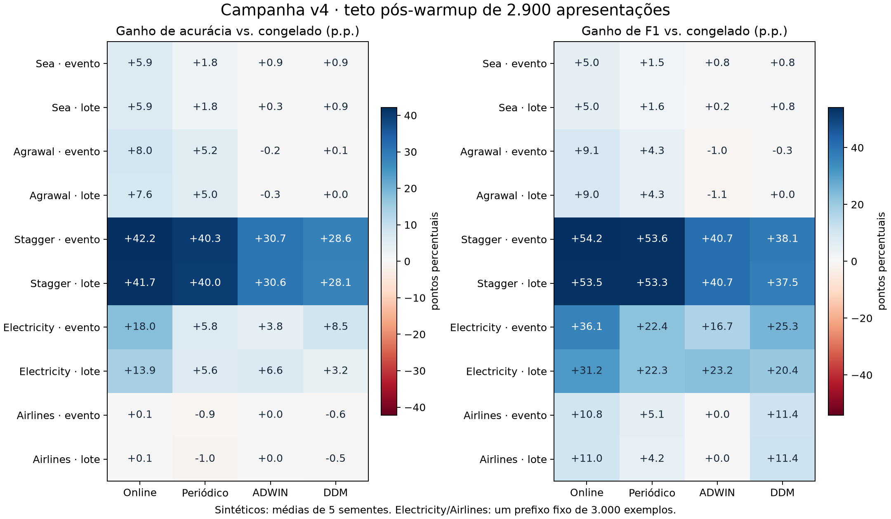

# Análise da campanha versioned-v4 nos cinco datasets

A política online liderou a acurácia média nos dez cenários dataset/protocolo, inclusive contra
os braços com teto maior. Com teto de 2900 apresentações pós-warmup, também teve os menores
Brier e log loss em todos os cenários. O resultado não estabelece uma política universal:
Agrawal continua próximo de uma referência constante, Airlines não supera em acurácia a referência
sempre-negativo, e existem vantagens de F1 e custo em outras estratégias.

A análise usa as 289 runs verificadas, sem executar novos treinos ou alterar os artefatos congelados.
São 255 configurações sintéticas (cinco sementes) e 34 reais (um prefixo por fonte).
Os 255 resultados sintéticos reproduzem a v3; não constituem cinco novas sementes independentes.

## Comparação principal com teto comum

Acurácia em %. Nos sintéticos: média ± desvio-padrão amostral entre cinco sementes.
Nos reais: um valor, sem estimativa de variância. O teto de 2900 é pós-warmup; congelado consome zero.
Os demais braços podem consumir menos que o teto. Não se agrega desempenho entre protocolos.

| Dataset | Protocolo | Congelado | Online | Periódico | ADWIN | DDM |
|---|---|---:|---:|---:|---:|---:|
| Sea | streaming | 88.32 ± 2.65 | 94.21 ± 0.17 | 90.08 ± 0.87 | 89.21 ± 1.83 | 89.22 ± 2.19 |
| Sea | incremental | 88.31 ± 2.65 | 94.21 ± 0.20 | 90.12 ± 0.94 | 88.57 ± 1.29 | 89.23 ± 2.02 |
| Agrawal | streaming | 50.09 ± 2.10 | 58.04 ± 0.83 | 55.26 ± 0.29 | 49.86 ± 1.56 | 50.18 ± 1.95 |
| Agrawal | incremental | 50.11 ± 2.14 | 57.67 ± 1.14 | 55.15 ± 0.47 | 49.80 ± 1.62 | 50.11 ± 2.14 |
| Stagger | streaming | 44.67 ± 5.14 | 86.85 ± 0.37 | 84.93 ± 1.13 | 75.39 ± 2.25 | 73.26 ± 2.19 |
| Stagger | incremental | 44.67 ± 5.14 | 86.39 ± 0.43 | 84.69 ± 0.97 | 75.29 ± 2.17 | 72.75 ± 2.15 |
| Electricity | streaming | 68.52 | 86.52 | 74.28 | 72.34 | 77.00 |
| Electricity | incremental | 68.48 | 82.41 | 74.03 | 75.07 | 71.66 |
| Airlines | streaming | 72.86 | 72.93 | 71.93 | 72.86 | 72.28 |
| Airlines | incremental | 72.86 | 73.00 | 71.83 | 72.86 | 72.38 |

## Interpretação por dataset

**SEA.** Online chega a 94.21% nos dois protocolos, contra cerca de 88.32% do congelado.
Os detectores ficam próximos de 89%, com muito menos treino: no streaming, ADWIN consome
307.2 e DDM 358.4 apresentações em média, contra 2900 do online. Periódico com teto maior
chega a 90.87% no streaming, ainda abaixo do online. Há uma troca entre qualidade e esforço de atualização.

**Agrawal.** Online melhora o congelado (58.04%/57.67% contra cerca de 50%), mas a referência
sempre-positivo obtém 57.73% de acurácia e 73.20% de F1; o online tem F1 de 66.52%/66.42%.
ADWIN e DDM permanecem perto de 50%; DDM incremental não emite alarmes e reproduz o congelado.
A escolha do detector não resolveu a baixa qualidade do modelo. Investigar representação e adequação
do classificador é uma hipótese mais promissora do que interpretar esse ganho relativo como solução suficiente.

**STAGGER.** A atualização é decisiva: congelado 44.67%, online 86.85%/86.39%, periódico
84.93%/84.69%, ADWIN 75.39%/75.29% e DDM 73.26%/72.75% no teto comum.
ADWIN supera DDM em acurácia. Com teto maior, periódico ultrapassa online em F1:
84.50%/84.19% contra 83.92%/83.31%, embora continue abaixo em acurácia e qualidade probabilística.
Online supera periódico de teto menor em quatro de cinco sementes em cada protocolo; a liderança média
não significa vitória em todas as execuções.

**Electricity.** Online é o melhor braço desta matriz: acurácia 86.52%/82.41% e F1 82.96%/77.98%.
O detector preferível depende do protocolo: no streaming, DDM tem 77.00% contra 72.34% do ADWIN;
no incremental, ADWIN tem 75.07% contra 71.66% do DDM. O congelado apresenta log loss de aproximadamente
8.37, reduzido a 0.319/0.400 pelo online. Isso indica erros muito confiantes no congelado; não demonstra
que a causa seja exclusivamente drift. O escopo do pré-processamento de origem permanece desconhecido.

**Airlines.** Acurácia online 72.93%/73.00%, contra 72.86% do congelado e 73.07% da referência
sempre-negativo. O ganho sobre o congelado corresponde a apenas dois/quatro acertos em 2900 exemplos.
ADWIN não dispara e reproduz o congelado. DDM tem F1 ligeiramente maior que online
(14.83%/14.88% contra 14.21%/14.43%), mas menor acurácia e piores Brier/log loss.
No limiar 0.5, online identifica 8.32%/8.45% dos atrasos e DDM 8.96%/8.96%.
A referência sempre-positivo teria F1 42.43%, mas acurácia 26.93%: F1 isolado também não basta.
As matrizes de confusão foram reconstruídas das métricas exatas e dos totais de classe dos eventos,
com verificação de integridade e contagens inteiras; não são novas runs MLflow.

## Detectores e consumo de treino

ADWIN/DDM observam erro de classificação rotulado. Os alarmes não são sinônimos de retreinamento:
a política aplica cooldown, janela mínima e orçamento, e reinicia o detector após o retreinamento.
A comparação mede o conjunto detector–modelo–política, não um detector isolado.

No teto de 2900, as médias são:

| Dataset | Protocolo | Alarmes ADWIN | Treino ADWIN | Alarmes DDM | Treino DDM |
|---|---|---:|---:|---:|---:|
| Sea | streaming | 1.2 | 307.2 | 1.8 | 358.4 |
| Sea | incremental | 1.2 | 307.2 | 1.6 | 256.0 |
| Agrawal | streaming | 0.4 | 102.4 | 0.4 | 102.4 |
| Agrawal | incremental | 0.4 | 102.4 | 0.0 | 0.0 |
| Stagger | streaming | 2.0 | 512.0 | 2.0 | 512.0 |
| Stagger | incremental | 2.2 | 563.2 | 2.0 | 512.0 |
| Electricity | streaming | 7.0 | 1792.0 | 23.0 | 2900.0 |
| Electricity | incremental | 7.0 | 1792.0 | 14.0 | 2560.0 |
| Airlines | streaming | 0.0 | 0.0 | 1.0 | 256.0 |
| Airlines | incremental | 0.0 | 0.0 | 1.0 | 256.0 |

Nos sintéticos, DDM emitiu três alarmes antes da primeira mudança em cada protocolo, todos no SEA;
ADWIN não emitiu alarmes nesse prefixo. Isso é um diagnóstico de prefixo estacionário, não uma taxa
calibrada de falsos positivos. No STAGGER, ADWIN teve alarme em todas as dez janelas de 500 exemplos
após mudanças, por protocolo; DDM em nove. No Agrawal, essa cobertura foi muito baixa para ambos.
As janelas de 500 foram definidas a posteriori para descrição e não constituem recall/precisão do detector.
Atrasos foram medidos em posições do fluxo, não em segundos de relógio ou latência operacional.

No Electricity streaming, DDM emite 23 alarmes, mas realiza 12 atualizações no teto menor; ADWIN
emite sete alarmes e realiza sete. No Airlines, DDM faz uma atualização e usa 256 apresentações,
enquanto ADWIN não treina novamente. Ambos ainda precisam observar os rótulos para calcular o erro;
pouco retreinamento não implica economia de aquisição de rótulos.

## O que mudou ao aumentar o teto para 5800

Periódico usa efetivamente 3584 apresentações, contra 2900 no teto menor: aumento de 23.6%, não 100%.
A acurácia melhora em SEA, Agrawal, STAGGER e Electricity; no Electricity, sobe cerca de 5.1/5.3 p.p.
No Airlines, piora cerca de 0.28 p.p. nos dois protocolos. Mais treino não garantiu melhor resultado.

Entre ADWIN e DDM, 67 de 68 pares de orçamento produzem predições idênticas: os tetos quase nunca
restringem essas estratégias. A exceção é DDM no Electricity streaming: consumo sobe de 2900 para
3328, com acurácia de 77.00% para 77.17%, e 13 atualizações em vez de 12.

Online continua líder em acurácia nos dez cenários com o teto maior, mas perde a liderança de F1
para periódico no STAGGER e DDM no Airlines. Periódico também tem menor log loss no Agrawal em ambos
os protocolos, e menor Brier no Agrawal incremental. Portanto, não há dominância em todas as métricas.

## Offline, analisado separadamente

Offline treina no prefixo de 1797 exemplos com rótulos disponíveis e testa nos 1200 finais.
Não há detector ou retreinamento. Essas métricas não classificam as políticas prequential, que
avaliam 2900 pontos em outro horizonte e usam 100 exemplos de aquecimento.

| Dataset | Acurácia (%) | F1 (%) | Brier | Log loss |
|---|---:|---:|---:|---:|
| Sea | 86.85 ± 0.96 | 89.99 ± 0.88 | 0.0891 ± 0.0069 | 0.2649 ± 0.0174 |
| Agrawal | 47.97 ± 2.30 | 47.79 ± 3.82 | 0.2903 ± 0.0112 | 0.7878 ± 0.0275 |
| Stagger | 51.95 ± 2.56 | 51.75 ± 2.80 | 0.3497 ± 0.0144 | 1.3314 ± 0.0861 |
| Electricity | 65.83 | 28.07 | 0.2790 | 0.9918 |
| Airlines | 69.92 | 6.23 | 0.2131 | 0.6242 |

## Limitações e implicações

1. Cinco sementes nos sintéticos, uma sequência fixa nos reais. As 289 configurações compartilham dados;
   não são 289 réplicas independentes. Não há teste de significância ou alegação de superioridade universal.
2. Cada fonte real usa só 3000 exemplos dos arquivos completos admitidos. Generalização para outros períodos
   ou para toda a fonte não foi medida. A ordem é a publicada; cronologia e atraso reais não foram estabelecidos.
3. Electricity já vem normalizado/imputado e o escopo de ajuste é desconhecido. Não se pode excluir vazamento
   no pré-processamento anterior ao adaptador. Não há pontos de mudança reais anotados nas duas fontes.
4. Online faz atualização contínua; os outros braços reiniciam modelo e pré-processador sobre até 256 exemplos.
   O ensaio varia frequência, gatilho e retenção de histórico. Não isola o efeito de um único fator.
5. Detector observa erro supervisionado, não qualquer mudança de distribuição. Seus resultados dependem
   do classificador, limiares, cooldown e reinícios. Ausência de alarme não prova ausência de drift.
6. Um modelo, uma representação e um conjunto de hiperparâmetros; nenhum ajuste independente de limiar de
   decisão, detector ou janela. O F1 usa limiar fixo 0.5. Brier/log loss medem qualidade probabilística,
   não isolam calibração. Não foram reportados custos específicos de falsos negativos/falsos positivos.
7. Orçamento conta apresentações pós-warmup, incluindo replays. Não é CPU, memória, custo de rótulos nem
   tempo total. As 2900 atualizações online e seus snapshots têm custo operacional que a contagem não equaliza.
8. Médias podem esconder recuperação após drift e extremos. As janelas de alarmes são diagnósticos a posteriori.
   O benchmark não demonstra ausência de esquecimento nem causalidade sobre sua origem.
9. Referências constantes são análises posteriores, sem novos treinos ou registros de campanha; servem como
   controles de interpretação, não como validação independente de seleção de modelos.

Para esta configuração, online é a principal referência de qualidade em SEA, STAGGER e Electricity.
Em Agrawal e Airlines, o resultado justifica investigar modelo/representação e objetivo de avaliação antes
de selecionar uma política para uso. ADWIN/DDM oferecem alternativas de menor esforço de treino com perdas
ou vantagens específicas, sem vencedor global. Um próximo ensaio controlado deve ampliar períodos reais,
incluir referências triviais previamente definidas e separar gatilho de drift, ação de atualização e tamanho
da janela, usando dados de validação independentes para escolher limiares.

## Evidência e reprodução

- [Estatísticas completas, diferenças pareadas, matrizes e janelas de alarme](versioned-v4-analysis.json)
- [Referências constantes e contagens dos rótulos](versioned-v4-reference-baselines.json)
- [Figura PNG](versioned-v4-policy-comparison.png) / [PDF](versioned-v4-policy-comparison.pdf)
- [Validação das publicações](versioned-v4-validation.json) e [relatório operacional](versioned-v4.md)

Coleta somente leitura no worker: `python scripts/collect_versioned_references.py`.
Análise: `python scripts/analyze_versioned_campaign.py --plot` (matplotlib/numpy disponíveis no ambiente
local de análise). O JSON registra SHA-256 dos dois arquivos de entrada. As asserções conferem identidades,
configurações, tamanhos de avaliação, replicação por grupo e consistência das matrizes de confusão.
Nenhum modelo foi treinado ou reconfigurado nesta análise.

## Apêndice — todos os braços e métricas

Sintéticos: média ± desvio-padrão; reais: um valor. Consumo indica apresentações pós-warmup; offline
aparece com zero atualizações, mas seu ajuste inicial usa 1797 exemplos, fora desse orçamento.

| Dataset | Protocolo | Braço | n | Acurácia (%) | F1 (%) | Brier | Log loss | Treino pós-warmup |
|---|---|---|---:|---:|---:|---:|---:|---:|
| agrawal | incremental | adwin@2900 | 5 | 49.80 ± 1.62 | 56.36 ± 2.24 | 0.2684 ± 0.0079 | 0.7336 ± 0.0173 | 102.4 |
| agrawal | incremental | adwin@5800 | 5 | 49.80 ± 1.62 | 56.36 ± 2.24 | 0.2684 ± 0.0079 | 0.7336 ± 0.0173 | 102.4 |
| agrawal | incremental | ddm@2900 | 5 | 50.11 ± 2.14 | 57.45 ± 3.07 | 0.2670 ± 0.0090 | 0.7305 ± 0.0197 | 0.0 |
| agrawal | incremental | ddm@5800 | 5 | 50.11 ± 2.14 | 57.45 ± 3.07 | 0.2670 ± 0.0090 | 0.7305 ± 0.0197 | 0.0 |
| agrawal | incremental | none | 5 | 50.11 ± 2.14 | 57.45 ± 3.07 | 0.2670 ± 0.0090 | 0.7305 ± 0.0197 | 0.0 |
| agrawal | incremental | online | 5 | 57.67 ± 1.14 | 66.43 ± 1.78 | 0.2483 ± 0.0025 | 0.6929 ± 0.0047 | 2900.0 |
| agrawal | incremental | periodic@2900 | 5 | 55.15 ± 0.47 | 61.71 ± 1.05 | 0.2499 ± 0.0020 | 0.6939 ± 0.0047 | 2900.0 |
| agrawal | incremental | periodic@5800 | 5 | 56.30 ± 0.34 | 63.43 ± 1.04 | 0.2476 ± 0.0018 | 0.6893 ± 0.0043 | 3584.0 |
| agrawal | offline | none | 5 | 47.97 ± 2.30 | 47.79 ± 3.82 | 0.2903 ± 0.0112 | 0.7878 ± 0.0275 | 0.0 |
| agrawal | streaming | adwin@2900 | 5 | 49.86 ± 1.56 | 56.42 ± 2.11 | 0.2687 ± 0.0079 | 0.7344 ± 0.0173 | 102.4 |
| agrawal | streaming | adwin@5800 | 5 | 49.86 ± 1.56 | 56.42 ± 2.11 | 0.2687 ± 0.0079 | 0.7344 ± 0.0173 | 102.4 |
| agrawal | streaming | ddm@2900 | 5 | 50.18 ± 1.95 | 57.16 ± 3.41 | 0.2666 ± 0.0085 | 0.7297 ± 0.0187 | 102.4 |
| agrawal | streaming | ddm@5800 | 5 | 50.18 ± 1.95 | 57.16 ± 3.41 | 0.2666 ± 0.0085 | 0.7297 ± 0.0187 | 102.4 |
| agrawal | streaming | none | 5 | 50.09 ± 2.10 | 57.42 ± 3.06 | 0.2670 ± 0.0089 | 0.7305 ± 0.0196 | 0.0 |
| agrawal | streaming | online | 5 | 58.04 ± 0.83 | 66.52 ± 1.72 | 0.2471 ± 0.0024 | 0.6902 ± 0.0052 | 2900.0 |
| agrawal | streaming | periodic@2900 | 5 | 55.26 ± 0.29 | 61.75 ± 1.01 | 0.2496 ± 0.0014 | 0.6934 ± 0.0033 | 2900.0 |
| agrawal | streaming | periodic@5800 | 5 | 56.46 ± 0.13 | 63.56 ± 1.06 | 0.2473 ± 0.0012 | 0.6888 ± 0.0029 | 3584.0 |
| airlines | incremental | adwin@2900 | 1 | 72.86 | 3.44 | 0.2027 | 0.6047 | 0.0 |
| airlines | incremental | adwin@5800 | 1 | 72.86 | 3.44 | 0.2027 | 0.6047 | 0.0 |
| airlines | incremental | ddm@2900 | 1 | 72.38 | 14.88 | 0.1990 | 0.5891 | 256.0 |
| airlines | incremental | ddm@5800 | 1 | 72.38 | 14.88 | 0.1990 | 0.5891 | 256.0 |
| airlines | incremental | none | 1 | 72.86 | 3.44 | 0.2027 | 0.6047 | 0.0 |
| airlines | incremental | online | 1 | 73.00 | 14.43 | 0.1908 | 0.5681 | 2900.0 |
| airlines | incremental | periodic@2900 | 1 | 71.83 | 7.68 | 0.2104 | 0.6470 | 2900.0 |
| airlines | incremental | periodic@5800 | 1 | 71.55 | 8.44 | 0.2076 | 0.6358 | 3584.0 |
| airlines | offline | none | 1 | 69.92 | 6.23 | 0.2131 | 0.6242 | 0.0 |
| airlines | streaming | adwin@2900 | 1 | 72.86 | 3.44 | 0.2027 | 0.6048 | 0.0 |
| airlines | streaming | adwin@5800 | 1 | 72.86 | 3.44 | 0.2027 | 0.6048 | 0.0 |
| airlines | streaming | ddm@2900 | 1 | 72.28 | 14.83 | 0.1988 | 0.5883 | 256.0 |
| airlines | streaming | ddm@5800 | 1 | 72.28 | 14.83 | 0.1988 | 0.5883 | 256.0 |
| airlines | streaming | none | 1 | 72.86 | 3.44 | 0.2027 | 0.6048 | 0.0 |
| airlines | streaming | online | 1 | 72.93 | 14.21 | 0.1892 | 0.5634 | 2900.0 |
| airlines | streaming | periodic@2900 | 1 | 71.93 | 8.54 | 0.2094 | 0.6409 | 2900.0 |
| airlines | streaming | periodic@5800 | 1 | 71.66 | 9.27 | 0.2065 | 0.6294 | 3584.0 |
| electricity | incremental | adwin@2900 | 1 | 75.07 | 69.99 | 0.1937 | 1.0743 | 1792.0 |
| electricity | incremental | adwin@5800 | 1 | 75.07 | 69.99 | 0.1937 | 1.0743 | 1792.0 |
| electricity | incremental | ddm@2900 | 1 | 71.66 | 67.20 | 0.2343 | 1.0068 | 2560.0 |
| electricity | incremental | ddm@5800 | 1 | 71.66 | 67.20 | 0.2343 | 1.0068 | 2560.0 |
| electricity | incremental | none | 1 | 68.48 | 46.80 | 0.2988 | 8.3715 | 0.0 |
| electricity | incremental | online | 1 | 82.41 | 77.98 | 0.1256 | 0.4001 | 2900.0 |
| electricity | incremental | periodic@2900 | 1 | 74.03 | 69.13 | 0.2205 | 2.0230 | 2900.0 |
| electricity | incremental | periodic@5800 | 1 | 79.38 | 72.42 | 0.1604 | 1.0007 | 3584.0 |
| electricity | offline | none | 1 | 65.83 | 28.07 | 0.2790 | 0.9918 | 0.0 |
| electricity | streaming | adwin@2900 | 1 | 72.34 | 63.55 | 0.2198 | 1.4271 | 1792.0 |
| electricity | streaming | adwin@5800 | 1 | 72.34 | 63.55 | 0.2198 | 1.4271 | 1792.0 |
| electricity | streaming | ddm@2900 | 1 | 77.00 | 72.15 | 0.1685 | 0.6950 | 2900.0 |
| electricity | streaming | ddm@5800 | 1 | 77.17 | 72.28 | 0.1658 | 0.6846 | 3328.0 |
| electricity | streaming | none | 1 | 68.52 | 46.89 | 0.2976 | 8.3688 | 0.0 |
| electricity | streaming | online | 1 | 86.52 | 82.96 | 0.0987 | 0.3189 | 2900.0 |
| electricity | streaming | periodic@2900 | 1 | 74.28 | 69.30 | 0.2185 | 1.9962 | 2900.0 |
| electricity | streaming | periodic@5800 | 1 | 79.38 | 72.39 | 0.1594 | 0.9767 | 3584.0 |
| sea | incremental | adwin@2900 | 5 | 88.57 ± 1.29 | 90.72 ± 1.15 | 0.1134 ± 0.0046 | 0.3802 ± 0.0130 | 307.2 |
| sea | incremental | adwin@5800 | 5 | 88.57 ± 1.29 | 90.72 ± 1.15 | 0.1134 ± 0.0046 | 0.3802 ± 0.0130 | 307.2 |
| sea | incremental | ddm@2900 | 5 | 89.23 ± 2.02 | 91.31 ± 1.74 | 0.1096 ± 0.0137 | 0.3734 ± 0.0387 | 256.0 |
| sea | incremental | ddm@5800 | 5 | 89.23 ± 2.02 | 91.31 ± 1.74 | 0.1096 ± 0.0137 | 0.3734 ± 0.0387 | 256.0 |
| sea | incremental | none | 5 | 88.31 ± 2.65 | 90.47 ± 2.34 | 0.1199 ± 0.0086 | 0.4028 ± 0.0203 | 0.0 |
| sea | incremental | online | 5 | 94.21 ± 0.20 | 95.52 ± 0.19 | 0.0538 ± 0.0007 | 0.1925 ± 0.0019 | 2900.0 |
| sea | incremental | periodic@2900 | 5 | 90.12 ± 0.94 | 92.06 ± 0.82 | 0.0937 ± 0.0025 | 0.3249 ± 0.0057 | 2900.0 |
| sea | incremental | periodic@5800 | 5 | 90.86 ± 0.57 | 92.70 ± 0.48 | 0.0869 ± 0.0011 | 0.3059 ± 0.0033 | 3584.0 |
| sea | offline | none | 5 | 86.85 ± 0.96 | 89.99 ± 0.88 | 0.0891 ± 0.0069 | 0.2649 ± 0.0174 | 0.0 |
| sea | streaming | adwin@2900 | 5 | 89.21 ± 1.83 | 91.29 ± 1.55 | 0.1114 ± 0.0053 | 0.3774 ± 0.0138 | 307.2 |
| sea | streaming | adwin@5800 | 5 | 89.21 ± 1.83 | 91.29 ± 1.55 | 0.1114 ± 0.0053 | 0.3774 ± 0.0138 | 307.2 |
| sea | streaming | ddm@2900 | 5 | 89.22 ± 2.19 | 91.30 ± 1.89 | 0.1095 ± 0.0135 | 0.3728 ± 0.0381 | 358.4 |
| sea | streaming | ddm@5800 | 5 | 89.22 ± 2.19 | 91.30 ± 1.89 | 0.1095 ± 0.0135 | 0.3728 ± 0.0381 | 358.4 |
| sea | streaming | none | 5 | 88.32 ± 2.65 | 90.48 ± 2.34 | 0.1198 ± 0.0086 | 0.4028 ± 0.0203 | 0.0 |
| sea | streaming | online | 5 | 94.21 ± 0.17 | 95.52 ± 0.16 | 0.0529 ± 0.0007 | 0.1902 ± 0.0019 | 2900.0 |
| sea | streaming | periodic@2900 | 5 | 90.08 ± 0.87 | 92.03 ± 0.76 | 0.0937 ± 0.0025 | 0.3248 ± 0.0057 | 2900.0 |
| sea | streaming | periodic@5800 | 5 | 90.87 ± 0.49 | 92.71 ± 0.40 | 0.0866 ± 0.0011 | 0.3049 ± 0.0033 | 3584.0 |
| stagger | incremental | adwin@2900 | 5 | 75.29 ± 2.17 | 70.48 ± 4.16 | 0.1672 ± 0.0089 | 0.5053 ± 0.0218 | 563.2 |
| stagger | incremental | adwin@5800 | 5 | 75.29 ± 2.17 | 70.48 ± 4.16 | 0.1672 ± 0.0089 | 0.5053 ± 0.0218 | 563.2 |
| stagger | incremental | ddm@2900 | 5 | 72.75 ± 2.15 | 67.22 ± 4.62 | 0.1781 ± 0.0059 | 0.5324 ± 0.0154 | 512.0 |
| stagger | incremental | ddm@5800 | 5 | 72.75 ± 2.15 | 67.22 ± 4.62 | 0.1781 ± 0.0059 | 0.5324 ± 0.0154 | 512.0 |
| stagger | incremental | none | 5 | 44.67 ± 5.14 | 29.76 ± 3.02 | 0.2954 ± 0.0091 | 0.7963 ± 0.0203 | 0.0 |
| stagger | incremental | online | 5 | 86.39 ± 0.43 | 83.31 ± 0.62 | 0.1105 ± 0.0011 | 0.3631 ± 0.0045 | 2900.0 |
| stagger | incremental | periodic@2900 | 5 | 84.69 ± 0.97 | 83.08 ± 0.75 | 0.1264 ± 0.0025 | 0.4139 ± 0.0056 | 2900.0 |
| stagger | incremental | periodic@5800 | 5 | 85.55 ± 0.93 | 84.19 ± 0.64 | 0.1199 ± 0.0027 | 0.3926 ± 0.0067 | 3584.0 |
| stagger | offline | none | 5 | 51.95 ± 2.56 | 51.75 ± 2.80 | 0.3497 ± 0.0144 | 1.3314 ± 0.0861 | 0.0 |
| stagger | streaming | adwin@2900 | 5 | 75.39 ± 2.25 | 70.45 ± 4.39 | 0.1665 ± 0.0080 | 0.5052 ± 0.0193 | 512.0 |
| stagger | streaming | adwin@5800 | 5 | 75.39 ± 2.25 | 70.45 ± 4.39 | 0.1665 ± 0.0080 | 0.5052 ± 0.0193 | 512.0 |
| stagger | streaming | ddm@2900 | 5 | 73.26 ± 2.19 | 67.89 ± 4.51 | 0.1767 ± 0.0049 | 0.5295 ± 0.0141 | 512.0 |
| stagger | streaming | ddm@5800 | 5 | 73.26 ± 2.19 | 67.89 ± 4.51 | 0.1767 ± 0.0049 | 0.5295 ± 0.0141 | 512.0 |
| stagger | streaming | none | 5 | 44.67 ± 5.14 | 29.76 ± 3.02 | 0.2953 ± 0.0090 | 0.7962 ± 0.0203 | 0.0 |
| stagger | streaming | online | 5 | 86.85 ± 0.37 | 83.92 ± 0.51 | 0.1059 ± 0.0010 | 0.3471 ± 0.0039 | 2900.0 |
| stagger | streaming | periodic@2900 | 5 | 84.93 ± 1.13 | 83.34 ± 0.97 | 0.1241 ± 0.0027 | 0.4081 ± 0.0060 | 2900.0 |
| stagger | streaming | periodic@5800 | 5 | 85.83 ± 0.99 | 84.50 ± 0.65 | 0.1173 ± 0.0028 | 0.3859 ± 0.0071 | 3584.0 |
